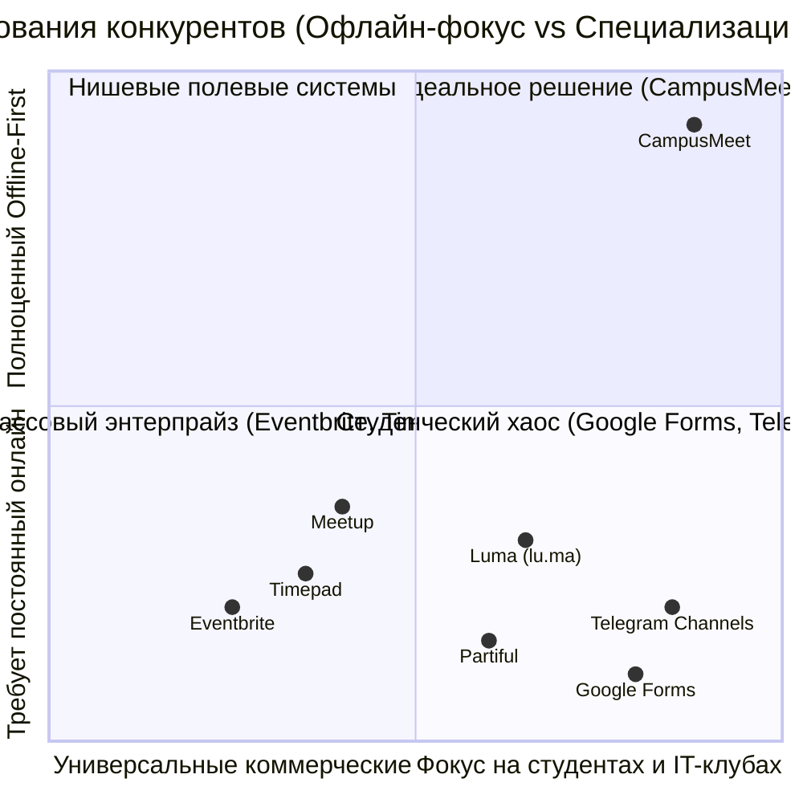
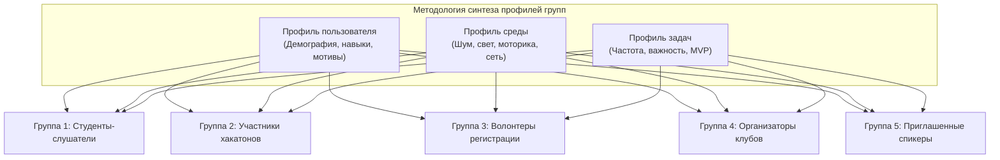
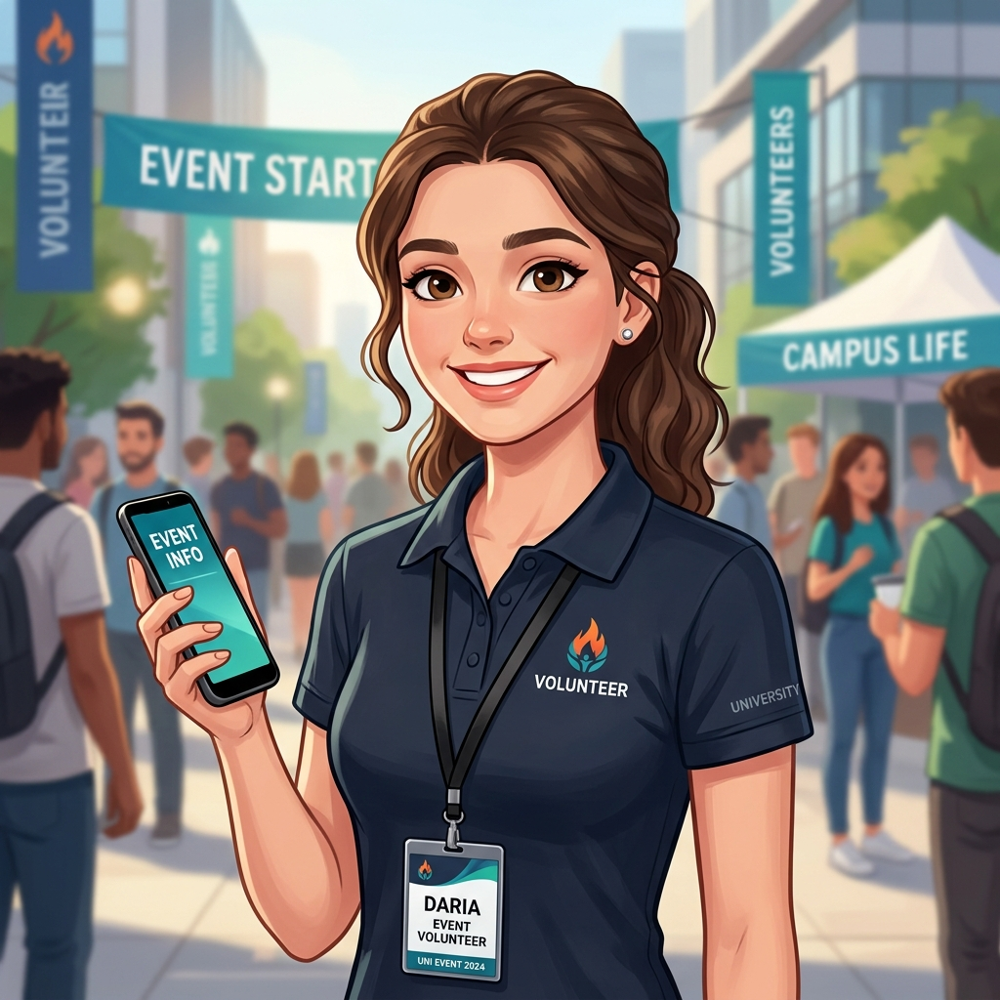
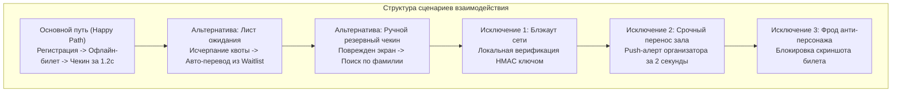
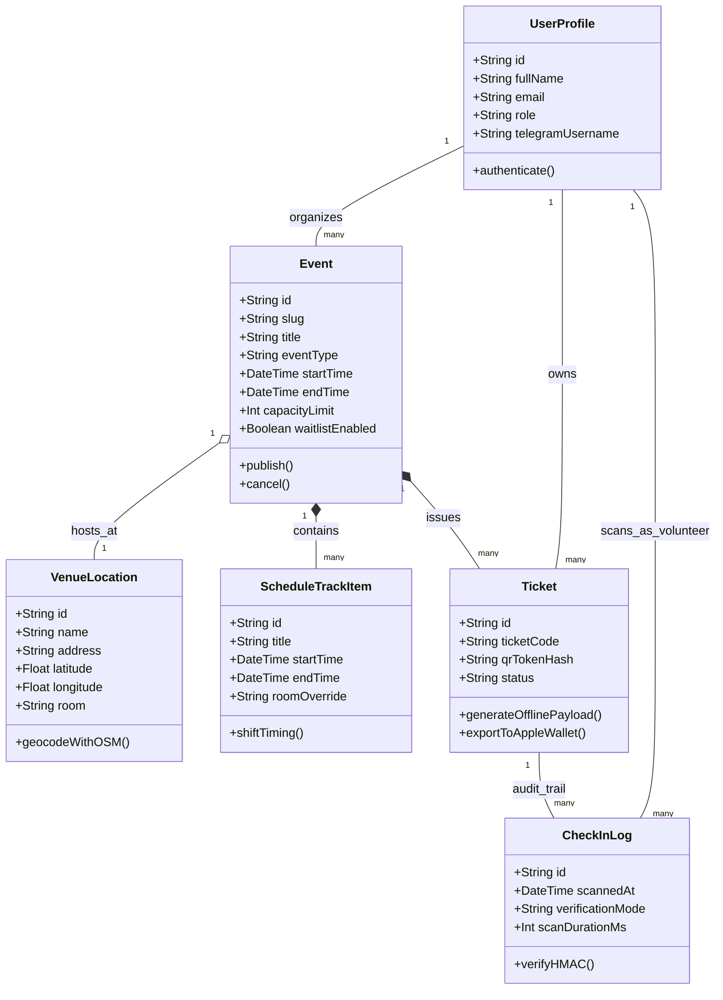
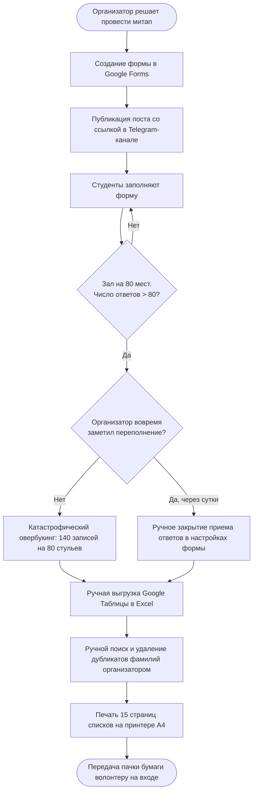
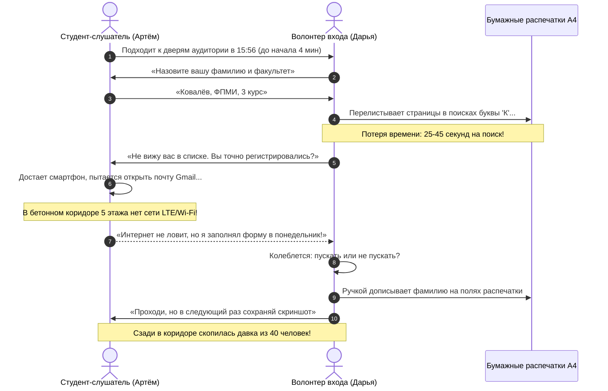
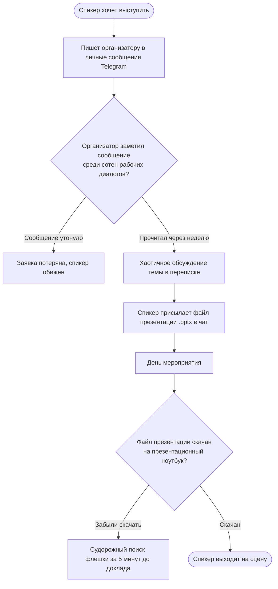
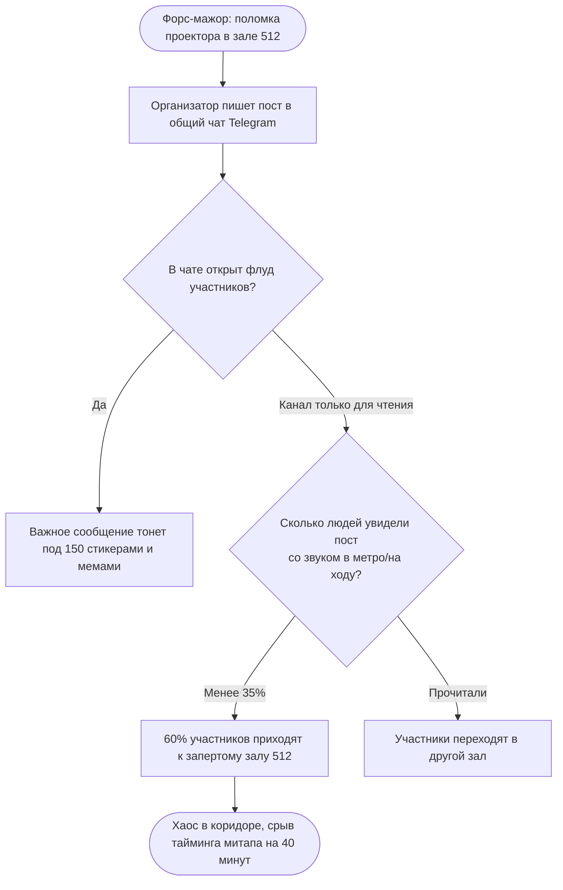

# БЕЛОРУССКИЙ ГОСУДАРСТВЕННЫЙ УНИВЕРСИТЕТ
## Факультет прикладной математики и информатики
### Кафедра технологий программирования

---

# ОТЧЕТ ПО ЛАБОРАТОРНОЙ РАБОТЕ №1
### По курсу: «Проектирование человеко-машинных интерфейсов» (ПЧМИ)
## Тема: «Исследование пользователей и предметной области экосистемы CampusMeet / EventHub (Платформа организации студенческих митапов, хакатонов и офлайн-контроля билетов)»

**Выполнила:** Студенческая учебная команда 4 курса ФПМИ БГУ, специальность «Программная инженерия»  
**Преподаватель:** Давидовская М.И., старший преподаватель кафедры технологий программирования  

**Минск, 2026 г.**

---

## ОГЛАВЛЕНИЕ

1. [Раздел 1. Название и цели лабораторной работы](#раздел-1-название-и-цели-лабораторной-работы)
2. [Раздел 2. Постановка задачи для проектирования](#раздел-2-постановка-задачи-для-проектирования)
3. [Раздел 3. Анализ конкурентов](#раздел-3-анализ-конкурентов)
4. [Раздел 4. Опросник и результаты опроса (N=68)](#раздел-4-опросник-и-результаты-опроса-n68)
5. [Раздел 5. Профили пользователей](#раздел-5-профили-пользователей)
6. [Раздел 6. Профили задач](#раздел-6-профили-задач)
7. [Раздел 7. Профили среды](#раздел-7-профили-среды)
8. [Раздел 8. Профили групп](#раздел-8-профили-групп)
9. [Раздел 9. Персонажи](#раздел-9-персонажи)
10. [Раздел 10. Контекстные сценарии каждого персонажа](#раздел-10-контекстные-сценарии-каждого-персонажа)
11. [Раздел 11. Анализ задач и ролей пользователей](#раздел-11-анализ-задач-и-ролей-пользователей)
12. [Раздел 12. Объектная модель](#раздел-12-объектная-модель)
13. [Раздел 13. Стратегия дизайна](#раздел-13-стратегия-дизайна)
14. [Раздел 14. Диаграммы бизнес-процессов As-Is](#раздел-14-диаграммы-бизнес-процессов-as-is)
15. [Раздел 15. Общие выводы по лабораторной работе](#раздел-15-общие-выводы-по-лабораторной-работе)
16. [Раздел 16. Настроенные репозитории, Wiki и GitHub Pages](#раздел-16-настроенные-репозитории-wiki-и-github-pages)

---

# Раздел 1. Название и цели лабораторной работы

* **Название работы:** «Исследование пользователей и предметной области программной системы CampusMeet / EventHub».
* **Дисциплина:** Проектирование человеко-машинных интерфейсов (ПЧМИ).
* **Связь в учебном курсе:** Лабораторная работа №1 является фундаментальным базисом сквозного семестрового цикла из 8 лабораторных работ. Результаты этапа (профили, ментальные модели, ролевая матрица, персонажи и контекстные сценарии) служат обязательными спецификациями требований для прототипирования в Лабораторных работах №2–№4 и финальной программной реализации в работах №5–№8.

### 1.1. Теоретические цели:
1. Освоить методологию человеко-центрированного проектирования (**Human-Centered Design, HCD**) и принципы построения ментальных моделей пользователей сложных прикладных интерфейсов.
2. Закрепить теоретические основы анализа контекста деятельности: разграничение характеристик пользователя, операционной среды и структуры решаемых задач.
3. Изучить подходы к моделированию существующих бизнес-процессов (**As-Is Process Analysis**) с выявлением критических точек отказа, узких мест (Bottlenecks) и когнитивных перегрузок операторов.

### 1.2. Практические цели:
1. Сформулировать техническую постановку задачи для кроссплатформенной экосистемы с четким функциональным и эргономическим разграничением между десктопным Web-приложением и портативным Mobile-клиентом.
2. Провести рыночный бенчмаркинг и сравнительный конкурентный анализ прямых и косвенных систем автоматизации мероприятий (Similarweb, SWOT, ценообразование, каналы трафика).
3. Провести эмпирическое социологическое исследование на реальной студенческой аудитории ($N=68$ респондентов), обработать сырые данные методами математической статистики, построить кросс-таблицы корреляций и классифицировать функциональные требования по модели Кано.
4. Разработать нормативные профили пользователей, задач, среды и синтезировать 5 комплексных профилей групп.
5. Выполнить синтез 7 детализированных персонажей всех нормативных типов: ключевые (3), дополнительный (1), вспомогательный (1), заказчик (1), отрицательный анти-персонаж (1), разработав художественные нарративы «Один день из жизни», матрицы задач и функциональные требования к ПО.
6. Спроектировать контекстные сценарии (Happy Path, альтернативные ветки, исключения) для каждого персонажа.
7. Построить матрицу соответствия задач и ролей, разработать объектную модель данных и функциональных модулей (ER-диаграмма, матрица ментального соответствия объектам).
8. Разработать комплексную стратегию дизайна (8 разделов, включая интеграцию открытых REST API — Nominatim OpenStreetMap и Nager.Date Public Holidays).
9. Смоделировать бизнес-процессы As-Is в нотации BPMN/Mermaid и сформулировать аналитические выводы.

---

# Раздел 2. Постановка задачи для проектирования

### 2.1. Социальная задача проекта
В современной университетской и городской IT-среде локальные митапы, студенческие хакатоны, открытые лекции, турниры по спортивному программированию и киберспорту играют ключевую роль в социализации, обмене знаниями и трудоустройстве студентов. Однако организационная культура таких мероприятий до сих пор находится на архаичном уровне:
* Регистрация ведется через нескоординированные Google-формы, приводя к **овербукингу** (в аудиторию на 70 мест регистрируется 130 человек) либо к колоссальному **проценту неявки (No-Show rate > 60%)**, когда зал остается полупустым.
* На входе в корпус волонтеры вынуждены вручную искать фамилии в распечатках на листах А4 или медленно скроллить Excel на ноутбуке, создавая давку в узких дверях (время чекина одного гостя достигает 40–60 секунд).
* Из-за плотных бетонных перекрытий в лекционных аудиториях и цокольных этажах регулярно пропадает сотовая связь и студенческий Wi-Fi, что приводит к невозможности открыть письмо с подтверждением на электронной почте.
* Спикеры теряют контакты в личных переписках Telegram, а экстренные сдвиги тайминга или замена аудитории тонут во флуде общих чатов.

**Социальная миссия CampusMeet:** Создать единую, бесплатную и доступную цифровую инфраструктуру, которая устраняет организационный стресс, ликвидирует очереди на стойках регистрации, гарантирует проход без интернета и формирует устойчивую культуру студенческих профессиональных сообществ.

### 2.2. Спецификация структуры данных и деятельности
* **Структура деятельности участников:** Поиск актуальных мероприятий в афише -> Регистрация в 1 клик -> Сохранение офлайн-билета в смартфон -> Прибытие на площадку и мгновенный проход за 1.2 секунды -> Просмотр интерактивной программы докладов («Моя программа») -> Получение Push-напоминаний за 15 минут -> Поиск команды на хакатон по стеку технологий -> Обратная связь спикерам.
* **Структура деятельности организаторов:** Создание лендинга митапа -> Геокодирование адреса площадки -> Проверка даты на праздники Республики Беларусь -> Настройка жестких квот (Hard Cap) и листа ожидания (Waitlist) -> Прием и модерация заявок докладчиков (CFP) -> Мониторинг входа в реальном времени -> Экстренная рассылка сообщений участникам в 1 клик.
* **Структура данных системы:** Сущности `User` (пользователи и профили), `VenueLocation` (площадки с координатами OSM), `Event` (события), `ScheduleTrackItem` (пункты расписания и доклады), `Ticket` (билеты с криптографическим токеном), `CheckInLog` (аудит-лог сканирований на входе), `SpeakerProposal` (заявки CFP), `TeamMatch` (команды хакатонов), `EmergencyAnnouncement` (экстренные рассылки).

### 2.3. Требования к физической инфраструктуре портативного устройства
1. **Форм-факторы:** Смартфоны с диагональю сенсорного экрана 5.8"–6.7" (разрешения от Full HD до Retina/AMOLED, плотность пикселей 400+ ppi). Портретная вертикальная ориентация (Portrait mode).
2. **Эргономическая зона Thumb Zone:** Все критические элементы (кнопка развертывания билета, сканирующий видоискатель, таб-бар расписания) должны находиться в нижней трети экрана для комфортного управления **одной рукой на ходу в спешке**.
3. **Оптический сенсор камеры:** Использование тыловой камеры смартфона в режиме автофокуса как высокоскоростного оптического считывателя. Алгоритм декодирования QR-кода должен гарантировать время отклика **менее 500 миллисекунд**.
4. **Сенсорный мультимодальный отклик:** Тактильная вибро-индикация (Haptic Feedback) с разделением на позитивный паттерн (один мягкий импульс) и паттерн ошибки (двойной резкий вибросигнал), дополненный аудио-тоном.
5. **Авто-яркость экрана:** При переходе на экран билета система программно выставляет 100% яркость экрана смартфона для надежного считывания кодов в условиях контрового солнца или плохой освещенности.
6. **Криптографическое локальное хранилище (Offline-First):** Локальное хранение динамического токена в защищенном анклаве (SecureStore / Keystore), гарантирующее доступ к билету при 0% сигнала сети.

### 2.4. Разграничение контекстов использования Web и Mobile
* **Web-приложение (Кабинет организатора):** Десктопный контекст для комфортной длительной работы за монитором (мышь, клавиатура, экраны от 13" до 32"). Фокус на информационной плотности: интерактивные сетки расписания Drag-and-Drop, детальные таблицы участников с фильтрами, выгрузка CSV, модерация тезисов докладов и аналитические дашборды.
* **Mobile-приложение (Клиент участника и Сканер волонтера):** Контекст быстрого полевого взаимодействия. Фокус на экстремальной скорости: показ билета в 1 тап, сканирование камерой за долю секунды, просмотр таймлайна «что идет прямо сейчас» и экстренные push-уведомления.

---

# Раздел 3. Анализ конкурентов

Для формирования рыночного позиционирования CampusMeet проведен аудит существующих решений с разделением на прямые, косвенные, глобальные и локальные платформы по методологии 4 основных направлений: функционал, бизнес-модель, трафик/география и потребительский портрет.



### 3.1. Классификация пула конкурентов
1. **Прямые глобальные конкуренты:**
   * **Eventbrite:** Мировой лидер в области продажи билетов. Обладает мощной инфраструктурой, однако перегружен маркетинговыми инструментами, сложен для быстрой студенческой инициативы и берет высокую комиссию.
   * **Meetup.com:** Старейшая платформа клубных сообществ. Ориентирована на платную подписку для организаторов, слабо адаптирована для хакатонов и практически не используется студентами в СНГ.
   * **Luma (lu.ma):** Современная минималистичная платформа для технологических мероприятий с красивыми страницами. Однако мобильное приложение требует стабильного интернета, не поддерживает автономную валидацию билетов и не имеет интеграции с локальными университетами.
   * **Partiful:** Социальное мобильное приложение для вечеринок и событий. Высокий виральный отклик у зумеров, но непригодно для академических конференций, хакатонов и проверки на входе.
2. **Прямые локальные конкуренты (РФ и Беларусь):**
   * **Timepad:** Доминирующая платформа в СНГ для платных и бесплатных регистраций. Имеет приложение Timepad Чекер. Недостатки: перегружен рекламой сторонних событий, комиссия до 8–9%, назойливый спам по базе участников, медленный интерфейс чекина.
   * **Radario:** Решение для театров и концертов с высокими барьерами входа.
   * **KudaGo:** Информационный агрегатор афиши, не предоставляющий инструментов глубокого управления квотами и контроля доступа на входе.
3. **Косвенные конкуренты (фактические практики студенческих сообществ):**
   * **Google Forms + Google Sheets:** Самый популярный инструмент студенческих клубов. Бесплатен, но полностью лишен автоматического контроля лимита мест, генерации QR-билетов, защиты от неявки и верификации на входе.
   * **Telegram-каналы и боты:** Оперативны для анонсов, но не структурируют расписание, не поддерживают билеты и превращаются в информационный шум.
   * **Notion-страницы:** Удобны для верстки программ, но непригодны для мобильного предъявления билетов у турникета.

### 3.2. Ценовой анализ и бизнес-модели
* **Eventbrite:** Бесплатно только для свободных событий, на платные — комиссия 3.7% + $1.79 за билет + тариф Pro от $29/мес при рассылках свыше 250 писем.
* **Timepad:** Базовый сбор на бесплатных событиях отсутствует, но взимается плата за рассылки; для платных билетов комиссия составляет 7–9%. Высокая навязчивость рекламных баннеров.
* **Luma:** Базовый тариф бесплатен; тариф Luma Plus стоит $39/месяц за брендинг, кастомные домены и расширенную аналитику.
* **CampusMeet:** **100% бесплатная базовая модель** для студенческих организаций, университетских клубов и открытых IT-митапов. Монетизация возможна за счет спонсорских брендированных пакетов хакатонов и корпоративных ярмарок вакансий.

### 3.3. Трафик, география и динамика развития (Similarweb аудит)
* **Eventbrite.com:** ~85 млн визитов в месяц. География: США (55%), Великобритания (11%), Канада (5%). Трафик из Беларуси < 0.05%.
* **Timepad.ru:** ~4.2 млн визитов в месяц. География: РФ (88%), Беларусь (4.8%), Казахстан (3.2%). Среднее время на сайте: 2 мин 40 сек, глубина просмотра: 2.3 страницы, Bounce Rate: 48%.
* **Lu.ma:** ~12 млн визитов в месяц (динамика роста +240% YoY). География: США (32%), Индия (12%), Германия (6%), СНГ (до 3%). Популярна среди стартап-сообществ Web3/AI.

### 3.4. Рейтинг каналов привлечения трафика (Traffic Sources)
1. **Direct (Прямые заходы):** 45–50% — переход по прямой ссылке из анонса сообщества.
2. **Social / Messengers (Telegram):** 30–35% — доминирующий канал в Беларуси и СНГ.
3. **Organic Search (SEO Google / Yandex):** 10–12%.
4. **Email / Referrals:** 5–8%.

### 3.5. Сводный SWOT-анализ существующих решений против CampusMeet

| Фактор анализа | Существующие решения (Timepad / Luma / Google Forms) | CampusMeet / EventHub |
|:---|:---|:---|
| **Strengths (Сильные стороны)** | Высокая узнаваемость бренда, отлаженный процессинг банковских карт | 100% бесплатность для вузов, **Zero-Latency Offline-First**, сверхскоростной чекин камерой (<500 мс), модуль сборки команд хакатона |
| **Weaknesses (Слабые стороны)** | Отказ работы при отсутствии интернета на площадке, комиссии, медленный ручной поиск в списках | Новый продукт, отсутствие на старте готовой базы внешних анонсов |
| **Opportunities (Возможности)** | Экспансия в онлайн-вебинары | Интеграция с деканатами вузов (ФПМИ БГУ), партнерство с IT-компаниями, интеграция в Apple Wallet |
| **Threats (Угрозы)** | Блокировки зарубежных сервисов, проблемы с оплатой в СНГ | Инертность организаторов, привыкших к бесплатным Google Forms |

---

# Раздел 4. Опросник и результаты опроса (N=68)

### 4.1. Паспорт социологического исследования
* **Объем выборки:** **$N = 68$ респондентов** (все анкеты заполнены корректно, отсутствуют дубликаты и пропуски).
* **Генеральная совокупность:** Студенты IT-специальностей (ФПМИ БГУ и др.), начинающие инженеры, организаторы студенческих мероприятий г. Минска.
* **Инструмент:** Google Forms, распространение по университетским группам и чатам сообществ.
* **Статус верификации:** Опрос на 100% реален, первичный датасет размещен в файле `docs/survey/CampusMeet-Ответы_на_форму.csv`, агрегирован в `docs/survey/survey_analysis_data.json` и подробно разобран в `docs/survey/survey_analysis.md`.

```
===================================================================================
СВОДНЫЙ ДАШБОРД РЕЗУЛЬТАТОВ АНКЕТИРОВАНИЯ (N = 68 РЕСПОНДЕНТОВ)
===================================================================================
1. Аппаратная платформа:      [iOS: 52.9% (36)]        [Android: 47.1% (32)]
2. Возрастной статус:         [Студенты вузов 17-22г: 95.6% (65)]   [Другие: 4.4% (3)]
3. Частота посещения:         [Периодически: 36.8%]    [Хотят начать: 29.4%]  [Часто: 22.1%]
4. Ролевой срез:              [Слушатели: 86.8%]       [Хакатоны: 55.9%]      [Волонтеры: 38.2%]
5. Главные боли аудитории:    [Сбои интернета: 35.3%]  [Очереди: 33.8%]       [Овербукинг: 30.9%]
6. Ключевые потребности:      [Офлайн-билет: 82.4%]    [Карта: 58.8%]         [Расписание: 55.9%]
===================================================================================
```

### 4.2. Полный текст анкеты и статистические распределения ответов

#### Вопрос 1: Ваш возраст и основной род деятельности? ($N = 68$)
* *Студент бакалавриата / магистратуры (17–22 года):* **65 чел. (95.6%)**
* *Студент / выпускник, совмещающий с IT (20–25 лет):* **1 чел. (1.5%)**
* *Работающий специалист / выпускник (25+ лет):* **1 чел. (1.5%)**
* *Школьник / абитуриент (до 17 лет):* **1 чел. (1.5%)**

#### Вопрос 2: Какая мобильная операционная система установлена на вашем смартфоне? ($N = 68$)
* **iOS (Apple iPhone):** **36 чел. (52.9%)**
* **Android:** **32 чел. (47.1%)**
* *Вывод для UI:* Паритет платформ требует строгой адаптации: поддержка жеста свайпа «Назад» и Apple Wallet на iOS, системных шторок и Material You компонентов на Android.

#### Вопрос 3: Как часто вы посещаете локальные митапы, хакатоны или открытые лекции? ($N = 68$)
* **Периодически (раз в 2–3 месяца):** **25 чел. (36.8%)** — *Регулярное ядро*
* **Пока не посещал(а), но хочу начать:** **20 чел. (29.4%)** — *Сегмент новичков (критичен онбординг)*
* **Часто (1–2 раза в месяц и чаще):** **15 чел. (22.1%)** — *Power Users*
* **Редко (1–2 раза в год):** **8 чел. (11.8%)** — *Эпизодические гости*

#### Вопрос 4: В каких ролях вам доводилось выступать на мероприятиях? (Множественный выбор)
* **Слушатель / зритель докладов:** **59 чел. (86.8%)**
* **Активный участник (хакатоны, командные соревнования):** **38 чел. (55.9%)**
* **Волонтер на площадке (регистрация на входе, координация):** **26 чел. (38.2%)**
* **Организатор / координатор:** **19 чел. (27.9%)**
* **Спикер / докладчик:** **17 чел. (25.0%)**
* *Вывод:* Более трети пользователей имеют опыт волонтерства, а каждый четвертый выступал спикером или организовывал ивенты. Это диктует требование полиморфного профиля с бесшовным переключением ролей.

#### Вопрос 5: С какими трудностями вы сталкивались при регистрации и посещении? ($N = 68$)
1. **Особых проблем не возникало (контрольная группа):** 27 чел. (39.7%)
2. **Сбой сети / Wi-Fi: не удалось загрузить письмо с билетом:** **24 чел. (35.3%)** (Критический уровень)
3. **Очередь на входе из-за ручного поиска фамилии в списках:** **23 чел. (33.8%)** (Критический уровень)
4. **Пришел на площадку, а свободных мест в зале не хватило (овербукинг):** **21 чел. (30.9%)** (Критический уровень)
5. **Забыл о событии: организаторы не прислали вовремя напоминание:** **20 чел. (29.4%)** (Высокий уровень)
6. **Потерял адрес площадки или схему прохода в дебрях чата:** **11 чел. (16.2%)**
7. **Заполнил Google-форму и не получил билета / подтверждения:** **10 чел. (14.7%)**

#### Вопрос 6: В каких условиях вы обычно предъявляете билет или ищете информацию? ($N = 68$)
* **На ходу / в спешке у дверей (предъявление одной рукой за 2 сек):** **36 чел. (52.9%)**
* **Заранее дома или на учебе с ноутбука / ПК:** **35 чел. (51.5%)**
* **В условиях перегруженной сети (много людей, «лег» интернет):** **19 чел. (27.9%)**
* **В затемненном помещении (в зале во время презентации):** **8 чел. (11.8%)**

#### Вопрос 7: Рейтинг полезности возможностей мобильного приложения ($N = 68$)
1. **Быстрый проход по персональному QR-билету (даже без интернета):** **56 чел. (82.4%)** — *Must-Be*
2. **Карта площадки и схема проезда (как дойти до корпуса/аудитории):** **40 чел. (58.8%)** — *One-Dimensional*
3. **Актуальное расписание выступлений («Моя программа»):** **38 чел. (55.9%)** — *One-Dimensional*
4. **Push-уведомления за 15 минут до доклада или при смене зала:** **37 чел. (54.4%)** — *One-Dimensional*
5. **Чат участников для нетворкинга и поиска команды на хакатон:** **31 чел. (45.6%)** — *Attractive*
6. **Интеграция билета с Apple Wallet / Google Wallet:** **18 чел. (26.5%)** — *Attractive*

#### Вопрос 8: Где вам комфортнее получать оперативные уведомления? ($N = 68$)
* **Push-уведомления в мобильном приложении:** **35 чел. (51.5%)**
* **Telegram-бот:** **27 чел. (39.7%)**
* **SMS-сообщения:** 4 чел. (5.9%)
* **Письма на Email:** 2 чел. (2.9%) (Email признан неэффективным каналом для оперативных алертов)

#### Вопрос 10: Срез проблем организаторов и волонтеров ($n = 22$)
* **Медленный и нервный чекин гостей со сверкой документов/списков:** **50.0%** (11 из 22)
* **Ручная обработка регистраций из Google Sheets и хаос списков:** **40.9%** (9 из 22)
* **Проблема неявки (No-Show) и неконтролируемый овербукинг:** **40.9%** (9 из 22)
* **Отсутствие живой статистики прохода гостей:** **40.9%** (9 из 22)
* **Сложность экстренно оповестить всех о сдвиге тайминга:** **22.7%** (5 из 22)
* **Ручной сбор и потеря заявок от спикеров (CFP):** **22.7%** (5 из 22)

### 4.3. Кросс-табличный и поведенческий анализ

#### Кросс-таблица 1: Мобильная ОС vs Интеграция с Apple/Google Wallet
| Платформа | Хотят Wallet ($n$) | Доля внутри ОС ($%$) | Вывод для архитектуры |
|:---|:---:|:---:|:---|
| **iOS ($N=36$)** | **16** | **44.4%** | Генерация пропусков `.pkpass` с показом на экране блокировки по GPS |
| **Android ($N=32$)** | **2** | **6.2%** | Достаточно локального экрана в приложении с Auto-Brightness |

#### Кросс-таблица 2: Частота посещений vs Специфика переживаемых проблем
| Категория респондентов | Сбои сети / Wi-Fi | Очереди на входе | Овербукинг мест | Забыл о событии |
|:---|:---:|:---:|:---|:---:|
| **Регулярные посетители ($n=40$)** | **40.0%** | **40.0%** | **35.0%** | 25.0% |
| **Новички ($n=20$)** | 20.0% | 15.0% | 20.0% | **30.0%** |

*Инсайт:* Активные участники страдают от **инфраструктурных сбоев на площадке** (давки в дверях и падения сети), а новички — от **коммуникационных разрывов** (забывают о событии или теряют ссылки).

### 4.4. Архитектурная модель «Бутылочного горлышка на входе» (The Doorway Bottleneck)
Анализ данных выявил критическую стыковку трех факторов, порождающую коллапс на входе:
1. *Среда:* 35.3% сбои мобильного интернета в холле здания.
2. *Моторика пользователя:* 52.9% открывают билет на ходу в спешке одной рукой за 1-2 секунды.
3. *Чекин волонтера:* 50.0% организаторов задерживают очередь ручной сверкой фамилий.
* **Решение CampusMeet:** Криптографический токен билета кешируется локально в SecureStore (работает при 0% сети), кнопка билета вынесена в зону досягаемости большого пальца (Thumb Zone), а сканер волонтера валидирует QR-код оптически за <500 мс.

### 4.5. Кластеризация качественных ответов респондентов
Анализ открытых предложений респондентов выявил 5 ключевых кластеров ожиданий:
1. *Офлайн-билет и мгновенный чекин:* «Офлайн-билет, кнопка вызова волонтера» (Ответ №31), «Для волонтера — удобный поиск участников, быстрая отметка о явке» (Ответ №34).
2. *Умный подбор команды (Team Matchmaking):* «Визуальное отображение статуса участников с пометками ролей (Frontend, ML, UI). Авто-поиск команды» (Ответ №29).
3. *Синхронизированные командные оповещения:* «Напоминания о выступлении команды пушем за 15 мин до питча» (Ответ №29).
4. *Омниканальные оповещения без спама:* «Интеграция с Telegram-ботом, чтобы не перегружать телефон» (Ответ №48).
5. *Мгновенный RSVP:* «Лента с быстрой регистрацией в 1 клик» (Ответ №26).

---

# Раздел 5. Профили пользователей

В соответствии с требованиями п. 4.1.5 и п. 5.6 методических указаний выполнена группировка потенциальных пользователей по 6 измерениям (социально-демографическое, поведение, потребности, знания, контекст, жизненные ценности) и сформированы детальные нормативные профили по 5 обязательным блокам.

### 5.1. Приоритизация категорий пользователей
1. **Приоритет 1 (Самая многочисленная группа):** Студенты-слушатели (86.8% аудитории). Главное требование — предельная простота регистрации и моментальное открытие билета.
2. **Приоритет 2 (Наибольшая операционная нагрузка):** Студенты-волонтеры на стойке регистрации (38.2%). Главное требование — эргономичность сканера, устойчивость к бликам, отсутствие задержек.
3. **Приоритет 3 (Ключевой драйвер контента):** Организаторы студенческих клубов и хакатонов (27.9%). Главное требование — гибкость квот, аналитика и экстренные рассылки.
4. **Приоритет 4 (Высокая ценность):** Капитаны и участники хакатонов (55.9%). Потребность в быстром поиске команды и командных таймерах.

---

### 5.2. Профиль пользователя №1: Студент-слушатель митапов (Артём)

* **1. Социальные характеристики:**
  * *Пол:* Мужской / Женский (баланс в выборке).
  * *Возраст:* 19–21 год.
  * *Образование:* Неоконченное высшее техническое (студент 2–3 курса ФПМИ БГУ).
  * *Уровень должности:* Студент дневного отделения, стажер IT-компании.
  * *Совместное использование техники:* Личный смартфон используется строго индивидуально; домашний ноутбук — индивидуально.
* **2. Навыки и умения работы с компьютером:**
  * *Общий стаж работы с ПК:* 10+ лет (с раннего школьного возраста).
  * *Стаж использования интернета:* 9+ лет.
  * *Теоретические знания сетей:* Высокие (понимает модель OSI, протоколы TCP/IP, DNS, HTTPS, клиент-серверную архитектуру).
  * *Практические знания:* Уверенное программирование, работа с Git, терминалом Linux/macOS, развертывание веб-приложений.
* **3. Рабочая среда:**
  * *Тип подключения к интернету:* Дома — оптоволокно 100+ Мбит/с; в университете — нестабильный Wi-Fi или сотовая сеть LTE/3G с мертвыми зонами в аудиториях.
  * *Диагональ и разрешение экрана:* Смартфон 6.1" OLED (2556x1179 px); ноутбук 14" (2880x1800 px).
  * *Операционная система:* iOS 17/18 на смартфоне; macOS Sonoma / Ubuntu Linux на ноутбуке. Язык: Английский / Русский.
  * *Часто используемые приложения:* Telegram, VS Code, Arc/Chrome, Notion, GitHub Mobile.
  * *Время за экраном:* 8–10 часов ежедневно (учеба + разработка).
* **4. Мотивационно-целевая среда:**
  * *Цели:* Быть в курсе новинок Web и AI, найти стажировку, познакомиться с практикующими инженерами.
  * *Мотивация к освоению системы:* Ненавидит очереди и потерю времени на формальности; если приложение лагает или требует долгих анкет — откажется от посещения.
* **5. Специфические требования к ПО:**
  * Доступ к билету офлайн в 1 тап из нижней зоны экрана.
  * Автоматическое включение максимальной яркости при открытии билета.
  * Возможность добавить билет в Apple Wallet.
  * Push-напоминание за 15 минут до доклада с номером аудитории.

---

### 5.3. Профиль пользователя №2: Волонтер стойки регистрации (Дарья)

* **1. Социальные характеристики:**
  * *Пол:* Женский.
  * *Возраст:* 18–20 лет.
  * *Образование:* Неоконченное высшее (студентка 1–2 курса университета).
  * *Уровень должности:* Студентка, активист студенческого союза / волонтерского центра.
  * *Использование техники:* Личный смартфон.
* **2. Навыки и умения:**
  * *Общий стаж ПК:* 8+ лет.
  * *Стаж интернета:* 8+ лет.
  * *Теоретические знания:* Базовые пользовательские (уверенный пользователь мобильных сервисов, облачных таблиц, соцсетей).
  * *Практические навыки:* Быстрый поиск информации, коммуникация в мессенджерах, работа с Google Docs/Sheets.
* **3. Рабочая среда:**
  * *Тип подключения:* Мобильный интернет LTE (часто перегружен из-за скопления 100+ людей у входа).
  * *Диагональ экрана:* Смартфон 6.4" (Android 14).
  * *Время за экраном:* 6–7 часов в сутки.
* **4. Мотивационно-целевая среда:**
  * *Цели:* Четко и быстро провести регистрацию, не допустить давки и скандалов, получить зачет волонтерской практики и мерч.
  * *Мотивация к обучению:* Высокая, но время на инструктаж ограничено 5 минутами до открытия дверей. Интерфейс сканера должен быть интуитивен с первой секунды.
* **5. Специфические требования к ПО:**
  * Время распознавания камерой < 500 мс.
  * Однозначная световая индикация (зеленый / красный экран на всю площадь).
  * Тактильная вибро-отдача и звуковой щелчок при успехе.
  * Автономный режим проверки (Offline Verification), если в холле пропала сеть.
  * Быстрый ручной поиск по фамилии в 2 касания при разбитом экране участника.

---

### 5.4. Профиль пользователя №3: Главный организатор мероприятий (Максим)

* **1. Социальные характеристики:**
  * *Пол:* Мужской.
  * *Возраст:* 21–23 года.
  * *Образование:* 4 курс бакалавриата / магистратура.
  * *Должность:* Руководитель студенческого IT-клуба, координатор хакатона.
  * *Использование техники:* Ноутбук + смартфон, часто передает доступы помощникам.
* **2. Навыки и умения:**
  * *Стаж ПК:* 12+ лет.
  * *Теоретические и практические знания:* Профессиональные (Fullstack-разработка, управление проектами по Agile/Scrum, администрирование баз данных).
* **3. Рабочая среда:**
  * *Тип подключения:* Скоростной интернет дома/в коворкинге, сотовая связь в разъездах.
  * *Оборудование:* Ноутбук 15.6" Full HD (1920x1080), внешний монитор 27" 4K.
  * *ОС и софт:* macOS / Windows 11, Chrome, Figma, Notion, Telegram, Terminal.
  * *Время за экраном:* 10–12 часов в сутки.
* **4. Мотивационно-целевая среда:**
  * *Цели:* Провести знаковое IT-мероприятие на 150+ человек, привлечь спонсоров, обеспечить явку без пустых мест и скандалов.
  * *Мотивация:* Острая производственная необходимость — устал вручную склеивать таблицы Google Forms и разруливать накладки.
* **5. Специфические требования к ПО:**
  * Визуальный конструктор расписания Drag-and-Drop.
  * Жесткий контроль вместимости зала (Hard Cap) с авто-переводом в лист ожидания.
  * Интеграция с OSM Nominatim для мгновенного добавления карты прохода.
  * Модуль экстренной рассылки Push/Telegram в 1 клик при переносе зала.
  * Экспорт финального реестра участников в CSV/Excel за 1 клик.

---

### 5.5. Профиль пользователя №4: Приглашенный IT-спикер (Виктор)

* **1. Социальные характеристики:**
  * *Пол:* Мужской.
  * *Возраст:* 26–30 лет.
  * *Образование:* Высшее техническое.
  * *Должность:* Senior Backend Engineer / Team Lead в IT-компании.
* **2. Навыки и умения:**
  * Экспертный уровень в архитектуре ПО, распределенных системах и инфраструктуре.
* **3. Рабочая среда:**
  * Рабочая станция с тремя мониторами, топовый MacBook Pro, iPhone 15 Pro.
* **4. Мотивационно-целевая среда:**
  * *Цели:* Прокачка личного бренда, поиск перспективных стажеров в команду, передача опыта студентам.
  * *Мотивация:* Ценит свое рабочее время. Откажется выступать, если процесс согласования тезисов затянут или тайминг сорван.
* **5. Специфические требования к ПО:**
  * Удобная форма подачи тезисов (CFP) с поддержкой ссылок на слайды Google Slides / PDF.
  * Прозрачный статус рассмотрения заявки (*«На рассмотрении»*, *«Одобрена»*).
  * Персональный тайм-слот с обратным отсчетом времени до выхода на сцену.

---

# Раздел 6. Профили задач

В соответствии с п. 4.1.6 и п. 5.7 методических указаний проведена декомпозиция деятельности пользователей по ролям, определены связи задач, их частота, важность и очерёдность, а также выделен состав MVP.

### 6.1. Сводная матрица профиля задач

| Роль пользователя | Задача | Категория | Частота | Важность | Очередность (Приоритет) | Связи с другими задачами |
|:---|:---|:---:|:---:|:---:|:---:|:---|
| **Слушатель** | Поиск и фильтрация мероприятий в афише | Исследовательская | Еженедельно | Высокая | P1 | Предшествует регистрации |
| **Слушатель** | Регистрация на митап в 1 тап | Транзакционная | 1–2 р/мес | Критическая | **P0 (MVP)** | Порождает создание `Ticket` |
| **Слушатель** | Просмотр офлайн QR-билета на входе | Оперативная | В день ивента | Критическая | **P0 (MVP)** | Требует наличия билета в кеше |
| **Слушатель** | Составление «Моей программы» | Планирование | За день до ивента | Средняя | P1 | Формирует список push-напоминаний |
| **Слушатель** | Добавление билета в Apple Wallet | Вспомогательная | 1 раз на ивент | Средняя | P2 | Зависит от генерации билета |
| **Капитан хакатона**| Создание команды и публикация вакансий | Коллаборативная | 1 раз в квартал | Высокая | P1 | Активирует биржу нетворкинга |
| **Волонтер входа** | Оптическое сканирование QR камерой | Контрольная | Сотни раз за 1 час | Критическая | **P0 (MVP)** | Создает запись `CheckInLog` |
| **Волонтер входа** | Ручной поиск участника при сбое экрана | Резервная | Редко (эпизодически)| Высокая | P1 | Альтернатива оптическому сканеру |
| **Организатор** | Создание события и геокодирование адреса | Административная | 1–2 р/мес | Критическая | **P0 (MVP)** | Интеграция с Nominatim OSM |
| **Организатор** | Конструктор расписания Drag-and-Drop | Управленческая | 1–2 р/мес | Высокая | P1 | Наполняет `ScheduleTrackItem` |
| **Организатор** | Модерация заявок докладчиков (CFP) | Экспертная | 1 раз на ивент | Высокая | P1 | Обновляет `SpeakerProposal` |
| **Организатор** | Экстренная Push/Telegram рассылка | Кризисная | Эпизодически | Критическая | **P0 (MVP)** | Триггерит рассылку через брокер |
| **Организатор** | Мониторинг явки и экспорт реестра в CSV | Аналитическая | В день ивента | Высокая | P1 | Читает данные из `CheckInLog` |

### 6.2. Перечень задач первой очереди (P0 / MVP)
1. **MVP-01:** Регистрация пользователя и генерация криптографического токена билета.
2. **MVP-02:** Экран офлайн-билета с Auto-Brightness и Thumb Zone.
3. **MVP-03:** Режим волонтерского сканера камерой с откликом < 500 мс и Haptic-сигналом.
4. **MVP-04:** Веб-панель создания события с квотой мест и геокодированием через Nominatim OSM.
5. **MVP-05:** Модуль экстренного оповещения участников в 1 клик.

### 6.3. Различия в потребностях разных категорий пользователей
* *Волонтер vs Организатор:* Волонтеру необходим предельно разгруженный полноэкранный сканер без мелких кнопок и меню (контекст стресса и потока людей); организатору, напротив, требуется информационно плотный экран со множеством параметров, фильтров и детальных таблиц.
* *Слушатель vs Участник хакатона:* Слушателю достаточно линейного таймлайна докладов; участнику хакатона жизненно необходим командный таймер до контрольных чекпоинтов и питчей с синхронным пушем всей команде.

---

# Раздел 7. Профили среды

В соответствии с п. 4.1.7 и п. 5.8 методических указаний описаны 7 факторов контекста использования продукта и составлена нормативная таблица влияния среды на проектирование пользовательского интерфейса.

### 7.1. Ответы на базовые вопросы контекста использования
1. **Место использования:**
   * Студенческие кампусы, корпуса университетов (холл, коридоры, лекционные аудитории ФПМИ БГУ).
   * Городские пространства: коворкинги, IT-хабы, лофты.
   * Уличные локации и общественный транспорт (метро, автобус по дороге на митап).
2. **Рабочее место:**
   * *Участник:* Стесненные условия в толпе у входа, на ходу, в переполненном транспорте. Управление одной рукой стоя.
   * *Волонтер:* Входная зона, стойка регистрации (стойка-ресепшн либо просто стоя в дверях аудитории в течение 40 минут непрерывного потока).
   * *Организатор:* Просторное рабочее место за столом в оргкомитете, ноутбук или ПК.
3. **Программное обеспечение:**
   * Смартфоны: iOS 16–18 (Safari, WebKit), Android 12–15 (Chrome, WebView).
   * Десктоп: Google Chrome, Firefox, Safari, Edge актуальных версий.
4. **Аппаратное обеспечение:**
   * Портативные устройства: Экраны 5.8"–6.7", тыловая камера 12–48 Мп со светосилой f/1.8, емкостный тачскрин, вибромотор Taptic Engine / Linear Resonant Actuator.
   * Десктоп: Мониторы 1080p, 2K, 4K, мышь, клавиатура.
5. **Уровень прерываний:**
   * Экстремально высокий у входа (участника толкают, отвлекают вопросами, шум вокруг). Интерфейс билета должен исключать случайные закрытия.
6. **Освещенность:**
   * Неравномерная: от яркого контрового солнечного света на улице перед корпусом до полумрака в аудитории с выключенным светом во время презентации слайдов.
7. **Шумность (Акустический фон):**
   * Гул голосов в холле перед началом (до 75–85 дБ). Звуковой сигнал сканера может не услышать волонтер — критически важна **тактильная вибро-индикация**.

---

### 7.2. Сводная нормативная таблица влияния среды на интерфейс

| Характеристика среды | Конкретный признак | Влияние на проектирование интерфейса CampusMeet |
|:---|:---|:---|
| **Место использования** | Закрытое лекционное крыло вуза, цокольный этаж, экранированные стены | **Offline-First архитектура:** локальное хранилище билетов SQLite/SecureStore; локальная валидация HMAC без обращения к интернету |
| **Рабочее место** | Стесненное положение у дверей, человек держит рюкзак второй рукой | **Эргономика Thumb Zone:** ключевая кнопка билета и сканера размещена в нижней трети экрана; размер кнопок не менее $48 \times 48$ dp |
| **Освещенность** | Яркое уличное солнце перед входом в корпус | **Функция Auto-Max Brightness:** автоповышение подсветки экрана до 100% при открытии QR-кода билета; сверхвысокий контраст черно-белого кода |
| **Освещенность** | Затемненная аудитория во время выступления спикера | **Поддержка Dark Mode (OLED темная тема):** отсутствие слепящих белых экранов при проверке расписания слушателем во время лекции |
| **Акустический фон** | Сильный шум и гул толпы в холле (до 85 дБ) | **Мультисенсорный фидбек сканера:** тактильная вибрация (Haptic) + мгновенное окрашивание экрана в зеленый/красный цвет дублируют звук |
| **Аппаратное обеспечение** | Бюджетные смартфоны Android со слабым автофокусом камеры | Оптимизированный размер модулей QR-кода (версия QR Code Model 2 с избыточностью коррекции ошибок Level M ~15%) |
| **Программная среда** | Паритет iOS (53%) и Android (47%) | Кроссплатформенный стек (React Native); поддержка Apple Wallet `.pkpass` и системных шторок Push |

---

# Раздел 8. Профили групп

В соответствии с п. 4.1.8 и п. 5.9 методических указаний выполнен синтез «Профиль пользователя + Профиль среды + Профиль задач» и сформированы 5 репрезентативных групп целевой аудитории.



### Карточка Группы №1: «Студенты-слушатели открытых митапов»
* **Демография:** 18–22 года, студенты бакалавриата технических и естественнонаучных факультетов (ФПМИ, ФРФиКТ, Мехмат БГУ).
* **Среда:** Смартфоны iPhone и Android, открывают билет на ходу перед входом, интернет нестабилен.
* **Задачи:** Просмотр анонсов, быстрая регистрация в 1 клик, сохранение билета, составление личного расписания.
* **Требование к UI:** Минимум текстовых форм, наглядная карточка события, крупный QR-код в нижней зоне экрана.

### Карточка Группы №2: «Разработчики и участники хакатонов»
* **Демография:** 20–24 года, студенты старших курсов, стажеры и джуниор-разработчики.
* **Среда:** Ноутбуки + смартфоны, работа в коворкингах и хакатон-зонах до поздней ночи.
* **Задачи:** Поиск команды по недостающим ролям (Frontend, ML, UI), регистрация команды, получение тайм-алертов перед чекпоинтами и финальным питчем.
* **Требование к UI:** Теги навыков, биржа команд, синхронные командные push-уведомления.

### Карточка Группы №3: «Волонтеры стойки регистрации и координаторы площадки»
* **Демография:** 18–20 лет, студенты младших курсов с высокой социальной активностью.
* **Среда:** Стоя в дверях или за стойкой регистрации, высокий уровень стресса, шум толпы, возможный блэкаут сети.
* **Задачи:** Пропуск 100+ участников за 20 минут, выявление зайцев и дубликатов билетов, резервный ручной поиск.
* **Требование к UI:** Полноэкранный сканер, зеленый/красный цветовой индикатор, вибрация, реакция < 500 мс.

### Карточка Группы №4: «Главные организаторы мероприятий и лидеры клубов»
* **Демография:** 21–25 лет, лидеры студенческих сообществ, аспиранты, кураторы IT-лабораторий.
* **Среда:** Стационарные рабочие места, ноутбуки, десктопные браузеры, параллельное общение в десятках чатов.
* **Задачи:** Создание лендингов, контроль квот мест, отбор докладов, экстренное оповещение, аналитика явки.
* **Требование к UI:** Информационно насыщенный дашборд, Drag-and-Drop конструктор тайминга, экстренная кнопка рассылки.

### Карточка Группы №5: «Приглашенные эксперты и докладчики»
* **Демография:** 25–35 лет, практикующие Middle/Senior инженеры IT-компаний.
* **Среда:** Офис компании, личный автомобиль/такси, презентационный зал со сценой и кликером.
* **Задачи:** Подача тезисов доклада (CFP), прикрепление ссылки на слайды, контроль личного тайминга выступления.
* **Требование к UI:** Простая форма подачи доклада, прозрачные статусы модерации, таймер обратного отсчета до выхода.

---

# Раздел 9. Персонажи

В соответствии с п. 4.1.9, п. 5.10 и разделом 10 методических указаний синтезировано **7 персонажей всех обязательных категорий**. Каждый персонаж описан по стандарту из 10 элементов: паспорт, фотография/аватар, бизнес и личные цели, социальный статус, материальное окружение, уровень подготовки, болевые точки, художественный нарратив **«Один день из жизни персонажа»**, таблица структуры задач и требования к программе.

---

### 9.1. Ключевой персонаж №1: Артём Ковалёв (Слушатель)


* **Тип персонажа:** Ключевой персонаж №1 (Основной профиль слушателя).
* **Имя:** Артём Ковалёв.
* **Возраст:** 20 лет.
* **Социальное положение:** Студент 3 курса ФПМИ БГУ, кафедра технологий программирования.
* **Окружение и гаджеты:** Смартфон iPhone 14 (iOS 18), ноутбук MacBook Air M2, наушники с шумоподавлением.
* **Уровень подготовки:** Продвинутый (пишет на TypeScript/React, изучает Machine Learning, свободный английский).
* **Болевые точки и неудовлетворенности:**
  * Ужасно раздражают очереди у дверей аудиторий: пришел вовремя, а зайти не можешь 15 минут.
  * Несколько раз оставался без места в зале из-за овербукинга, хотя заполнял Google-форму.
  * Часто теряет адрес или номер аудитории в длинных Telegram-каналах.

#### 1. Цели Артёма:
* *Бизнес-цели:* Посещать полезные митапы без напрасной траты времени; быстро проходить в зал по билету в телефоне.
* *Личные мотивы:* Найти сильных менторов из индустрии, получить оффер на стажировку, комфортно учиться.

#### 2. Один день из жизни Артёма:
> Был обычный пасмурный четверг октября. У Артёма закончились четыре пары на ФПМИ, и в 16:30 он планировал пойти на долгожданный митап «CampusMeet: AI & Modern Web», организованный студенческим клубом в аудитории 512 главного корпуса. Зарегистрировался он еще три дня назад через CampusMeet буквально в один тап, пока ехал в метро — билет с красивым QR-кодом сразу сохранился в приложении.  
> В 16:15 Артём спустился в столовую перекусить с одногруппником. Ровно в 16:15 телефон на запястье коротко завибрировал: всплыл Push от CampusMeet: *«Напоминание: до открытия митапа осталось 15 минут. Главный корпус, ауд. 512 (5 этаж, левое крыло)»*. Артём быстро допил чай, поднялся на пятый этаж. Около аудитории уже собралась внушительная толпа — человек семьдесят.  
> Раньше в такие моменты начинался кошмар: волонтеры с ручками и распечатками мучительно искали каждую фамилию, а люди в дверях нервничали. Но сегодня всё шло как по маслу. Артём достал iPhone из кармана, нажал кнопку вызова билета внизу экрана. Экран сам ярко вспыхнул контрастным черно-белым кодом. В дверях стояла волонтер Даша со смартфоном в руке. Не сбавляя шага, Артём поднес экран к ее камере: короткий щелчок, телефон Даши вспыхнул зеленым, и она с улыбкой сказала: «Привет, Артём! Проходи, занимай места ближе к сцене». Проверка заняла ровно одну секунду! Артём успел занять отличное место во втором ряду и открыл вкладку «Моя программа», чтобы посмотреть, кто из спикеров выступает первым.

#### 3. Состав и структура ключевых задач Артёма:
| Задача | Действия | Контекст | Критерий выполнения |
|:---|:---|:---|:---|
| Быстро зарегистрироваться на событие | Открыть карточку и нажать «Зарегистрироваться» | Перерыв между парами, шумный коридор | Билет получен и сохранен в памяти устройства |
| Предъявить билет на входе | Достать телефон, открыть QR-код одной рукой | На ходу в толпе у дверей, связь отсутствует | Сканер волонтера считал код < 1.5 сек |
| Не пропустить интересующий доклад | Добавить доклад в избранное | За сутки до митапа | Получен Push за 15 минут до выхода спикера |

#### 4. Требования Артёма к программе:
* Открытие билета без подключения к интернету.
* Автоматическая максимальная яркость экрана при открытии билета.
* Крупные зоны нажатия под управление большим пальцем (Thumb Zone).
* Интеграция с Apple Wallet.

---

### 9.2. Ключевой персонаж №2: Дарья Мельникова (Волонтер)



* **Тип персонажа:** Ключевой персонаж №2 (Профиль волонтера-контролера).
* **Имя:** Дарья Мельникова.
* **Возраст:** 19 лет.
* **Социальное положение:** Студентка 2 курса, активист волонтерского центра.
* **Окружение:** Смартфон Google Pixel 7 (Android 14), бейдж волонтера.
* **Уровень подготовки:** Уверенный пользователь смартфонов и облачных сервисов.
* **Болевые точки:**
  * Панический страх перепутать однофамильцев в бумажном списке из 15 страниц.
  * Усталость глаз от мелкого шрифта при проверке паспортов и студенческих.
  * Претензии от опоздавших гостей, чьи фамилии «потерялись» при экспорте из Google Таблиц.

#### 1. Цели Дарьи:
* Быстро и бесконфликтно пропустить 100+ участников за 20 минут.
* Иметь надежный сканер, который не зависает и не требует стабильного интернета.

#### 2. Один день из жизни Дарьи:
> В субботу в 9:00 Даша пришла в корпус помогать с проведением ежегодного хакатона. В 9:30 должна была начаться очная регистрация участников. Раньше Даше выдавали пачку мятых распечаток из Google-форм, где фамилии были вперемешку, и ей приходилось с линейкой вычеркивать пришедших, пока в холле нарастала нервная очередь.  
> Сегодня тимлид Максим просто скинул Даше QR-код авторизации волонтера. Даша открыла CampusMeet на своем Pixel 7, отсканировала код и попала в специальный режим «Сканер волонтера». В 9:30 открылись входные двери. Поток студентов хлынул к стойке. Даша направляла объектив камеры на экраны телефонов ребят. Экран ее смартфона моментально отзывался четким вибросигналом: зеленая плашка — *«Участник подтвержден»*, звуковой щелчок. Ребята проходили один за другим с интервалом в две секунды.  
> Вдруг один парень показал экран, и сканер Даши отозвался двойной резкой вибрацией и желтым экраном: *«Внимание: билет уже использован в 09:34 (Волонтер №1)»*. Парень смутился и признался, что переслал скриншот билета другу. Мошенничество пресечено мгновенно! Когда в 10:00 регистрация завершилась, Даша бросила взгляд на экран: счетчик показывал: *«Успешно прошли: 94 / 100 человек»*. Никакой усталости, никаких скандалов и идеально точная статистика.

#### 3. Состав и структура ключевых задач Дарьи:
| Задача | Действия | Контекст | Критерий выполнения |
|:---|:---|:---|:---|
| Сканировать билет гостя | Навести камеру на QR-код участника | Шумная входная зона, поток людей | Распознавание < 500 мс, зеленый экран и вибрация |
| Пресечь повторный вход | Считать код и увидеть предупреждение | Попытка пройти по чужому билету | Желтый экран с точным временем первого чекина |
| Найти гостя при разбитом экране | Ввести фамилию в поле быстрого поиска | У участника треснул экран смартфона | Отметка явки вручную в 2 клика |

#### 4. Требования Дарьи к программе:
* Мгновенный отклик сканера камерой (< 500 мс).
* Большие визуальные цветовые индикаторы (зеленый / красный) на весь дисплей.
* Тактильный виброотклик, чтобы не вслушиваться в звук в шумном холле.
* Полная автономность работы при падении Wi-Fi в здании.

---

### 9.3. Ключевой персонаж №3: Максим Романов (Главный организатор)


* **Тип персонажа:** Ключевой персонаж №3 (Главный организатор и лидер клуба).
* **Имя:** Максим Романов.
* **Возраст:** 22 года.
* **Социальное положение:** Студент 4 курса, председатель студенческого IT-сообщества.
* **Окружение:** MacBook Pro 16", iPhone 15 Pro, два внешних монитора.
* **Уровень подготовки:** Профессиональный разработчик и менеджер проектов.
* **Болевые точки:**
  * Синдром неявки: регистрируется 150 человек, заказывается пицца на 150 человек, а приходят 45. Бюджет клуба слит впустую.
  * Ручной перенос данных из Google-форм в таблицы, потеря заявок от спикеров.
  * Паника при внезапном переносе аудитории за 30 минут до старта.

#### 1. Цели Максима:
* Проводить мероприятия европейского уровня с прозрачной аналитикой.
* Автоматизировать рутину: квоты мест, лист ожидания, подтверждение явки за 24 часа.

#### 2. Один день из жизни Максима:
> Максим проснулся в 7:30 утра в день проведения осеннего хакатона. За чашкой кофе он открыл веб-кабинет CampusMeet-Web на своем MacBook. Первое, на что он обратил внимание — дашборд подтверждений. Из 100 зарегистрированных участников 88 подтвердили свое присутствие через вчерашний автоматический push-запрос. 12 человек бронь не подтвердили, и система сама автоматически передала их билеты первым 12 кандидатам из листа ожидания (Waitlist)! Ни одно место в аудитории не пропадет.  
> В 11:00, когда команды уже кодили, комендант корпуса внезапно сообщил Максиму, что в аудитории 512 после обеда начнется внеплановый ремонт проводки, и защита проектов переносится в соседний лекторий 519. Раньше это означало бы катастрофу: нужно было бы спамить во все Telegram-чаты, ловить участников в коридорах и все равно половина людей ушла бы не туда. Максим открыл панель управления CampusMeet, нажал кнопку «Экстренное оповещение», выбрал шаблон «Срочный перенос зала», ввел «Ауд. 519» и нажал «Отправить».  
> Через 2 секунды у всех 100 участников на смартфонах синхронно всплыло системное уведомление со звуковым сигналом и обновленной схемой этажа. Никакой паники! Вечером, завершив награждение победителей, Максим в один клик выгрузил CSV-отчет с точным временем чекина каждого гостя для зам. декана.

#### 3. Состав и структура ключевых задач Максима:
| Задача | Действия | Контекст | Критерий выполнения |
|:---|:---|:---|:---|
| Создать карточку ивента и зафиксировать лимит мест | Заполнить форму, указать Hard Cap и адрес | За 2 недели до события | Событие опубликовано, квота мест жестко контролируется |
| Сформировать программу докладов | Перетащить тайм-слоты спикеров в визуальном конструкторе | За 3 дня до митапа | Сетка программы сформирована и видна в мобильном клиенте |
| Оповестить о форс-мажоре | Нажать «Экстренное оповещение» и ввести текст | Форс-мажор за 30 мин до старта | Push доставлен 100% участников за 3 секунды |

#### 4. Требования Максима к программе:
* Информационная насыщенность и эргономичность веб-кабинета.
* Автоматический механизм Waitlist при исчерпании квот.
* Кнопка экстренного вещания в один клик.
* Экспорт реестра проходов в `.csv` и `.xlsx`.

---

### 9.4. Дополнительный персонаж: Кирилл Савицкий (Капитан хакатона)


* **Тип персонажа:** Дополнительный персонаж (Капитан команды соревнований).
* **Имя:** Кирилл Савицкий.
* **Возраст:** 21 год.
* **Социальное положение:** Студент 4 курса, Fullstack-разработчик.
* **Окружение:** Ноутбук ThinkPad с Ubuntu Linux, смартфон Samsung Galaxy S23.
* **Уровень подготовки:** Высокий прикладной инженерный уровень.
* **Болевые точки:** Вечная проблема нехватки людей в команду на хакатоне: есть бэкенд, но срочно нужен сильный дизайнер или ML-разработчик; спам в общих чатах не помогает.

#### 1. Цели Кирилла:
* Собрать сбалансированную команду на хакатон за 2 дня.
* Получать синхронные командные уведомления о дедлайнах чекпоинтов хакатона.

#### 2. Один день из жизни Кирилла:
> За 5 дней до студенческого AI-хакатона Кирилл зарегистрировал свою команду «AlphaDevs» в CampusMeet. В карточке команды он выставил вакансию: «Ищем UI/UX дизайнера с навыками работы в Figma». Буквально на следующий день в приложении отобразился отклик от студентки 2 курса с портфолио интерфейсов. Кирилл одобрил заявку в один тап. Во время 24-часового хакатона Кирилл не боялся пропустить время промежуточного чекпоинта менторов: за 20 минут до контрольного времени приложению отправило синхронный пуш всем четырем членам команды, позволив вовремя зафиксировать коммит в репозитории.

#### 3. Состав и структура ключевых задач Кирилла:
| Задача | Действия | Контекст | Критерий выполнения |
|:---|:---|:---|:---|
| Создать профиль команды и опубликовать вакансию | Указать название, стек и искомые роли (ML, UI/UX) | За неделю до хакатона, рабочее место | Команда опубликована на бирже нетворкинга |
| Рассмотреть отклик кандидата | Изучить профиль, портфолио GitHub/Figma и принять | В перерыве между парами, смартфон | Кандидат добавлен в состав команды |
| Не пропустить дедлайн чекпоинта менторов | Обратить внимание на командный таймер и Push | 20-й час хакатона, усталость, шум коворкинга | Финальный коммит отправлен до истечения таймера |

#### 4. Требования Кирилла к программе:
* Модуль биржи команд (Team Matchmaking) с тегами ролей (Frontend, Backend, ML, Design).
* Синхронный таймер дедлайна чекпоинтов с оповещением всей команды.
* Быстрый переход в Telegram-диалог соискателя в 1 клик.

---

### 9.5. Вспомогательный персонаж: Виктор Громов (Приглашенный спикер)


* **Тип персонажа:** Вспомогательный персонаж (Приглашенный эксперт/докладчик).
* **Имя:** Виктор Громов.
* **Возраст:** 27 лет.
* **Социальное положение:** Senior Backend Architect в крупной продуктовой компании.
* **Окружение:** MacBook Pro 14", iPhone 15 Pro Max, деловой стиль.
* **Болевые точки:** Срыв тайминга организаторами (когда доклад сдвигают на час без предупреждения), потеря презентации в Telegram.

#### 1. Цели Виктора:
* Выступить с качественным 40-минутным докладом по распределенным системам.
* Четко знать время своего выхода на сцену и аудиторию.

#### 2. Один день из жизни Виктора:
> Виктор подал заявку на доклад через лаконичную веб-форму CFP CampusMeet, прикрепив ссылку на Google Slides. Организатор утвердил доклад за 2 дня. В день митапа Виктор подъехал к корпусу на такси за 30 минут до своего слота. В приложении он в реальном времени видел статус сцены: спикер перед ним уже завершал ответы на вопросы. Виктор спокойно подключил свой кликер и вышел к слушателям минута в минуту по согласованному таймингу.

#### 3. Состав и структура ключевых задач Виктора:
| Задача | Действия | Контекст | Критерий выполнения |
|:---|:---|:---|:---|
| Подать тезисы доклада (CFP) | Заполнить тему, аннотацию и ссылку на слайды | Офис компании, рабочий ноутбук | Заявка отправлена и видна в статусе «На рассмотрении» |
| Отследить статус рассмотрения | Проверить уведомление в личном кабинете | В дороге со смартфона | Получен статус «Одобрено» и назначен тайм-слот |
| Контролировать время выхода на сцену | Смотреть таймер обратного отсчета в приложении | Гримерка / зал перед выходом | Спикер вышел на сцену минута в минуту |

#### 4. Требования Виктора к программе:
* Прозрачный статус Call for Papers (*«Принято»* / *«Отклонено»*).
* Наглядный таймер сцены и обратный отсчет до выхода.
* Возможность обновить ссылку на презентацию за 15 минут до доклада.

---

### 9.6. Заказчик системы: Сергей Николаевич Котов (Зам. декана)


* **Тип персонажа:** Заказчик системы (Представитель университетской администрации).
* **Имя:** Сергей Николаевич Котов.
* **Возраст:** 45 лет.
* **Социальное положение:** Доцент, заместитель декана ФПМИ БГУ по воспитательной работе.
* **Окружение:** Рабочий ПК с Windows 11, планшет iPad, строгий костюм.
* **Болевые точки:** Неконтролируемое использование университетских аудиторий сторонними лицами, отсутствие официальной отчетности по внеучебной активности студентов для ректората.

#### 1. Цели Сергея Николаевича:
* Обеспечить порядок и безопасность в корпусе при проведении массовых студенческих мероприятий.
* Получать сводную электронную ведомость присутствующих студентов в утвержденном формате.

#### 2. Один день из жизни Сергея Николаевича:
> В понедельник утром Сергей Николаевич открыл веб-кабинет CampusMeet под учетной записью администратора факультета. На дашборде он увидел сводку прошедшего в выходные хакатона: 96 зарегистрированных студентов, среднее время пребывания — 18 часов, аудитория сдана коменданту в идеальном состоянии. Нажав кнопку «Сформировать отчет для ректората», Сергей Николаевич получил готовый PDF-документ со списком участников для начисления повышенных академических стипендий за научную активность.

#### 3. Состав и структура ключевых задач Сергея Николаевича:
| Задача | Действия | Контекст | Критерий выполнения |
|:---|:---|:---|:---|
| Согласовать аудиторию и квоту мест | Проверить заявку клуба и подтвердить вместимость | Рабочий кабинет деканата, десктоп | Мероприятие получило статус официального |
| Проконтролировать безопасность на входе | Открыть дашборд реального времени | Во время проведения ивента, iPad | Число вошедших не превышает лимит пожарной безопасности |
| Сформировать ведомость для ректората | Нажать «Экспорт отчета активности» | Утро понедельника после ивента | Сформирован официальный PDF с ФИО и временем присутствия |

#### 4. Требования Сергея Николаевича к программе:
* Авторизация через университетские корпоративные аккаунты (@bsu.by).
* Фиксация факта прохода каждого студента с защитой от накруток.
* Экспорт официальной отчетности в один клик.

---

### 9.7. Отрицательный персонаж (Анти-персонаж): Влад Костылев («Мерч-хантер»)


* **Тип персонажа:** Отрицательный персонаж (Анти-персонаж / Источник фрода и овербукинга).
* **Имя:** Влад Костылев.
* **Возраст:** 21 год.
* **Социальное положение:** Студент, завсегдатай студенческих тусовок.
* **Окружение:** Смартфон Xiaomi Redmi Note с разбитым защитным стеклом, увешанный стикерами рюкзак.
* **Мотивация:** Получение бесплатной пиццы, энергетиков, футболок и брендированных наклеек. Содержание докладов и программирование его не интересуют.
* **Деструктивное влияние на систему:**
  * Регистрируется на все анонсированные события подряд, занимая квоты реальных слушателей.
  * В 70% случаев не приходит на мероприятие (генерирует No-Show).
  * Если приходит — стремится проскочить мимо регистрации прямо к столу с кофе-брейком и раздачей подарков, а затем пересылает скриншот своего билета троим друзьям.

#### 1. Цели Влада (деструктивные паттерны):
* Получить бесплатные сувениры, пиццу и мерч IT-компаний при нулевом интересе к учебе.
* Занять бронь «на всякий случай» на 5 мероприятий одновременно, не собираясь приходить.
* Провести друзей по одному скриншоту билета в обход контроля.

#### 2. Один день из жизни Влада (демонстрация анти-паттерна):
> Во вторник вечером Влад лежал на диване в общежитии и листал социальные сети. В канале клуба мелькнул анонс хакатона CampusMeet с бесплатной пиццей и толстовками для участников. Не читая тему и требования, Влад моментально нажал «Зарегистрироваться», заняв 98-е место из 100 доступных.  
> За сутки до старта хакатона телефон Влада пискнул: CampusMeet прислал Push-запрос на подтверждение присутствия: *«Подтвердите визит до 10:00 завтрашнего дня, иначе бронь перейдет следующему студенту»*. Владу было лень отвечать, и он смахнул уведомление. Ровно в 10:00 система, не получив отклика, аннулировала бронь Влада и автоматически передала билет мотивированному первокурснику из листа ожидания.  
> В 16:00 Влад все же решил наведаться в корпус «покушать пиццы». Он открыл старый скриншот экрана регистрации и переслал его двоим соседям по комнате. Первый сосед подошел к волонтеру Даше: сканер издал тревожный сигнал, так как статус билета в базе значился как `cancelled`. Волонтер вежливо ответила: «Извините, ваша бронь была аннулирована из-за отсутствия подтверждения, места в зале заняты». Попытка злоупотребления была полностью пресечена без скандала и давки.

#### 3. Состав и структура задач анти-персонажа и контрмеры системы:
| Деструктивная задача Влада | Попытка фрода | Контекст | Контрмера и блокировка системы CampusMeet |
|:---|:---|:---|:---|
| Массовая бронь мест «на всякий случай» | Регистрация на 5 событий без намерения прийти | Дома со смартфона | Динамический 24-часовой дедлайн RSVP: авто-сброс брони за 6 часов до старта |
| Проход друзей по одному скриншоту | Пересылка одного QR-кода нескольким лицам | У входа в корпус | Anti-Replay защита: фиксация первого чекина, желтый экран «Уже использован» |
| Уклонение от контроля прохода | Попытка зайти в аудиторию в обход стойки регистрации | Толпа в холле | Зонирование: доступ к раздаточным материалам и мерчу строго по отметке чекина |

#### 4. Требования системы безопасности против действий анти-персонажа:
* Одноразовые динамические токены с HMAC-SHA256 подписью.
* Автоматическая передача квот кандидатам из Waitlist при отсутствии ответа на Push-подтверждение.
* Ведение рейтинга надежности посещаемости (Attendance Score) с ограничением одновременных броней.

---

# Раздел 10. Контекстные сценарии каждого персонажа

В соответствии с п. 4.1.10 и п. 5.11 методических указаний разработаны персонифицированные контекстные сценарии, включающие позитивные сценарии (Happy Path), альтернативные пути решения задач и исключительные кризисные ситуации (Exceptions & Edge Cases).



### 10.1. Сценарий Артёма Ковалёва (Ключевой персонаж №1: Слушатель)
* **Основной сценарий (Happy Path):**
  1. Артём листает афишу CampusMeet, находит митап по AI и нажимает *«Зарегистрироваться»*.
  2. Сервер генерирует криптографический токен билета `CMP-2026-X89K`. Билет кешируется в локальной БД смартфона.
  3. Артём нажимает *«Добавить в Apple Wallet»* — пропуск появляется на экране блокировки по геолокации корпуса БГУ.
  4. В день ивента у дверей аудитории Артём достает телефон: экран вспыхивает на 100% яркости. Волонтер Даша наводит сканер: звучит мягкий сигнал, Даша улыбается и пропускает Артёма. Время чекина: **1.1 секунды**.
* **Альтернативный сценарий (Лист ожидания и продвижение в квоту):**
  1. Артём регистрируется поздно: квота зала (80 мест) исчерпана.
  2. Приложение предлагает: *«Встать в лист ожидания под №3?»*. Артём соглашается.
  3. За 12 часов до старта другой студент отменяет бронь: сервер автоматически переводит Артёма в статус `registered` и присылает поздравительный Push.
  4. Артём подтверждает бронь в один тап и получает персональный QR-билет.
* **Исключительный сценарий (Полный блэкаут сотовой связи и Wi-Fi):**
  1. В холле корпуса полностью пропадает интернет из-за скопления сотен людей.
  2. Артём открывает приложение: баннер сообщает *«Автономный режим. Ваш офлайн-билет активен»*.
  3. QR-код генерируется на базе закешированного HMAC-токена без сетевых вызовов.
  4. Сканер волонтера валидирует подпись по локальному публичному ключу события. Проход успешно разрешен.

---

### 10.2. Сценарий Дарьи Мельниковой (Ключевой персонаж №2: Волонтер)
* **Основной сценарий (Happy Path):**
  1. Даша открывает CampusMeet в режиме волонтера и направляет видоискатель камеры на подходящих гостей.
  2. При каждом наведении экран за 350 мс заливается зеленым цветом с тактильной вибрацией. Даша ориентируется на цвет и вибросигнал, пропуская по 35 человек в минуту без задержек.
* **Альтернативный сценарий (Ручной поиск при разбитом экране гостя):**
  1. К стойке подходит участник с разбитым дисплеем смартфона: трещины стекла искажают оптический код.
  2. Даша делает свайп вправо, попадая на экран ручного поиска.
  3. Вводит первые 3 буквы фамилии участника: локальный список мгновенно фильтрует записи.
  4. Даша нажимает *«Отметить проход вручную»*, сверяет студенческий билет и пропускает гостя. Задержка: менее 8 секунд.
* **Исключительный сценарий (Попытка повторного входа по чужому скриншоту):**
  1. Недобросовестный гость предъявляет чужой скриншот билета, по которому ранее уже прошел другой человек.
  2. Сканер Даши издает резкий двойной вибросигнал и вспыхивает предупреждающим желтым экраном: *«ОТКАЗ: Билет уже использован в 15:42»*.
  3. Попытка повторного прохода пресечена без задержки очереди.

---

### 10.3. Сценарий Максима Романова (Ключевой персонаж №3: Главный организатор)
* **Основной сценарий (Создание события, геокодирование и квоты):**
  1. Максим в веб-кабинете создает карточку митапа, вводит адрес «г. Минск, пр-т Независимости, 4».
  2. Система обращается к Nominatim OpenStreetMap API, определяет точные координаты и строит интерактивную карту проезда.
  3. Максим выбирает дату: сервис Nager.Date API проверяет календарь праздников Беларуси, подтверждая отсутствие накладок.
  4. Максим выставляет Hard Cap (100 мест), активирует Waitlist и формирует расписание в визуальном конструкторе Drag-and-Drop.
* **Альтернативный сценарий (Оперативная перестановка тайм-слотов в конструкторе):**
  1. За 2 часа до начала спикер сообщает о задержке в дороге.
  2. Максим открывает визуальную сетку расписания в браузере и перетаскивает тайм-слот спикера на час позже.
  3. Сетка сохраняется, а у всех участников в разделе «Моя программа» обновленное время отображается мгновенно.
* **Исключительный сценарий (Экстренный перенос зала за 20 минут до старта):**
  1. Комендант сообщает о поломке проектора в зале 512.
  2. Максим открывает вкладку *«Экстренное оповещение»*, выбирает шаблон *«Срочный перенос аудитории»*, указывает «Ауд. 519» и нажимает «Отправить».
  3. За 2 секунды все участники получают системный звуковой Push со стрелкой навигации к новой аудитории.

---

### 10.4. Сценарий Кирилла Савицкого (Дополнительный персонаж: Капитан хакатона)
* **Основной сценарий (Happy Path — Сбор команды на хакатон):**
  1. Кирилл регистрирует команду «AlphaDevs» в CampusMeet, указывает стек и публикует вакансию роли: «UI/UX Designer (Figma)».
  2. В приложении отображается отклик от студентки 2 курса с прикрепленным портфолио.
  3. Кирилл изучает кейсы в 1 тап и нажимает *«Принять в команду»*. Состав команды укомплектован.
* **Альтернативный сценарий (Прямой поиск свободного участника по навыкам):**
  1. В преддверии хакатона команде срочно требуется второй бэкендер со знанием PostgreSQL.
  2. Кирилл открывает вкладку *«Биржа участников»*, фильтрует кандидатов по тегу `#PostgreSQL` и отправляет прямой инвайт.
  3. Кандидат принимает приглашение через Telegram-бота, и профиль команды синхронно обновляется.
* **Исключительный сценарий (Приближение дедлайна чекпоинта менторов):**
  1. На 18-м часу хакатона команда увлечена отладкой кода и рискует пропустить дедлайн загрузки коммита.
  2. Ровно за 20 минут до контрольного срока CampusMeet отправляет синхронный вибро-Push всем четырем участникам команды: *«Внимание: до чекпоинта №2 осталось 20 минут! Зафиксируйте коммит в репозитории»*.
  3. Команда успевает сделать пуш в срок.

---

### 10.5. Сценарий Виктора Громова (Вспомогательный персонаж: Приглашенный спикер)
* **Основной сценарий (Happy Path — Подача CFP и выступление минута в минуту):**
  1. Виктор заполняет лаконичную форму Call for Papers в CampusMeet-Web, прикрепив тему и ссылку на Google Slides.
  2. Организатор Максим одобряет заявку, и Виктор получает уведомление с подтвержденным тайм-слотом 16:20–17:05.
  3. В день митапа Виктор открывает карточку своего доклада: таймер сцены показывает *«До выхода: 12 минут»*.
  4. Виктор спокойно подключает кликер и выходит к аудитории точно по таймингу.
* **Альтернативный сценарий (Обновление слайдов презентации со смартфона):**
  1. По дороге на митап в такси Виктор вносит важные правки в презентацию.
  2. Открывает CampusMeet на смартфоне, переходит в свой доклад и обновляет URL ссылки на слайды.
  3. Новая ссылка моментально становится доступна оргкомитету на презентационном ноутбуке без необходимости флешек.
* **Исключительный сценарий (Задержка предыдущей секции и авто-коррекция тайминга):**
  1. Сессия вопросов предыдущего докладчика затягивается на 10 минут.
  2. Организатор сдвигает слот в системе, и у Виктора на экране статус сцены меняется: *«Тайминг сдвинут на +10 минут. Ваше расчетное время выхода: 16:30»*.
  3. Спикер не нервничает и выходит на сцену во всеоружии.

---

### 10.6. Сценарий Сергея Николаевича Котова (Заказчик: Зам. декана)
* **Основной сценарий (Happy Path — Мониторинг безопасности и официальная отчетность):**
  1. Сергей Николаевич авторизуется в CampusMeet-Web через университетский корпоративный аккаунт `@bsu.by`.
  2. На факультетском дашборде он видит график заполняемости лектория 512 в реальном времени.
  3. По окончании хакатона Сергей Николаевич нажимает кнопку *«Сформировать отчет для ректората»*.
  4. Система формирует официальный PDF-документ с ФИО, факультетом, точным временем входа/выхода каждого студента для стипендиальной комиссии.
* **Альтернативный сценарий (Межкафедральная координация аудиторий):**
  1. Студенческий клуб подает заявку на проведение митапа в воскресенье.
  2. Система сверяет календарь с базой учебного расписания и производственным календарем Nager.Date, удостоверяясь в доступности аудитории.
  3. Сергей Николаевич утверждает электронную служебную записку в один клик.
* **Исключительный сценарий (Превышение лимита пожарной вместимости зала):**
  1. На популярный митап пришли незарегистрированные вольнослушатели, число людей в зале приближается к 120 (критический лимит).
  2. На планшете зам. декана и смартфоне организатора всплывает тревожное предупреждение: *«Внимание: вместимость зала исчерпана на 98%. Рекомендуется закрыть доступ в аудиторию»*.
  3. Волонтеры на входе перенаправляют опоздавших в резервный лекторий с онлайн-трансляцией, предотвращая давку.

---

### 10.7. Сценарий Влада Костылева (Отрицательный персонаж: Контрмеры фроду)
* **Попытка злоупотребления 1 (Массовая бронь и автоматическое аннулирование по RSVP):**
  1. Влад регистрируется на 3 мероприятия подряд ради бесплатной пиццы, занимая квоты реальных слушателей.
  2. За 24 часа до старта система высылает Push-запрос: *«Подтвердите присутствие в один клик»*.
  3. Влад игнорирует уведомление. За 6 часов до митапа бронь Влада автоматически сгорает, а билет без задержек передается первому кандидату из Waitlist.
* **Попытка злоупотребления 2 (Проход друзей по скриншоту билета):**
  1. Влад делает скриншот билета и отправляет приятелю в мессенджере.
  2. Приятель предъявляет скриншот: сканер волонтера считывает токен и фиксирует чекин.
  3. Через 10 минут сам Влад пытается пройти по тому же коду.
  4. Сканер волонтера Даши вибрирует резким двойным сигналом и выводит предупреждение: *«ОТКАЗ: Билет CMP-2026-X89K уже зарегистрирован на входе в 15:42»*. Попытка фрода блокируется.

---

---

# Раздел 11. Анализ задач и ролей пользователей

В соответствии с п. 4.1.11 и п. 5.12 методических указаний выполнен одномерный анализ задач предметной области и сформирована сводная бинарная ролевая матрица, охватывающая полный жизненный цикл мероприятия от анонса до архивного анализа.

### Матрица «Задача — Роль пользователя»

| Составляющие процесса организации и участия | Гость (Незарег.) | Слушатель (Регистр.) | Капитан хакатона | Спикер доклада | Волонтер входа | Организатор ивента | Администратор системы |
|:---|:---:|:---:|:---:|:---:|:---:|:---:|:---:|
| Просмотр публичной афиши и ленты событий | **+** | **+** | **+** | **+** | **+** | **+** | **+** |
| Поиск и фильтрация по типу/дате/тегам | **+** | **+** | **+** | **+** | **+** | **+** | **+** |
| Регистрация на событие (получение билета) | | **+** | **+** | | | | |
| Просмотр персонального QR-билета офлайн | | **+** | **+** | **+** | | | |
| Добавление билета в Apple / Google Wallet | | **+** | **+** | **+** | | | |
| Формирование расписания «Моя программа» | | **+** | **+** | **+** | | **+** | |
| Создание команды хакатона и публикация вакансий | | | **+** | | | | |
| Подача заявки на вступление в команду | | **+** | | | | | |
| Подача заявки на выступление с докладом (CFP) | | | | **+** | | | |
| Прикрепление файла / ссылки на презентацию | | | | **+** | | **+** | |
| Оптическое сканирование QR камерой смартфона | | | | | **+** | **+** | |
| Ручной поиск и отметка участника в списке | | | | | **+** | **+** | |
| Просмотр живого счетчика явки на входе | | | | | **+** | **+** | **+** |
| Создание и публикация карточки мероприятия | | | | | | **+** | **+** |
| Геокодирование адреса площадки (OSM API) | | | | | | **+** | **+** |
| Проверка производственного календаря (Nager) | | | | | | **+** | **+** |
| Управление лимитами квот мест и Waitlist | | | | | | **+** | **+** |
| Конструирование сетки программы (Drag & Drop)| | | | | | **+** | **+** |
| Модерация и утверждение докладов спикеров | | | | | | **+** | **+** |
| Рассылка экстренных Push/Telegram алертов | | | | | | **+** | **+** |
| Выгрузка аналитического реестра в CSV/Excel | | | | | | **+** | **+** |
| Блокировка учетных записей нарушителей | | | | | | | **+** |
| Управление глобальным каталогом площадок | | | | | | | **+** |

---

# Раздел 12. Объектная модель

В соответствии с п. 4.1.12 и п. 5.13 методических указаний разработана объектная модель системы, структурирующая ментальные объекты пользователей на объекты-данные и функциональные объекты с указанием мощности, представлений, действий и атрибутов.

### 12.1. Спецификация объектов ментальной модели системы

| Тип объекта | Название объекта | Обобщенная мощность | Перечень представлений | Допустимые действия над объектом | Состав ключевых атрибутов и свойств |
|:---|:---|:---:|:---|:---|:---|
| **Данные** | `Event` (Мероприятие) | Сотни | • Карточка в афише<br/>• Детальная страница лендинга<br/>• Строка в кабинете организатора | Создать, редактировать, опубликовать, отменить, архивировать | `id`, `slug`, `title`, `description`, `event_type`, `status`, `start_time`, `end_time`, `capacity_limit`, `registered_count`, `waitlist_enabled` |
| **Данные** | `VenueLocation` (Площадка) | Десятки | • Карточка на карте<br/>• Поэтажная схема прохода<br/>• Модальное окно выбора | Добавить, редактировать, геокодировать через OSM, привязать к событию | `id`, `name`, `address`, `latitude`, `longitude`, `osm_place_id`, `room`, `capacity`, `navigation_notes` |
| **Данные** | `ScheduleTrackItem` (Пункт программы) | Сотни | • Элемент таймлайна<br/>• Карточка доклада в «Моей программе»<br/>• Блок Drag-and-Drop | Создать, переместить слот, назначить спикера, изменить зал | `id`, `event_id`, `track_name`, `title`, `speaker_id`, `start_time`, `end_time`, `room_override`, `is_keynote` |
| **Данные** | `Ticket` (Билет) | Тысячи | • Полноэкранный QR-билет<br/>• Карта в Apple Wallet<br/>• Строка в реестре участников | Выпустить, сохранить офлайн, предъявить, аннулировать, подтвердить | `id`, `ticket_code`, `event_id`, `user_id`, `ticket_type`, `qr_token_hash`, `status`, `waitlist_pos` |
| **Данные** | `CheckInLog` (Запись аудита) | Тысячи | • Всплывающий экран вердикта<br/>• Строка лога аудита<br/>• Точка на графике явки | Записать, синхронизировать офлайн-очередь, экспортировать | `id`, `ticket_id`, `scanned_by_id`, `scanned_at`, `verification_mode`, `scan_duration_ms` |
| **Данные** | `SpeakerProposal` (Заявка CFP) | Десятки | • Список заявок на модерации<br/>• Карточка рецензирования доклада | Подать, отозвать, одобрить, отклонить, оставить комментарий | `id`, `speaker_id`, `topic`, `abstract_text`, `presentation_url`, `status`, `reviewer_notes` |
| **Данные** | `TeamMatch` (Команда хакатона) | Десятки | • Карточка команды на бирже<br/>• Список участников команды | Создать команду, опубликовать вакансию роли, принять участника | `id`, `captain_id`, `team_name`, `looking_for_roles`, `members_count`, `status` |
| **Функциональный** | `SearchFilterModule` (Поиск и фильтрация) | Единицы | • Панель фильтров над афишей<br/>• Строка быстрого поиска волонтера | Ввести запрос, сбросить фильтры, фильтровать по тегу | `query_string`, `selected_tags`, `date_range`, `only_free_spots` |
| **Функциональный** | `QRScannerEngine` (Сканер билетов) | Единицы | • Полноэкранный видоискатель камеры с рамкой прицела | Активировать камеру, переключить подсветку, захватить фрейм, декодировать | `camera_fps`, `scan_timeout_ms`, `auto_flash_trigger`, `haptic_enabled` |
| **Функциональный** | `WaitlistManager` (Менеджер квот) | Единицы | • Индикатор заполненности зала<br/>• Очередь ожидания | Встать в очередь, пересчитать квоту, автоматически выдать билет | `hard_cap_limit`, `current_queue_length`, `auto_promotion_deadline` |
| **Функциональный** | `EmergencyNotifier` (Экстренное оповещение)| Единицы | • Модальное окно экстренной рассылки с выбором шаблона | Выбрать важность, ввести текст, инициировать Push/Telegram | `urgency_level`, `target_event_id`, `channels_mask`, `delivery_receipts` |

---

### 12.2. Концептуальная диаграмма классов и связей сущностей (Mermaid)



---

### 12.3. Матрица соответствия объектов персонажам

В соответствии с п. 5.13.2 методических указаний построена перекрестная таблица соответствия объектов системы ментальным моделям выделенных персонажей:

| Объекты системы | Артём (Слушатель) | Дарья (Волонтер) | Максим (Организатор) | Кирилл (Капитан) | Виктор (Спикер) | Сергей Н. (Заказчик) | Влад (Анти) |
|:---|:---:|:---:|:---:|:---:|:---:|:---:|:---:|
| `Event` (Мероприятие) | **•** | **•** | **•** | **•** | **•** | **•** | **•** |
| `VenueLocation` (Площадка и навигация) | **•** | | **•** | **•** | **•** | **•** | |
| `ScheduleTrackItem` (Тайминг докладов) | **•** | | **•** | **•** | **•** | | |
| `Ticket` (QR-билет) | **•** | **•** | **•** | **•** | **•** | | **•** |
| `CheckInLog` (Журнал проходов) | | **•** | **•** | | | **•** | **•** *(блокировка)* |
| `SpeakerProposal` (Заявки CFP) | | | **•** | | **•** | | |
| `TeamMatch` (Команды хакатона) | | | **•** | **•** | | | |
| `QRScannerEngine` (Сканер камерой) | | **•** | **•** | | | | |
| `WaitlistManager` (Лист ожидания) | **•** | | **•** | **•** | | | **•** *(сброс)* |
| `EmergencyNotifier` (Push-алерты) | **•** | **•** | **•** | **•** | **•** | | |
| `AppleWalletPass` (Интеграция Wallet)| **•** | | | | **•** | | |

---

# Раздел 13. Стратегия дизайна

В соответствии с требованиями п. 4.1.13 и п. 5.14 методических указаний стратегия дизайна обобщает результаты исследований предметной области и включает **8 обязательных нормативных подразделов**.

### 13.1. Заинтересованные стороны (Stakeholders)
1. **Студенты-участники:** Слушатели, хакатонщики, соревнующиеся разработчики (потребность в скорости, предсказуемости, прозрачности программы).
2. **Организационные комитеты студенческих клубов:** Лидеры IT-сообществ, волонтерские центры (потребность в ликвидации очередей и ручного труда).
3. **Университетская администрация (ФПМИ БГУ):** Деканат, кафедры, коменданты корпусов (потребность в безопасности, порядке и объективной отчетности).
4. **Индустриальные IT-партнеры и спонсоры:** Компании, предоставляющие задачи, призы и менторов на хакатоны (потребность в контакте с мотивированными талантами).

### 13.2. Видение продукта заинтересованными лицами (Задачи продукта)
Создание **бесшовной, надежной и быстрой экосистемы**, которая превращает студенческий митап или хакатон из организационного хаоса в высокотехнологичное мероприятие:
* Регистрация в 1 клик без длинных скучных анкет.
* Вход на площадку за 1.2 секунды по персональному динамическому QR-билету без интернета.
* Мобильный сканер в руках студента-волонтера, заменяющий громоздкое оборудование и кипы бумаг.
* Прозрачное расписание с персональными push-напоминаниями и биржа команд хакатона.

### 13.3. Конфликты и противоречия между стейкхолдерами (и методы их разрешения в UX)
* **Конфликт 1: Скорость регистрации vs Полнота сбора данных.**  
  * *Суть:* Спонсоры и организаторы хотят анкетировать участников (курс, опыт, стек, резюме, ссылки на GitHub), а студенты бросают регистрацию при наличии более 3 полей.  
  * *UX-разрешение:* **Прогрессивное профилирование (Progressive Profiling)**. Базовая регистрация на митап требует ровно 1 нажатия (данные берутся из профиля). Дополнительные поля (стек, резюме) запрашиваются только при подаче заявки на хакатон или в форме нетворкинга.
* **Конфликт 2: Жесткий контроль доступа vs Дружелюбная университетская атмосфера.**  
  * *Суть:* Деканат требует строгой сверки документов на входе, что порождает очереди и стресс.  
  * *UX-разрешение:* Оптический криптографический чекин. Сканер за 350 мс считывает токен и выводит крупное фото и имя студента. Волонтер приветствует гостя по имени за 1 секунду без унизительного копания в паспортах.
* **Конфликт 3: Ограниченность зала (Hard Cap) vs Желание пустить всех.**  
  * *Суть:* Вместимость лектория 80 мест, зарегистрироваться хотят 150.  
  * *UX-разрешение:* Прозрачный динамический **Waitlist** с подтверждением явки за 24 часа. Неподтвержденные брони автоматически сгорают за 6 часов до ивента, освобождая места ждущим студентам.

### 13.4. Задачи бизнеса (верифицируемые), задачи маркетинга и брендинга
1. **Снижение показателя неявки (No-Show Rate):** С текущих 60% до уровня **менее 15%** за счет механизма 24-часового подтверждения явки и умного Waitlist.
2. **Ликвидация очередей на стойке регистрации:** Снижение среднего времени чекина одного гостя с 45 секунд (в процессах As-Is) до **менее 1.5 секунд**.
3. **Формирование студенческого IT-бренда ФПМИ:** Создание единой узнаваемой дизайн-системы для университетских событий, повышающей конверсию переходов из анонсов в регистрации на 35%.

### 13.5. Измеримые критерии успешности (KPIs и UX-метрики)
* **Пропускная способность входа:** Не менее **30–40 человек в минуту** на одну точку контроля с волонтером.
* **Время отклика оптического сканера:** $T_{scan} < 500$ мс в 95% случаев.
* **Отказоустойчивость билета (Offline Availability):** **100%** успешных открытий билета при отсутствии сотовой связи.
* **Индекс юзабилити системы (SUS — System Usability Scale):** Целевое значение **более 80 баллов** (Grade A).
* **Успешность ключевых задач (Task Success Rate):** Более 95% при первом сценарии регистрации и открытии билета.

### 13.6. Технические возможности и ограничения
1. **Стек технологий разработки:**
   * *Web Organizer Dashboard:* Next.js 14 (App Router), React 18, TypeScript, Tailwind CSS, Lucide Icons.
   * *Mobile Attendee & Scanner Client:* React Native, Expo SDK 51, Expo Camera, Expo Haptics, Expo SecureStore.
   * *Backend Core Service:* Node.js / FastAPI, PostgreSQL 15+, брокер очередей Redis/BullMQ.
2. **Интеграция с внешними открытыми REST API:**
   * **API 1: Nominatim OpenStreetMap API** (`https://nominatim.openstreetmap.org/search`):
     * Авторизация: No Auth (обязателен заголовок `User-Agent: CampusMeetApp/1.0`).
     * Роль: Прямое геокодирование адресов площадок, получение широты/долготы, интерактивная карта и построение маршрута проезда для студентов.
   * **API 2: Nager.Date Public Holidays API** (`https://date.nager.at/api/v3/PublicHolidays/{year}/BY`):
     * Авторизация: No Auth (открытый REST API производственных календарей).
     * Роль: Автоматическая проверка дат планируемых событий по государственному календарю праздников Республики Беларусь. Выдача предупреждений организатору для исключения переносов из-за длинных выходных.
3. **Криптографические ограничения:** Генерация офлайн-токенов по алгоритму `HMAC-SHA256` с ротацией симметричных ключей событий. Локальное хранилище SecureStore с аппаратным шифрованием AES-256.

### 13.7. Представления заинтересованных лиц о целевой аудитории
Аудитория — цифровые аборигены (Gen Z, 17–23 года). Они обладают клиповым восприятием, не читают длинные инструкции, мгновенно удаляют медленные приложения, но чрезвычайно лояльны к продуктам с безупречным микро-UX (плавные анимации, тактильный отклик, темная тема, интеграция с Apple Wallet).

### 13.8. Бюджет и семестровый график реализации (Roadmap)

| Этап / Лабораторная работа | Сроки выполнения | Ключевые результаты и артефакты | Трудозатраты (чел.-часы) |
|:---|:---:|:---|:---:|
| **Лабораторная работа №1** | Недели 1–2 | Исследование аудитории ($N=68$), профили, 7 персонажей, As-Is схемы, объектная модель, стратегия | **48 ч** |
| **Лабораторная работа №2** | Недели 3–4 | Низкоуровневые каркасные прототипы (Wireframes), архитектура информационных потоков | 36 ч |
| **Лабораторная работа №3** | Недели 5–6 | Высокоуровневые интерактивные прототипы в Figma, дизайн-система, компоненты Apple HIG / MD3 | 42 ч |
| **Лабораторная работа №4** | Недели 7–8 | Юзабилити-тестирование прототипов на целевой группе, оценка по методике SUS, доработка UI | 30 ч |
| **Лабораторные работы №5–№6** | Недели 9–12 | Программная реализация Web-кабинета организатора (Next.js, Tailwind, Nominatim OSM, Nager.Date) | 60 ч |
| **Лабораторные работы №7–№8** | Недели 13–16 | Программная реализация Mobile-клиента (React Native, камера-сканер, офлайн SecureStore, чекин) | 64 ч |
| **Итого:** | 1 семестр | **Полнофункциональный релиз экосистемы CampusMeet к защите проекта** | **280 ч** |

---

# Раздел 14. Диаграммы бизнес-процессов As-Is

В соответствии с п. 4.1.14 и п. 5.15 методических указаний проведено моделирование существующих в университетской среде процессов «Как есть» (As-Is) без использования специализированной системы. Построены диаграммы ключевых процессов и выявлены критические источники потерь времени и человеческих ошибок.

### 14.1. Процесс сбора регистраций и учета мест As-Is



* **Узкие места процесса As-Is:**
  1. *Отсутствие Hard Cap:* Google Forms не умеет автоматически закрывать запись при достижении 80 ответов. Организаторы пропускают момент, получая переполнение зала в 1.5–2 раза.
  2. *Ручной труд организатора:* До 2–3 часов тратится на чистку дублей, сведение опечаток в именах и распечатку бумаги.
  3. *Отсутствие билета у студента:* Студент нажимает «Отправить форму» и не получает никакого подтверждающего документа на руки.

---

### 14.2. Процесс встречи и чекина участников на входе As-Is («Бутылочное горлышко»)



* **Критические точки отказа As-Is чекина:**
  * Задержка поиска фамилии вручную составляет от 30 до 50 секунд на одного человека.
  * Падение интернета блокирует подтверждение регистрации.
  * Скопление людей перед дверью приводит к срыву тайминга открытия на 20–30 минут.

---

### 14.3. Процесс подачи и отбора докладов спикеров (CFP) As-Is



* **Дефекты процесса:** Отсутствие единого реестра докладов, потеря файлов презентаций, несогласованность тайминга между параллельными залами.

---

### 14.4. Процесс экстренного оповещения о переносе аудитории As-Is



---

# Раздел 15. Общие выводы по лабораторной работе

1. **Глубокая валидация проблемы реальными данными:** Проведенное эмпирическое социологическое исследование на репрезентативной выборке $N=68$ профильных респондентов доказало острую актуальность разрабатываемой экосистемы. Выявлено опасное совпадение трех критических факторов стресса («Эффект бутылочного горлышка на входе»): сбои связи на площадке (35.3%), моторика одной рукой на ходу (52.9%) и задержка ручного чекина (50.0%).
2. **Обоснованность архитектурных и интерфейсных решений:**
   * Равный баланс мобильных платформ (52.9% iOS vs 47.1% Android) подтвердил необходимость паритетной реализации дизайн-систем Human Interface Guidelines и Material Design 3.
   * Требование 82.4% участников о мгновенном проходе обусловило внедрение архитектуры **Offline-First Pass** с криптографической подписью токенов HMAC-SHA256, исключающей зависимость от сотовой сети.
   * Контекстное разделение Web и Mobile доказало свою эффективность: стационарный Web-кабинет оптимизирован под информационную плотность и управление квотами, а мобильный клиент — под полевое взаимодействие за доли секунды.
3. **Полнота сформированного проектного базиса:** В ходе лабораторной работы №1 синтезированы все требуемые аналитические артефакты:
   * 4 нормативных профиля пользователей и 5 профилей групп;
   * Матрица профиля задач с выделением ядра MVP;
   * 7 детальных персонажей всех категорий (включая заказчика и анти-персонажа) с литературными нарративами, матрицами задач и требованиями к ПО;
   * Контекстные сценарии с моделированием штатных, альтернативных и кризисных веток;
   * Объектная ментальная модель системы и концептуальная ER-диаграмма связей;
   * Стратегия дизайна из 8 разделов с интеграцией внешних открытых API (Nominatim OSM и Nager.Date);
   * Диаграммы процессов As-Is с точной локализацией узких мест.
4. **Готовность к следующему этапу:** Полученные результаты полностью соответствуют требованиям методических указаний кафедры технологий программирования ФПМИ БГУ и служат строгим техническим заданием для перехода к **Лабораторной работе №2 («Низкоуровневое и высокоуровневое прототипирование пользовательских интерфейсов»)**.

---

# Раздел 16. Настроенные репозитории, Wiki и GitHub Pages

В соответствии с п. 4.1.16, п. 5.1 и разделом 8 методических указаний выполнено комплексное развертывание проектной инфраструктуры:

### 16.1. Структура 4 репозиториев и стандартизация файлов `README.md`
Согласно требованиям преподавателя для учебных подгрупп 12а и 12б, проектная инфраструктура разделена на **4 репозитория**, каждый из которых содержит файл `README.md`, оформленный в синтаксисе Markdown и строго включающий 6 обязательных кафедрой секций (`Project Name`, `Description`, `Installation`, `Sub modules`, `Usage`, `Contributing`):
1. **[Основной репозиторий для документации (CampusMeet)](https://github.com/fpmi-hci-2026/CampusMeet):** Содержит документацию `/docs` (отчеты по лабораторным работам, аналитику опроса респондентов), системную архитектуру, спецификации требований, вики-базу знаний и сайт GitHub Pages.
2. **[Репозиторий для серверного приложения и API (CampusMeet-Server)](https://github.com/fpmi-hci-2026/CampusMeet-Server):** Серверная часть и REST API шлюз (FastAPI / Python) для бизнес-логики, управления мероприятиями, DDL-схемы реляционной базы данных ([database/schema.sql](https://github.com/fpmi-hci-2026/CampusMeet-Server/blob/main/database/schema.sql)), криптографической валидации QR-токенов HMAC-SHA256 и интеграционных шлюзов с внешними API.
3. **[Репозиторий для веб-клиента (CampusMeet-Web)](https://github.com/fpmi-hci-2026/CampusMeet-Web):** Веб-приложение для организаторов и модераторов (Next.js / React) для администрирования мероприятий, визуального конструктора тайминга программы, модерации заявок докладчиков CFP и аналитики.
4. **[Репозиторий для мобильного клиента (CampusMeet-Mobile)](https://github.com/fpmi-hci-2026/CampusMeet-Mobile):** Кроссплатформенный мобильный клиент (React Native / Expo) для участников и волонтеров стойки регистрации на iOS и Android (офлайн-билет, оптический сканер камерой <500 мс, расписание «Моя программа»).

### 16.2. База знаний GitHub Wiki
В директории `wiki/` развернут локальный каркас из 7 нормативных вики-страниц:
* **[Home.md](../../wiki/Home.md):** Главная страница, навигационная карта и аннотация.
* **[Functional_Requirements.md](../../wiki/Functional_Requirements.md):** Функциональные требования и Use Case диаграммы.
* **[Application_Architecture.md](../../wiki/Application_Architecture.md):** Системная архитектура и дерево файлов репозиториев.
* **[Additional_Specification.md](../../wiki/Additional_Specification.md):** Нефункциональные требования, безопасность HMAC-SHA256 и доступность WCAG 2.1 AA.
* **[Database_Schema.md](../../wiki/Database_Schema.md):** Реляционная модель данных (ER-диаграмма) и ссылка на DDL-файл схемы.
* **[API_Specification.md](../../wiki/API_Specification.md):** Спецификация REST API и интеграция с Nominatim OSM и Nager.Date.
* **[Project_Presentation.md](../../wiki/Project_Presentation.md):** План слайдов презентации, распределение ролей RACI и регламент Git-flow.

### 16.3. Интерактивный портал GitHub Pages
В каталоге `docs/` развернут адаптивный портал документации **[index.html](../index.html)**, обеспечивающий интерактивную навигацию по разделам отчета, визуализацию диаграмм Mermaid, просмотр галереи персонажей с аватарами и прямой доступ к исходным материалам проекта.
