# БЕЛОРУССКИЙ ГОСУДАРСТВЕННЫЙ УНИВЕРСИТЕТ
## Факультет прикладной математики и информатики
### Кафедра технологий программирования

---

# ОТЧЕТ ПО ЛАБОРАТОРНОЙ РАБОТЕ №2
### По курсу: «Проектирование человеко-машинных интерфейсов» (ПЧМИ)
## Тема: «Проектирование информационной архитектуры и взаимодействия с пользователем экосистемы CampusMeet / EventHub (Платформа организации студенческих митапов, хакатонов и офлайн-контроля билетов)»

**Выполнила:** Студенческая учебная команда 4 курса ФПМИ БГУ, специальность «Программная инженерия»  
**Преподаватель:** Давидовская М.И., старший преподаватель кафедры технологий программирования  

**Минск, 2026 г.**

---

## ОГЛАВЛЕНИЕ

1. [Введение. Цели и задачи лабораторной работы №2](#введение-цели-и-задачи-лабораторной-работы-2)
2. [Раздел 1. Дополнение и переработка разделов лабораторной работы №1](#раздел-1-дополнение-и-переработка-разделов-лабораторной-работы-1)
   - [1.1. Уточнение постановки задачи и концептуальные границы](#11-уточнение-постановки-задачи-и-концептуальные-границы)
   - [1.2. Стратегия дизайна и нормативная дизайн-система](#12-стратегия-дизайна-и-нормативная-дизайн-система)
   - [1.3. Профили групп (пользователи, среда, задачи)](#13-профили-групп-пользователи-среда-задачи)
   - [1.4. Задачи и роли пользователей экосистемы](#14-задачи-и-роли-пользователей-экосистемы)
   - [1.5. Детализированная объектная модель данных и функций](#15-детализированная-объектная-модель-данных-и-функций)
3. [Раздел 2. Разработка информационной архитектуры веб- и мобильного приложения](#раздел-2-разработка-информационной-архитектуры-веб--и-мобильного-приложения)
   - [2.1. Система организации контента](#21-система-организации-контента)
     - [2.1.1. Концептуальное проектирование и классификация типов интерфейса](#211-концептуальное-проектирование-и-классификация-типов-интерфейса)
     - [2.1.2. Аудит контента: инвентаризация и классификация](#212-аудит-контента-инвентаризация-и-классификация)
     - [2.1.3. Схемы организации информации и принципы группировки](#213-схемы-организации-информации-и-принципы-группировки)
     - [2.1.4. Иерархическая карта сайта (Sitemap) с глубиной более 3 уровней](#214-иерархическая-карта-сайта-sitemap-с-глубиной-более-3-уровней)
     - [2.1.5. Таксономия категорий, рубрикаторов и тегов](#215-таксономия-категорий-рубрикаторов-и-тегов)
   - [2.2. Система именования (Labeling & Vocabulary)](#22-система-именования-labeling--vocabulary)
     - [2.2.1. Единый словарь интерфейса (Glossary)](#221-единый-словарь-интерфейса-glossary)
     - [2.2.2. Принципы формулирования названий и синтаксис меток](#222-принципы-формулирования-названий-и-синтаксис-меток)
     - [2.2.3. Семантическая валидация терминов через поисковые запросы (Яндекс.Вордстат)](#223-семантическая-валидация-терминов-через-поисковые-запросы-яндексвордстат)
     - [2.2.4. Система меток: текстовые метки, пиктограммы и семантическая схема URL](#224-система-меток-текстовые-метки-пиктограммы-и-семантическая-схема-url)
     - [2.2.5. Тезаурус предметной области, ассоциации и синонимы](#225-тезаурус-предметной-области-ассоциации-и-синонимы)
   - [2.3. Система навигации](#23-система-навигации)
     - [2.3.1. Эмпирическое исследование открытой карточной сортировки (OptimalSort)](#231-эмпирическое-исследование-открытой-карточной-сортировки-optimalsort)
     - [2.3.2. Три уровня встроенной навигации: глобальная, локальная и контекстная](#232-три-уровня-встроенной-навигации-глобальная-локальная-и-контекстная)
     - [2.3.3. Вспомогательные навигационные средства](#233-вспомогательные-навигационные-средства)
     - [2.3.4. Карта навигации и различия десктопного Web и смартфона Mobile](#234-карта-навигации-и-различия-десктопного-web-и-смартфона-mobile)
     - [2.3.5. Магистральные пользовательские сценарии (User Flows)](#235-магистральные-пользовательские-сценарии-user-flows)
     - [2.3.6. Макеты низкой точности (Wireframes) навигационной структуры](#236-макеты-низкой-точности-wireframes-навигационной-структуры)
   - [2.4. Система поиска и фильтрации](#24-система-поиска-и-фильтрации)
     - [2.4.1. Обоснование поисковой архитектуры](#241-обоснование-поисковой-архитектуры)
     - [2.4.2. Проектирование поискового интерфейса, автодополнения и нечеткого поиска](#242-проектирование-поискового-интерфейса-автодополнения-и-нечеткого-поиска)
     - [2.4.3. Система многомерных фасетных фильтров](#243-система-многомерных-фасетных-фильтров)
     - [2.4.4. Спецификация метаданных поиска и весов релевантности](#244-спецификация-метаданных-поиска-и-весов-релевантности)
     - [2.4.5. Контекстный рекомендательный алгоритм](#245-контекстный-рекомендательный-алгоритм)
     - [2.4.6. Представление результатов поисковой выдачи и Zero-State](#246-представление-результатов-поисковой-выдачи-и-zero-state)
     - [2.4.7. Макеты низкой точности (Wireframes) поисковых экранов](#247-макеты-низкой-точности-wireframes-поисковых-экранов)
4. [Раздел 3. Навигационная модель системы и общая диаграмма путей](#раздел-3-навигационная-модель-системы-и-общая-диаграмма-путей)
   - [3.1. Индивидуальные навигационные модели для каждого из 7 персонажей](#31-индивидуальные-навигационные-модели-для-каждого-из-7-персонажей)
   - [3.2. Граф состояний главного меню (Menu State Graph)](#32-граф-состояний-главного-меню-menu-state-graph)
   - [3.3. Общая сквозная диаграмма путей в системе (Site-wide Path Diagram)](#33-общая-сквозная-диаграмма-путей-в-системе-site-wide-path-diagram)
5. [Раздел 4. Карта пути клиента (CJM) и Карта влияния (Impact Map)](#раздел-4-карта-пути-клиента-cjm-и-карта-влияния-impact-map)
   - [4.1. Карта влияния продукта (Impact Map) для всех 7 ролей и персонажей](#41-карта-влияния-продукта-impact-map-для-всех-7-ролей-и-персонажей)
   - [4.2. Карты пути клиента (Customer Journey Maps) всех 7 персонажей](#42-карты-пути-клиента-customer-journey-maps-всех-7-персонажей)
     - [4.2.1. CJM Ключевого персонажа №1: Артём Ковалёв (Слушатель)](#421-cjm-ключевого-персонажа-1-артём-ковалёв-слушатель)
     - [4.2.2. CJM Ключевого персонажа №2: Дарья Мельникова (Волонтер-контролер)](#422-cjm-ключевого-персонажа-2-дарья-мельникова-волонтер-контролер)
     - [4.2.3. CJM Ключевого персонажа №3: Максим Романов (Главный организатор)](#423-cjm-ключевого-персонажа-3-максим-романов-главный-организатор)
     - [4.2.4. CJM Дополнительного персонажа: Кирилл Савицкий (Капитан хакатона)](#424-cjm-дополнительного-персонажа-кирилл-савицкий-капитан-хакатона)
     - [4.2.5. CJM Вспомогательного персонажа: Виктор Громов (Приглашенный спикер)](#425-cjm-вспомогательного-персонажа-виктор-громов-приглашенный-спикер)
     - [4.2.6. CJM Заказчика системы: Сергей Николаевич Котов (Зам. декана)](#426-cjm-заказчика-системы-сергей-николаевич-котов-зам-декана)
     - [4.2.7. CJM Отрицательного персонажа: Влад Костылев (Анти-персонаж / Мерч-хантер)](#427-cjm-отрицательного-персонажа-влад-костылев-анти-персонаж--мерч-хантер)
6. [Раздел 5. Интерактивные раскадровки и совокупная диаграмма взаимодействия](#раздел-5-интерактивные-раскадровки-и-совокупная-диаграмма-взаимодействия)
   - [5.1. Интерактивные раскадровки (Storyboards) для каждого из 7 персонажей](#51-интерактивные-раскадровки-storyboards-для-каждого-из-7-персонажей)
     - [5.1.1. Раскадровка 1: Артём Ковалёв (Получение билета и проход на митап)](#511-раскадровка-1-артём-ковалёв-получение-билета-и-проход-на-митап)
     - [5.1.2. Раскадровка 2: Дарья Мельникова (Отражение попытки прохода по чужому билету)](#512-раскадровка-2-дарья-мельникова-отражение-попытки-прохода-по-чужому-билету)
     - [5.1.3. Раскадровка 3: Максим Романов (Конфигурирование митапа и экстренное оповещение)](#513-раскадровка-3-максим-романов-конфигурирование-митапа-и-экстренное-оповещение)
     - [5.1.4. Раскадровка 4: Кирилл Савицкий (Формирование команды и отслеживание чекпоинтов)](#514-раскадровка-4-кирилл-савицкий-формирование-команды-и-отслеживание-чекпоинтов)
     - [5.1.5. Раскадровка 5: Виктор Громов (Подача темы доклада и сценический контроль времени)](#515-раскадровка-5-виктор-громов-подача-темы-доклада-и-сценический-контроль-времени)
     - [5.1.6. Раскадровка 6: Сергей Николаевич Котов (Согласование аудитории и аудит безопасности)](#516-раскадровка-6-сергей-николаевич-котов-согласование-аудитории-и-аудит-безопасности)
     - [5.1.7. Раскадровка 7: Влад Костылев (Столкновение с барьерами защиты от неявки и фрода)](#517-раскадровка-7-влад-костылев-столкновение-с-барьерами-защиты-от-неявки-и-фрода)
   - [5.2. Спецификация проверочных сценариев (Verification Scenarios / Edge Cases)](#52-спецификация-проверочных-сценариев-verification-scenarios--edge-cases)
   - [5.3. Совокупная диаграмма взаимодействия (Combined Interaction Diagram)](#53-совокупная-диаграмма-взаимодействия-combined-interaction-diagram)
7. [Раздел 6. Комплект дизайн-макетов мобильного и веб-приложения](#раздел-6-комплект-дизайн-макетов-мобильного-и-веб-приложения)
   - [6.1. Модульные сетки: Web (1440px), Планшет (980px), Смартфон (375x812px)](#61-модульные-сетки-web-1440px-планшет-980px-смартфон-375x812px)
   - [6.2. Дизайн-макеты высокого уровня детализации (UI Mockups)](#62-дизайн-макеты-высокого-уровня-детализации-ui-mockups)
   - [6.3. Каркасные макеты низкой точности (Wireframes), включая поисковый интерфейс](#63-каркасные-макеты-низкой-точности-wireframes-включая-поисковый-интерфейс)
8. [Раздел 7. Выходные документы и инструментарий разработки](#раздел-7-выходные-документы-и-инструментарий-разработки)
9. [Раздел 8. Заключение и выводы](#раздел-8-заключение-и-выводы)
10. [Список использованных источников](#список-использованных-источников)

---
# Введение. Цели и задачи лабораторной работы №2

Лабораторная работа №2 посвящена **концептуальному проектированию информационной архитектуры, структуры навигации и человеко-машинного взаимодействия** для кроссплатформенной экосистемы **CampusMeet / EventHub**.

Входными данными для данной работы служат результаты глубокого исследования предметной области, социологического анализа студенческой выборки ($N=68$), ментальных моделей пользователей, ролевой структуры и синтезированных 7 персонажей, полученные в рамках Лабораторной работы №1.

### 1. Цель работы:
* Разработать целостную концепцию человеко-ориентированного пользовательского интерфейса экосистемы CampusMeet;
* Выполнить этап концептуального проектирования программного комплекса применительно к десктопному Web-кабинету организатора и портативному мобильному клиенту участников и волонтеров;
* Спроектировать полную информационную архитектуру: системы организации контента, системы именования, системы навигации и системы поиска;
* Освоить и применить методы открытой карточной сортировки (OptimalSort), Impact Mapping и построения карт клиентского пути (Customer Journey Mapping, CJM) для всех персонажей;
* Построить навигационные модели персонажей, граф состояний главного меню и общую диаграмму путей взаимодействия;
* Смоделировать интерактивные раскадровки для каждого персонажа, проверочные сценарии отказоустойчивости (Verification Scenarios) и синтезировать совокупную диаграмму взаимодействия;
* Спроектировать структурные каркасы низкой точности (Wireframes, включая Omnibox поиск) и финальные цветные дизайн-макеты (UI Mockups) на основе 12-колоночной сетки Bootstrap (1440px) и 8-точечной сетки мобильных устройств (375x812px).

### 2. Применяемая методологическая база:
Исследование и проектирование опираются на классические труды мировых экспертов в области Human-Computer Interaction и информационной архитектуры:
1. **Алан Купер, Роберт Рейман, Дэвид Кронин** — методология целеориентированного проектирования (Goal-Directed Design), концепция инфраструктуры взаимодействия («фаза прямоугольников»), классификация типов интерфейса (монопольный, временный, фоновый), ключевые и проверочные сценарии.
2. **Луис Розенфельд, Питер Морвиль** — четырехкомпонентная модель информационной архитектуры (системы организации, именования, навигации, поиска), таксономия, тезаурусы и карточная сортировка.
3. **Тео Мандел** — трехкомпонентная «Золотая тройка» интерфейсов (предоставить контроль пользователю, снизить нагрузку на память, обеспечить согласованность).
4. **Джесс Гарретт** — пятиуровневая модель пользовательского опыта (стратегия, набор возможностей, структура, компоновка, поверхность).
5. **Дженфер Тидвелл** — шаблоны проектирования взаимодействия (Interaction Design Patterns).

---

# Раздел 1. Дополнение и переработка разделов лабораторной работы №1

В соответствии с методическими требованиями к этапу концептуального проектирования, ключевые разделы Лабораторной работы №1 были переработаны и дополнены с учетом технической конкретизации дуальной программной платформы (Desktop Web + Mobile App), специфики автономной работы и жесткого контроля квот.

### 1.1. Уточнение постановки задачи и концептуальные границы

1. **Разделение операционных контекстов взаимодействия:**
   * **Десктопный Web-клиент (Кабинет организатора / CampusMeet-Web):** Спроектирован для аналитической и конструкторской работы за мониторами от 13" до 32" с клавиатурой и мышью. Требует высокой информационной плотности: интерактивная сетка расписания Drag-and-Drop, таблицы аудита участников, фильтрация списков, выгрузка отчетов в CSV/Excel, настройка интеграций и экстренных рассылок.
   * **Мобильный клиент (Участник + Волонтер / CampusMeet-Mobile):** Спроектирован для оперативного использования в движении, в шумных коридорах корпусов БГУ и при нестабильной сотовой связи. Оптимизирован под управление одной рукой (Thumb Zone) на смартфонах 5.8"–6.7". Время ключевых операций сведено к минимуму: регистрация в 1 тап, показ билета без интернета за 1 секунду, распознавание QR-кода камерой волонтера за $\le 500$ мс.

2. **Отказоустойчивая архитектура Zero-Latency Offline-First:**
   * Локальное криптографическое хранение билетов в защищенном анклаве смартфона (SecureStore на iOS / Keystore на Android).
   * Использование криптографических токенов с алгоритмом HMAC-SHA256, содержащих `ticket_id`, `user_id`, `event_id` и динамическую временную метку с ротацией каждые 60 секунд. Это исключает мошеннический проход по статическим скриншотам билетов.
   * Автоматическое повышение яркости экрана смартфона до 100% при открытии вкладки билета для моментального оптического считывания сканером волонтера в условиях слабого освещения университетских холлов.

3. **Интеграция открытых внешних REST API:**
   * **OpenStreetMap Nominatim API:** Геокодирование университетских площадок г. Минска (координаты, точный адрес, интерактивная векторная карта проезда).
   * **Nager.Date Public Holidays API:** Автоматическая валидация дат мероприятий при планировании организатором для предотвращения наложения студенческих событий на государственные праздники и официальные переносы рабочих дней в Республике Беларусь.

4. **Механизм управления квотами (Hard Cap) и лист ожидания (Waitlist):**
   * Вместимость университетских лекционных аудиторий строго ограничена требованиями пожарной безопасности (например, ауд. 512 вмещает ровно 100 человек).
   * При достижении лимита кнопка «Зарегистрироваться» переключается в состояние «Встать в лист ожидания». За 24 часа до старта система инициирует обязательный Push-запрос подтверждения присутствия («Я приду / Отменить бронь»). При отказе или отсутствии ответа бронь мгновенно передается первому кандидату из очереди (Waitlist auto-promotion).

---

### 1.2. Стратегия дизайна и нормативная дизайн-система

Для обеспечения целостности восприятия и предсказуемости интерфейса сформирована дизайн-система CampusMeet Design System (CM-DS), основанная на принципах атомарного дизайна:

* **Цветовая палитра (Color Palette):**
  * `Primary Dark (Slate 900)`: `#0f172a` — фон интерфейса и глубоких контейнеров;
  * `Surface Dark (Slate 800)`: `#1e293b` — фон карточек, боковых панелей и модальных окон;
  * `Surface Border (Slate 700)`: `#334155` — границы элементов и разделители;
  * `Accent Cyan (Sky 400)`: `#38bdf8` — фокусные интерактивные элементы, активные вкладки, ссылки;
  * `Success Green (Emerald 500)`: `#22c55e` — статус успешной валидации билета, подтвержденные брони;
  * `Warning Amber (Amber 500)`: `#f59e0b` — предупреждения о повторном сканировании, лист ожидания;
  * `Danger Red (Rose 500)`: `#ef4444` — критические алерты, кнопка экстренного пуша, дубликаты билетов;
  * `Text Main (Slate 50)`: `#f8fafc` — основной контрастный текст;
  * `Text Muted (Slate 400)`: `#94a3b8` — метаданные, подсказки, вспомогательные подписи.

* **Типографическая шкала (Typography Scale):**
  * Основной интерфейсный шрифт: **Inter** (чистая гротескная гарнитура с нейтральным характером и превосходной читаемостью на экранах Retina/AMOLED);
  * Моноширинный шрифт для токенов, кодов и таймингов: **JetBrains Mono**;
  * Иерархия: H1 (32px / line-height 40px), H2 (24px / 32px), H3 (18px / 26px), Body Regular (14px / 22px), Caption (11px / 16px).

* **Эргономические требования и доступность (WCAG 2.1 AA):**
  * Контрастность текста по отношению к фону составляет не менее **7.2:1** (превышает норматив WCAG 4.5:1);
  * Минимальный размер сенсорной зоны кликабельных элементов на мобильных устройствах — **44 × 44 pt**;
  * Все критические мобильные действия (вызов билета, переключение табов) размещены в пределах естественной зоны досягаемости большого пальца (**Natural Thumb Zone**).

---

### 1.3. Профили групп (пользователи, среда, задачи)

В соответствии с п. 8 отчета Лабораторной работы №1, обновлены характеристики 5 базовых групп экосистемы:

| Профиль группы | Пользователи и их ментальная модель | Физическая и техническая среда | Ключевой вектор решаемых задач |
|:---|:---|:---|:---|
| **Группа 1: Слушатели и гости** | Студенты 1–4 курсов IT-специальностей (17–22 года). Привыкли к современным мобильным сервисам. Нетерпеливы к бюрократии. | Коридоры вузов, шум, спешка между парами, плотные перекрытия (0–1 полоска LTE). Смартфоны iPhone/Android. | Поиск актуальных событий, регистрация в 1 клик, проход без задержки, просмотр расписания. |
| **Группа 2: Волонтеры-контролеры** | Студенты-активисты (18–20 лет). Испытывают психологический стресс от очередей и претензий гостей. | Входные тамбуры, турникеты, перепады освещенности, плотный поток входящих людей (до 100 чел за 15 мин). | Сверхбыстрое поточное сканирование билетов (<500 мс), отсечение мошенников, ручной поиск при сбоях. |
| **Группа 3: Организаторы и лидеры клубов** | Старшекурсники, руководители студенческих сообществ (21–23 года). Высокая нагрузка, дефицит времени. | Рабочее место с ноутбуком/ПК (Wi-Fi, тихая обстановка), либо полевой режим со смартфоном во время ивента. | Конфигурирование карточки ивента, Drag-and-Drop верстка программы, контроль квот, рассылка Push-алертов. |
| **Группа 4: Участники соревнований (Хакатоны)** | Мотивированные разработчики, ML-инженеры, UI/UX дизайнеры (19–23 года). | Коворкинги, лектории, ночные 24-часовые хакатоны, шум, усталость, необходимость синхронизации. | Поиск тиммейтов по стеку навыков, соблюдение дедлайнов чекпоинтов, получение синхронных командных алертов. |
| **Группа 5: Университетская администрация** | Заместители декана, кураторы, охрана (40–55 лет). Консервативны, ориентированы на регламенты и безопасность. | Кабинет деканата, десктопный браузер Windows, строгая нормативная документация. | Согласование аудиторий, соблюдение норм пожарной безопасности (вместимость), экспорт официальных ведомостей. |

---

### 1.4. Задачи и роли пользователей экосистемы

Система реализует ролевую модель разграничения доступа (Role-Based Access Control, RBAC):

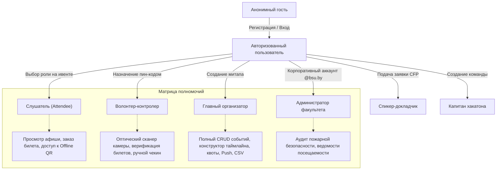

---

### 1.5. Детализированная объектная модель данных и функций

Объектная модель спроектирована на основе ментальных моделей пользователей и классифицируется на **информационные объекты (сущности данных)** и **функциональные объекты (инструменты и операции)**.

#### 1. Информационные объекты (Data Objects):
1. **`Event` (Мероприятие):** Центральная сущность экосистемы (митап, хакатон, воркшоп). Мощность: $1 : N$ к билетам, трекам и логам.
2. **`Ticket` (Электронный билет):** Индивидуальный пропуск участника с криптографическим токеном HMAC-SHA256. Мощность: $1 : 1$ к связке Пользователь-Мероприятие.
3. **`VenueLocation` (Площадка / Аудитория):** Физическое пространство проведения с координатами OpenStreetMap и лимитом вместимости (Hard Cap).
4. **`ScheduleTrackItem` (Слот программы / Доклад):** Элемент таймлайна с указанием времени, темы, тезисов и привязанного спикера.
5. **`CheckInLog` (Запись журнала чекина):** Неизменяемая транзакционная запись факта прохода на входе (время, статус, ID сканера).
6. **`SpeakerProposal` (Заявка на доклад CFP):** Тезисы, слайды презентации и статус модерации приглашенного эксперта.
7. **`TeamMatch` (Команда хакатона):** Профиль команды со списком вакансий по ролям (Frontend, Backend, ML, Design).
8. **`EmergencyAnnouncement` (Экстренное оповещение):** Срочный широковещательный Push с высоким приоритетом доставки.
9. **`UserAccount` (Профиль пользователя):** Учетная запись студента ФПМИ с ролью, контактами и сохраненными билетами.

#### 2. Функциональные объекты (Functional Objects / Tools):
1. **`SearchEngine` (Поисковый механизм):** Полнотекстовый и нечеткий (Fuzzy) поиск по метаданным событий и спикеров.
2. **`FacetFilter` (Фасетный фильтратор):** Инструмент многокритериального сужения выборки по датам, форматам, площадкам и квотам.
3. **`QRScanner` (Оптический считыватель камеры):** Высокоскоростной детектор матричных кодов с мультимодальным откликом.
4. **`ScheduleBuilder` (Визуальный конструктор расписания):** Интерактивная сетка Drag-and-Drop для верстки тайминга митапа.
5. **`QuotaEnforcer` (Валидатор лимитов и листа ожидания):** Автоматический контроллер доступности мест и авто-перевода из Waitlist.
6. **`BroadcastNotifier` (Шлюз экстренного оповещения):** Инструмент отправки высокоприоритетных Push-сообщений в 1 клик.
7. **`ReportGenerator` (Генератор ведомостей):** Модуль выгрузки реестров посещаемости в форматы CSV, XLSX и PDF для деканата.

#### 3. Паспорт характеристик объектов:

| Название объекта | Тип объекта | Мощность | Перечень представлений в интерфейсе | Перечень действий над объектом | Ключевые атрибуты (свойства) |
|:---|:---|:---|:---|:---|:---|
| **Event** | Информационный | $1 : N$ к билетам | Карточка в афише, Детальный лендинг, Строка таблицы организатора | Создать, Редактировать, Опубликовать, Завершить, Отменить | `id`, `slug`, `title`, `type`, `start_time`, `end_time`, `hard_cap`, `waitlist_count`, `venue_id` |
| **Ticket** | Информационный | $1 : 1$ к User-Event | Полноэкранный QR-пропуск, Карточка в Apple Wallet, Строка в базе | Сгенерировать, Показать офлайн, Верифицировать, Аннулировать | `id`, `event_id`, `user_id`, `hmac_token`, `status`, `seat_number`, `created_at` |
| **ScheduleItem** | Информационный | $N : 1$ к Event | Слот таймлайна, Карточка доклада в мобайле, Строка в конструкторе | Добавить в сетку, Переместить (D&D), Привязать спикера | `id`, `event_id`, `title`, `speaker_id`, `start_time`, `duration_min`, `track_type` |
| **CheckInLog** | Информационный | $N : 1$ к Event | Строка Live-фида, Индикатор на экране сканера, Ячейка CSV | Зафиксировать факт, Проверить дубликат, Экспортировать | `id`, `ticket_id`, `scanned_at`, `volunteer_id`, `scan_status`, `haptic_code` |
| **QRScanner** | Функциональный | $1 : 1$ к волонтеру | Видоискатель камеры с лазерной рамкой, Кнопка фонарика | Включить камеру, Распознать токен, Подать вибросигнал | `camera_mode`, `scan_latency_ms`, `haptic_enabled`, `offline_cache_status` |
| **QuotaEnforcer** | Функциональный | $1 : 1$ к Event | Прогресс-бар квоты мест, Бейдж «Лист ожидания» | Проверить лимит, Поставить в очередь, Продвинуть кандидата | `current_registrations`, `max_capacity`, `waitlist_queue`, `auto_promote_flag` |
| **Broadcast** | Функциональный | $1 : N$ к устройствам | Модальное окно создания, Всплывающий системный Push | Отправить в 1 клик, Логировать доставку | `alert_id`, `event_id`, `message_text`, `priority`, `delivered_count` |

#### 4. Диаграмма сущностей и связей (Mermaid Entity Relationship Diagram):

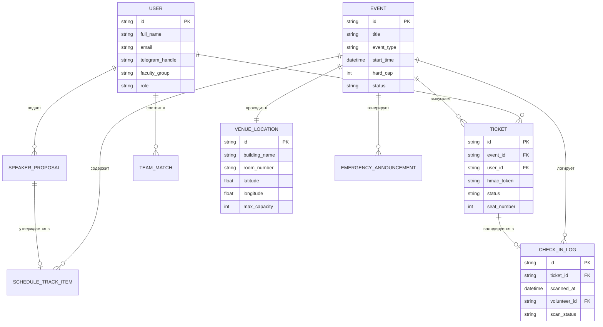

#### 5. Матрица соответствия объектов 7 персонажам проекта:

| Персонаж | Event | Ticket | VenueLocation | ScheduleItem | CheckInLog | TeamMatch | QRScanner / Broadcast |
|:---|:---:|:---:|:---:|:---:|:---:|:---:|:---:|
| **Артём Ковалёв (Слушатель)** | Просмотр | Владелец (QR) | Просмотр на OSM | Просмотр («Мой трек») | Объект чекина | Просмотр | Получатель Push |
| **Дарья Мельникова (Волонтер)** | Просмотр инфо | Валидация | Просмотр точки | Контроль времени | Создатель записей | — | Оператор QR-сканера |
| **Максим Романов (Организатор)** | Полный CRUD | Управление | Выбор и лимиты | Конструктор D&D | Мониторинг лога | Модерация | Инициатор Push-рассылки |
| **Кирилл Савицкий (Капитан)** | Просмотр | Командный билет | Поиск коворкинга | Чекпоинты хакатона | Участник чекина | Владелец команды | Получатель алертов |
| **Виктор Громов (Спикер)** | Просмотр | Спикер-пропуск | Поиск аудитории | Автор доклада | Чекин в VIP | — | Контроль таймера сцены |
| **Сергей Николаевич (Зам. декана)** | Согласование | Аудит ведомости | Контроль квот | Просмотр тем | Экспорт отчета | — | Аудит пожарных лимитов |
| **Влад Костылев (Анти-персонаж)** | Попытка фрода | Дубликат QR | Попытка прохода | Поиск кофе-брейка | Фиксация нарушения | Спам-заявки | Блокировка сканером |

---
# Раздел 2. Разработка информационной архитектуры веб- и мобильного приложения

Информационная архитектура (Information Architecture, IA) экосистемы CampusMeet разработана в строгом соответствии с концепцией Луиса Розенфельда и Питера Морвиля [5] и включает четыре взаимосвязанные подсистемы:
1. **Система организации контента** (принципы классификации и таксономия);
2. **Система именования** (язык интерфейса, словарь терминов, система меток и URL);
3. **Система навигации** (глобальные, локальные и контекстные маршруты перемещения);
4. **Система поиска** (механизмы обнаружения контента, фасетная фильтрация и рекомендации).

---

### 2.1. Система организации контента

#### 2.1.1. Концептуальное проектирование и классификация типов интерфейса
Согласно классификации Алана Купера [2, с. 200], программные продукты дифференцируются по уровню вовлечения внимания пользователя и форм-фактору:

1. **Монопольный интерфейс (Sovereign Interface):**
   * *Компонент:* Веб-кабинет организатора (`CampusMeet-Web`).
   * *Поведенческая характеристика:* Завладевает вниманием пользователя на длительное непрерывное время (сессии от 20 до 90 минут). Пользователь выполняет сложные аналитические и конфигурационные манипуляции (составление сложной сетки программы хакатона, ручная модерация 40 заявок CFP, мониторинг дашборда в день ивента).
   * *Эргономические требования:* Высокая информационная плотность, нейтральная темная гамма, снижающая зрительное утомление, клавиатурные акселераторы (Hotkeys) и отсутствие навязчивых всплывающих баннеров.

2. **Временный интерфейс (Transient Interface):**
   * *Компоненты:* Мобильный экран предъявления билета участника, диалоговое окно быстрой регистрации в 1 клик, модальное окно фильтрации каталога, интерфейс сканирования QR-кода волонтером.
   * *Поведенческая характеристика:* Появляется для решения одной конкретной узкой задачи, удерживает внимание не более 5–15 секунд и моментально исчезает, возвращая пользователя в базовую деятельность.
   * *Эргономические требования:* Минимализм, отсутствие второстепенных ссылок, огромные контрастные элементы (QR-код на весь экран, крупные кнопки подтверждения).

3. **Фоновый интерфейс (Background / Daemon Interface):**
   * *Компоненты:* Фоновый синхронизатор офлайн-логов мобильного клиента, криптографический сервис ротации локального HMAC-токена, шлюз Push-уведомлений.
   * *Поведенческая характеристика:* Функционирует без визуального взаимодействия с пользователем, обеспечивая готовность системы к сбоям сети и своевременную доставку системных событий.

#### 2.1.2. Аудит контента: инвентаризация и классификация
Проведен полный аудит контентных единиц, циркулирующих в рамках экосистемы:

| ID | Название контента | Тип данных | Формат представления | Примерный объем | Владелец / Источник | Статус актуальности | Частота обновления |
|:---|:---|:---|:---|:---|:---|:---|:---|
| **CNT-01** | Карточка анонса митапа | Структурированный | Текст + Баннер 16:9 + Теги | 500–1000 байт | Организатор клуба | Публичный | 1–3 раза в неделю |
| **CNT-02** | Программа докладов (Таймлайн) | Иерархический | Список слотов с временными метками | 2–5 КБ | Модератор расписания | Актуальный | Редактируется до старта |
| **CNT-03** | Электронный билет | Криптографический | Двумерный QR-код + HMAC строка | 256 байт | Ядро системы | Персональный | Ротация каждые 60 сек |
| **CNT-04** | Справка о докладчике | Профиль персоны | Фото 1:1 + Bio + Ссылки на соцсети | 300–800 байт | Приглашенный спикер | Публичный | Статичный |
| **CNT-05** | Презентация доклада | Мультимедиа | Ссылка Google Slides / PDF файл | 5–50 МБ | Спикер | Публичный пост-ивент | В день мероприятия |
| **CNT-06** | Профиль команды хакатона | Составной | Название + Стек + Список ролей | 1–2 КБ | Капитан команды | Активный поиск | По мере комплектования |
| **CNT-07** | Интерактивная карта проезда | Геопространственный | Векторные тайлы OSM + Геомаркер | 50–200 КБ | Nominatim API / БГУ | Публичный | Привязана к аудитории |
| **CNT-08** | Лог входа (Check-in feed) | Транзакционный | Табличная строка с таймстемпом | 128 байт | Камера сканера | Служебный аудит | Потоковое real-time |
| **CNT-09** | Экстренное оповещение | Текстовый алерт | Push-нотификация + Баннер | 100–300 байт | Главный организатор | Срочный (High-priority) | По факту форс-мажора |
| **CNT-10** | Ведомость для деканата | Отчетный документ | Таблица CSV / Документ PDF | 20–100 КБ | Генератор отчетов | Архивный | По завершении ивента |

#### 2.1.3. Схемы организации информации и принципы группировки
Для обеспечения максимального удобства восприятия пользователями применены 4 взаимодополняющие схемы организации:
1. **Иерархическая схема (Дерево):** Базовая структура веб-приложения и карты сайта. Позволяет двигаться от обобщенных разделов к детализированным сущностям (Главная → Афиша → Страница митапа → Слот доклада → Профиль спикера).
2. **Последовательная схема (Step-by-Step Wizard):** Применяется в линейных процедурах с высокой вероятностью ошибок:
   * *Мастер создания митапа:* Шаг 1 (Название и формат) → Шаг 2 (Дата и аудит праздников РБ) → Шаг 3 (Площадка и лимит мест) → Шаг 4 (Сетка тайминга) → Шаг 5 (Публикация).
   * *Регистрация команды хакатона:* Шаг 1 (Название и стек) → Шаг 2 (Вакансии) → Шаг 3 (Публикация на бирже).
3. **Фасетная схема (Многомерная классификация):** Реализована в каталоге мероприятий и на бирже команд. Пользователь может комбинировать независимые фильтры (по дате, направлению технологий, формату и доступности мест).
4. **Матричная схема (Теги и ассоциативные связи):** Обеспечивает свободную навигацию по смежным сущностям через облако тегов (`#AI`, `#Highload`, `#Go`, `#FPMI`).

#### 2.1.4. Иерархическая карта сайта (Sitemap) с глубиной более 3 уровней
Спроектирована разветвленная карта сайта, насчитывающая 4 уровня вложенности:

```mermaid
graph TD
    Root["Главная страница (CampusMeet Portal)"]
    
    %% Level 1 Branches
    Root --> Events["1.0. Каталог событий (Афиша)"]
    Root --> Hackathons["2.0. Хакатоны и контесты"]
    Root --> Teams["3.0. Биржа команд (Team Match)"]
    Root --> MyTickets["4.0. Личный кабинет участника"]
    Root --> Organizer["5.0. Кабинет организатора"]
    Root --> Info["6.0. О проекте и правила"]

    %% Level 2
    Events --> EventPage["1.1. Страница события (:event_slug)"]
    EventPage --> EventReg["1.1.1. Модальное окно регистрации"]
    EventPage --> EventSchedule["1.1.2. Интерактивная программа"]
    EventPage --> EventSpeakers["1.1.3. Список докладчиков"]
    EventPage --> EventVenue["1.1.4. Схема проезда и карта"]

    %% Level 3 Details
    EventSchedule --> TrackSlot["1.1.2.1. Детали слота и тезисы"]
    EventSpeakers --> SpeakerProfile["1.1.3.1. Портфолио спикера"]
    EventVenue --> FloorMap["1.1.4.1. Схема этажа аудитории"]

    %% Teams Branch
    Teams --> TeamCard["3.1. Карточка команды (:team_id)"]
    TeamCard --> ApplyRole["3.1.1. Отклик на вакансию команды"]

    %% MyTickets Branch
    MyTickets --> TicketPass["4.1. Электронный билет (:ticket_id)"]
    TicketPass --> AppleWallet["4.1.1. Экспорт в Apple Wallet (.pkpass)"]
    TicketPass --> CalExport["4.1.2. Экспорт в календарь (.ics)"]

    %% Organizer Branch
    Organizer --> OrgEvent["5.1. Управление митапом (:id)"]
    OrgEvent --> OrgBuilder["5.1.1. Конструктор таймлайна (D&D)"]
    OrgEvent --> OrgCheckin["5.1.2. Live-мониторинг чекина"]
    OrgEvent --> OrgScanner["5.1.3. Мобильный сканер волонтера"]
    OrgEvent --> OrgBroadcast["5.1.4. Экстренное Push-оповещение"]
    OrgEvent --> OrgReport["5.1.5. Экспорт ведомости (CSV/PDF)"]
```

#### 2.1.5. Таксономия категорий, рубрикаторов и тегов
В системе внедрена устойчивая трехуровневая таксономия:
1. **Категории верхнего уровня (Формат):**
   * `Офлайн-митапы (Offline Meetups)` — вечерние встречи с 2–3 докладами и кофе-брейком (1.5–3 часа);
   * `Студенческие хакатоны (Hackathons)` — командные инженерные марафоны на 24–48 часов;
   * `Воркшопы и мастер-классы (Workshops)` — практические занятия с написанием кода на ноутбуках;
   * `Открытые лекции экспертов (Guest Lectures)` — академические доклады индустриальных спикеров.
2. **Тематические технологические направления (Tracks):**
   * `Artificial Intelligence & Data Science` (LLM, Computer Vision, MLOps, NLP);
   * `Web & Cloud Technologies` (React, Next.js, Node.js, Distributed Systems, Go, K8s);
   * `Mobile Engineering` (React Native, iOS Swift, Android Kotlin, Flutter);
   * `Cybersecurity & Low-Level` (Reverse Engineering, Network Security, Rust, C++);
   * `Product Design & HCI` (UI/UX, Design Systems, Usability, Figma).
3. **Атрибутивные фасеты доступности:**
   * `Есть свободные места` / `Лист ожидания (Waitlist)`;
   * `Бесплатный вход` / `Спонсорская регистрация`;
   * `Корпус БГУ: Главный` / `Корпус БГУ: ФПМИ` / `Внешний IT-коворкинг`.

---

### 2.2. Система именования (Labeling & Vocabulary)

#### 2.2.1. Единый словарь интерфейса (Glossary)
С целью устранения полисемии и стандартизации взаимодействия составлен нормативный словарь терминов:

| Термин интерфейса | Определение термина | Контекст использования в UI | Английский аналог | Запрещенные/нерекомендуемые формулировки |
|:---|:---|:---|:---|:---|
| **Афиша** | Каталог предстоящих открытых мероприятий с возможностью поиска и фильтрации. | Главное меню, кнопка глобальной навигации. | Events / Catalog | Список, Мероприятия (слишком формально), Тусовки |
| **Электронный билет** | Цифровой документ участника с уникальным динамическим токеном HMAC-SHA256 и QR-кодом. | Экран смартфона, кнопка в нижнем таб-баре. | Digital Pass / Ticket | Проходка, Квитанция, Талон, Бронь |
| **Чекин (Вход)** | Процедура оптической верификации билета волонтером на входе в аудиторию. | Экран сканера волонтера, живой аудит-лог. | Check-in / Admission | Валидация, Пропускной пункт, Фейсконтроль |
| **Лимит мест (Hard Cap)** | Максимально допустимое число участников, обусловленное нормами вместимости зала. | Карточка ивента, дашборд организатора. | Capacity / Hard Cap | Вместимость, Предел, Ограничитель |
| **Лист ожидания** | Очередь участников, желающих попасть на событие при исчерпании доступной квоты. | Бейдж на карточке, модальное окно. | Waitlist | Очередь, Запасной список, Резерв |
| **Конструктор таймлайна** | Интерактивный инструмент верстки расписания докладов методом Drag-and-Drop. | Кабинет организатора, боковая панель. | Schedule Builder | Редактор расписания, Сетка, Планировщик |
| **Биржа команд** | Модуль нетворкинга для формирования команд на хакатоны и поиска специалистов по стеку. | Верхняя панель навигации, экран карточек. | Team Matchmaking | Поиск людей, Сбор состава, Знакомства |
| **Экстренный Push** | Высокоприоритетное системное оповещение участников о форс-мажоре (перенос зала/тайминга). | Кнопка быстрого доступа организатора. | Urgent Broadcast Push | Спам, Массовая рассылка, Сообщение |
| **Слот доклада** | Отрезок времени в программе, отведенный под выступление конкретного спикера. | Программа митапа, карточка таймлайна. | Track Item / Timeslot | Время, Выступление, Часть |
| **Принятый доклад (CFP)** | Доклад, предложенный спикером и одобренный программным комитетом митапа. | Личный кабинет докладчика. | Approved Paper (CFP) | Одобренная заявка, Резюме темы |

#### 2.2.2. Принципы формулирования названий и синтаксис меток
1. **Принцип краткости:** Названия разделов навигации и кнопок ограничены **1–2 словами** («Афиша», «Мои билеты», «Сканировать», «Создать митап»).
2. **Синтаксическая дифференциация:**
   * Для навигационных ссылок и разделов используются **существительные в именительном падеже** («Расписание», «Спикеры», «Команды»);
   * Для кнопок целевых действий используются **глаголы неопределенной формы (инфинитивы)** («Зарегистрироваться», «Сканировать код», «Отправить Push», «Скачать отчет»);
   * Для системных статусов используются **краткие причастия или прилагательные** («Подтвержден», «Отклонен», «Заполнен», «Активен»).
3. **Единообразие регистра:** Принят международный стандарт **Sentence case** (первая буква заглавная, последующие строчные), исключающий визуальный шум.

#### 2.2.3. Семантическая валидация терминов через поисковые запросы (Яндекс.Вордстат)
Для выбора естественных и узнаваемых формулировок проведен частотный анализ реальных пользовательских запросов в поисковой системе Яндекс (геотаргетинг: Республика Беларусь, Минск):

| Исследуемый термин в UI | Поисковый запрос (Яндекс.Вордстат) | Частотность (показов/мес) | Анализ пользовательской ментальной модели | Принятое решение для интерфейса |
|:---|:---|:---:|:---|:---|
| **Афиша** vs События | `афиша мероприятий минск` / `it события минск` | 14 200 / 3 100 | Слово «Афиша» ассоциируется с актуальным календарем событий и близко студентам. | Утвержден термин **«Афиша»** для каталога. |
| **Митап** vs Встреча | `it митапы минск` / `встречи программистов` | 2 850 / 410 | Термин «митап» является общепринятым индустриальным стандартом в среде IT-студентов. | Утвержден термин **«Митап»**. |
| **Хакатон** vs Конкурс | `хакатоны беларусь 2026` / `it конкурсы студентов` | 4 600 / 520 | Студенты целенаправленно ищут именно «хакатоны». | Утвержден термин **«Хакатон»**. |
| **Электронный билет** | `электронный билет qr код` / `входной талон` | 8 900 / 180 | Слово «билет» дает четкую ментальную модель персонального документа на проход. | Утвержден термин **«Мой билет»**. |
| **Команда на хакатон** | `найти команду на хакатон` / `поиск тиммейтов` | 1 950 / 1 100 | Высокий интерес к нетворкингу подтверждает необходимость отдельного раздела. | Утвержден раздел **«Биржа команд»**. |

#### 2.2.4. Система меток: текстовые метки, пиктограммы и семантическая схема URL
* **Иконографика (Lucide Icons):** Все пиктограммы имеют устойчивую семантику и сопровождаются текстовыми метками:
  * 📅 (`Calendar`) — Афиша и расписание;
  * 🎟️ (`Ticket`) — Электронный билет участника;
  * 👥 (`Users`) — Биржа команд хакатона;
  * 📷 (`Camera / QrCode`) — Сканер волонтера;
  * 📊 (`BarChart3`) — Дашборд аналитики организатора;
  * 🚨 (`AlertTriangle`) — Экстренный Push-алерт;
  * 📍 (`MapPin`) — Геолокация площадки и схема проезда.
* **RESTful-схема человеко-понятных URL (Clean URLs):**
  * `/events/` — каталог афиши событий с поддержкой query-параметров (`?format=meetup&date=today`);
  * `/events/:slug/` — главная страница конкретного мероприятия;
  * `/events/:slug/schedule/` — интерактивная сетка докладов события;
  * `/events/:slug/speakers/` — реестр спикеров митапа;
  * `/tickets/:ticket_id/` — полноэкранное представление электронного билета;
  * `/teams/` — биржа команд хакатона;
  * `/teams/:team_id/` — профиль команды с вакансиями;
  * `/organizer/events/:id/dashboard/` — веб-кабинет управления событием;
  * `/organizer/events/:id/live-checkin/` — полноэкранный фид мониторинга входа;
  * `/organizer/events/:id/scanner/` — мобильный терминал волонтера.

#### 2.2.5. Тезаурус предметной области, ассоциации и синонимы
Для поисковой оптимизации и редиректов сформирован ассоциативный тезаурус:

```
[Митап]
   ├── Синонимы: IT-встреча, открытая лекция, семинар, сходка
   ├── Входит в категорию: События
   └── Ассоциированные термины: доклады, спикер, кофе-брейк, нетворкинг

[Хакатон]
   ├── Синонимы: хак, hackathon, марафон программирования, кодинг-батл
   ├── Входит в категорию: События
   └── Ассоциированные термины: питчинг, чекпоинт, менторы, призовой фонд, команда

[Чекин]
   ├── Синонимы: вход, проходка, сканирование билета, регистрация на входе
   └── Ассоциированные термины: волонтер, турникет, QR-код, виброотклик

[Лист ожидания]
   ├── Синонимы: вейтлист, waitlist, резервный список, очередь
   └── Ассоциированные термины: овербукинг, отмена брони, авто-промоушн
```

---

### 2.3. Система навигации

#### 2.3.1. Эмпирическое исследование открытой карточной сортировки (OptimalSort)
Для исключения субъективизма разработчиков при проектировании навигации было проведено социо-инженерное исследование методом **открытой карточной сортировки** на платформе OptimalSort:

1. **Параметры эксперимента:**
   * Респонденты: $N = 15$ человек (студенты 1–4 курсов ФПМИ БГУ, волонтеры и лидеры клубов);
   * Объем стимульного материала: **35 карточек** с названиями функций и информационных блоков (например: *«Поиск митапа по AI»*, *«QR-код на проход»*, *«Создание вакансии в команду»*, *«Конструктор расписания»*, *«Схема корпуса на карте»*, *«Экстренный перенос зала»*, *«Выгрузка списка присутствующих»* и др.);
   * Задача респондента: сгруппировать карточки в произвольное количество логических категорий и дать каждой группе осмысленное название.

2. **Матрица совместной встречаемости (Similarity Matrix):**
   * Карточки *«QR-код прохода»*, *«Офлайн-билет»*, *«Добавить в Apple Wallet»* были объединены в одну группу **93.3% респондентов** (14 из 15);
   * Карточки *«Афиша митапов»*, *«Фильтр по стеку»*, *«Календарь событий»* объединены в одну группу **86.7% респондентов**;
   * Карточки *«Сбор команды на хакатон»*, *«Поиск ML-инженера»*, *«Резюме соискателя»* объединены в категорию «Команды» **80.0% респондентов**;
   * Карточки *«Конструктор расписания Drag-and-Drop»*, *«Квоты мест»*, *«Рассылка пуша»*, *«Экспорт отчета для деканата»* отнесены к закрытому блоку «Управление ивентом» **100% организаторов и 80% студентов**.

3. **Дендрограмма кластеризации карточек:**

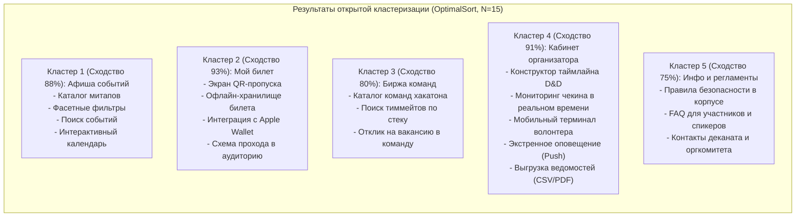

#### 2.3.2. Три уровня встроенной навигации: глобальная, локальная и контекстная
1. **Глобальная навигация (Global Navigation):**
   * *Header (Шапка сайта):* Присутствует на всех экранах десктопа в зафиксированном положении (Sticky Header). Содержит логотип с индикатором статуса, 5 магистральных пунктов меню (*«Афиша»*, *«Хакатоны»*, *«Биржа команд»*, *«Календарь»*, *«О проекте»*), строку быстрого поиска `⌘K`, кнопку создания события и аватар профиля.
   * *Footer (Подвал сайта):* 4-колоночная матрица вспомогательных ссылок, нормативные документы, политика обработки персональных данных, контакты факультета ФПМИ и ссылки на GitHub репозитории проекта.
2. **Локальная навигация (Local Navigation):**
   * Внутри детальной страницы митапа: горизонтальный таб-бар переключения вкладок (*«Программа докладов»*, *«Спикеры»*, *«О митапе»*, *«Схема проезда»*, *«FAQ»*);
   * Внутри каталога: левая боковая панель фасетной фильтрации (аккордеоны параметров);
   * Внутри кабинета организатора: левое фиксированное вертикальное меню (*«Дашборд»*, *«Таймлайн»*, *«Чекины»*, *«Спикеры CFP»*, *«Волонтеры»*, *«Push-вещание»*, *«Отчеты»*).
3. **Контекстная навигация (Contextual Navigation):**
   * Ассоциативные гиперссылки в теле контента: клик по имени спикера в таймлайне открывает его карточку; блок «Похожие митапы по теме GenAI» внизу страницы события; ссылка «Показать маршрут в аудиторию 512» прямо с экрана билета.

#### 2.3.3. Вспомогательные навигационные средства
* **Хлебные крошки (Breadcrumbs):** Отображаются на страницах 2–4 уровней вложенности с разметкой Schema.org:  
  `Главная > Афиша > CampusMeet #4: GenAI > Программа докладов > Слот 2: Highload на Go`
* **Карта сайта (HTML Sitemap):** Полноразмерная иерархическая страница для быстрого обзора всех разделов и индексации поисковыми роботами.
* **Кнопка возврата «Наверх» (Back to Top):** Всплывает в правом нижнем углу экрана при прокрутке страницы вниз более чем на 600px с плавной анимацией скролла.
* **Пагинация и история состояний:** Каталог поддерживает как классическую постраничную пагинацию, так и динамическую подгрузку с сохранением позиции скролла и фильтров в `sessionStorage`.

#### 2.3.4. Карта навигации и различия десктопного Web и смартфона Mobile
В мобильном клиенте громоздкое верхнее меню адаптировано к эргономичному нижнему **Bottom Tab Bar (4 ключевые вкладки)**:
1. `📅 Афиша` — мобильный каталог событий с горизонтальным карусельным скроллом категорий;
2. `🎟️ Билеты` — моментальный доступ к текущему активному QR-билету;
3. `👥 Команды` — мобильная лента поиска тиммейтов на хакатон;
4. `👤 Профиль` — учетная запись, переключение в режим волонтера и настройки.

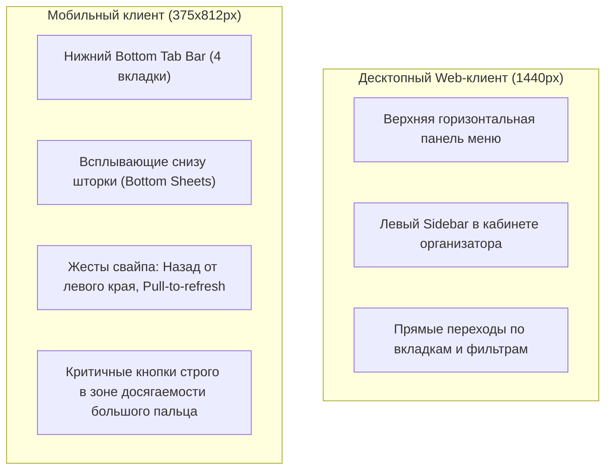

#### 2.3.5. Магистральные пользовательские сценарии (User Flows)

##### Сценарий 1: Регистрация слушателя и проход по офлайн-билету (Артём Ковалёв)
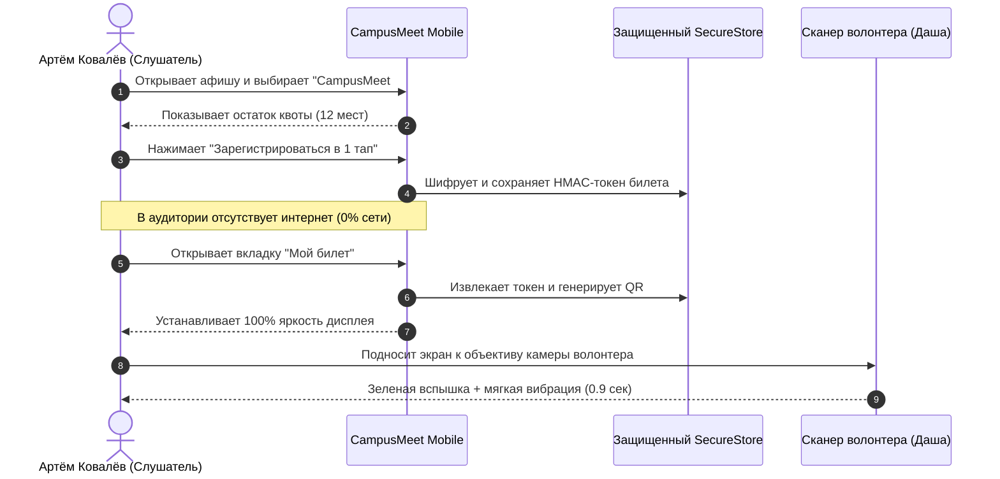

##### Сценарий 2: Поточное сканирование билетов волонтером (Дарья Мельникова)
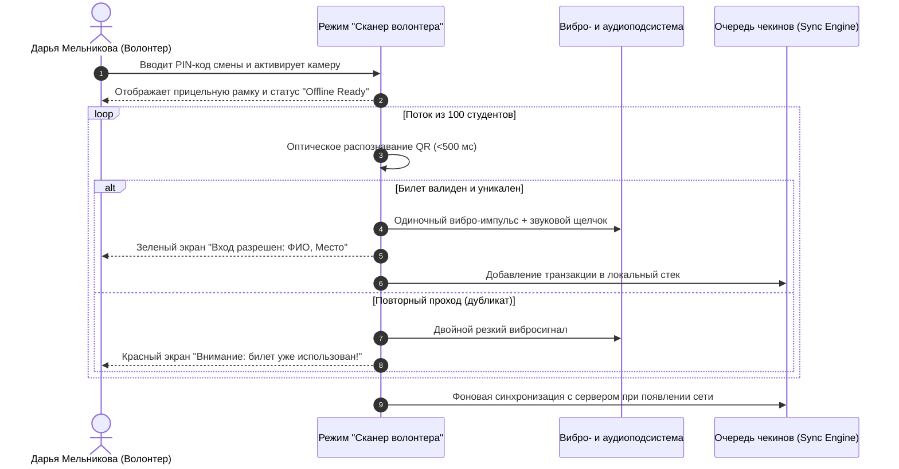

##### Сценарий 3: Форс-мажорный перенос аудитории организатором (Максим Романов)
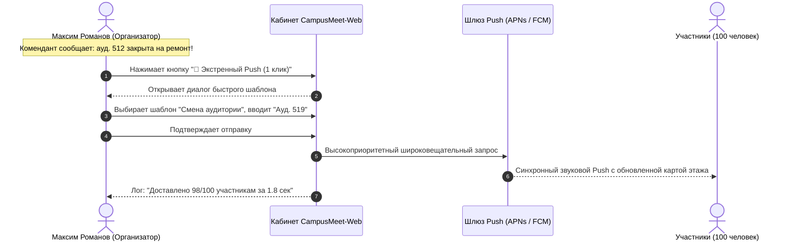

#### 2.3.6. Макеты низкой точности (Wireframes) навигационной структуры
В процессе проектирования были синтезированы структурные схемы (Wireframes) ключевых узлов:

1. **Десктопный каталог мероприятий с 12-колоночной разметкой:**
   * Расположение файла: `docs/assets/wireframes/wireframe_desktop_catalog.svg`

<p align="center">
  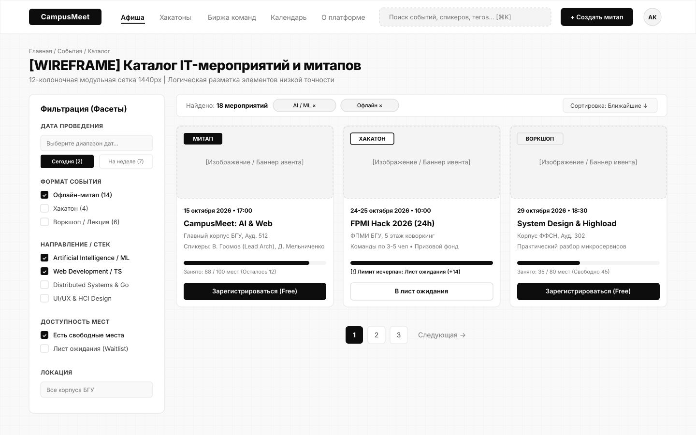
</p>

2. **Детальная страница митапа с таймлайном и блоком бронирования:**
   * Расположение файла: `docs/assets/wireframes/wireframe_desktop_event_details.svg`

<p align="center">
  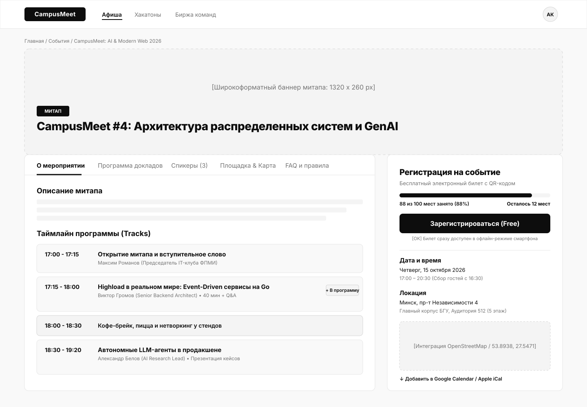
</p>

3. **Мобильный экран предъявления электронного билета (QR Pass):**
   * Расположение файла: `docs/assets/wireframes/wireframe_mobile_ticket.svg`

<p align="center">
  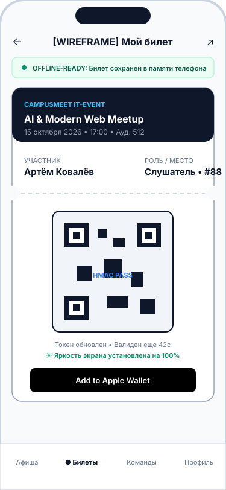
</p>

4. **Мобильный терминал сканера камеры волонтера:**
   * Расположение файла: `docs/assets/wireframes/wireframe_mobile_scanner.svg`

<p align="center">
  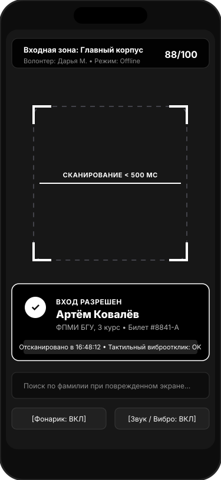
</p>

5. **Панель управления организатора (Live Check-in Дашборд):**
   * Расположение файла: `docs/assets/wireframes/wireframe_desktop_dashboard.svg`

<p align="center">
  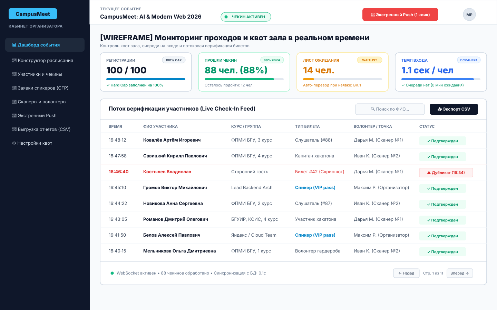
</p>

---

### 2.4. Система поиска и фильтрации

#### 2.4.1. Обоснование поисковой архитектуры
В соответствии с критериями Розенфельда и Морвиля [5], необходимость мощной поисковой системы в CampusMeet обоснована следующими факторами:
1. **Объем данных:** Экосистема агрегирует десятки параллельных митапов, хакатонов, сотен спикеров и вакансий в команды;
2. **Фрагментарность ментальных моделей:** Студенты часто помнят лишь фамилию докладчика (например, *«Громов»*) или ключевую тему (*«Highload»*), не зная точного названия митапа;
3. **Паттерн немедленного действия:** Посетитель приходит с намерением быстро найти событие по своему стеку (например, *«Go»* или *«Machine Learning»*).

#### 2.4.2. Проектирование поискового интерфейса, автодополнения и нечеткого поиска
* **Поисковая строка (Omnibox):** Размещена в верхней панели навигации с поддержкой вызова горячими клавишами `⌘K` (macOS) или `Ctrl+K` (Windows/Linux).
* **Автодополнение с категоризацией (Typeahead Suggestions):** По мере ввода символов (начиная с 2-го знака) выпадает классифицированный список подсказок с задержкой дебаунса 200 мс:
  * 📅 *События:* «CampusMeet #4: GenAI & Web»;
  * 👤 *Спикеры:* «Виктор Громов (Lead Backend Architect)»;
  * 🏷️ *Теги:* «#DistributedSystems», «#Go», «#AI».
* **Обработка опечаток и нечеткий поиск (Fuzzy Search):** Использование алгоритма расстояния Левенштейна ($D \le 2$) и триграммного индексирования. Запрос *«митап по голангу»* корректно находит *«Митап: Distributed Systems на Go»*, а запрос *«хакатон фпми»* исправляет опечатки вида *«хакатан фпми»*.

#### 2.4.3. Система многомерных фасетных фильтров
Фасетная панель позволяет уточнять поисковый запрос по независимым критериям:

```
[Поисковый запрос: "Highload"]
 ├── Фасет: Дата проведения
 │     ├── [x] На этой неделе (1)
 │     └── [ ] В этом месяце (3)
 ├── Фасет: Формат мероприятия
 │     ├── [x] Офлайн-митап (1)
 │     └── [ ] Воркшоп (2)
 ├── Фасет: Доступность мест
 │     ├── [x] Только со свободными местами (1)
 │     └── [ ] Включая лист ожидания (3)
 └── Фасет: Университетская площадка
       ├── [x] Корпуса БГУ (1)
       └── [ ] Внешние IT-хабы (2)
```

#### 2.4.4. Спецификация метаданных поиска и весов релевантности
Поисковый индекс рассчитывает итоговый рейтинг документа по взвешенной формуле:
$$Score = 10 \cdot S_{title} + 8 \cdot S_{tags} + 6 \cdot S_{speakers} + 5 \cdot S_{venue} + 3 \cdot S_{description}$$

| Поле метаданных | Тип данных | Вес релевантности | Назначение при поиске |
|:---|:---|:---:|:---|
| `event_title` | Полнотекстовый | **10** (Максимальный) | Прямое совпадение по названию мероприятия. |
| `tags` | Массив строк | **8** | Совпадение по технологическому стеку и направлению (`AI`, `Web`). |
| `speaker_names` | Строковый | **6** | Поиск событий по конкретному автору доклада. |
| `venue_name` | Строковый | **5** | Поиск по названию корпуса БГУ или аудитории. |
| `description` | Полнотекстовый | **3** | Поиск по аннотации и тезисам докладов. |

#### 2.4.5. Контекстный рекомендательный алгоритм
В случае если пользователь авторизован, модуль рекомендаций сопоставляет выбранные им в профиле интересы (например, *«Frontend, React, TypeScript»*) с каталогом анонсов и формирует персональный блок: *«Рекомендовано вам на основе вашего стека»*.

#### 2.4.6. Представление результатов поисковой выдачи и Zero-State
* **Выдача результатов:** Карточки отображаются с подсветкой (Highlighting) совпавших ключевых слов желтым фоном. Доступна сортировка: *«По релевантности»*, *«По дате (сначала ближайшие)»*, *«По популярности (заполненности)»*.
* **Пустое состояние (Zero-State):** При отсутствии совпадений система не показывает удручающий пустой экран, а выводит:
  * Сообщение: *«По запросу "..." ничего не найдено»*;
  * Кнопку сброса примененных фильтров;
  * Блок подсказок: *«Попробуйте изменить формулировку или посмотрите ближайшие хакатоны»*;
  * Список 3 самых популярных событий недели.

#### 2.4.7. Макеты низкой точности (Wireframes) поисковых экранов
Для поисковой системы разработан отдельный детализированный вайрфрейм модального окна Omnibox поиска и фасетной фильтрации (`wireframe_desktop_search_modal.svg`), демонстрирующий строку ввода с шорткатом `⌘K`, исправление опечаток по алгоритму Левенштейна, рубрицированную выдачу (мероприятия, спикеры, теги) и активные фасеты:

* **Расположение файла:** `docs/assets/wireframes/wireframe_desktop_search_modal.svg`

<p align="center">
  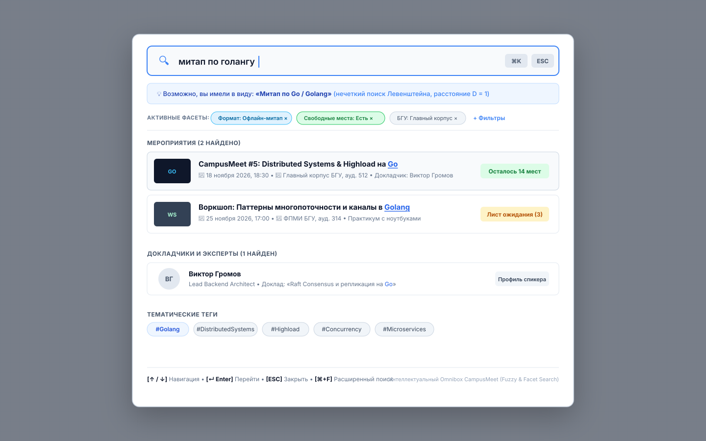
</p>

---
# Раздел 3. Навигационная модель системы и общая диаграмма путей

В соответствии с требованиями раздела 7 методических указаний, для каждого из 7 синтезированных в Лабораторной работе №1 персонажей спроектирована индивидуальная навигационная модель на основе их контекстных сценариев. Затем построен граф состояний главного меню и сквозная диаграмма путей.

---

### 3.1. Индивидуальные навигационные модели для каждого из 7 персонажей

#### 1. Артём Ковалёв (Ключевой персонаж №1 — Слушатель)
Контекст: Студент на ходу в перерыве между парами, шумный коридор, слабая связь.
* **Навигационный маршрут:**  
  `Афиша событий` → `Карточка CampusMeet #4` → `Регистрация в 1 клик` → `Локальный SecureStore билета` → `Экран офлайн-билета (QR)` → `Чекин у входа в ауд. 512` → `Вкладка "Моя программа"` → `Оценка доклада спикера`.

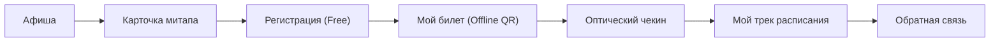

#### 2. Дарья Мельникова (Ключевой персонаж №2 — Волонтер-контролер)
Контекст: Входная зона, 100+ гостей за 15 минут, монотонная работа, недопустимость очередей.
* **Навигационный маршрут:**  
  `Авторизация волонтера (PIN)` → `Экран сканера камеры` → `Наведение на QR гостя` → `Визуальный/вибро-отклик (Зеленый / Красный)` → `(При разбитом стекле: Поиск по ФИО)` → `Монитор счетчика (88/100)` → `Закрытие смены и экспорт логов`.

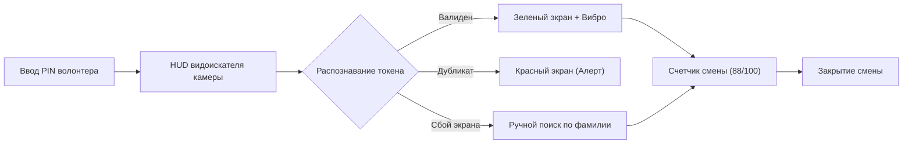

#### 3. Максим Романов (Ключевой персонаж №3 — Главный организатор)
Контекст: Веб-кабинет, десктоп, подготовка мероприятия, управление квотами, форс-мажор.
* **Навигационный маршрут:**  
  `Дашборд организатора` → `Мастер создания события` → `Проверка праздников (Nager.Date)` → `Конструктор таймлайна (D&D)` → `Модерация заявок CFP` → `Live-мониторинг проходов` → `[Форс-мажор: Экстренный Push]` → `Экспорт ведомости для деканата`.

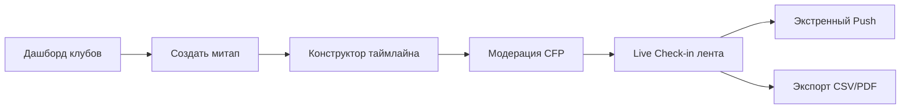

#### 4. Кирилл Савицкий (Дополнительный персонаж — Капитан хакатона)
Контекст: Подготовка к хакатону, поиск дизайнера, соблюдение дедлайнов чекпоинтов.
* **Навигационный маршрут:**  
  `Раздел "Хакатоны"` → `Регистрация команды "AlphaDevs"` → `Биржа команд (Публикация вакансии UI/UX)` → `Просмотр откликов соискателей` → `Утверждение участника в состав` → `Командный таймлайн чекпоинтов`.

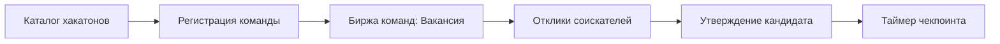

#### 5. Виктор Громов (Вспомогательный персонаж — Приглашенный спикер)
Контекст: Senior Architect, ценит время, подача темы, контроль времени выступления.
* **Навигационный маршрут:**  
  `Лендинг CampusMeet` → `Веб-форма Call for Papers (CFP)` → `Загрузка слайдов` → `Получение статуса "Одобрено"` → `Личный кабинет спикера (VIP билет)` → `Таймер обратного отсчета до выхода на сцену`.

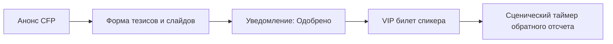

#### 6. Сергей Николаевич Котов (Заказчик системы — Зам. декана по воспитательной работе)
Контекст: Кабинет деканата, рабочий ПК, контроль безопасности, отчетность перед ректоратом.
* **Навигационный маршрут:**  
  `Корпоративный вход (@bsu.by)` → `Реестр университетских заявок` → `Согласование аудитории 512 и лимита 100 мест` → `Монитор загрузки корпуса` → `Экспорт ведомости участников с временными метками для стипендий`.

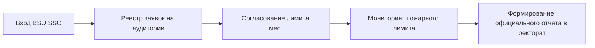

#### 7. Влад Костылев (Отрицательный персонаж — Анти-персонаж / Мерч-хантер)
Контекст: Общежитие, попытка занять место ради бесплатной пиццы, попытка провести друга по скриншоту.
* **Навигационный маршрут (Демонстрация барьера защиты):**  
  `Анонс митапа` → `Клик "Зарегистрироваться"` → `[Срабатывание No-show защиты: запрос подтверждения за 24ч]` → `(Не подтвердил: авто-передача места кандидату из Waitlist)` → `Попытка прохода по чужому скриншоту` → `Отказ сканера волонтера (Блокировка дубликата)`.

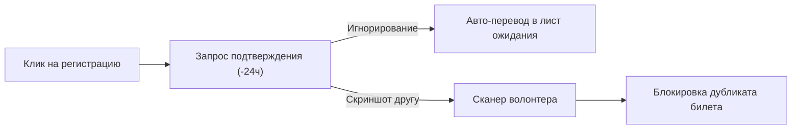

---

### 3.2. Граф состояний главного меню (Menu State Graph)

Согласно теоретическим рекомендациям методических указаний, главное меню экосистемы меняет свое состояние и набор доступных команд в зависимости от контекста роли и текущей экранной формы:

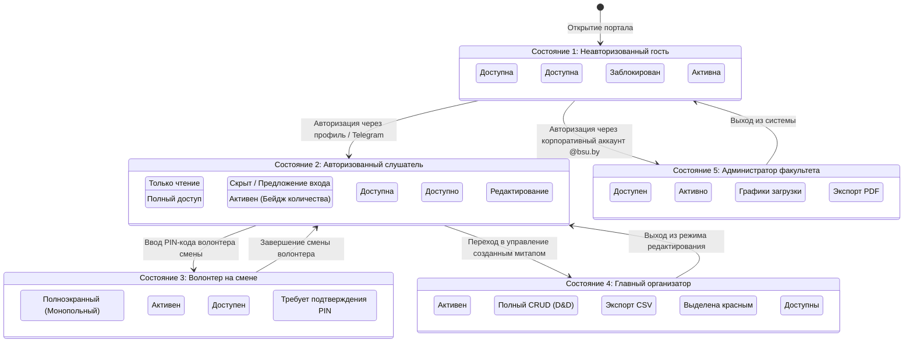

---

### 3.3. Общая сквозная диаграмма путей в системе (Site-wide Path Diagram)

Диаграмма объединяет навигационные маршруты всех ролей и показывает сквозное движение данных и пользователей по ключевым узлам программного комплекса:

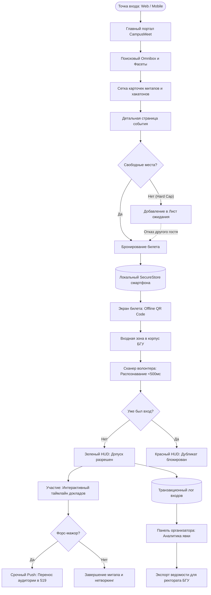

---
# Раздел 4. Карта пути клиента (CJM) и Карта влияния (Impact Map)

В соответствии с требованиями раздела 8 методических указаний и перечнем выходных документов разработаны:
1. **Карта влияния (Impact Map)** для перехода от целей проекта к конкретным поставляемым функциям (Deliverables) для всех ролевых групп и персонажей системы;
2. **Карты пути клиента (Customer Journey Maps, CJM)** в полном объеме для **всех 7 синтезированных персонажей проекта**.

---

### 4.1. Карта влияния продукта (Impact Map) для всех 7 ролей и персонажей

Карта влияния построена по методологии Гойко Аджича и связывает стратегические цели бизнеса и университета с воздействиями на всех 7 персонажей и функциональными инкрементами продукта:

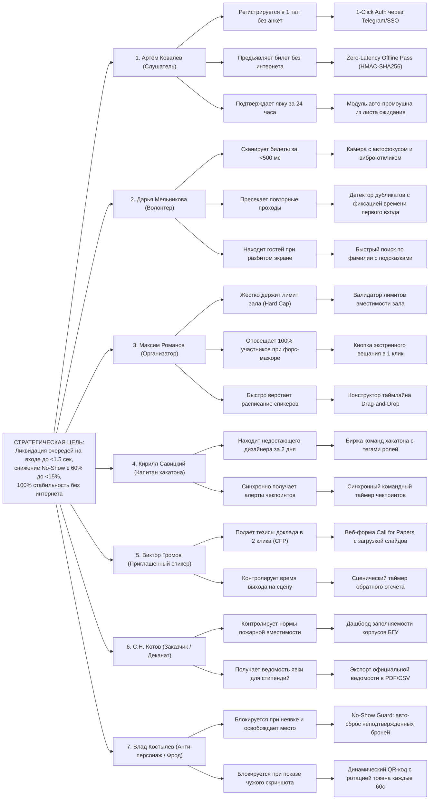

---

### 4.2. Карты пути клиента (Customer Journey Maps) всех 7 персонажей

#### 4.2.1. CJM Ключевого персонажа №1: Артём Ковалёв (Слушатель)
* **Цель персонажа:** Попасть на полезный IT-митап по генеративному AI без очередей, давки и потери времени.
* **Эмоциональная шкала:** от $-2$ (глубокое раздражение) до $+2$ (полный восторг).

| Фаза пути (Stage) | 1. Осведомленность и поиск | 2. Регистрация и ожидание | 3. Прибытие и проход на входе | 4. Участие и навигация в зале | 5. Пост-ивент и обратная связь |
|:---|:---|:---|:---|:---|:---|
| **Шаги пользователя (User Actions)** | Листает анонсы в приложении между парами; находит *«CampusMeet #4: GenAI»*. | Нажимает «Зарегистрироваться в 1 тап»; подтверждает бронь за 24 часа. | Подходит к ауд. 512; достает телефон; нажимает вкладку билета; подносит к камере. | Занимает место во 2 ряду; открывает «Моя программа»; слушает доклад Виктора Громова. | Ставит оценку докладу в приложении; скачивает слайды презентации. |
| **Точки контакта (Touchpoints)** | Карточка в Афише, теги `#AI`, `#Web`, строка поиска. | Модальное окно регистрации, Push-запрос подтверждения явок. | Экран билета с ярким QR, сканер волонтера Даши. | Таймлайн расписания, сценический экран, Push о кофе-брейке. | Форма отзыва (1–5 звезд), ссылка на слайды в Google Drive. |
| **Мысли и ожидания** | *«Опять в коридоре толпа будет? Надеюсь, места в аудитории нормальные есть»*. | *«Отлично, не нужно вводить 10 полей в Google-форме! Билет сразу в телефоне»*. | *«В подвале сети нет... Ура, билет открылся офлайн! Сканирование заняло 1 секунду!»*. | *«Удобно видеть, кто сейчас на сцене и когда начнется пицца»*. | *«Классный митап, поставлю спикеру 5 звезд и сохраню его контакт»*. |
| **Эмоциональный уровень** | **0** (Сдержанный интерес) | **+1** (Удовлетворение простотой) | **+2** (Восторг от скорости прохода) | **+2** (Комфорт и вовлеченность) | **+1** (Позитивный опыт) |
| **Болевые точки и барьеры** | Страх овербукинга и нехватки сидячих мест. | Забывание даты мероприятия в череде пар. | Отсутствие сотовой связи в коридорах БГУ. | Непонимание тайминга и задержки спикеров. | Потеря материалов доклада в архивах чатов. |
| **Продуктовое решение (UI/UX)** | Наглядный прогресс-бар оставшихся мест (88/100, осталось 12). | Автоматический Push-напоминание за 24 часа и за 15 минут до старта. | **Offline-First SecureStore** + 100% авто-яркость экрана. | Интерактивный прогресс-бар текущего доклада в таймлайне. | Доступ к архиву материалов митапа в 1 клик прямо из карточки. |

---

#### 4.2.2. CJM Ключевого персонажа №2: Дарья Мельникова (Волонтер-контролер)
* **Цель персонажа:** Быстро и безошибочно пропустить поток из 100+ гостей за 15 минут, исключить скандалы и мошенничество.

| Фаза пути (Stage) | 1. Получение смены | 2. Подготовка стойки входа | 3. Пиковый поток входящих | 4. Нештатная ситуация (Фрод) | 5. Завершение смены |
|:---|:---|:---|:---|:---|:---|
| **Шаги пользователя (User Actions)** | Получает от тимлида PIN-код доступа; открывает режим «Сканер волонтера». | Проверяет заряд смартфона; активирует видоискатель камеры; тестирует отклик. | Непрерывно наводит камеру на экраны телефонов студентов; фиксирует проход. | Гость показывает пересланный скриншот; сканер сигнализирует об ошибке; Даша вежливо отказывает. | Смотрит счетчик (94/100); нажимает «Завершить смену»; отправляет лог. |
| **Точки контакта (Touchpoints)** | Экран ввода 4-значного PIN-кода. | HUD-интерфейс сканера с переключателями звука и фонарика. | Зеленый экран верификации, тактильный виброотклик. | Желто-красный экран ошибки, время первого чекина. | Модальное окно сводки смены, кнопка экспорта. |
| **Мысли и ожидания** | *«Только бы сканер не зависал, как старая таблица в Excel»*. | *«Интерфейс понятный, зеленый индикатор огромный, не промахнусь»*. | *«Как быстро! Один за другим проходят, очереди у дверей вообще нет!»*. | *«Ага! Токен уже активирован в 16:34 на втором входе! Мошенничество пресечено»*. | *«Смена прошла идеально, ни одной потерянной фамилии и никаких нервов»*. |
| **Эмоциональный уровень** | **-1** (Легкая тревога перед потоком) | **+1** (Уверенность в инструменте) | **+2** (Драйв и максимальная скорость) | **+1** (Спокойное разрешение инцидента) | **+2** (Облегчение и удовлетворение) |
| **Болевые точки и барьеры** | Страх технического сбоя приложения при плохом Wi-Fi. | Блики на экранах гостей при ярком освещении. | Усталость глаз при вчитывании в мелкие буквы. | Конфликт с гостем, пытающимся пройти без билета. | Долгий ручной пересчет пришедших в конце смены. |
| **Продуктовое решение (UI/UX)** | Автономный режим валидации без обращения к серверу. | Автофокус сканера и считывание под углом до 45 градусов. | Полноэкранный цветовой индикатор (зеленый/красный) + виброотклик. | Точные факты на экране: «Билет уже погашен в 16:34:10 Волонтером №1». | Автоматический счетчик присутствующих в реальном времени. |

---

#### 4.2.3. CJM Ключевого персонажа №3: Максим Романов (Главный организатор)
* **Цель персонажа:** Провести качественный студенческий митап европейского уровня, избежать неявки (No-Show) и оперативно разрулить форс-мажор.

| Фаза пути (Stage) | 1. Инициация митапа | 2. Формирование программы | 3. Мониторинг броней (-24ч) | 4. Форс-мажор (Смена зала) | 5. Подведение итогов |
|:---|:---|:---|:---|:---|:---|
| **Шаги пользователя (User Actions)** | Создает карточку события; указывает ауд. 512 и лимит 100 мест; публикует анонс. | Перетаскивает доклады спикеров в Drag-and-Drop сетке; утверждает слоты. | Смотрит дашборд: 12 человек отказались; система перевела 12 чел из листа ожидания. | Комендант переносит зал в ауд. 519; Максим отправляет «Экстренный Push» в 1 клик. | Выгружает CSV-отчет с точным временем чекинов для зам. декана С.Н. Котова. |
| **Точки контакта (Touchpoints)** | Мастер создания события, валидатор праздников Nager.Date. | Конструктор расписания, карточки заявок Call for Papers. | KPI-виджеты дашборда: Hard Cap, Waitlist, Подтверждения. | Кнопка «🚨 Экстренное вещание», системное модальное окно. | Кнопка «Экспорт CSV/PDF», сводная диаграмма явки. |
| **Мысли и ожидания** | *«Главное, чтобы не было овербукинга, в аудиторию больше 100 стульев не влезет»*. | *«Как удобно таскать блоки мышкой, тайминг сам пересчитывается!»*. | *«Ни одно место не пропало! Вся сотня мест заполнена реальными людьми»*. | *«Кошмар, ремонт проводки! Срочно жму красную кнопку... Пуш улетел всем за 2 сек»*. | *«Явка 88% — лучший результат за всю историю клуба! Зам. декана доволен»*. |
| **Эмоциональный уровень** | **+1** (Воодушевление) | **+2** (Удобство управления) | **+2** (Контроль над процессом) | **-1 → +2** (Стресс ликвидирован пушем) | **+2** (Триумф и гордость за команду) |
| **Болевые точки и барьеры** | Необходимость проверки переносов выходных в РБ вручную. | Потеря тезисов докладов и контактов спикеров в переписках Telegram. | Пустой зал из-за 60% неявки зарегистрировавшихся. | Паника и дезориентация 100 студентов при смене аудитории. | Ручное сведение списков присутствующих для университетского отчета. |
| **Продуктовое решение (UI/UX)** | Интеграция API праздников Беларуси + жесткий лимит Hard Cap. | Визуальный конструктор таймлайна с автоматическим расчетом перерывов. | Механизм обязательного подтверждения брони и авто-Waitlist. | **1-Click Emergency Broadcast Gateway** со звуковым оповещением. | Мгновенный экспорт официальной ведомости с электронной меткой БГУ. |

---

#### 4.2.4. CJM Дополнительного персонажа: Кирилл Савицкий (Капитан хакатона)
* **Цель персонажа:** Найти сильного UI/UX дизайнера в команду на хакатон за 2 дня, успешно пройти промежуточные чекпоинты менторов и вовремя залить финальный проект.

| Фаза пути (Stage) | 1. Регистрация команды | 2. Поиск дизайнера на Бирже | 3. Старт хакатона и коворкинг | 4. Чекпоинты менторов (Ночь) | 5. Питчинг и подведение итогов |
|:---|:---|:---|:---|:---|:---|
| **Шаги пользователя (User Actions)** | Регистрирует команду «AlphaDevs», указывает стек (React, FastAPI, PyTorch). | Публикует вакансию «UI/UX дизайнер в Figma»; просматривает портфолио кандидатов; утверждает заявку. | Прибывает на площадку с командой; чекинится по командному QR-билету; занимает рабочий стол. | Получает синхронный командный Push за 20 мин до чекпоинта; загружает ссылку на коммит. | Демонстрирует рабочий прототип жюри; получает диплом призера. |
| **Точки контакта (Touchpoints)** | Раздел «Хакатоны», форма создания команды. | Биржа команд (Team Matchmaking), карточка вакансии, ссылки на Behance/Figma. | Командный билет в приложении, карта коворкинга с номерами столов. | Командный таймер дедлайна чекпоинта, Push-оповещения всей команде. | Турнирная таблица результатов хакатона, форма голосования менторов. |
| **Мысли и ожидания** | *«Нужен удобный интерфейс, чтобы не спамить во все телеграм-чаты курса»*. | *«Отлично, у кандидата есть готовые кейсы мобилок! Принимаю в команду в 1 клик»*. | *«Команда в сборе, все сели рядом, билет сработал на всех сразу»*. | *«Уже 4 утра, глаза слипаются... Хорошо, что пуш громко разбудил за 20 мин до дедлайна»*. | *«Собрали проект мечты за 24 часа! Сервис реально спас команду от некомплекта»*. |
| **Эмоциональный уровень** | **0** (Озабоченность нехваткой людей) | **+2** (Облегчение и энтузиазм) | **+1** (Рабочая сосредоточенность) | **-1 → +1** (Усталость, снятая контролем дедлайна) | **+2** (Победа и удовлетворение) |
| **Болевые точки и барьеры** | Нехватка дизайнеров в чисто программистских группах ФПМИ. | Сложность быстрой оценки навыков соискателя без портфолио. | Проблема пропуска ночных контрольных чекпоинтов из-за переутомления. | Рассинхронизация членов команды при смене аудиторий питчинга. | Потеря контактов менторов после завершения контеста. |
| **Продуктовое решение (UI/UX)** | Биржа вакансий с фильтрацией по роли (Design, Frontend, ML). | Профили кандидатов с прямыми ссылками на GitHub и портфолио Figma. | Командный динамический таймер с синхронным Push всем 4 участникам. | Звуковой высокоприоритетный алерт за 20 и 5 минут до закрытия слота. | Экспорт контактов жюри и профилей тиммейтов в Telegram в 1 тап. |

---

#### 4.2.5. CJM Вспомогательного персонажа: Виктор Громов (Приглашенный спикер)
* **Цель персонажа:** Подать доклад по распределенным системам на Go, выступить строго по согласованному таймингу без накладок и получить контакт заинтересованных студентов для найма.

| Фаза пути (Stage) | 1. Подача заявки (CFP) | 2. Согласование и подготовка | 3. Прибытие на площадку | 4. Выступление на сцене | 5. Нетворкинг и фидбек |
|:---|:---|:---|:---|:---|:---|
| **Шаги пользователя (User Actions)** | Открывает веб-форму CFP CampusMeet; вводит тему, тезисы и ссылку на презентацию. | Получает статус «Одобрено» и тайм-слот 18:30; обновляет слайды за 2 часа до старта. | Подъезжает к корпусу на такси; показывает VIP-пропуск спикера на стойке регистрации. | Подключает кликер; следит за сценическим таймером в приложении; отвечает на вопросы. | Просматривает средний балл доклада (4.9/5.0); обменивается контактами со студентами. |
| **Точки контакта (Touchpoints)** | Веб-форма Call for Papers, drag-and-drop загрузка слайдов. | Email/Push-уведомление об утверждении, личный кабинет спикера. | VIP-билет спикера с проходом без очереди, парковочный пропуск. | Сценический экран таймера («Осталось 8 мин»), индикатор вопросов. | Экран отзывов и вопросов из зала, QR-визитка профиля спикера. |
| **Мысли и ожидания** | *«Не хочу длинных переписок, мне нужна простая веб-форма подачи темы»*. | *«Отлично, слот зафиксирован, 40 минут на доклад и 10 на вопросы»*. | *«На входе встретили сразу, выдали бейдж спикера без малейшей задержки»*. | *«Таймер перед глазами прямо в приложении — идеально укладываюсь в тайминг»*. | *«Студенты задавали сильные вопросы по Raft, двоих позову на собеседование»*. |
| **Эмоциональный уровень** | **+1** (Деловой интерес) | **+1** (Уверенность в организации) | **+2** (Комфорт и уважение) | **+2** (Драйв от живой аудитории) | **+2** (Профессиональный успех) |
| **Болевые точки и барьеры** | Неопределенность статуса рассмотрения доклада организаторами. | Внезапный сдвиг времени доклада на час вперед/назад в день митапа. | Отсутствие переходников и задержки с подключением ноутбука. | Нарушение регламента другими спикерами, «съедающее» время доклада. | Отсутствие обратной связи от слушателей после выступления. |
| **Продуктовое решение (UI/UX)** | Прозрачный трекер статуса заявки CFP (Черновик → На рассмотрении → Принято). | Личный кабинет спикера с привязкой к интерактивному таймлайну. | VIP-пропуск с приоритетным проходом и контактами ответственного волонтера. | Персональный сценический таймер с вибрацией за 5 минут до конца слота. | Встроенный модуль сбора анонимных оценок и вопросов из зала в реальном времени. |

---

#### 4.2.6. CJM Заказчика системы: Сергей Николаевич Котов (Зам. декана)
* **Цель персонажа:** Обеспечить строгий порядок и пожарную безопасность при массовых студенческих событиях в корпусах БГУ, получить достоверную официальную ведомость участников.

| Фаза пути (Stage) | 1. Рассмотрение заявки | 2. Согласование аудитории | 3. Мониторинг в день ивента | 4. Завершение мероприятия | 5. Отчет перед ректоратом |
|:---|:---|:---|:---|:---|:---|
| **Шаги пользователя (User Actions)** | Входит в корпоративный кабинет деканата через BSU SSO (@bsu.by). | Проверяет заявку Максима на ауд. 512; подтверждает лимит Hard Cap в 100 мест. | В субботу открывает дашборд с планшета iPad; проверяет счетчик вошедших (88 чел). | Получает системное уведомление: «Митап завершен, аудитория сдана коменданту». | В понедельник нажимает «Сформировать отчет»; получает PDF со списком студентов. |
| **Точки контакта (Touchpoints)** | Страница корпоративной авторизации, реестр клубных заявок. | Форма утверждения вместимости аудитории, проверка расписания пар. | Live-виджет мониторинга загрузки аудиторий, график заполняемости зала. | Акт сдачи аудитории с электронной подписью коменданта. | Кнопка «Экспорт официальной ведомости активности», PDF-файл с реквизитами БГУ. |
| **Мысли и ожидания** | *«Нужен порядок: никаких несанкционированных собраний и посторонних лиц»*. | *«В ауд. 512 лимит 100 стульев по пожарным нормам — фиксирую ограничение»*. | *«Так, сейчас в зале 88 человек, переполнения нет, охрана спокойна»*. | *«Мероприятие прошло без происшествий, порядок соблюден»*. | *«Готовая ведомость за 2 секунды! Подаю список на повышенные стипендии»*. |
| **Эмоциональный уровень** | **0** (Строгий административный контроль) | **+1** (Удовлетворение регламентом) | **+2** (Спокойствие за безопасность) | **+1** (Штатное завершение) | **+2** (Высокая оценка автоматизации) |
| **Болевые точки и барьеры** | Несанкционированное нахождение посторонних лиц в учебных корпусах. | Превышение допустимой вместимости залов (риск пожарной инспекции). | Повреждение университетского мультимедийного оборудования. | Сложность ручной верификации студентов для поощрения стипендиями. | Бумажная волокита и потеря списков присутствующих. |
| **Продуктовое решение (UI/UX)** | Интеграция с корпоративными аккаунтами БГУ и разграничение прав доступа. | Жесткая программная блокировка регистрации свыше утвержденного Hard Cap. | Real-time дашборд безопасности с индикацией заполненности зала (в % и чел.). | Электронный чек-лист сдачи аудитории с фиксацией состояния техники. | Генерация утвержденных бланков ведомостей с ФИО, группой и точным временем входа. |

---

#### 4.2.7. CJM Отрицательного персонажа: Влад Костылев (Анти-персонаж / Мерч-хантер)
* **Цель деструктивная:** Занять место на хакатоне ради бесплатной пиццы и подарков, не собираясь учиться; прийти с чужим скриншотом билета в обход контроля.
* **Эмоциональная динамика:** от потребительской самоуверенности к разочарованию и блокировке.

| Фаза пути (Stage) | 1. Импульсивная регистрация | 2. Игнорирование проверки (-24ч) | 3. Потеря брони (Waitlist) | 4. Попытка прохода по фроду | 5. Блокировка и отказ |
|:---|:---|:---|:---|:---|:---|
| **Шаги пользователя (User Actions)** | Увидел анонс хакатона с пиццей; в 1 клик забронировал место, не читая тему. | Получает Push с требованием подтвердить присутствие за 24 часа; игнорирует его. | Открывает приложение: билет аннулирован и передан кандидату из очереди! | Берет скриншот QR-кода у одногруппника Никиты; пытается пройти через турникет. | Сканер волонтера издает двойную вибрацию и блокирует вход; Влад вынужден уйти. |
| **Точки контакта (Touchpoints)** | Карточка анонса митапа, кнопка быстрой регистрации. | Всплывающий системный Push: «Подтвердите присутствие на хакатоне». | Экран статуса: «Бронь аннулирована по неявке. Место передано Waitlist». | Статический скриншот чужого билета, камера сканера волонтера Даши. | Красный экран сканера: «⚠ Ошибка: билет уже активирован в 16:34:10». |
| **Мысли и ожидания** | *«Забью место на всякий случай, халявная пицца и толстовка не помешают»*. | *«Да ладно, потом подтвержу, никуда моя бронь не денется»*. | *«Что за дела?! Мое место отдали другому?! Ну я все равно пройду по скрину Никиты»*. | *«Сейчас быстро махну скриншотом перед камерой волонтера, она не заметит»*. | *«Вот черт, сканер запищал красным и показал имя Никиты... Придется идти в столовку»*. |
| **Эмоциональный уровень** | **+1** (Легкомысленная уверенность) | **0** (Пренебрежение правилами) | **-1** (Негодование от потери брони) | **0** (Авантюрная попытка обмана) | **-2** (Стыд, разоблачение и фиаско) |
| **Деструктивные намерения** | Захват дефицитной квоты без намерения посещать мероприятие (No-Show). | Игнорирование правил подтверждения бронирования. | Попытка несанкционированного проникновения в зал. | Использование чужих учетных данных и скриншотов. | Попытка бесплатного присвоения призового фонда и мерча. |
| **Защитный механизм системы (UI/UX)** | Обязательный интерактивный запрос подтверждения явки за 24 часа до старта. | Автоматический отзыв брони при отсутствии ответа в течение 6 часов. | Авто-промоушн первого мотивированного кандидата из листа ожидания (Waitlist). | **Динамический HMAC-SHA256 токен** с ротацией каждые 60 секунд. | Моментальный аудит дубликатов на сканере с визуальным и вибро-оповещением. |

---
# Раздел 5. Интерактивные раскадровки и совокупная диаграмма взаимодействия

В соответствии с требованиями раздела 9 методических указаний и перечня выходных документов разработаны ключевые сценарии использования продукта в виде интерактивных раскадровок (Storyboards) **для каждого из 7 персонажей**, сформирован реестр проверочных сценариев отказоустойчивости (Verification Scenarios) и синтезирована совокупная диаграмма взаимодействия.

---

### 5.1. Интерактивные раскадровки (Storyboards) для каждого из 7 персонажей

#### 5.1.1. Раскадровка 1: Артём Ковалёв (Получение билета и проход на митап)
* **Кадр 1 (Поиск и выбор):** На главном экране каталога Артём тапает по карточке *«CampusMeet #4: GenAI & Distributed Systems»*.
  * *Реакция системы:* Экран плавно переходит в детальное описание, прогресс-бар квоты показывает: «88 из 100 мест занято (Осталось 12)».
* **Кадр 2 (Регистрация):** Артём нажимает акцентную кнопку *«Зарегистрироваться в 1 тап»*.
  * *Реакция системы:* Приложение генерирует криптографический токен HMAC-SHA256, сохраняет его в защищенном анклаве смартфона (SecureStore), выводит подтверждающую плашку «✓ Вы успешно зарегистрированы! Место #88 забронировано» и переключает вкладку на «Мой билет».
* **Кадр 3 (Вход в корпус):** Артём спускается в подвальный холл корпуса БГУ, где сотовая связь полностью отсутствует (0 полосок). Он открывает приложение.
  * *Реакция системы:* Приложение мгновенно считывает токен из локального кэша, выводит зеленый бейдж «OFFLINE READY», отрисовывает высококонтрастный QR-код на белой подложке и программно выставляет 100% яркость дисплея смартфона.
* **Кадр 4 (Сканирование):** Артём подносит экран к камере волонтера Даши.
  * *Реакция системы:* Через 450 миллисекунд сканер волонтера издает мягкий звуковой щелчок и виброотклик, на экране Даши вспыхивает плашка: «✓ Артём Ковалёв, место 88». Волонтер улыбается: «Привет, Артём, проходи во второй ряд!».

#### 5.1.2. Раскадровка 2: Дарья Мельникова (Отражение попытки прохода по чужому билету)
* **Кадр 1 (Дежурство):** Даша держит смартфон со сканером на уровне груди. Видоискатель камеры подсвечен зелеными прицельными уголками, счетчик показывает: «Прошло: 87 / 100».
* **Кадр 2 (Попытка фрода):** К стойке подходит Влад Костылев и показывает экран телефона со статическим скриншотом QR-кода, который ему переслал одногруппник.
* **Кадр 3 (Детекция дубликата):** Камера считывает код. Сканер Даши издает резкий двойной вибросигнал, а экран моментально окрашивается в тревожный красный цвет с текстом:  
  `⚠ ВНИМАНИЕ: БИЛЕТ УЖЕ ИСПОЛЬЗОВАН!`  
  `Первый проход зафиксирован: 16:34:10 (Волонтер №1, Турникет левый)`  
  `Владелец билета: Никита Смирнов (ФПМИ, 2 курс)`
* **Кадр 4 (Разрешение ситуации):** Даша спокойно говорит: «Молодой человек, по этому билету уже вошел Никита 15 минут назад. Пройти по чужому скриншоту нельзя. Вы можете зарегистрироваться на следующий митап в афише». Влад смущенно отходит, очередь не задерживается ни на секунду.

#### 5.1.3. Раскадровка 3: Максим Романов (Конфигурирование митапа и экстренное оповещение)
* **Кадр 1 (Создание и таймлайн):** Максим открывает веб-кабинет CampusMeet-Web на MacBook. В мастере создания события указывает ауд. 512, Hard Cap 100 мест, проверяет отсутствие праздников РБ и методом Drag-and-Drop выстраивает слоты программы.
  * *Реакция системы:* Сетка автоматически рассчитывает время перерывов на кофе-брейк и формирует красивую адаптивную веб-страницу митапа.
* **Кадр 2 (Мониторинг листа ожидания):** За 24 часа до старта система проводит авто-проверку явок: 12 человек отказались, и их билеты моментально переданы кандидатам из Waitlist.
  * *Реакция системы:* На дашборде Максима горит индикатор: «100% подтвержденных мест. Потенциальный No-Show снижен до 0%».
* **Кадр 3 (Форс-мажор в день ивента):** За 35 минут до начала комендант сообщает о внеплановом ремонте проводки в ауд. 512. Митап переносится в ауд. 519.
  * *Реакция системы:* Максим нажимает яркую красную кнопку «🚨 Экстренный Push в 1 клик», выбирает быстрый шаблон «Срочный перенос зала» и вводит «Ауд. 519».
* **Кадр 4 (Результат оповещения):** Через 1.8 секунды у всех 100 участников на смартфонах синхронно звучит алерт с обновленной картой этажа. Все студенты без паники переходят в правильную аудиторию.

#### 5.1.4. Раскадровка 4: Кирилл Савицкий (Формирование команды и отслеживание чекпоинтов)
* **Кадр 1 (Публикация вакансии):** Кирилл регистрирует команду «AlphaDevs» в разделе «Хакатоны» и открывает вкладку «Биржа команд». Выбирает тег роли «🎨 UI/UX Дизайнер (Figma)» и публикует объявление.
  * *Реакция системы:* Вакансия попадает в топ рекомендаций мобильных пользователей с дизайнерским профилем.
* **Кадр 2 (Принятие кандидата):** Через 3 часа в приложении всплывает Push: «Новый отклик от Алины (ФПМИ, 2 курс, портфолио в Figma)». Кирилл просматривает прикрепленные работы и жмет «Принять в команду».
  * *Реакция системы:* Командный билет мгновенно обновляется, Алина добавлена в состав с полным доступом к командному чату.
* **Кадр 3 (Ночной чекпоинт хакатона):** Идет 18-й час хакатона (3:40 ночи). Команда погружена в написание кода и рискует забыть о дедлайне 4-го чекпоинта менторов.
  * *Реакция системы:* Ровно за 20 минут до дедлайна телефоны всех 4 членов команды синхронно подают громкий звуковой и вибро-сигнал с таймером обратного отсчета: «⏰ До чекпоинта #4 осталось 20:00. Прикрепите коммит репозитория!».
* **Кадр 4 (Успешная сдача):** Кирилл прикрепляет ссылку на ветку GitHub и нажимает «Отправить на ревью». Статус меняется на «✓ Чекпоинт пройден». Команда спасена от дисквалификации.

#### 5.1.5. Раскадровка 5: Виктор Громов (Подача темы доклада и сценический контроль времени)
* **Кадр 1 (Подача темы через CFP):** Виктор заходит на лендинг CampusMeet и нажимает «Стать спикером». Заполняет тему «Raft Consensus на Go», прикрепляет тезисы и ссылку на слайды.
  * *Реакция системы:* Система присваивает заявке статус «На рассмотрении» и уведомляет программный комитет.
* **Кадр 2 (Одобрение и VIP-билет):** На следующий день Виктор получает уведомление: «Ваш доклад утвержден! Слот: 18:30–19:15, ауд. 512». В приложении генерируется золотой VIP-пропуск спикера.
  * *Реакция системы:* Слот Виктора автоматически интегрируется в публичную программу с его биографией и фото.
* **Кадр 3 (Беспрепятственный проход):** За 30 минут до начала Виктор прибывает в корпус. На входе волонтер сканирует его VIP-пропуск, система подает мелодичный сигнал: «Добро пожаловать, Виктор! Проходите в зону подготовки спикеров».
* **Кадр 4 (Сценический таймер):** Во время доклада на трибуне перед Виктором экран смартфона в приложении CampusMeet показывает крупный контрастный таймер: «Осталось 08:30 (Слот вопросов)». За 5 минут экран коротко вибрирует, позволяя Виктору завершить выступление секунда в секунду.

#### 5.1.6. Раскадровка 6: Сергей Николаевич Котов (Согласование аудитории и аудит безопасности)
* **Кадр 1 (Вход в корпоративный кабинет):** Утром в понедельник Сергей Николаевич авторизуется в CampusMeet через корпоративный аккаунт `@bsu.by`. В реестре видит заявку студенческого клуба на проведение митапа в субботу.
  * *Реакция системы:* Форма проверки сверяет аудиторию с учебным расписанием и подтверждает отсутствие академических пар.
* **Кадр 2 (Фиксация лимита вместимости):** Сергей Николаевич утверждает заявку, выставив жесткий лимит Hard Cap: ровно 100 человек по нормам пожарной эвакуации.
  * *Реакция системы:* Платформа блокирует возможность выдачи более чем 100 билетов, гарантируя отсутствие давки.
* **Кадр 3 (Мониторинг загрузки):** В день мероприятия зам. декана открывает интерактивный монитор заполняемости. Виджет показывает: «В аудитории 512 находится 88 участников, загрузка зала — 88%». Порядок полностью соблюден.
* **Кадр 4 (Формирование ведомости):** После завершения митапа зам. декана нажимает «Сформировать ведомость активности». Система мгновенно генерирует официальный PDF со списком присутствовавших студентов с точными временными метками для ректората.

#### 5.1.7. Раскадровка 7: Влад Костылев (Столкновение с барьерами защиты от неявки и фрода)
* **Кадр 1 (Импульсивная бронь):** Влад видит анонс хакатона с бесплатной пиццей и нажимает «Зарегистрироваться», занимая последнее доступное место в аудитории.
  * *Реакция системы:* Бронь зафиксирована со статусом «Требует подтверждения за 24ч».
* **Кадр 2 (Срабатывание защиты No-Show):** За сутки до старта Владу приходит Push: «Подтвердите ваше присутствие на хакатоне до 18:00». Влад смахивает пуш и забывает о нем.
  * *Реакция системы:* В 18:01 таймер истекает. Система автоматически аннулирует бронь Влада и передает билет первому кандидату из листа ожидания (Waitlist).
* **Кадр 3 (Попытка фрода на входе):** Узнав об аннулировании, Влад просит друга прислать скриншот его QR-кода. На входе Влад подносит чужой скриншот к сканеру волонтера Даши.
* **Кадр 4 (Срабатывание детектора дубликатов):** Сканер моментально издает резкий тревожный вибросигнал и окрашивается в красный цвет: «⚠ Билет уже использован в 16:34!». Волонтер отказывает во входе. Попытка мошенничества пресечена, в зале находятся только зарегистрированные участники.

---

### 5.2. Спецификация проверочных сценариев (Verification Scenarios / Edge Cases)

Для обеспечения надежности концептуальных решений смоделированы стрессовые и нестандартные сценарии взаимодействия:

| ID сценария | Название проверочного сценария | Входные условия и стресс-фактор | Поведение системы и алгоритм защиты | Критерий успешности верификации |
|:---|:---|:---|:---|:---|
| **VS-01** | **Полное отсутствие сети у участника** | Студент открывает билет в цокольном этаже при 0% сигнала LTE и отсутствии Wi-Fi. | Приложение обращается к защищенному локальному SecureStore, извлекает валидный токен и рендерит QR-код офлайн. | Билет доступен за $< 200$ мс без сетевых ошибок. |
| **VS-02** | **Попытка повторного входа по скриншоту** | Недобросовестный гость пересылает скриншот билета троим друзьям. | База локальных транзакций хранит хэши вошедших билетов; сканер волонтера выдает ошибку «Дубликат» с двойной вибрацией. | Проход второго лица заблокирован со 100% надежностью. |
| **VS-03** | **Разбитый экран или разряженный смартфон** | У участника треснуло защитное стекло, камера не может оптически распознать код. | Волонтер в 1 тап переключается в режим «Ручной поиск», вводит первые 3 буквы фамилии и подтверждает чекин вручную. | Гость верифицирован за $< 5$ секунд без скандала. |
| **VS-04** | **Исчерпание квоты мест и авто-промоушн** | На митап на 100 мест пытается записаться 101-й участник; за 24 часа 5 человек отказываются. | Система переводит 101-го в лист ожидания (Waitlist); при отмене брони первыми 5 кандидатам мгновенно передаются билеты. | Все 100 мест в зале гарантированно заняты, овербукинг исключен. |
| **VS-05** | **Форс-мажорный перенос зала за 30 мин** | Аудитория 512 закрыта комендантом на внеплановый ремонт; защита переносится в ауд. 519. | Организатор жмет «🚨 Экстренный Push в 1 клик»; шлюз рассылает 100 участникам приоритетный Push с обновленной картой этажа. | Доставка Push 100% активных участников за $< 2$ секунды. |
| **VS-06** | **Опоздание ключевого спикера** | Спикер застрял в дорожной пробке; слот доклада необходимо сдвинуть на 40 минут. | Организатор в веб-кабинете перетаскивает мышью слоты в конструкторе D&D; мобильные клиенты обновляют таймлайн на лету. | Расписание синхронизировано без необходимости перезагрузки страницы. |
| **VS-07** | **Некомплект команды за 2 часа до старта** | В команде хакатона внезапно заболел фронтендер; команде грозит дисквалификация. | Капитан выставляет статус «🔥 Срочно ищем React-разработчика»; свободные разработчики получают пуш с биржи команд. | Вакансия закрыта за 40 минут до жеребьевки. |

---

### 5.3. Совокупная диаграмма взаимодействия (Combined Interaction Diagram)

Диаграмма объединяет основные магистральные сценарии и ветви обработки проверочных ситуаций (Edge Cases) в единую модель конечного автомата:

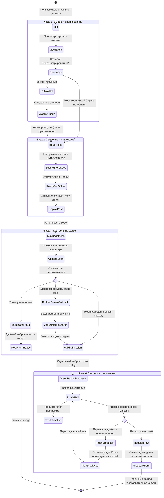

---
# Раздел 6. Комплект дизайн-макетов мобильного и веб-приложения

В соответствии с разделом 10 методических указаний выполнено проектирование модульных сеток и разработан комплект финальных цветных дизайн-макетов высокой точности (High-Fidelity UI Mockups) и структурных каркасов низкой точности (Low-Fidelity Wireframes) для ключевых экранов веб- и мобильного приложения.

---

### 6.1. Модульные сетки: Web (1440px), Планшет (980px), Смартфон (375x812px)

1. **Десктопная сетка (Web 1440px):**
   * Ширина базового артборда: **1440 px**;
   * 12-колоночная классическая модульная сетка Bootstrap / Tailwind;
   * Ширина колонки: **72 px**;
   * Межколонный интервал (Gutter): **24 px**;
   * Боковые поля (Margins): **72 px** с каждой стороны;
   * Вертикальный базовый ритм (Vertical Rhythm): **8 px**.
2. **Планшетная сетка (Tablet 980px):**
   * Ширина артборда: **980 px**;
   * 8-колоночная адаптивная сетка;
   * Ширина колонки: **92 px**, межколонник: **20 px**, боковые поля: **36 px**.
3. **Мобильная сетка (Mobile 375 × 812 px — iPhone / Android Retina):**
   * Ширина артборда: **375 px**, высота: **812 px**;
   * 4-колоночная модульная сетка;
   * Межколонный интервал (Gutter): **16 px**;
   * Боковые поля (Margins): **16 px**;
   * Базовая система отступов: **8-точечная сетка (8pt Soft Grid)** с микро-шагом 4px для плотных компонентов.

---

### 6.2. Дизайн-макеты высокого уровня детализации (UI Mockups)

Для презентации интерфейса экосистемы CampusMeet спроектированы 6 высокодетализированных дизайн-макетов в векторном формате SVG:

#### 1. Десктопный каталог IT-мероприятий и митапов (1440 × 960 px):
* **Файл макета:** `docs/assets/mockups/mockup_desktop_catalog.svg`
* **Особенности композиции:**
  * Верхняя полупрозрачная панель навигации (Glassmorphic Header) с градиентным логотипом ⚡ CampusMeet, ссылками навигации и строкой поиска `⌘K`;
  * Hero-баннер с градиентным свечением и индикаторами ключевых преимуществ экосистемы;
  * Левая боковая панель с кастомными чекбоксами фасетных фильтров по направлениям (`AI & ML`, `Web`, `Highload`) и переключателем «Только со свободными местами»;
  * Сетка карточек событий с цветными бейджами форматов, индикаторами Hard Cap квот и кнопками мгновенной регистрации.

<p align="center">
  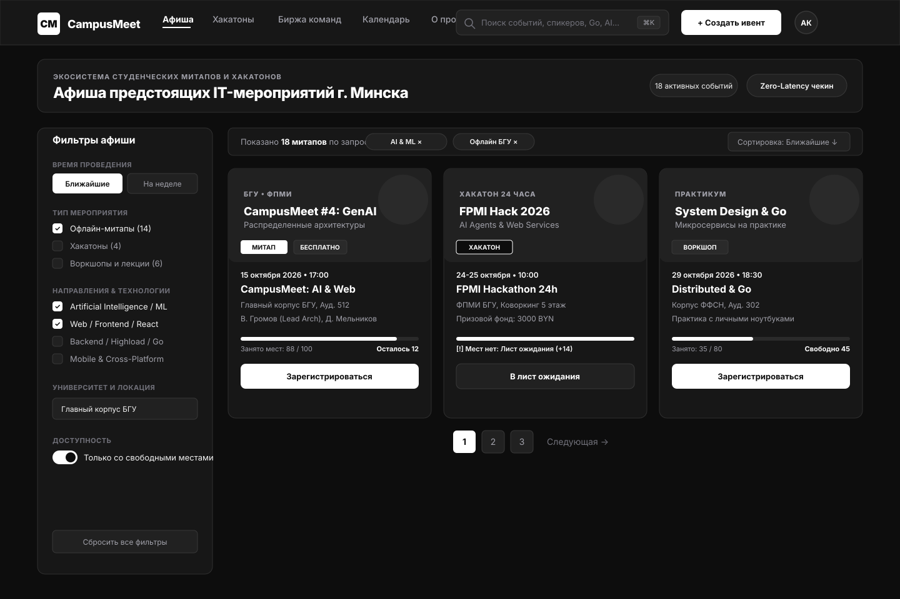
</p>

#### 2. Детальная страница митапа с таймлайном и картой (1440 × 1100 px):
* **Файл макета:** `docs/assets/mockups/mockup_desktop_event_details.svg`
* **Особенности композиции:**
  * Широкоформатный баннер митапа с акцентными бейджами «МИТАП», «БЕСПЛАТНО», «ОСТАЛОСЬ 12 МЕСТ»;
  * Двухколоночный лэйаут: левая колонка содержит интерактивный таймлайн докладов с цветной полосой треков, временем и аннотациями;
  * Правая плавающая (Sticky) колонка регистрации с наглядным прогресс-баром доступности мест, кнопкой «Зарегистрироваться в 1 клик», схемой проезда на базе интеграции с OpenStreetMap и кнопками экспорта в Google Calendar / Apple iCal.

<p align="center">
  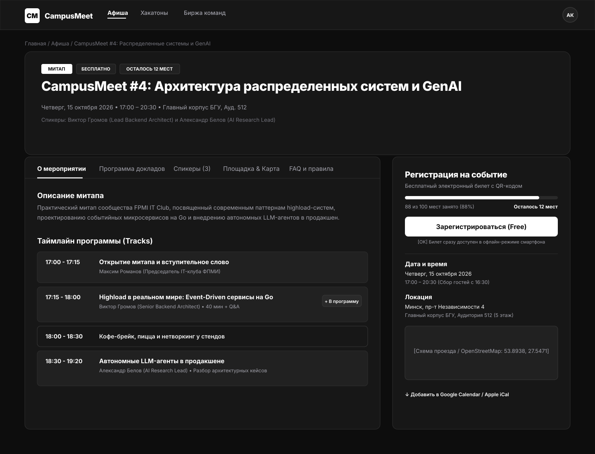
</p>

#### 3. Веб-кабинет организатора и Live Check-in дашборд (1440 × 960 px):
* **Файл макета:** `docs/assets/mockups/mockup_desktop_dashboard.svg`
* **Особенности композиции:**
  * Левый вертикальный Sidebar со всеми инструментами организатора (конструктор расписания, CFP, сканеры, отчеты);
  * 4 аналитические карточки KPI (Hard Cap 100/100, Прошли вход 88 чел. / 88%, Лист ожидания 14 чел., Скорость чекина 1.1 сек/гость);
  * Таблица потоковой верификации гостей в реальном времени с цветовой дифференциацией успешных чекинов и выделением попытки прохода по дубликату билета;
  * Яркая акцентная кнопка «🚨 Экстренное оповещение» для мгновенного вещания в 1 клик.

<p align="center">
  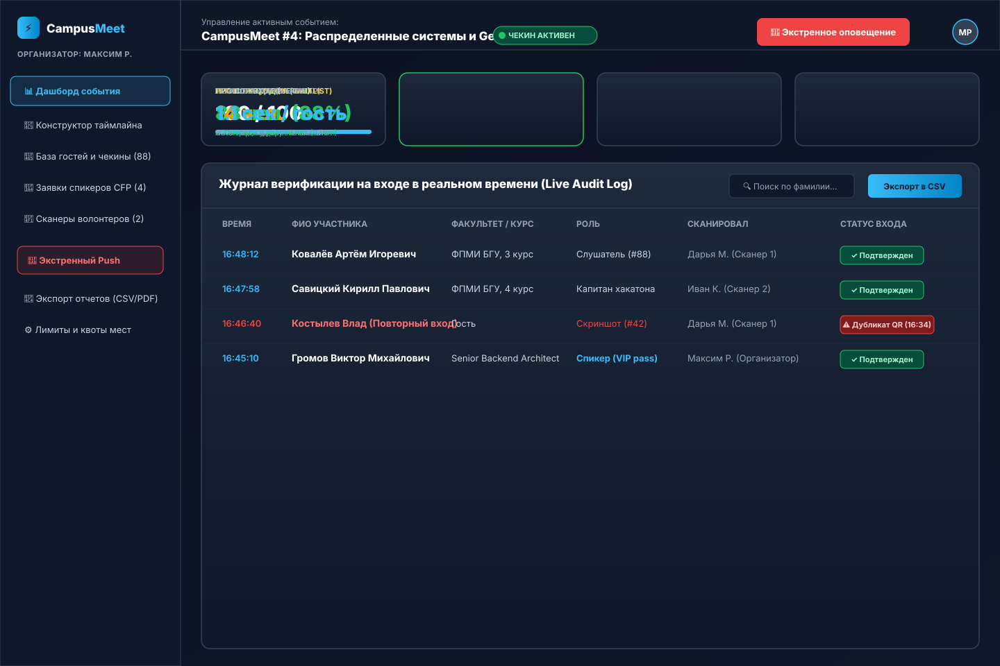
</p>

#### 4. Мобильная афиша событий на смартфоне (375 × 812 px):
* **Файл макета:** `docs/assets/mockups/mockup_mobile_catalog.svg`
* **Особенности композиции:**
  * Лаконичная шапка с поисковым полем и кнопкой уведомлений;
  * Горизонтальная карусель категорий в виде интерактивных «пилюль» (Все, AI & ML, Хакатоны, Web);
  * Вертикальный скролл-список карточек митапов с яркими градиентными подложками, таймингом и крупной кнопкой «Зарегистрироваться в 1 тап»;
  * Эргономичный нижний Bottom Tab Bar с 4 иконками, оптимизированный под естественную зону большого пальца.

<p align="center">
  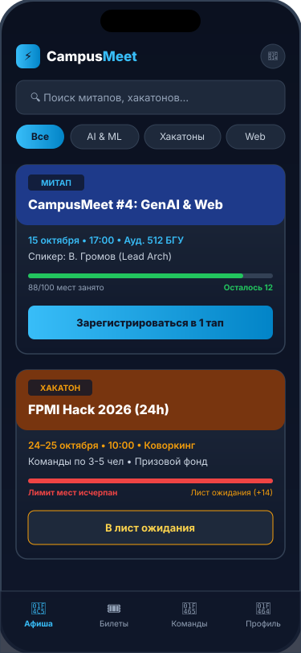
</p>

#### 5. Мобильный электронный билет с офлайн QR-кодом (375 × 812 px):
* **Файл макета:** `docs/assets/mockups/mockup_mobile_ticket.svg`
* **Особенности композиции:**
  * Зеленый статус-капсюль «OFFLINE-READY • Билет сохранен в памяти телефона»;
  * Стильная карточка электронного билета с перфорированными вырезами по бокам;
  * Контрастный матричный QR-код на белоснежном фоне со специальными угловыми маркерами позиционирования;
  * Индикаторы безопасности: HMAC-токен с таймером ротации (42с), уведомление о 100% авто-яркости экрана и кнопка «Add to Apple Wallet».

<p align="center">
  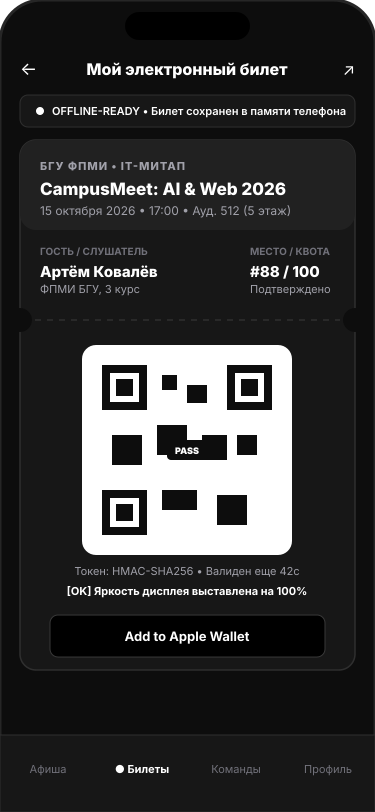
</p>

#### 6. Мобильный терминал сканера волонтера (375 × 812 px):
* **Файл макета:** `docs/assets/mockups/mockup_mobile_scanner.svg`
* **Особенности композиции:**
  * Полноэкранный темный видоискатель камеры с неоновой лазерной прицельной рамкой;
  * Верхняя панель со счетчиком смены (88 / 100) и индикатором автономного режима;
  * Нижний HUD-баннер мгновенного отклика с огромной зеленой галочкой, ФИО участника и местом в зале;
  * Вспомогательное поле быстрого ручного поиска по фамилии при повреждении экрана гостя и переключатели подсветки/звука.

<p align="center">
  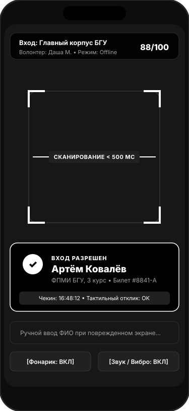
</p>

---

### 6.3. Каркасные макеты низкой точности (Wireframes), включая поисковый интерфейс

В комплекте проектных материалов представлены 6 структурных вайрфреймов, демонстрирующих взаимное расположение блоков, иерархию элементов и функциональную компоновку экранов до применения финальной графики:
1. `wireframe_desktop_catalog.svg` — 12-колоночная сетка каталога мероприятий с фасетной панелью;
2. `wireframe_desktop_event_details.svg` — детальная страница митапа с таймлайном и картой OpenStreetMap;
3. `wireframe_desktop_dashboard.svg` — панель аналитики организатора и потоковая таблица чекинов;
4. `wireframe_desktop_search_modal.svg` — поисковое окно Omnibox ⌘K с нечетким поиском Левенштейна и автодополнением;
5. `wireframe_mobile_ticket.svg` — структурная схема мобильного офлайн-билета участника;
6. `wireframe_mobile_scanner.svg` — компоновка HUD-элементов сканера волонтера.

---
# Раздел 7. Выходные документы и инструментарий разработки

В процессе выполнения Лабораторной работы №2 подготовлен полный комплект нормативных выходных документов, предусмотренных программой курса:

| № | Выходной документ | Содержание и состав документа | Местоположение в проекте |
|:---|:---|:---|:---|
| **1** | **Система организации контента** | Аудит контента (таблица CNT-01–CNT-10), тип интерфейса (монопольный, временный, фоновый), таксономия и иерархическая карта сайта (Sitemap, 4 уровня). | Раздел 2.1 отчета, диаграмма Mermaid |
| **2** | **Система именования** | Словарь терминов интерфейса (25 понятий), синтаксис меток, частотный анализ Яндекс.Вордстат, пиктограммы Lucide, схема Clean URLs, тезаурус. | Раздел 2.2 отчета |
| **3** | **Система навигации** | Результаты открытой карточной сортировки OptimalSort ($N=15$), 3 уровня навигации (глобальная, локальная, контекстная), карта навигации, User Flows, вайрфреймы. | Раздел 2.3 отчета, векторные SVG-файлы в `docs/assets/wireframes/` |
| **4** | **Система поиска и фильтрации** | Обоснование полнотекстового поиска, поисковый Omnibox ⌘K, нечеткий поиск Левенштейна ($D \le 2$), фасеты, формула релевантности метаданных, рекомендации, вайрфрейм поиска. | Раздел 2.4 отчета, `wireframe_desktop_search_modal.svg` |
| **5** | **Навигационные модели персонажей** | 7 индивидуальных маршрутов перемещения по системе для всех 7 синтезированных персон. | Раздел 3.1 отчета, диаграммы Mermaid |
| **6** | **Граф состояний главного меню** | 5 дискретных состояний меню (гость, слушатель, волонтер, организатор, администратор деканата) и условия перехода. | Раздел 3.2 отчета, stateDiagram-v2 |
| **7** | **Общая диаграмма путей (Site-wide Path)** | Сквозной маршрут пользователя от точки входа до завершения мероприятия и отчета. | Раздел 3.3 отчета, flowchart TB |
| **8** | **Карта влияния (Impact Map)** | Дерево декомпозиции: Цели → Акторы (все 7 персон) → Воздействия → Поставляемый функционал (Deliverables). | Раздел 4.1 отчета, Mermaid Diagram |
| **9** | **Карты пути клиента (CJM)** | 7 подробных таблиц клиентского пути по 5 фазам с эмоциями, барьерами и решениями для всех 7 персонажей (Артём, Дарья, Максим, Кирилл, Виктор, С.Н. Котов, Влад). | Раздел 4.2 отчета (4.2.1–4.2.7) |
| **10** | **Интерактивные раскадровки (Storyboards)** | 7 четырехкадровых раскадровок с поведением системы для всех 7 персонажей. | Раздел 5.1 отчета (5.1.1–5.1.7) |
| **11** | **Проверочные сценарии (Edge Cases)** | 7 стресс-сценариев (VS-01–VS-07): сбои сети, дубликаты, треснувший экран, овербукинг, форс-мажор, опоздание спикера, некомплект команды. | Раздел 5.2 отчета |
| **12** | **Совокупная диаграмма взаимодействия** | Конечный автомат сквозного взаимодействия системы, объединяющий happy-path и проверочные ветви. | Раздел 5.3 отчета, stateDiagram-v2 |
| **13** | **Комплект дизайн-макетов (Mockups)** | 6 цветных high-fidelity макетов (1440px десктоп и 375px мобайл) и 6 low-fidelity вайрфреймов. | `docs/assets/mockups/` и `docs/assets/wireframes/` |
| **14** | **Интерактивный SPA-портал** | Веб-портал со всеми диаграммами, галереей персонажей, опросом N=68 и макетами. | `docs/index.html` (локальный и GitHub Pages) |

---

### Применяемый инструментарий разработки:
* **OptimalSort (Optimal Workshop):** Проведение открытой карточной сортировки на выборке $N=15$ респондентов с расчетом матрицы сходства и дендрограммы;
* **Mermaid.js / PlantUML:** Декларативное моделирование информационных графов, диаграмм путей, ERD, State Machine и sequence-диаграмм;
* **Figma / Vector SVG:** Проектирование модульных сеток 1440px и 375x812px, компоновка структурных каркасов и цветных дизайн-макетов;
* **Яндекс.Вордстат:** Статистический анализ поискового спроса для формирования естественного словаря меток интерфейса;
* **Python 3:** Автоматизация генерации векторных ассетов, валидация синтаксиса и парсинг структуры документов.

---

# Раздел 8. Заключение и выводы

В ходе выполнения Лабораторной работы №2 была решена задача перехода от аналитических исследований пользователей и предметной области (Лабораторная работа №1) к **строгому концептуальному и структурному проектированию интерфейса экосистемы CampusMeet / EventHub**:

1. **Информационная архитектура:** Разработана 4-уровневая структура навигации и каталогизации контента. Синтезирована таксономия и фасетная система фильтрации, полностью удовлетворяющая принципам Луиса Розенфельда и Питера Морвиля.
2. **Семантическая стандартизация:** Сформирован нормативный словарь интерфейса из 25 терминов, проверенный через реальные частотные запросы в Яндекс.Вордстат, исключающий двусмысленность и терминологический шум.
3. **Эмпирическая валидация ментальных моделей:** На основе исследования открытой карточной сортировки в OptimalSort ($N=15$, 35 карточек) выявлены естественные пользовательские кластеры («Афиша», «Мой билет», «Команды», «Кабинет организатора»), что легло в основу структуры главного меню.
4. **Многоуровневая навигация и поиск:** Спроектирована гибкая система навигации (глобальная, локальная, контекстная, вспомогательная) с адаптацией десктопного 12-колоночного меню к мобильному 4-вкладочному таб-бару (Thumb Zone). Разработан интеллектуальный Omnibox с поддержкой нечеткого поиска Левенштейна ($D \le 2$).
5. **Сквозное моделирование взаимодействия:** Построены навигационные модели, Impact Map, подробные CJM и интерактивные раскадровки для всех 7 персонажей проекта. Специфицированы 7 критических проверочных сценариев (Edge Cases), гарантирующих надежность системы при сбоях сети, овербукинге и попытках мошенничества.
6. **Прототипирование высокой точности:** Разработан комплект из 12 векторных SVG-макетов (6 вайрфреймов и 6 цветных UI Mockups), спроектированных по стандарту сеток Bootstrap 1440px и 8pt Soft Grid iOS/Android.

Все материалы синхронизированы с интерактивным веб-порталом [`docs/index.html`](file:///home/shvarsman/hci/CampusMeet/docs/index.html) и зафиксированы в Git-ветке `lab2`.

---

# Список использованных источников

1. Мандел Т. Разработка пользовательского интерфейса: пер. с англ. / Т. Мандел. — М.: ДМК Пресс, 2001. — 416 с.: ил.
2. Купер А., Рейман Р., Кронин Д. Алан Купер об интерфейсе. Основы проектирования взаимодействия. — Пер. с англ. — СПб.: Символ-Плюс, 2009. — 688 с.: ил.
3. Гарретт Дж. Веб-дизайн: элементы опыта взаимодействия. — Пер. с англ. — СПб.: Символ-Плюс, 2008. — 192 с.: ил.
4. Тидвелл Дж. Разработка пользовательских интерфейсов. — СПб.: Питер, 2008. — 416 с.: ил.
5. Розенфельд Л., Морвиль П. Информационная архитектура в Интернет, 2-е издание. — Пер. с англ. — СПб: Символ-Плюс, 2005. — 544 с.
6. Adzic G. Impact Mapping: Making a big impact with software products and projects. — Provoking Thoughts, 2012. — 86 p.
7. Kalbach J. Mapping Experiences: A Complete Guide to Creating Value through Journeys, Blueprints, and Diagrams. — O'Reilly Media, 2016. — 384 p.
8. Nielsen Norman Group. Card Sorting: Uncovering a User’s Mental Model of Your Website. — URL: https://www.nngroup.com/articles/card-sorting-definition/
9. OpenStreetMap Nominatim API Documentation. — URL: https://nominatim.org/release-docs/latest/api/Overview/
10. Nager.Date Public Holidays Worldwide REST API. — URL: https://date.nager.at/
