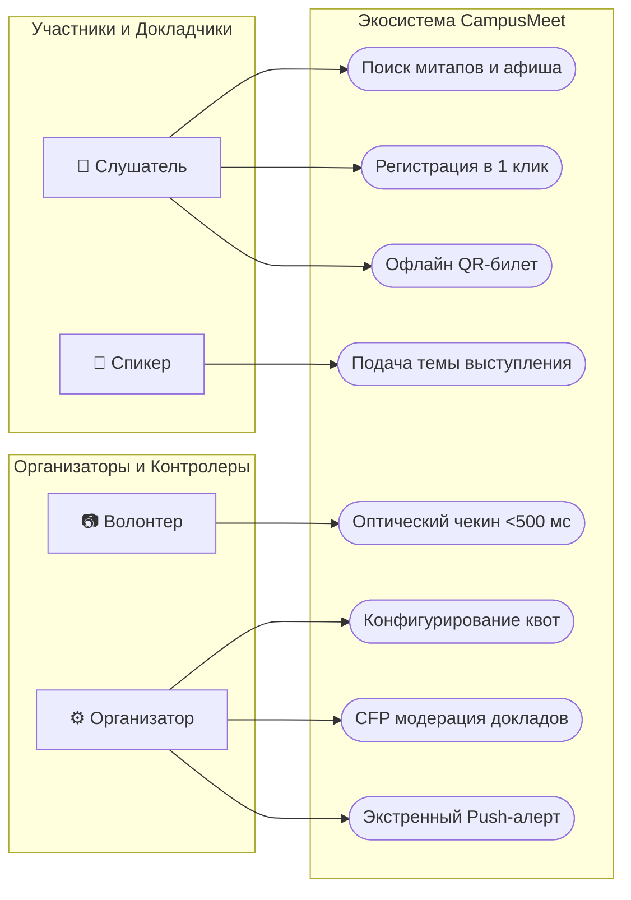
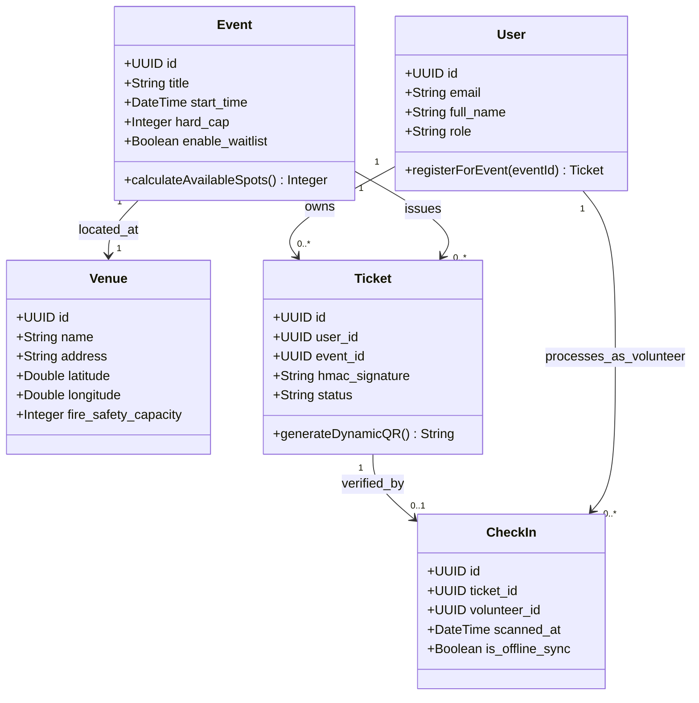

# БЕЛОРУССКИЙ ГОСУДАРСТВЕННЫЙ УНИВЕРСИТЕТ
## Факультет прикладной математики и информатики
### Кафедра технологий программирования

---

# ОТЧЕТ ПО ЛАБОРАТОРНОЙ РАБОТЕ №3
### По курсу: «Проектирование человеко-машинных интерфейсов» (ПЧМИ)
## Тема: «Разработка требований к программной системе и проектирование архитектуры экосистемы CampusMeet / EventHub (Платформа организации студенческих митапов, хакатонов и офлайн-контроля билетов)»

---

## ОГЛАВЛЕНИЕ

1. [Введение. Цели и задачи лабораторной работы №3](#введение-цели-и-задачи-лабораторной-работы-3)
2. [Раздел 1. Разработка требований в виде пользовательских историй (User Stories & BDD)](#раздел-1-разработка-требований-в-виде-пользовательских-историй-user-stories--bdd)
   - [1.1. Краткое описание экосистемы и ролевая модель](#11-краткое-описание-экосистемы-и-ролевая-модель)
   - [1.2. Спецификация 5 ключевых сценариев использования и User Stories](#12-спецификация-5-ключевых-сценариев-использования-и-user-stories)
   - [1.3. Блоки критериев приёмки (Acceptance Criteria в формате Given-When-Then)](#13-блоки-критериев-приёмки-acceptance-criteria-в-формате-given-when-then)
   - [1.4. Платформенные различия (Mobile vs Web)](#14-платформенные-различия-mobile-vs-web)
   - [1.5. Приоритеты MoSCoW и граф зависимостей между историями](#15-приоритеты-moscow-и-граф-зависимостей-между-историями)
3. [Раздел 2. Разработка спецификации системы с использованием PlantUML (базовый набор)](#раздел-2-разработка-спецификации-системы-с-использованием-plantuml-базовый-набор)
   - [2.1. Базовая диаграмма вариантов использования (Use Case)](#21-базовая-диаграмма-вариантов-использования-use-case)
   - [2.2. Базовая диаграмма деятельности (Activity)](#22-базовая-диаграмма-деятельности-activity)
   - [2.3. Базовая диаграмма классов (Class)](#23-базовая-диаграмма-классов-class)
   - [2.4. Пояснительная записка для команды разработки и стейкхолдеров](#24-пояснительная-записка-для-команды-разработки-и-стейкхолдеров)
4. [Раздел 3. Разработка спецификации системы с использованием Mermaid](#раздел-3-разработка-спецификации-системы-с-использованием-mermaid)
   - [3.1. Mermaid Use Case диаграмма](#31-mermaid-use-case-диаграмма)
   - [3.2. Mermaid диаграмма последовательности оптического чекина](#32-mermaid-диаграмма-последовательности-оптического-чекина)
   - [3.3. Mermaid диаграмма классов доменной модели](#33-mermaid-диаграмма-классов-доменной-модели)
5. [Раздел 4. Разработка спецификации с использованием PlantUML, Mermaid и ИИ-агентов](#раздел-4-разработка-спецификации-с-использованием-plantuml-mermaid-и-ии-агентов)
   - [4.1. Разработка специализированных промптов для ИИ (User Story, UML, SRS)](#41-разработка-специализированных-промптов-для-ии-user-story-uml-srs)
   - [4.2. Демонстрация AI Skills for System Analyst (методика SARD)](#42-демонстрация-ai-skills-for-system-analyst-методика-sard)
   - [4.3. Расширенный набор пользовательских историй (US-10..12)](#43-расширенный-набор-пользовательских-историй-us-1012)
   - [4.4. Детальные спецификации сценариев Use Case по Коберну / ГОСТ (UC-01..05)](#44-детальные-спецификации-сценариев-use-case-по-коберну--гост-uc-0105)
   - [4.5. Расширенный комплекс диаграмм PlantUML (29 диаграмм)](#45-расширенный-комплекс-диаграмм-plantuml-29-диаграмм)
     - [4.5.1. Диаграммы деятельности (Activity)](#451-диаграммы-деятельности-activity)
     - [4.5.2. Диаграммы классов и объектов (Class & Object)](#452-диаграммы-классов-и-объектов-class--object)
     - [4.5.3. Диаграммы последовательности (Sequence)](#453-диаграммы-последовательности-sequence)
     - [4.5.4. Диаграммы компонентов, пакетов и развертывания](#454-диаграммы-компонентов-пакетов-и-развертывания)
     - [4.5.5. Реляционная схема базы данных (ERD)](#455-реляционная-схема-базы-данных-erd)
6. [Раздел 5. Проектирование системы на основе метода EventStorming](#раздел-5-проектирование-системы-на-основе-метода-eventstorming)
   - [5.1. Теоретическая основа и цветовая нотация Альберто Брандолини](#51-теоретическая-основа-и-цветовая-нотация-альберто-брандолини)
   - [5.2. Уровень 1: Крупномасштабное исследование (Big Picture) и Hotspots](#52-уровень-1-крупномасштабное-исследование-big-picture-и-hotspots)
   - [5.3. Уровень 2: Моделирование процессов (Process Modeling) и Политики](#53-уровень-2-моделирование-процессов-process-modeling-и-политики)
   - [5.4. Уровень 3: Проектирование архитектуры (Software Design) и Bounded Contexts](#54-уровень-3-проектирование-архитектуры-software-design-и-bounded-contexts)
7. [Раздел 6. Проектирование системы с применением метода Event Modeling](#раздел-6-проектирование-системы-с-применением-метода-event-modeling)
   - [6.1. Методология Адама Димитрука и информационные срезы (Slices)](#61-методология-адама-димитрука-и-информационные-срезы-slices)
   - [6.2. Спецификация 4 шаблонов: Command, View, Automation, Translation](#62-спецификация-4-шаблонов-command-view-automation-translation)
   - [6.3. Интеграция с BDD и трассировка данных](#63-интеграция-с-bdd-и-трассировка-данных)
8. [Раздел 7. Описание архитектуры системы с использованием подхода C4 Model](#раздел-7-описание-архитектуры-системы-с-использованием-подхода-c4-model)
   - [7.1. Методология C4 Саймона Брауна](#71-методология-c4-саймона-брауна)
   - [7.2. C1: Системный контекст (System Context Diagram)](#72-c1-системный-контекст-system-context-diagram)
   - [7.3. C2: Диаграмма контейнеров (Container Diagram)](#73-c2-диаграмма-контейнеров-container-diagram)
   - [7.4. C3: Диаграмма компонентов API Gateway & Core Service](#74-c3-диаграмма-компонентов-api-gateway--core-service)
   - [7.5. C4: Диаграмма уровня кода (Code Level — TicketCryptoEngine)](#75-c4-диаграмма-уровня-кода-code-level--ticketcryptoengine)
9. [Раздел 8. Техническое задание на разработку приложения (SRS по Карлу Вигерсу / IEEE 830)](#раздел-8-техническое-задание-на-разработку-приложения-srs-по-карлу-вигерсу--ieee-830)
   - [8.1. Введение, общие соглашения и границы](#81-введение-общие-соглашения-и-границы)
   - [8.2. Общее описание, классы пользователей и операционная среда](#82-общее-описание-классы-пользователей-и-операционная-среда)
   - [8.3. Функциональные требования по подсистемам (FR-CAT, FR-TCK, FR-SCN, FR-EXT, FR-NTF)](#83-функциональные-требования-по-подсистемам-fr-cat-fr-tck-fr-scn-fr-ext-fr-ntf)
   - [8.4. Требования к данным, словарь и регламент утилизации](#84-требования-к-данным-словарь-и-регламент-утилизации)
   - [8.5. Внешние интерфейсы (Web/Mobile UI, REST API, датчики камеры, вибромотор)](#85-внешние-интерфейсы-webmobile-ui-rest-api-датчики-камеры-вибромотор)
   - [8.6. Атрибуты качества системы (WCAG 2.1 AA, скорость чекина <500 мс, HMAC-SHA256, Offline-First)](#86-атрибуты-качества-системы-wcag-21-aa-скорость-чекина-500-мс-hmac-sha256-offline-first)
   - [8.7. Приложение А: Глоссарий терминов](#87-приложение-а-глоссарий-терминов)
   - [8.8. Приложение Б: Сводная матрица трассируемости требований](#88-приложение-б-сводная-матрица-трассируемости-требований)
10. [Раздел 9. Выходные документы и инструментарий разработки](#раздел-9-выходные-документы-и-инструментарий-разработки)
11. [Раздел 10. Заключение и выводы](#раздел-10-заключение-и-выводы)
12. [Список использованных источников](#список-использованных-источников)

---

# Введение. Цели и задачи лабораторной работы №3

Лабораторная работа №3 посвящена **разработке требований к программной системе и системному проектированию архитектуры** для кроссплатформенной экосистемы **CampusMeet / EventHub**.

### Входные данные:
* Результаты социологического исследования студенческой выборки ($N=68$), подтвердившие критическую проблему очередей на входе (73.5% респондентов) и отсутствия мобильного интернета в подвальных лекционных аудиториях (61.8%) из Лабораторной работы №1.
* Информационная архитектура, карты пользовательского пути (CJM) для всех 7 синтезированных персонажей, раскадровки (Storyboards) и комплект из 12 макетов (векторные Wireframes и High-Fidelity UI Mockups) из Лабораторной работы №2.

### Цели работы:
1. Разработать детальные функциональные и нефункциональные требования в виде пользовательских историй (User Stories) с критериями приёмки в формате **Given-When-Then (BDD)**.
2. Освоить и применить язык графического моделирования **PlantUML** и нотацию **Mermaid** для спецификации вариантов использования, деятельности и классов.
3. Разработать системные промпты и продемонстрировать применение агентных навыков системного аналитика (**AI Skills for System Analyst**) по методологии SARD для генерации расширенного аналитического комплекса диаграмм (Use Case, Activity, Classes, Sequence, Component, Package, Deployment, ERD).
4. Провести доменное исследование предметной области методом **EventStorming** (Альберто Брандолини) на уровнях Big Picture, Process Modeling и Software Design.
5. Спроектировать информационные срезы экосистемы методом **Event Modeling** (Адам Димитрук) с использованием 4 фундаментальных шаблонов (Command, View, Automation, Translation Patterns).
6. Описать архитектуру системы с применением многоуровневого подхода **C4 Model** (Саймон Браун): Context (C1), Container (C2), Component (C3) и Code (C4).
7. Разработать нормативное техническое задание (SRS) по стандарту **IEEE 830 / Карлу Вигерсу** со словарем данных и матрицей трассируемости требований.
8. Опубликовать проектную базу знаний в **GitHub Wiki** и актуализировать интерактивный SPA-портал **GitHub Pages**.

---

# Раздел 1. Разработка требований в виде пользовательских историй (User Stories & BDD)

## 1.1. Краткое описание экосистемы и ролевая модель

**CampusMeet (EventHub)** — кроссплатформенная экосистема для локальных студенческих и IT-сообществ, обеспечивающая сквозной цикл организации митапов, хакатонов и открытых лекций. Архитектура объединяет десктопный Web-кабинет для комплексного администрирования событий и нативное мобильное приложение (iOS/Android) с Offline-First доступом к динамическому билету, оптическим сканером прохода (<500 мс) и интерактивным таймингом «Моя программа».

### Ролевая модель экосистемы:
1. **Слушатель (Attendee):** Студент или IT-специалист, ищущий события в каталоге, регистрирующийся в 1 клик и открывающий криптографический билет без интернета.
2. **Волонтер-контролер (Volunteer):** Дежурный на входе в аудиторию, осуществляющий потоковый чекин мобильной камерой со звуковым и тактильным откликом.
3. **Главный организатор (Organizer):** Координатор митапа, управляющий карточками событий, квотами мест, CFP-заявками и экстренными рассылками.
4. **Капитан команды хакатона (Hacker Lead):** Студент-разработчик, регистрирующий команду и привлекающий специалистов через биржу навыков.
5. **Приглашенный спикер (Speaker):** Эксперт, подающий заявку на выступление через CFP и прикрепляющий презентацию.
6. **Администратор площадки (Patron):** Представитель деканата, контролирующий вместимость аудиторий и получающий отчетность.

---

## 1.2. Спецификация 5 ключевых сценариев использования и User Stories

### Сценарий 1: Первичная регистрация и получение офлайн-билета (Новый пользователь / Слушатель)
* **US-01:** *«Как студент-слушатель, я хочу зарегистрироваться на интересующий митап в одно нажатие при заполненном профиле, чтобы гарантировать себе посадочное место в аудитории и не тратить время на повторный ввод анкетных данных».* (Приоритет: High).
* **US-02:** *«Как участник митапа, я хочу иметь доступ к своему персональному QR-билету без подключения к интернету, чтобы беспрепятственно пройти через стойку регистрации в цокольной лекционной аудитории без сотовой связи».* (Приоритет: High).

### Сценарий 2: Потоковый оптический чекин на входе (Волонтер-контролер)
* **US-03:** *«Как волонтер на входе, я хочу сканировать QR-коды участников через встроенную камеру смартфона с мгновенным откликом, чтобы ликвидировать скопление людей у дверей и пропускать не менее 40 человек в минуту».* (Приоритет: High).
* **US-04:** *«Как волонтер, я хочу, чтобы сканер определял подлинность билетов и факт повторного использования без доступа к серверу, чтобы исключить мошеннический проход по скриншотам чужих билетов при отсутствии интернета на площадке».* (Приоритет: High).

### Сценарий 3: Создание события, квотирование и внешние интеграции (Организатор)
* **US-05:** *«Как организатор, я хочу создавать событие с автоматической проверкой адреса через OSM Nominatim и производственного календаря через Nager.Date, чтобы площадка гарантированно существовала на карте, а дата не конфликтовала с государственными праздниками Республики Беларусь».* (Приоритет: Medium).
* **US-06:** *«Как организатор, я хочу задавать жесткий лимит доступных мест (Hard Cap) и включать автоматическую очередь ожидания, чтобы исключить нарушение требований пожарной безопасности аудитории и автоматически добирать гостей при отказах».* (Приоритет: High).

### Сценарий 4: Мэтчинг команд хакатона по стеку навыков (Капитан команды)
* **US-07:** *«Как капитан команды хакатона, я хочу опубликовать карточку своей команды с указанием недостающих ролей (ML-инженер, UI/UX дизайнер), чтобы быстро найти сильных тиммейтов среди зарегистрированных студентов».* (Приоритет: Medium).

### Сценарий 5: Сквозная навигация и экстренные оповещения (Организатор и Администратор)
* **US-08:** *«Как пользователь веб-кабинета, я хочу вызывать сквозной поисковый омнибокс сочетанием клавиш ⌘K/Ctrl+K, чтобы мгновенно находить митапы, спикеров, аудитории и разделы управления без ручного серфинга по меню».* (Приоритет: Medium).
* **US-09:** *«Как организатор митапа, я хочу отправить срочное системное Push-уведомление всем зарегистрированным гостям в один клик, чтобы оперативно известить аудиторию о переносе доклада или смене аудитории».* (Приоритет: High).

---

## 1.3. Блоки критериев приёмки (Acceptance Criteria в формате Given-When-Then)

Каждая пользовательская история содержит от 4 до 5 проверяемых критериев:
* **AC для US-01 (Регистрация в 1 клик):**
  1. *Given:* Пользователь авторизован и на карточке события `free_spots > 0`. *When:* Нажимает «Зарегистрироваться». *Then:* `free_spots` уменьшается на 1, статус становится `CONFIRMED`, появляется баннер «Билет забронирован».
  2. Если квота исчерпана в момент клика конкурентным запросом, транзакция атомарно откатывается и выводится модальное окно постановки в Waitlist.
  3. Повторный клик блокируется интерфейсом («Вы уже зарегистрированы»).
  4. В течение 10 секунд отправляется транзакционное email-подтверждение.
  5. Время выполнения API-запроса не превышает 800 мс на сети 4G.
* **AC для US-02 (Offline-First билет):**
  1. Криптографический токен билета сохраняется в `SecureStore` (iOS Keychain / Android Keystore).
  2. При включенном «Авиарежиме» экран билета открывается быстрее 300 мс и выводит валидный QR-код.
  3. Яркость дисплея автоматически повышается до 100% при открытии экрана билета.
  4. Под QR-кодом отображается 6-значный резервный код (например, `CMP-AI9-421`).
* **AC для US-03 (Оптический сканер <500 мс):**
  1. Время распознавания QR-кода видеопотоком камеры составляет не более 500 мс.
  2. При успешном сканировании экран вспыхивает зеленым (`#16A34A`), воспроизводится сигнал 880 Гц и одинарная вибрация.
  3. Крупным шрифтом выводится имя, факультет и категория бейджа гостя.
* **AC для US-04 (Офлайн-валидация и дубликаты):**
  1. Подлинность билета вычисляется локально через `HMAC-SHA256` по открытой соли события.
  2. При повторном предъявлении билета экран окрашивается в желтый цвет (`#CA8A04`), вибромотор выдает 3 импульса, выводится точное время первого прохода.
  3. Офлайн-записи сохраняются в локальный SQLite-журнал и пачками синхронизируются с сервером.
* **AC для US-06 (Квоты и Waitlist):**
  1. `hard_cap` не может превышать физическую вместимость зала `Venue.fire_safety_capacity`.
  2. При отмене бронирования участником система автоматически переводит первого пользователя из Waitlist в статус `CONFIRMED` и рассылает уведомление с 12-часовым таймером.

---

## 1.4. Платформенные различия (Mobile vs Web)

| Аспект архитектуры и интерфейса | Нативный мобильный клиент (Mobile App) | Десктопный веб-кабинет (Web App) |
|:---|:---|:---|
| **Экран и сетка** | Вертикальный вьюпорт (375×812 pt), 8pt сетка, Safe Area под вырез камеры. | Десктопные дисплеи (1366px — 4K), 12-колоночная адаптивная сетка 1440px. |
| **Взаимодействие и жесты** | Сенсорные жесты: Pull-to-Refresh, Swipe карточек, Long Press, зоны Thumb Zone. | Мышь и клавиатура: Hover-состояния, Drag-and-Drop конструктор сетки, колесо мыши. |
| **Горячие клавиши** | Отсутствуют (акцент на одноручное управление пальцем). | Сквозной поиск `⌘K`/`Ctrl+K`, закрытие модальных окон клавишей `Esc`. |
| **Офлайн-режим** | **Полный Offline-First:** кеширование в `SecureStore`, локальная SQLite БД чекинов. | **Offline-Aware:** Service Worker кеш, баннер потери сети, автосохранение черновиков. |
| **Сенсоры и датчики** | 60 fps видеокамера, тактильный вибромотор (Haptic Feedback), авто-яркость 100%. | Отсутствует доступ к вибромотору; веб-камера используется только как запасной вариант. |
| **Доставка уведомлений** | Системные push-уведомления (APNs / FCM), локальные напоминания за 15 мин до доклада. | Toast-уведомления в интерфейсе, браузерные Web Push (при согласии), email-рассылки. |
| **Доступность (A11y)** | VoiceOver и TalkBack, минимальная область тапа $44 \times 44$ pt. | WCAG 2.1 AA: контраст $\ge 4.5:1$, семантические теги HTML5, полный Tab-фокус. |

---

## 1.5. Приоритеты MoSCoW и граф зависимостей между историями

* **Must Have:** `US-01` (Регистрация), `US-02` (Offline-билет), `US-03` (Сканер <500 мс), `US-04` (Офлайн-валидация и дубликаты), `US-06` (Квоты и Waitlist), `US-09` (Экстренный Push).
* **Should Have:** `US-05` (Валидация OSM и Nager.Date), `US-07` (Биржа команд хакатона).
* **Could Have:** `US-08` (Сквозной омнибокс ⌘K).

```text
[US-05: Создание митапа] ──► [US-06: Настройка квот и Waitlist] ──► [US-01: Регистрация]
                                                                           │
                                                                           ▼
                                                             [US-02: Выпуск Offline-билета]
                                                                           │
                                            ┌──────────────────────────────┴──────────────────────────────┐
                                            ▼                                                             ▼
                             [US-03: Оптический сканер]                                    [US-09: Экстренный Push]
                                            │
                                            ▼
                             [US-04: Офлайн-валидация и дубликаты]
```

---


# Раздел 2. Разработка спецификации системы с использованием PlantUML (базовый набор)

В соответствии с Заданием 2 разработаны три базовые диаграммы на языке PlantUML. Исходные коды сохранены в репозитории:
* `docs/diagrams/puml/use_cases/use_case_base.puml`
* `docs/diagrams/puml/activity/activity_base.puml`
* `docs/diagrams/puml/classes/class_base.puml`

## 2.1. Базовая диаграмма вариантов использования (Use Case)

Диаграмма структурирует границы системы и акторов: Слушатель, Волонтер, Организатор и Спикер.

```plantuml
@startuml
skinparam packageStyle rectangle
skinparam defaultFontName "Helvetica, Arial, sans-serif"

actor "Слушатель (Attendee)" as Attendee
actor "Волонтер (Volunteer)" as Volunteer
actor "Организатор (Organizer)" as Organizer
actor "Спикер (Speaker)" as Speaker

rectangle "Экосистема CampusMeet" {
    usecase "UC-B1: Просмотр каталога\nи поиск митапов" as UC_Catalog
    usecase "UC-B2: Регистрация на событие\nи получение билета" as UC_Register
    usecase "UC-B3: Просмотр билета\nв офлайн-режиме" as UC_OfflineTicket
    usecase "UC-B4: Оптическое сканирование\nQR-билета камерой" as UC_ScanTicket
    usecase "UC-B5: Создание митапа и\nуправление квотами" as UC_CreateEvent
    usecase "UC-B6: Модерация заявок\nдокладчиков (CFP)" as UC_ModerateCFP
    usecase "UC-B7: Подача заявки на доклад" as UC_SubmitTalk
    usecase "UC-B8: Отправка экстренного\nPush-оповещения" as UC_EmergencyPush
}

Attendee --> UC_Catalog
Attendee --> UC_Register
Attendee --> UC_OfflineTicket

Volunteer --> UC_ScanTicket

Organizer --> UC_CreateEvent
Organizer --> UC_ModerateCFP
Organizer --> UC_EmergencyPush

Speaker --> UC_SubmitTalk
@enduml
```



## 2.2. Базовая диаграмма деятельности (Activity)

Диаграмма описывает магистральный путь участника: выбор события в афише, проверка доступности квот, резервирование слота и выпуск динамического QR-билета, предъявление экрана на максимальной яркости волонтеру, оптическое считывание камерой (<500 мс) и допуск в зал.

## 2.3. Базовая диаграмма классов (Class)

Определяет 5 фундаментальных сущностей доменной модели: `User`, `Event`, `Venue`, `Ticket`, `CheckIn`. Задает типы атрибутов, модификаторы доступа и кардинальности ассоциативных связей.

## 2.4. Пояснительная записка для команды разработки и стейкхолдеров

Базовый комплект диаграмм формирует единый семантический язык (Ubiquitous Language) для разработчиков клиентской части (Next.js и React Native) и серверной части (FastAPI). Выделение сущностей `Ticket` и `CheckIn` в отдельные классы изолирует логику владения билетом от факта его физического использования контролером на площадке.

---

# Раздел 3. Разработка спецификации системы с использованием Mermaid

В соответствии с Заданием 3 базовые модели переведены в нотацию Mermaid для интеграции в интерактивный веб-портал документации и Markdown-реестры GitHub.

## 3.1. Mermaid Use Case диаграмма



## 3.2. Mermaid диаграмма последовательности оптического чекина

```mermaid
sequenceDiagram
    autonumber
    actor Attendee as 👤 Слушатель (Артём)
    actor Volunteer as 📷 Волонтер (Дарья)
    participant Scanner as 📱 Сканер (Expo)
    participant Validator as 🔐 HMAC Валидатор
    participant LocalDB as 💾 SQLite Локальный кеш
    participant Server as ☁️ Сервер (FastAPI)

    Attendee->>Scanner: Предъявление экрана с QR-кодом
    activate Scanner
    Scanner->>Scanner: Захват видеопотока и парсинг токена (&lt;120 мс)
    Scanner->>Validator: Проверка подписи {ticket_id, salt, sig}
    activate Validator
    Validator->>Validator: Вычисление HMAC-SHA256(payload, salt)
    Validator-->>Scanner: Подпись валидна
    deactivate Validator

    Scanner->>LocalDB: SELECT * FROM local_scans WHERE ticket_id = ?
    activate LocalDB
    alt Билет уже использован ранее
        LocalDB-->>Scanner: Запись найдена (18:04:12)
        Scanner-->>Volunteer: 🟡 ЖЕЛТЫЙ экран + вибро-алерт: Повторный проход!
    else Первичный проход
        LocalDB-->>Scanner: Запись отсутствует
        Scanner->>LocalDB: INSERT INTO local_scans (ticket_id, status='OK')
        LocalDB-->>Scanner: Сохранено локально
        deactivate LocalDB
        Scanner-->>Volunteer: 🟢 ЗЕЛЕНЫЙ экран + вибро-клик (&lt;500 мс)
        Volunteer-->>Attendee: Допуск в аудиторию
    end

    Scanner--)Server: Фоновая синхронизация пачки чекинов при появлении сети
    deactivate Scanner
```

## 3.3. Mermaid диаграмма классов доменной модели



---

# Раздел 4. Разработка спецификации с использованием PlantUML, Mermaid и ИИ-агентов

## 4.1. Разработка специализированных промптов для ИИ (User Story, UML, SRS)

В рамках Задания 4 спроектирована библиотека системных промптов для ИИ-агента аналитика:
1. **Промпт №1 (User Story & BDD Generator):** Ролевая инструкция Principal Business Analyst для синтеза историй по Майку Кону с проверкой по критериям INVEST, 4–7 критериями приёмки Given-When-Then, платформенными различиями и шкалой MoSCoW.
2. **Промпт №2 (PlantUML Diagram Architect):** Специализированные системные инструкции для каждого вида диаграмм (Use Case, Activity, Class, Sequence, Component, Package, Deployment, ERD) с регламентом стилей Neo-Swiss, строгим синтаксисом модификаторов доступа и компилируемостью.
3. **Промпт №3 (SRS Technical Specification Generator):** Инструкция нормативного аналитика по разработке разделов ТЗ по стандарту IEEE 830 / ISO/IEC/IEEE 29148 / Карлу Вигерсу.

Полный текст промптов зафиксирован в [wiki/AI_Engineering_Prompts.md](../../wiki/AI_Engineering_Prompts.md).

## 4.2. Демонстрация AI Skills for System Analyst (методика SARD)

Агентное моделирование позволило реализовать:
* **Контекстную декомпозицию (Chain-of-Thought):** Выделение критических физических барьеров (экранирование радиосигнала в цокольных этажах корпуса) и трансформация их в архитектурный инвариант автономной валидации билетов.
* **Семантический аудит согласованности (Self-Consistency):** Перекрестная валидация полей схемы `database/schema.sql` (поля `hard_cap`, `secret_salt`, `fire_safety_capacity`) с методами классов PlantUML и спецификациями Use Case.

## 4.3. Расширенный набор пользовательских историй (US-10..12)

* **US-10 (Экспорт в Apple Wallet / Google Wallet):** Добавление билета `.pkpass` в нативный кошелек смартфона с геофенсингом на экране блокировки при приближении к аудитории.
* **US-11 (Визуальный Drag-and-Drop конструктор расписания):** Формирование программы митапа мышью в сетке таймлайна с автоматической проверкой наложений по времени и залам.
* **US-12 (Аналитическая выгрузка явки в XLSX):** Генерация сводной ведомости чекинов с указанием учебных групп и точных секунд прохода для учебной части деканата.

## 4.4. Детальные спецификации сценариев Use Case по Коберну / ГОСТ (UC-01..05)

Разработаны 5 детальных спецификаций сценариев, включающих акторов, предусловия, триггер, основной успешный поток (Basic Flow), альтернативные потоки (Alternative Flows), постусловия и бизнес-правила:
1. `UC-01: ReserveEventSpotAndIssueTicket` — Атомарное бронирование слота, проверка квоты Hard Cap, переход в Waitlist при переполнении и локальное кеширование в `SecureStore`.
2. `UC-02: OfflineOpticalTicketValidation` — Сканирование камерой 60 fps, математическая проверка `HMAC-SHA256`, поиск в локальном SQLite-журнале, звуковой/вибро-отклик и допуск гостя (<500 мс).
3. `UC-03: CreateEventWithExternalValidation` — Создание митапа с геокодированием через OSM Nominatim и контролем производственного календаря через Nager.Date API.
4. `UC-04: SubmitTalkProposalCFP` — Подача тезисов доклада, прикрепление презентаций до 50 МБ и модерация программным комитетом.
5. `UC-05: HackathonTeamFormationAndMatching` — Публикация открытых вакансий по ролям (ML, Frontend, UI/UX), подача заявок соискателями и подтверждение капитаном.

Полный текст спецификаций сценариев представлен в [wiki/UML_Specification.md](../../wiki/UML_Specification.md).

## 4.5. Расширенный комплекс диаграмм PlantUML (29 диаграмм)

Все 29 диаграмм расширенного комплекса скомпилированы в векторный формат SVG с помощью компилятора PlantUML и Graphviz:

### 4.5.1. Диаграммы деятельности (Activity)
* `docs/diagrams/puml/activity/activity_base.puml` (.svg) — Сквозной поток участия.
* `docs/diagrams/puml/activity/activity_registration_waitlist.puml` (.svg) — Регистрация, лимиты мест и автоматическая ротация Waitlist.
* `docs/diagrams/puml/activity/activity_checkin_validation.puml` (.svg) — Оптический чекин, офлайн-валидация и детекция дубликатов.
* `docs/diagrams/puml/activity/activity_cfp_moderation.puml` (.svg) — Подача и рецензирование докладов спикеров.

### 4.5.2. Диаграммы классов и объектов (Class & Object)
* `docs/diagrams/puml/classes/class_base.puml` (.svg) — Базовая модель сущностей ядра.
* `docs/diagrams/puml/classes/class_core_domain.puml` (.svg) — Полная доменная модель (User, Event, Venue, Ticket, WaitlistEntry, CheckInRecord).
* `docs/diagrams/puml/classes/class_schedule_cfp.puml` (.svg) — Программа мероприятий, треки, сессии и спикеры.
* `docs/diagrams/puml/classes/class_hackathon_matching.puml` (.svg) — Хакатон, команды, вакантные роли и навыки.
* `docs/diagrams/puml/classes/class_crypto_offline.puml` (.svg) — Криптографический движок HMAC-SHA256 и SecureStore кеширование.
* `docs/diagrams/puml/classes/object_runtime_event.puml` (.svg) — Диаграмма реальных объектов рантайма («FPMI AI Night 2026», билет Артёма, сканер Дарьи).

### 4.5.3. Диаграммы последовательности (Sequence)
* `docs/diagrams/puml/sequence/sequence_auth_ticket_sync.puml` (.svg) — Аутентификация и скачивание билетов в защищенное хранилище.
* `docs/diagrams/puml/sequence/sequence_scanner_offline_validation.puml` (.svg) — Оптическое сканирование камерой и офлайн-валидация.
* `docs/diagrams/puml/sequence/sequence_event_creation_external_api.puml` (.svg) — Геокодирование OSM и праздники Nager.Date.
* `docs/diagrams/puml/sequence/sequence_emergency_push_broadcast.puml` (.svg) — Экстренная Push-рассылка через Celery, Redis и APNs/FCM.
* `docs/diagrams/puml/sequence/sequence_hackathon_team_invite.puml` (.svg) — Мэтчинг участников хакатона и одобрение капитаном.

### 4.5.4. Диаграммы компонентов, пакетов и развертывания
* `docs/diagrams/puml/architecture/component_architecture.puml` (.svg) — Архитектура компонентов (Web, Mobile, Gateway, DB, Redis, Celery).
* `docs/diagrams/puml/architecture/package_backend_structure.puml` (.svg) — Пакетная организация модулей FastAPI бэкенда (`api`, `core`, `models`, `schemas`, `services`, `integrations`, `db`).
* `docs/diagrams/puml/architecture/deployment_infrastructure.puml` (.svg) — Физическая топология развертывания (смартфоны, CDN, Nginx, Docker-контейнеры, СУБД).

### 4.5.5. Реляционная схема базы данных (ERD)
* `docs/diagrams/puml/architecture/erd_database_model.puml` (.svg) — Реляционная ER-модель базы данных (10 таблиц, внешние ключи, типы полей, кардинальности).

---

# Раздел 5. Проектирование системы на основе метода EventStorming

## 5.1. Теоретическая основа и цветовая нотация Альберто Брандолини

EventStorming — метод предметно-ориентированного проектирования (DDD), позволяющий смоделировать сквозную картину процессов во времени. Использована каноническая палитра стикеров:
* **Оранжевый:** Domain Event (событие в прошедшем времени);
* **Голубой:** Command (команда в повелительном наклонении);
* **Фиолетовый:** Policy (автоматическое бизнес-правило);
* **Желтый (малый):** User Role (действующее лицо);
* **Желтый (большой):** Aggregate (агрегат / кластер состояния);
* **Зеленый:** Read Model / View (проекция данных для интерфейса);
* **Розовый:** External System (внешняя система);
* **Малиновый:** Hotspot (риск, конфликт, узкое место).

## 5.2. Уровень 1: Крупномасштабное исследование (Big Picture) и Hotspots
Исходный файл: `docs/diagrams/puml/event_storming/event_storming_big_picture.puml` (.svg)

Выделены ключевые временные фазы от анонса до закрытия митапа и 3 критические горячие точки (Hotspots):
1. **H1:** Конфликт расписания учебных занятий с бронированием аудиторий деканатом.
2. **H2:** Риск овербукинга и неявки участников (No-Show rate до 35%).
3. **H3 (Критический):** Полное отсутствие мобильного интернета в подвальных лекционных залах.

## 5.3. Уровень 2: Моделирование процессов (Process Modeling) и Политики
Исходный файл: `docs/diagrams/puml/event_storming/event_storming_process.puml` (.svg)

Смоделированы цепочки:
* Команда `RegisterAttendee` $\rightarrow$ Агрегат `EventQuota` $\rightarrow$ Событие `QuotaExhausted` $\rightarrow$ Политика `WaitlistPolicy` $\rightarrow$ Команда `EnqueueWaitlist` $\rightarrow$ Событие `AttendeeAddedToWaitlist`.
* Команда волонтера `ScanQRCode` $\rightarrow$ Агрегат `Ticket` $\rightarrow$ Событие `TicketRedeemed` $\rightarrow$ Обновление зеленой витрины `LiveAttendanceDashboard`.

## 5.4. Уровень 3: Проектирование архитектуры (Software Design) и Bounded Contexts
Исходный файл: `docs/diagrams/puml/event_storming/event_storming_design.puml` (.svg)

Выделены 4 ограниченных контекста (Bounded Contexts):
1. `Ticketing & Quota Context` — бронирование, квоты, выпуск билетов и лист ожидания.
2. `Access Control Context` — автономный контроль входа, валидация крипто-подписи и журнал проходов.
3. `CFP & Schedule Context` — прием заявок спикеров, программа и треки.
4. `Notification Context` — асинхронные рассылки Push-оповещений.

---

# Раздел 6. Проектирование системы с применением метода Event Modeling

## 6.1. Методология Адама Димитрука и информационные срезы (Slices)

Метод Event Modeling (Адам Димитрук) ориентирован на представление системы в виде непрерывной временной оси слева направо, разделенной на горизонтальные полосы: интерфейсы/макеты (UI), команды (Commands), неизменяемые события (Events) и модели чтения (Read Models).

## 6.2. Спецификация 4 шаблонов: Command, View, Automation, Translation
Исходный файл: `docs/diagrams/puml/event_modeling/event_modeling_slices.puml` (.svg)

В архитектуре CampusMeet реализованы все 4 канонических шаблона:
1. **Command Pattern (Срез регистрации):**  
   `UI Button Click -> Command: RegisterAttendee -> Event: TicketReserved`.
2. **View Pattern (Срез витрины билета):**  
   `Event: TicketIssued -> Read Model: MyActiveTicketsReadModel -> UI Display (QR Pass)`.
3. **Automation Pattern (Срез ротации Waitlist):**  
   `Event: TicketCancelled -> View: WaitlistQueueView -> Auto Trigger: QueueProcessorDaemon -> Command: PromoteWaitlistGuest -> Event: TicketGrantedFromWaitlist`.
4. **Translation Pattern (Срез экстренных Push-сообщений):**  
   `Event: RoomChangedEvent -> View: PendingPushBatchView -> Translator: FCMGatewayWorker -> External Command: SendMulticastPayload -> External Event: PushDeliveredToDevice`.

## 6.3. Интеграция с BDD и трассировка данных

Каждый информационный срез образует автономную единицу реализации (Slice), которая однозначно транслируется в приемочный BDD-тест формата Given-When-Then, связывая визуальный макет экрана с сохраняемым фактом в базе данных.

---

# Раздел 7. Описание архитектуры системы с использованием подхода C4 Model

Архитектура системы спроектирована по методологии Саймона Брауна с использованием библиотеки **C4-PlantUML** на 4 уровнях абстракции.

## 7.1. Методология C4 Саймона Брауна
Иерархическая декомпозиция позволяет анализировать систему на разных уровнях детализации: от внешних системных связей (C1) до структуры конкретных программных классов (C4).

## 7.2. C1: Системный контекст (System Context Diagram)
Исходный файл: `docs/diagrams/puml/c4/c4_context.puml` (.svg)

Определяет взаимодействие экосистемы CampusMeet с 5 ролями пользователей (Слушатель, Волонтер, Организатор, Спикер, Администратор площадки) и 4 внешними сервисами: OpenStreetMap Nominatim (геокодинг), Nager.Date (праздники РБ), Apple APNs / Google FCM (push-шлюзы) и Telegram Bot Gateway.

## 7.3. C2: Диаграмма контейнеров (Container Diagram)
Исходный файл: `docs/diagrams/puml/c4/c4_container.puml` (.svg)

Определяет 7 ключевых контейнеров:
1. Web Organizer Dashboard (Next.js 14, React, Tailwind CSS);
2. Mobile Client & Scanner (React Native, Expo, TypeScript);
3. Mobile Secure Vault (SecureStore, зашифрованный кеш на смартфоне);
4. API Gateway & Core Service (Python, FastAPI, Uvicorn);
5. Async Task Worker (Celery, Python);
6. Message Broker & Cache (Redis 7);
7. Relational Database (PostgreSQL 16).

## 7.4. C3: Диаграмма компонентов API Gateway & Core Service
Исходный файл: `docs/diagrams/puml/c4/c4_component.puml` (.svg)

Детализирует контейнер FastAPI:
* `AuthController & Security` — выпуск JWT, RBAC;
* `EventManagementController` — управление митапами и квотами;
* `TicketCryptoEngine` — генерация HMAC-SHA256 подписей билетов;
* `AttendanceCheckinService` — валидация чекинов и обнаружение дубликатов;
* `CFP & ScheduleManager` — модерация докладов и верстка программы;
* `GeoCalendarAdapter` — клиенты к OSM и Nager.Date;
* `NotificationDispatcher` — отправка задач в очередь Redis.

## 7.5. C4: Диаграмма уровня кода (Code Level — TicketCryptoEngine)
Исходный файл: `docs/diagrams/puml/c4/c4_code.puml` (.svg)

Специфицирует интерфейсы `ITicketSigner`, `IOfflineCacheStorage` и классы `HMACSHA256TicketEngine`, `OfflineValidationScanner` и структуру результата `CheckInDecision`.

---

# Раздел 8. Техническое задание на разработку приложения (SRS по Карлу Вигерсу / IEEE 830)

Нормативное техническое задание сформировано в соответствии со стандартом **IEEE 830 / ISO/IEC/IEEE 29148** и структурой Карла Вигерса. Полный текст представлен в [wiki/Software_Requirements_Specification_SRS.md](../../wiki/Software_Requirements_Specification_SRS.md).

### Краткое резюме ключевых разделов:
* **Функциональные требования:**
  - `FR-CAT-01..03`: Каталог митапов, фильтрация, сквозной омнибокс ⌘K;
  - `FR-TCK-01..04`: Атомарное квотирование, HMAC-SHA256 подпись, SecureStore кеш, авто-яркость 100%;
  - `FR-SCN-01..04`: Время распознавания <500 мс, световая/звуковая/вибро индикация, детекция дубликатов, офлайн-режим;
  - `FR-EXT-01..02`: Геокодинг OSM Nominatim, проверка календаря Nager.Date;
  - `FR-NTF-01..02`: Экстренный Push в 1 клик, доставка <3 сек через Celery/Redis.
* **Требования к данным:** Реляционная 3НФ модель на 10 таблиц, аудит-лог проходов с запретом жесткого удаления (Soft Delete), ежедневное резервное копирование и анонимизация персональных данных через 1 год.
* **Внешние интерфейсы:** Web UI (Neo-Swiss, светлая/темная тема), Mobile UI (HIG / Material Design 3, Thumb Zone), REST API (OpenAPI 3.0), аппаратный доступ к камере (60 fps) и вибромотору (Haptic).
* **Атрибуты качества:** Доступность WCAG 2.1 AA (контраст $\ge 4.5:1$), юзабилити SUS $\ge 80$, время оптического чекина $\le 500$ мс, доступность сервиса 99.8%, 100% Offline-First надежность билетов при обрыве связи.
* **Приложения:** Словарь терминов (CFP, Hard Cap, Waitlist, Offline-First, HMAC) и матрица трассируемости требований (Traceability Matrix).

---

# Раздел 9. Выходные документы и инструментарий разработки

### Реестр созданных проектных артефактов:
1. **Академический отчет:** `docs/reports/Lab3_report.md` (настоящий документ).
2. **Комплект диаграмм PlantUML (29 исходников .puml и 29 векторных SVG):**
   - Каталоги `docs/diagrams/puml/{use_cases, activity, classes, sequence, architecture, event_storming, event_modeling, c4}/`.
3. **Статьи базы знаний GitHub Wiki (`wiki/`):**
   - `wiki/User_Stories_and_BDD.md` — Пользовательские истории и BDD-критерии;
   - `wiki/UML_Specification.md` — Спецификации PlantUML и Mermaid с 5 сценариями Use Case;
   - `wiki/AI_Engineering_Prompts.md` — Библиотека промптов и навыки ИИ-аналитика;
   - `wiki/EventStorming.md` — Моделирование Big Picture, Process и Software Design;
   - `wiki/Event_Modeling.md` — Срезы данных по Адаму Димитруку;
   - `wiki/C4_Architecture.md` — Модель C4 (Context, Container, Component, Code);
   - `wiki/Software_Requirements_Specification_SRS.md` — Полное ТЗ по Карлу Вигерсу / IEEE 830;
   - `wiki/Home.md` — Обновленная карта разделов вики.
4. **Интерактивный SPA-портал GitHub Pages:**
   - Страница `docs/index.html` с интерактивными вкладками, галереей векторных диаграмм и поддержкой темного режима.

### Использованный инструментарий:
* **PlantUML 1.2026.2:** Локальный компилятор диаграмм в связке с OpenJDK 25 и Graphviz dot 14.1.4.
* **Mermaid.js:** Веб-рендеринг интерактивных диаграмм в браузере и GitHub Markdown.
* **C4-PlantUML:** Стандартная библиотека шаблонов Саймона Брауна.
* **Python 3:** Скрипты сборки и верификации документации.

---

# Раздел 10. Заключение и выводы

В ходе выполнения Лабораторной работы №3 учебной командой студентов 4 курса ФПМИ БГУ был реализован полный цикл системного анализа и проектирования требований (Requirements Engineering) для кроссплатформенной экосистемы **CampusMeet / EventHub**.

### Основные результаты:
1. Сформулированы 12 пользовательских историй (User Stories) по методологии Майка Кона с детальными критериями приёмки в формате Given-When-Then (BDD / Gherkin), анализом платформенных различий (Mobile vs Web), матрицей MoSCoW и графом зависимостей.
2. Построена сквозная архитектурная спецификация из **29 диаграмм** на языках PlantUML и Mermaid, охватывающая варианты использования (Use Case с 5 детальными сценариями по Коберну), диаграммы деятельности (Activity), классов и объектов (Class & Object), последовательности (Sequence), компонентов (Component), пакетов (Package), развертывания (Deployment) и базы данных (ERD).
3. Разработана библиотека специализированных системных промптов для ИИ и продемонстрированы навыки системного аналитика по методологии SARD.
4. Проведено глубокое исследование предметной области методом **EventStorming** на 3 уровнях (Big Picture, Process Modeling, Software Design) с локализацией критических проблемных точек (Hotspots).
5. Спроектированы 4 информационных среза системы методом **Event Modeling** (Command, View, Automation, Translation Patterns) по Адаму Димитруку.
6. Выполнена ступенчатая декомпозиция архитектуры методом **C4 Model** от контекста до уровня кода криптографического движка билетов.
7. Сформировано нормативное техническое задание (SRS) по стандарту **IEEE 830 / Карлу Вигерсу** с матрицей трассируемости требований.
8. Все материалы верифицированы, скомпилированы и опубликованы в GitHub Wiki и на портале GitHub Pages.
