# БЕЛОРУССКИЙ ГОСУДАРСТВЕННЫЙ УНИВЕРСИТЕТ
## Факультет прикладной математики и информатики
### Кафедра технологий программирования

---

# ОТЧЕТ ПО ЛАБОРАТОРНОЙ РАБОТЕ №4
### По курсу: «Проектирование человеко-машинных интерфейсов» (ПЧМИ)
## Тема: «Стили интеграции программных систем и проектирование API экосистемы CampusMeet / EventHub»

**Команда проекта:**
* Минчук Станислав (Бэкенд-архитектура, REST API Mock, MCP-сервер, Docker)
* Иванова Виктория (Моделирование требований, спецификация API, OpenAPI, отчетность, UX/UI интеграция)
* Шварцман Дидар (Моделирование БД, PostgreSQL/SQLite DDL, CI/CD пайплайны, тестирование)

**Преподаватель:** Давидовская М.И., старший преподаватель кафедры технологий программирования  
**Учебный год:** 2026–2027  
**Минск, 2026 г.**

---

## ОГЛАВЛЕНИЕ

1. [Раздел 1. Введение. Цели и задачи лабораторной работы №4](#раздел-1-введение-цели-и-задачи-лабораторной-работы-4)
   - [1.1. Назначение работы и нормативная база](#11-назначение-работы-и-нормативная-база)
   - [1.2. Входные данные и преемственность результатов ЛР1–3](#12-входные-данные-и-преемственность-результатов-лр13)
2. [Раздел 2. Проектирование модели требований и реестра вариантов использования (Задание 1)](#раздел-2-проектирование-модели-требований-и-реестра-вариантов-использования-задание-1)
   - [2.1. Анализ требований и ролевая модель](#21-анализ-требований-и-ролевая-модель)
   - [2.2. Модель требований: Действующее лицо → User Story → Use Case (Рисунок 1)](#22-модель-требований-действующее-лицо--user-story--use-case-рисунок-1)
   - [2.3. Расширенный каталог пользовательских историй (US-01..US-17) и критерии приемки](#23-расширенный-каталог-пользовательских-историй-us-01us-17-и-критерии-приемки)
   - [2.4. Реестр вариантов использования (UC-01..UC-15)](#24-реестр-вариантов-использования-uc-01uc-15)
   - [2.5. Диаграмма вариантов использования REST API (PlantUML)](#25-диаграмма-вариантов-использования-rest-api-plantuml)
3. [Раздел 3. Проектирование логической и физической моделей базы данных (Задание 2)](#раздел-3-проектирование-логической-и-физической-моделей-базы-данных-задание-2)
   - [3.1. Логическая схема базы данных (Рисунок 2)](#31-логическая-схема-базы-данных-рисунок-2)
   - [3.2. Логическая ER-диаграмма данных (PlantUML)](#32-логическая-er-диаграмма-данных-plantuml)
   - [3.3. Физическая модель данных PostgreSQL 16 (Рисунок 3)](#33-физическая-модель-данных-postgresql-16-рисунок-3)
   - [3.4. DDL-скрипты, ограничения целостности и триггеры](#34-ddl-скрипты-ограничения-целостности-и-триггеры)
4. [Раздел 4. Проектирование маршрутов и конечных точек спецификации API (Задание 3)](#раздел-4-проектирование-маршрутов-и-конечных-точек-спецификации-api-задание-3)
   - [4.1. Проектирование маршрутов: Сущность → Таблица БД → Маршрут (Рисунок 4)](#41-проектирование-маршрутов-сущность--таблица-бд--маршрут-рисунок-4)
   - [4.2. Сопоставление Use Case с конечными точками и HTTP-методами (Рисунок 5)](#42-сопоставление-use-case-с-конечными-точками-и-http-методами-рисунок-5)
   - [4.3. Диаграмма архитектуры ресурсов REST API (PlantUML)](#43-диаграмма-архитектуры-ресурсов-rest-api-plantuml)
5. [Раздел 5. Проектирование и тестирование API (Задание 4)](#раздел-5-проектирование-и-тестирование-api-задание-4)
   - [5.1. Спецификация OpenAPI 3.0.3 и контракт интерфейса](#51-спецификация-openapi-303-и-контракт-интерфейса)
   - [5.2. Семантика HTTP-методов, коды состояний и формат ошибок](#52-семантика-http-методов-коды-состояний-и-формат-ошибок)
   - [5.3. Реализация Mock-сервера и режимы работы (Stateful vs Example)](#53-реализация-mock-сервера-и-режимы-работы-stateful-vs-example)
   - [5.4. Диаграмма последовательности работы REST API и Mock-сервера (PlantUML)](#54-диаграмма-последовательности-работы-rest-api-и-mock-сервера-plantuml)
   - [5.5. Тестирование с помощью Bruno, Postman и Swagger UI](#55-тестирование-с-помощью-bruno-postman-и-swagger-ui)
6. [Раздел 6. Проектирование и реализация MCP-сервера (Задание 5)](#раздел-6-проектирование-и-реализация-mcp-сервера-задание-5)
   - [6.1. Стандарт Model Context Protocol (MCP) и архитектурная концепция](#61-стандарт-model-context-protocol-mcp-и-архитектурная-концепция)
   - [6.2. Проектирование примитивов: Tools, Resources, Prompts](#62-проектирование-примитивов-tools-resources-prompts)
   - [6.3. Реализация MVP MCP-сервера на Python](#63-реализация-mvp-mcp-сервера-на-python)
   - [6.4. Безопасность, изоляция агента и журнал аудита](#64-безопасность-изоляция-агента-и-журнал-аудита)
   - [6.5. Диаграмма архитектуры MCP-сервера (PlantUML)](#65-диаграмма-архитектуры-mcp-сервера-plantuml)
   - [6.6. Тестирование через MCP Inspector и сценарии использования](#66-тестирование-через-mcp-inspector-и-сценарии-использования)
7. [Раздел 7. Проектирование и развертывание инфраструктуры проекта (Задание 6)](#раздел-7-проектирование-и-развертывание-инфраструктуры-проекта-задание-6)
   - [7.1. Организация репозиториев и версионирование](#71-организация-репозиториев-и-версионирование)
   - [7.2. Управление проектом в GitHub Projects и распределение задач](#72-управление-проектом-в-github-projects-и-распределение-задач)
   - [7.3. Диаграмма развертывания инфраструктуры Docker (PlantUML)](#73-диаграмма-развертывания-инфраструктуры-docker-plantuml)
   - [7.4. Контейнеризация компонентов (Dockerfile и Docker Compose)](#74-контейнеризация-компонентов-dockerfile-и-docker-compose)
   - [7.5. Автоматизированные тесты и непрерывная интеграция (CI/CD)](#75-автоматизированные-тесты-и-непрерывная-интеграция-cicd)
   - [7.6. Статический анализ качества кода SonarQube / SonarCloud](#76-статический-анализ-качества-кода-sonarqube--sonarcloud)
   - [7.7. Развертывание в облачной среде Render](#77-развертывание-в-облачной-среде-render)
   - [7.8. Сводный отчет о вкладе участников команды](#78-сводный-отчет-о-вкладе-участников-команды)
8. [Раздел 8. Заключение и выводы](#раздел-8-заключение-и-выводы)
9. [Список использованных источников](#список-использованных-источников)

---

# Раздел 1. Введение. Цели и задачи лабораторной работы №4

## 1.1. Назначение работы и нормативная база

Лабораторная работа №4 посвящена **проектированию стилей интеграции программных систем, спецификации REST API, разработке агентных интерфейсов по стандарту Model Context Protocol (MCP) и формированию воспроизводимой инфраструктуры контейнеризации на базе Docker**.

Работа выполнена в строгом соответствии с методическими указаниями кафедры технологий программирования ФПМИ БГУ: **«ПЧМИ ЛабРабота4 2026-2027.pdf»** (Давидовская М.И., Минск, 2026 г.).

### Ключевые цели работы:
* Освоение методов формализации требований к программным интерфейсам интеграции (API-First подход);
* Проектирование согласованных логических и физических моделей реляционных баз данных с учетом ограничений целевых СУБД (PostgreSQL 16, SQLite);
* Проектирование маршрутов (Routes), конечных точек (Endpoints), схем тел запросов/ответов по стандарту OpenAPI 3.0.3;
* Реализация и тестирование прототипа Mock-сервера с поддержкой идемпотентности и транзакционной целостности;
* Проектирование и реализация полнофункционального MVP MCP-сервера (Model Context Protocol), предоставляющего AI-ассистентам управляемый доступ к данным и действиям в системе через инструменты (Tools), ресурсы (Resources) и шаблоны промптов (Prompts);
* Создание и автоматизация инфраструктуры непрерывной интеграции (CI/CD), контейнеризации (Docker, Docker Compose), статического анализа качества (SonarQube) и облачного развертывания.

## 1.2. Входные данные и преемственность результатов ЛР1–3

Проект **CampusMeet / EventHub** (цифровая экосистема организации студенческих научно-популярных митапов, хакатонов и офлайн-контроля билетов) разрабатывается как единый сквозной программный комплекс. Входными данными для ЛР4 выступают результаты предыдущих этапов:

| Этап | Созданные артефакты | Использование в Лабораторной работе №4 |
| :--- | :--- | :--- |
| **ЛР1** | Социологическое исследование ($N=68$), подтвердившее проблему очередей на входе и экранирования сотовой связи в аудиториях; 7 синтезированных персон (Артём, Дарья, Максим, Кирилл, Виктор, София, Сергей); первичный словарь доменных сущностей. | Ролевая модель, правила доступа к операциям API, разграничение прав и базовые инварианты ограничений целостности. |
| **ЛР2** | Информационная архитектура портала, карты пользовательского пути (CJM), раскадровки сценариев, 12 векторных экранных макетов (Wireframes и High-Fidelity UI). | Преобразование экранных переходов и пользовательских действий в атомарные HTTP-запросы и наборы параметров API. |
| **ЛР3** | 12 базовых User Stories, 5 детализированных спецификаций Use Case (по Коберну), 29 UML-диаграмм (Use Case, Activity, Class, Sequence, Component, Deployment, ERD), C4-модель архитектуры, SRS спецификация по IEEE 830. | Базис для формализации реестра требований API, структурирования микросервисов и контейнеров, детализации транзакционных контрактов. |

---

# Раздел 2. Проектирование модели требований и реестра вариантов использования (Задание 1)

## 2.1. Анализ требований и ролевая модель

В ходе проектирования программных интерфейсов требования ЛР3 были дополнены сценариями, необходимыми для полноценного функционирования распределенной системы: аутентификацией и получением профиля, отменой бронирования с автоматическим продвижением листа ожидания (Waitlist), формированием персональной программы, модерацией докладов (CFP) и агентным взаимодействием через LLM.

Исходные 7 персонажей обобщены в **6 прикладных ролей** и **1 системного агента**:
1. **Слушатель (Attendee)** — студенты (Артём, Влад): поиск митапов, бронирование слота, просмотр и отмена билета, личная программа;
2. **Волонтер (Volunteer)** — контролер на входе (Дарья): сканирование QR-билетов, синхронизация журнала офлайн-проходов;
3. **Организатор (Organizer)** — лидер сообщества (Максим): создание событий, модерация заявок CFP, верстка расписания, экстренные оповещения, выгрузка аналитики;
4. **Капитан команды (Hacker Lead)** — участник хакатона (Кирилл): регистрация команды, публикация вакантных позиций, отправка приглашений;
5. **Спикер (Speaker)** — докладчик (Виктор): подача тезисов выступлений, загрузка материалов;
6. **Администратор площадки (Admin / Patron)** — представитель деканата (Сергей): согласование вместимости залов, контроль пожарной безопасности, утверждение списков;
7. **AI-ассистент (MCP Agent)** — автономный программный агент, выполняющий операции от лица авторизованного пользователя в рамках предоставленных прав.

## 2.2. Модель требований: Действующее лицо → User Story → Use Case (Рисунок 1)

В соответствии с методическими указаниями (Задание 1, п. 2, Рисунок 1) разработана модель требований в формате трехзвенной цепочки: **«Действующее лицо → User Story → Use Case»**:

| Действующее лицо (Актор) | Пользовательская история (User Story) | Вариант использования (Use Case) |
| :--- | :--- | :--- |
| **Слушатель** | **US-01:** Как слушатель, я хочу зарегистрироваться на митап в один клик с защитой от повторных нажатий, чтобы гарантированно забронировать место. | **UC-01:** Зарегистрироваться на событие и получить билет |
| **Слушатель** | **US-02:** Как слушатель, я хочу иметь доступ к своему билету даже без доступа к сети Интернет, чтобы беспрепятственно пройти в подвальную аудиторию. | **UC-07:** Просмотреть собственный билет в защищенном кеше |
| **Волонтер** | **US-03:** Как волонтер на входе, я хочу сканировать QR-билеты менее чем за 500 мс с мгновенной индикацией, чтобы исключить очереди в холле. | **UC-02:** Проверить билет и зафиксировать проход |
| **Волонтер** | **US-04:** Как волонтер, я хочу передавать локально сохраненный журнал сканирований на сервер пакетом, чтобы синхронизировать данные при появлении сети. | **UC-02:** Пакетная синхронизация офлайн-проходов |
| **Организатор** | **US-05:** Как организатор, я хочу создавать митап с проверкой адреса аудитории и производственного календаря, чтобы избежать накладок с праздниками. | **UC-03:** Создать событие; **UC-13:** Проверить адрес и дату |
| **Слушатель** | **US-06:** Как слушатель, при исчерпании квоты я хочу встать в очередь ожидания (Waitlist), чтобы автоматически получить билет при отказе другого участника. | **UC-01:** Добавление в лист ожидания; **UC-08:** Продвижение очереди |
| **Капитан** | **US-07:** Как капитан хакатона, я хочу собрать команду по требуемым ролям и выслать приглашения, чтобы укомплектовать состав до дедлайна. | **UC-05:** Создать команду и пригласить участника |
| **Слушатель** | **US-08:** Как слушатель, я хочу искать мероприятия по тематическим тегам и дате, чтобы находить интересующие доклады. | **UC-06:** Найти и просмотреть мероприятие |
| **Организатор** | **US-09:** Как организатор, я хочу отправить срочное Push-оповещение участникам, чтобы оперативно уведомить о переносе аудитории. | **UC-10:** Отправить экстренное Push-оповещение |
| **Слушатель** | **US-10:** Как слушатель, я хочу добавить свой билет в Apple Wallet / Google Wallet, чтобы пропуск отображался на экране блокировки по геометке. | **UC-11:** Экспортировать билет в Wallet-пропуск |
| **Организатор** | **US-11:** Как организатор, я хочу формировать сетку докладов и аудиторий, чтобы опубликовать согласованную программу митапа. | **UC-09:** Редактировать расписание мероприятия |
| **Организатор, Деканат** | **US-12:** Как организатор или представитель деканата, я хочу выгружать ведомость явки в формате XLSX, чтобы подтвердить посещаемость студентов. | **UC-12:** Экспортировать журнал явки в XLSX |
| **Все пользователи** | **US-13:** Как авторизованный пользователь, я хочу получать данные своего профиля по Bearer-токену, чтобы видеть доступные мне права. | **UC-14:** Аутентификация и определение профиля |
| **Слушатель** | **US-14:** Как слушатель, я хочу добровольно отменить регистрацию на митап, если мои планы изменились, чтобы освободить квоту для очереди ожидания. | **UC-08:** Отменить регистрацию и освободить квоту |
| **Слушатель** | **US-15:** Как слушатель, я хочу отмечать избранные доклады в таймлайне, чтобы сформировать персональный маршрут посещения. | **UC-09:** Сформировать персональное расписание |
| **Спикер, Организатор** | **US-16:** Как спикер, я хочу подать тезисы доклада на модерацию (CFP), а как организатор — одобрить или отклонить их с рецензией. | **UC-04:** Подать заявку CFP и принять решение |
| **Слушатель** | **US-17:** Как слушатель, я хочу поручить AI-ассистенту найти подходящий митап и зарегистрировать меня, сохраняя границы моих прав. | **UC-15:** Управление через MCP-ассистента |

## 2.3. Расширенный каталог пользовательских историй (US-01..US-17) и критерии приемки

Критерии приёмки для ключевых историй специфицированы в строгом формате **BDD (Given-When-Then)**:

* **Критерий US-01 (Идемпотентная регистрация):**
  * `Given` у митапа осталось 2 свободных места, и 5 пользователей отправляют запросы на регистрацию одновременно;
  * `When` бэкенд обрабатывает транзакции с заголовком `Idempotency-Key`;
  * `Then` ровно 2 пользователя получают статус `REGISTERED`, а остальные 3 переводятся в статус `WAITLISTED`; переполнения квоты не происходит.
* **Критерий US-03 (Оптический чекин):**
  * `Given` волонтер сканирует валидный динамический QR-код билета в офлайн-режиме;
  * `When` криптографическая подпись `HMAC-SHA256` совпадает с эталоном аудитории;
  * `Then` на экране сканера загорается зеленый маркер допуска за время $<500$ мс, в локальный журнал пишется вердикт `GRANTED`.
* **Критерий US-14 (Отмена и продвижение очереди):**
  * `Given` в очереди ожидания находится слушатель Влад, а у зарегистрированного Артёма изменились планы;
  * `When` Артём отправляет `DELETE /api/v1/tickets/{id}`;
  * `Then` билет Артёма переходит в статус `CANCELLED`, а заявка Влада атомарно переводится из `WAITLISTED` в `REGISTERED`.

## 2.4. Реестр вариантов использования (UC-01..UC-15)

Реестр прецедентов систематизирован по системным подсистемам:
1. `UC-01: ReserveSpotAndIssueTicket` — Регистрация на митап, резерв квоты и формирование билета;
2. `UC-02: ValidateTicketAndSyncCheckins` — Валидация билета и пакетная синхронизация проходов;
3. `UC-03: ManageEventLifecycle` — Создание, изменение статуса и удаление черновиков событий;
4. `UC-04: SubmitAndReviewCFP` — Подача доклада спикером и модерация программным комитетом;
5. `UC-05: CoordinateHackathonTeam` — Формирование команды, поиск участников и рассылка инвайтов;
6. `UC-06: SearchEventsCatalog` — Полнотекстовый поиск и фильтрация мероприятий;
7. `UC-07: GetAttendeeTicket` — Чтение данных билета и криптографического токена;
8. `UC-08: CancelTicketAndPromoteWaitlist` — Отмена бронирования и продвижение очереди;
9. `UC-09: OrganizeEventSchedule` — Конфигурирование сетки докладов и личных закладок;
10. `UC-10: BroadcastEmergencyPush` — Формирование и рассылка срочного оповещения;
11. `UC-11: GenerateWalletPass` — Формирование цифрового пропуска PKPass;
12. `UC-12: ExportAttendanceReport` — Формирование отчета посещаемости в формате XLSX;
13. `UC-13: ValidateVenueAndScheduleDates` — Геокодирование адреса площадки и проверка календаря;
14. `UC-14: AuthenticateAndInspectProfile` — Идентификация по токену и чтение профиля пользователя;
15. `UC-15: ExecuteAssistantInteractions` — Выполнение операций через протокол MCP.

## 2.5. Диаграмма вариантов использования REST API (PlantUML)

Диаграмма вариантов использования разработана на языке **PlantUML** в строгом соответствии с визуальным стилем ЛР3 (мягкая палитра `#EFF6FF` / `#F8FAFC`, акцентные границы `#2563EB` / `#334155`, четкая группировка по функциональным пакетам):

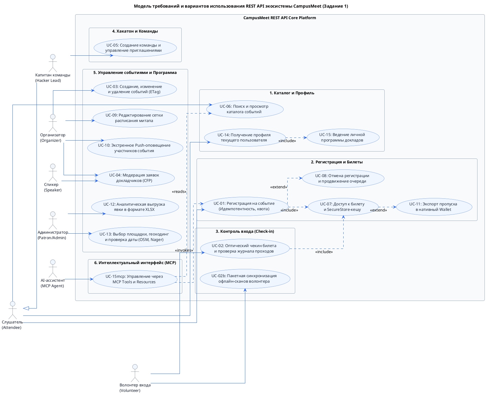

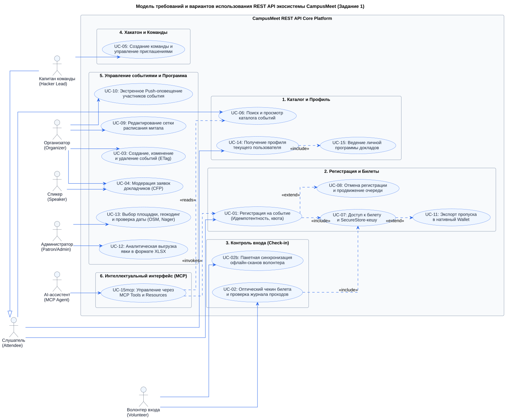

---

# Раздел 3. Проектирование логической и физической моделей базы данных (Задание 2)

## 3.1. Логическая схема базы данных (Рисунок 2)

В соответствии с требованиями Задания 2 (п. 1, Рисунок 2 методички) логическая модель базы данных представлена в виде нормализованной спецификации структуры отношений:

| Сущность | Таблица БД | Поле | Смысл поля | Тип данных |
| :--- | :--- | :--- | :--- | :--- |
| **Пользователь** | `users` | `id` | Уникальный суррогатный идентификатор пользователя | UUID / VARCHAR(36) |
| | | `email` | Адрес электронной почты (логин в системе) | VARCHAR(255) |
| | | `password_hash` | Криптографический хеш пароля (Argon2id/bcrypt) | TEXT |
| | | `full_name` | Фамилия, имя и отчество пользователя | VARCHAR(150) |
| | | `role` | Роль доступа (attendee, volunteer, organizer, admin) | VARCHAR(24) |
| | | `is_active` | Признак активности учетной записи | BOOLEAN |
| | | `created_at` | Дата и время регистрации пользователя в системе | TIMESTAMPTZ |
| **Площадка** | `venues` | `id` | Уникальный идентификатор университетской площадки | UUID / VARCHAR(36) |
| | | `name` | Наименование аудитории или конференц-зала | VARCHAR(200) |
| | | `address` | Физический адрес корпуса университета | TEXT |
| | | `latitude` | Географическая широта для навигации | NUMERIC(10,7) |
| | | `longitude` | Географическая долгота для навигации | NUMERIC(10,7) |
| | | `total_capacity` | Предельная вместимость зала по пожнадзору | INTEGER |
| **Мероприятие** | `events` | `id` | Первичный ключ мероприятия | UUID / VARCHAR(36) |
| | | `slug` | Человеко-понятный URL-идентификатор митапа | VARCHAR(120) |
| | | `title` | Официальное наименование митапа или хакатона | VARCHAR(200) |
| | | `event_type` | Тип события (meetup, hackathon, workshop) | VARCHAR(20) |
| | | `status` | Жизненный цикл (draft, published, completed) | VARCHAR(24) |
| | | `venue_id` | Внешний ключ привязки к аудитории | UUID / VARCHAR(36) |
| | | `organizer_user_id`| Внешний ключ ответственного организатора | UUID / VARCHAR(36) |
| | | `start_time` | Дата и время открытия мероприятия | TIMESTAMPTZ |
| | | `end_time` | Дата и время завершения мероприятия | TIMESTAMPTZ |
| | | `capacity_limit` | Лимит регистрационных мест (квота) | INTEGER |
| | | `waitlist_enabled` | Разрешение на формирование очереди ожидания | BOOLEAN |
| | | `version` | Версионный номер для оптимистической блокировки | INTEGER |
| **Билет** | `tickets` | `id` | Идентификатор билета участника | UUID / VARCHAR(36) |
| | | `ticket_code` | Публичный буквенно-цифровой код пропуска | VARCHAR(32) |
| | | `event_id` | Внешний ключ мероприятия | UUID / VARCHAR(36) |
| | | `user_id` | Внешний ключ держателя билета | UUID / VARCHAR(36) |
| | | `status` | Статус (registered, waitlisted, checked_in, cancelled)| VARCHAR(20) |
| | | `qr_token_hash` | Криптографический хеш полезной нагрузки QR | VARCHAR(64) |
| | | `signature_key_id` | Идентификатор ключа валидации подписи | VARCHAR(80) |
| | | `created_at` | Метка времени оформления билета | TIMESTAMPTZ |
| **Очередь** | `waitlist_entries`| `ticket_id` | Внешний ключ заявки в листе ожидания | UUID / VARCHAR(36) |
| | | `queued_at` | Метка времени постановки в очередь | TIMESTAMPTZ |
| | | `promoted_at` | Метка времени перевода в основной состав | TIMESTAMPTZ |
| | | `offer_expires_at`| Срок действия приглашения подтвердить место | TIMESTAMPTZ |
| **Чекин-лог** | `check_in_logs` | `id` | Идентификатор записи о проходе | UUID / VARCHAR(36) |
| | | `event_id` | Внешний ключ события | UUID / VARCHAR(36) |
| | | `ticket_id` | Внешний ключ проверяемого билета | UUID / VARCHAR(36) |
| | | `scanned_by_volunteer_id`| Внешний ключ контролера-волонтера | UUID / VARCHAR(36) |
| | | `client_scan_id` | Уникальный UUID сканирования на клиенте | VARCHAR(64) |
| | | `verdict` | Результат чекина (granted, denied_duplicate) | VARCHAR(20) |
| | | `verification_mode`| Режим валидации (online, offline_sync) | VARCHAR(20) |
| | | `scanned_at` | Время фиксации сканирования на площадке | TIMESTAMPTZ |
| **Персонал** | `event_staff` | `event_id` | Идентификатор события назначения волонтера | UUID / VARCHAR(36) |
| | | `user_id` | Идентификатор назначенного волонтера | UUID / VARCHAR(36) |
| | | `assignment` | Роль волонтера (scanner, checkin_lead, room_mod) | VARCHAR(20) |
| **Заявка CFP**| `speaker_proposals`| `id` | Первичный ключ заявки на доклад | UUID / VARCHAR(36) |
| | | `event_id` | Мероприятие, на которое подан доклад | UUID / VARCHAR(36) |
| | | `speaker_user_id` | Автор доклада (спикер) | UUID / VARCHAR(36) |
| | | `topic` | Тема планируемого выступления | VARCHAR(200) |
| | | `abstract_text` | Развернутые тезисы и презентационные материалы | TEXT |
| | | `status` | Статус рассмотрения (submitted, accepted, rejected)| VARCHAR(20) |
| **Расписание** | `schedule_items` | `id` | Идентификатор слота программы митапа | UUID / VARCHAR(36) |
| | | `event_id` | Идентификатор мероприятия | UUID / VARCHAR(36) |
| | | `speaker_user_id` | Идентификатор утвержденного спикера | UUID / VARCHAR(36) |
| | | `title` | Название доклада / мастер-класса | VARCHAR(200) |
| | | `room` | Наименование зала / секции | VARCHAR(60) |
| | | `start_time` | Время начала выступления | TIMESTAMPTZ |
| | | `end_time` | Время завершения выступления | TIMESTAMPTZ |
| **Личная программа**| `personal_schedule`| `user_id` | Внешний ключ слушателя | UUID / VARCHAR(36) |
| | | `schedule_item_id`| Внешний ключ избранного доклада | UUID / VARCHAR(36) |
| **Команда** | `team_matches` | `id` | Идентификатор команды хакатона | UUID / VARCHAR(36) |
| | | `event_id` | Мероприятие проведения хакатона | UUID / VARCHAR(36) |
| | | `captain_user_id` | Капитан команды | UUID / VARCHAR(36) |
| | | `team_name` | Название команды | VARCHAR(120) |
| | | `looking_for_roles`| Список требуемых компетенций (frontend, ML) | TEXT |
| | | `max_members` | Максимальный размер команды (квота) | INTEGER |
| | | `status` | Статус набора (forming, ready, locked) | VARCHAR(20) |
| **Член команды**| `team_members` | `team_id` | Идентификатор команды | UUID / VARCHAR(36) |
| | | `event_id` | Идентификатор хакатона (составной инвариант) | UUID / VARCHAR(36) |
| | | `user_id` | Участник команды | UUID / VARCHAR(36) |
| | | `role_in_team` | Назначенная роль (Backend Dev, Designer) | VARCHAR(60) |
| **Инвайт** | `team_invitations`| `id` | Идентификатор приглашения в команду | UUID / VARCHAR(36) |
| | | `team_id` | Приглашающая команда | UUID / VARCHAR(36) |
| | | `user_id` | Приглашаемый пользователь | UUID / VARCHAR(36) |
| | | `status` | Состояние инвайта (pending, accepted, declined) | VARCHAR(20) |
| **Оповещение** | `emergency_announcements`| `id`| Идентификатор срочного оповещения | UUID / VARCHAR(36) |
| | | `event_id` | Мероприятие, к которому относится сообщение | UUID / VARCHAR(36) |
| | | `author_user_id` | Автор сообщения (организатор) | UUID / VARCHAR(36) |
| | | `title` | Заголовок оповещения | VARCHAR(200) |
| | | `body_text` | Текст экстренного объявления | TEXT |
| | | `created_at` | Метка времени отправки | TIMESTAMPTZ |
| **Доставка** | `notification_deliveries`| `id` | Идентификатор доставки сообщения | UUID / VARCHAR(36) |
| | | `announcement_id` | Ссылка на объявление | UUID / VARCHAR(36) |
| | | `user_id` | Получатель уведомления | UUID / VARCHAR(36) |
| | | `channel` | Канал отправки (push, email, telegram) | VARCHAR(20) |
| | | `status` | Статус доставки (sent, delivered, failed) | VARCHAR(20) |
| **Аудит агента**| `agent_audit_log`| `id` | Первичный ключ записи аудита | UUID / VARCHAR(36) |
| | | `actor_user_id` | Пользователь, от чьего лица действовал агент | UUID / VARCHAR(36) |
| | | `action` | Вызванный Tool или прочитанный Resource | VARCHAR(60) |
| | | `target_id` | Идентификатор затронутой сущности | VARCHAR(64) |
| | | `outcome` | Результат вызова (success, forbidden, rejected) | VARCHAR(20) |
| | | `created_at` | Точное время выполнения операции | TIMESTAMPTZ |
| **Идемпотентность**| `idempotency_keys`| `actor_user_id`| Пользователь, передавший ключ повтора | UUID / VARCHAR(36) |
| | | `operation` | Наименование эндпоинта / операции | VARCHAR(64) |
| | | `idempotency_key` | Клиентский токен идемпотентности | VARCHAR(128) |
| | | `request_hash` | SHA-256 хеш исходного тела запроса | VARCHAR(64) |
| | | `response_status` | Сохраненный HTTP-статус ответа | INTEGER |
| | | `response_body` | Сохраненное тело ответа для мгновенного реплея | TEXT |
| | | `created_at` | Метка времени фиксации ключа | TIMESTAMPTZ |

## 3.2. Логическая ER-диаграмма данных (PlantUML)

```plantuml
@startuml
skinparam monochrome false
skinparam shadowing false
skinparam packageStyle rectangle
skinparam defaultFontName "Helvetica, Arial, sans-serif"
skinparam defaultFontSize 13
skinparam roundcorner 6
skinparam linetype ortho
skinparam nodesep 45
skinparam ranksep 50

skinparam entity {
    BackgroundColor #F8FAFC
    BorderColor #334155
    ArrowColor #2563EB
    HeaderBackgroundColor #E2E8F0
    FontColor #0F172A
}

skinparam package {
    BackgroundColor #F1F5F9
    BorderColor #94A3B8
    FontColor #0F172A
}

title Логическая модель базы данных экосистемы CampusMeet (17 сущностей, Задание 2)

' ==========================================
' 1. УЧЕТНЫЕ ЗАПИСИ, ПЛОЩАДКИ И СЕССИИ
' ==========================================
package "1. Пользователи, Площадки и Идемпотентность" {
    entity "users\n(Пользователи)" as users {
        * id : UUID <<PK>>
        --
        * email : String <<UQ>>
        * password_hash : String
        * full_name : String
        * role : String (ATTENDEE, VOLUNTEER, ORGANIZER, SPEAKER, ADMIN)
        is_active : Boolean
        created_at : Timestamp
    }

    entity "venues\n(Университетские аудитории)" as venues {
        * id : UUID <<PK>>
        --
        * name : String
        * address : String
        latitude : Numeric(10,7)
        longitude : Numeric(10,7)
        * total_capacity : Integer
    }

    entity "idempotency_keys\n(Ключи повторов запросов)" as idempotency_keys {
        * actor_user_id : UUID <<PK, FK>>
        * operation : String <<PK>>
        * idempotency_key : String <<PK>>
        --
        * request_hash : String
        * response_status : Integer
        response_body : Text
        created_at : Timestamp
    }
}

' ==========================================
' 2. МЕРОПРИЯТИЯ И ПЕРСОНАЛ
' ==========================================
package "2. Мероприятия и Назначения" {
    entity "events\n(События и митапы)" as events {
        * id : UUID <<PK>>
        --
        * slug : String <<UQ>>
        * title : String
        * event_type : String (MEETUP, HACKATHON, WORKSHOP)
        * status : String (DRAFT, PUBLISHED, COMPLETED, CANCELLED)
        * venue_id : UUID <<FK>>
        * organizer_user_id : UUID <<FK>>
        * start_time : Timestamp
        * end_time : Timestamp
        * capacity_limit : Integer
        waitlist_enabled : Boolean
        version : Integer
    }

    entity "event_staff\n(Назначенные волонтеры)" as event_staff {
        * event_id : UUID <<PK, FK>>
        * user_id : UUID <<PK, FK>>
        --
        * assignment : String (CHECKIN_LEAD, SCANNER, MODERATOR)
    }
}

' ==========================================
' 3. БИЛЕТЫ, ОЧЕРЕДЬ И ЧЕКИН
' ==========================================
package "3. Билеты и Контроль доступа" {
    entity "tickets\n(Электронные билеты)" as tickets {
        * id : UUID <<PK>>
        --
        * ticket_code : String <<UQ>>
        * event_id : UUID <<FK>>
        * user_id : UUID <<FK>>
        * status : String (REGISTERED, WAITLISTED, CHECKED_IN, CANCELLED)
        qr_token_hash : String
        signature_key_id : String
        created_at : Timestamp
    }

    entity "waitlist_entries\n(Очередь ожидания)" as waitlist_entries {
        * ticket_id : UUID <<PK, FK>>
        --
        * queued_at : Timestamp
        promoted_at : Timestamp
        offer_expires_at : Timestamp
    }

    entity "check_in_logs\n(Журнал фиксации проходов)" as check_in_logs {
        * id : UUID <<PK>>
        --
        * event_id : UUID <<FK>>
        * ticket_id : UUID <<FK>>
        * scanned_by_volunteer_id : UUID <<FK>>
        * client_scan_id : String <<UQ>>
        * verdict : String (GRANTED, DENIED_DUPLICATE, DENIED_INVALID)
        * verification_mode : String (ONLINE, OFFLINE_SYNC)
        * scanned_at : Timestamp
    }
}

' ==========================================
' 4. ПРОГРАММА, ДОКЛАДЫ И ЗАКЛАДКИ
' ==========================================
package "4. Программа и Доклады (CFP)" {
    entity "schedule_items\n(Сетка расписания митапа)" as schedule_items {
        * id : UUID <<PK>>
        --
        * event_id : UUID <<FK>>
        speaker_user_id : UUID <<FK>>
        * title : String
        room : String
        * start_time : Timestamp
        * end_time : Timestamp
    }

    entity "speaker_proposals\n(Заявки на доклады)" as speaker_proposals {
        * id : UUID <<PK>>
        --
        * event_id : UUID <<FK>>
        * speaker_user_id : UUID <<FK>>
        * topic : String
        abstract_text : Text
        * status : String (SUBMITTED, UNDER_REVIEW, ACCEPTED, REJECTED)
    }

    entity "personal_schedule\n(Личные закладки докладов)" as personal_schedule {
        * user_id : UUID <<PK, FK>>
        * schedule_item_id : UUID <<PK, FK>>
    }
}

' ==========================================
' 5. ХАКАТОН И КОМАНДЫ
' ==========================================
package "5. Хакатон и Команды" {
    entity "team_matches\n(Команды хакатона)" as team_matches {
        * id : UUID <<PK>>
        --
        * event_id : UUID <<FK>>
        * captain_user_id : UUID <<FK>>
        * team_name : String
        looking_for_roles : Text
        max_members : Integer
        * status : String (FORMING, READY, LOCKED)
    }

    entity "team_members\n(Состав команды)" as team_members {
        * team_id : UUID <<PK, FK>>
        * event_id : UUID <<FK>>
        * user_id : UUID <<PK, FK>>
        --
        * role_in_team : String
    }

    entity "team_invitations\n(Приглашения в команду)" as team_invitations {
        * id : UUID <<PK>>
        --
        * team_id : UUID <<FK>>
        * user_id : UUID <<FK>>
        * status : String (PENDING, ACCEPTED, DECLINED, EXPIRED)
    }
}

' ==========================================
' 6. ОПОВЕЩЕНИЯ И АССИСТЕНТ
' ==========================================
package "6. Оповещения и Аудит Агента" {
    entity "emergency_announcements\n(Срочные оповещения)" as emergency_announcements {
        * id : UUID <<PK>>
        --
        * event_id : UUID <<FK>>
        * author_user_id : UUID <<FK>>
        * title : String
        * body_text : Text
        * created_at : Timestamp
    }

    entity "notification_deliveries\n(Каналы доставки Push/Email)" as notification_deliveries {
        * id : UUID <<PK>>
        --
        * announcement_id : UUID <<FK>>
        * user_id : UUID <<FK>>
        * channel : String (PUSH, EMAIL, TELEGRAM)
        * status : String (SENT, DELIVERED, FAILED)
    }

    entity "agent_audit_log\n(Журнал действий MCP)" as agent_audit_log {
        * id : UUID <<PK>>
        --
        * actor_user_id : UUID <<FK>>
        * action : String
        target_id : String
        * outcome : String (SUCCESS, FORBIDDEN, REJECTED)
        * created_at : Timestamp
    }
}

' ==========================================
' РЕЛЯЦИОННЫЕ СВЯЗИ (ЧЕТКАЯ ИЕРАРХИЯ)
' ==========================================

' Уровень 1 -> Уровень 2
users ||--down--o{ events
venues ||--down--o{ events
users ||--left--o{ idempotency_keys
users ||--left--o{ agent_audit_log

' Уровень 2 -> Назначения
events ||--right--o{ event_staff

' Уровень 2 -> Уровень 3 (Билеты и Чекин)
events ||--down--o{ tickets
users ||--down--o{ tickets
tickets ||--right--o| waitlist_entries
tickets ||--down--o{ check_in_logs

' Уровень 2 -> Уровень 4 (Программа и CFP)
events ||--right--o{ schedule_items
events ||--right--o{ speaker_proposals
schedule_items ||--down--o{ personal_schedule

' Уровень 2 -> Уровень 5 (Хакатон)
events ||--down--o{ team_matches
team_matches ||--right--o{ team_members
team_matches ||--down--o{ team_invitations

' Уровень 2 -> Уровень 6 (Оповещения)
events ||--down--o{ emergency_announcements
emergency_announcements ||--down--o{ notification_deliveries

@enduml
```

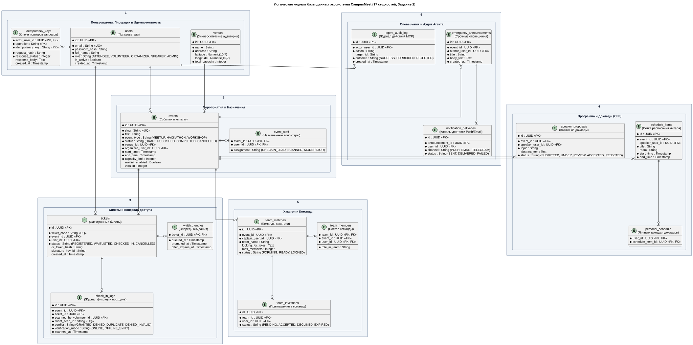

## 3.3. Физическая модель данных PostgreSQL 16 (Рисунок 3)

В соответствии с методическими требованиями (Задание 2, п. 2, Рисунок 3 методички) разработана подробная физическая ER-диаграмма, отражающая специфику типов данных СУБД PostgreSQL 16, ключевые ограничения и внешние связи:

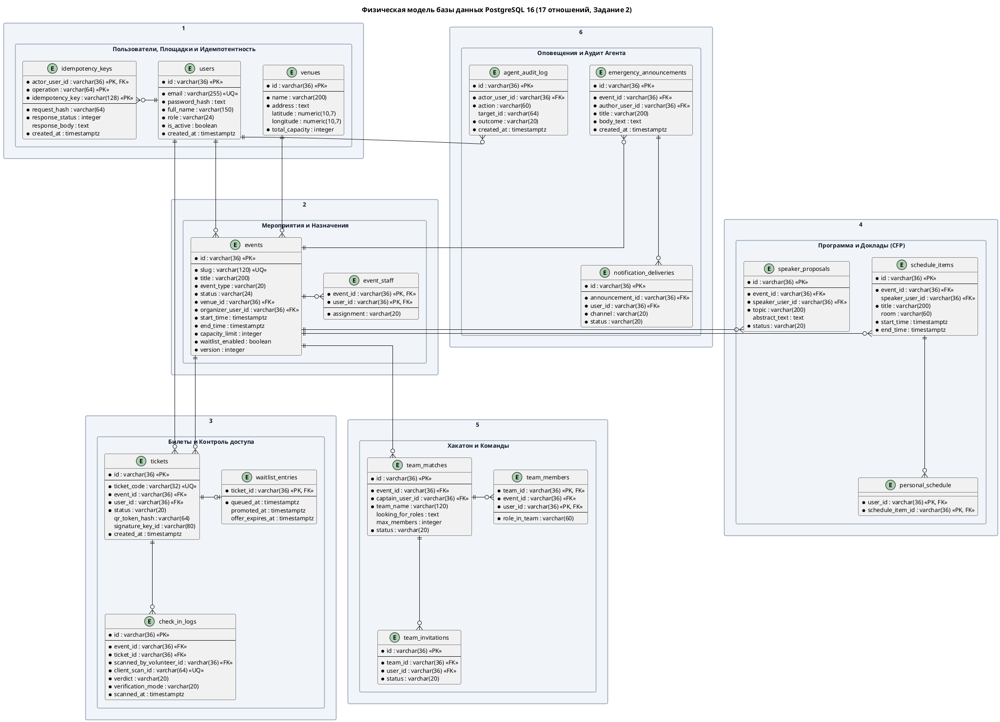

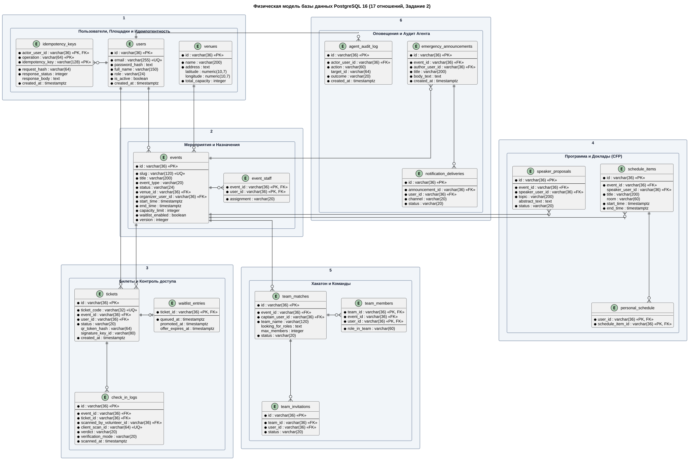

## 3.4. DDL-скрипты, ограничения целостности и триггеры

Реализация физической схемы размещена в репозитории `CampusMeet-Server`:
* **Целевая схема PostgreSQL 16:** [`database/schema.postgresql.sql`](https://github.com/fpmi-hci-2026/CampusMeet-Server/blob/main/database/schema.postgresql.sql);
* **Легковесная схема SQLite Mock:** [`database/schema.sqlite.sql`](https://github.com/fpmi-hci-2026/CampusMeet-Server/blob/main/database/schema.sqlite.sql).

### Ключевые архитектурные инварианты схемы:
1. **Предотвращение повторных регистраций:** Ограничение `UNIQUE(event_id, user_id)` в таблице `tickets` гарантирует, что один слушатель не сможет получить два активных билета на одно мероприятие;
2. **Атомарность офлайн-чекина:** Частичный уникальный индекс `CREATE UNIQUE INDEX idx_single_granted ON check_in_logs (ticket_id) WHERE verdict = 'GRANTED'` предотвращает допуск по повторно предъявленному билету на уровне ядра СУБД;
3. **Изоляция команд:** Составной внешний ключ `(team_id, event_id)` в `team_members` исключает запись участника в команду чужого хакатона;
4. **Контроль предельной квоты площадки:** Триггер `check_venue_capacity_trigger` блокирует создание события, если запрошенная организатором квота `capacity_limit` превышает физическую вместимость зала `venues.total_capacity`.

---

# Раздел 4. Проектирование маршрутов и конечных точек спецификации API (Задание 3)

## 4.1. Проектирование маршрутов: Сущность → Таблица БД → Маршрут (Рисунок 4)

В соответствии с требованиями Задания 3 (п. 1, Рисунок 4 методички) спроектированы REST-маршруты для управления ключевыми сущностями системы:

| Сущность предметной области | Таблица базы данных | Базовый маршрут API |
| :--- | :--- | :--- |
| **Аутентификация / Сессия** | `users`, `idempotency_keys` | `/auth/token`, `/me` |
| **Мероприятие (Митап / Хакатон)** | `events` | `/events` |
| **Билет участника** | `tickets`, `waitlist_entries` | `/tickets`, `/me/tickets` |
| **Регистрация на событие** | `tickets`, `idempotency_keys` | `/events/{id}/registrations` |
| **Контроль входа (Чекин)** | `check_in_logs` | `/events/{id}/check-ins`, `/events/{id}/check-in-batches` |
| **Сетка расписания** | `schedule_items`, `personal_schedule` | `/events/{id}/schedule`, `/me/schedule` |
| **Заявки докладчиков (CFP)** | `speaker_proposals` | `/events/{id}/proposals`, `/proposals/{id}` |
| **Команды хакатона** | `team_matches`, `team_members` | `/events/{id}/teams`, `/teams/{id}/invitations` |
| **Срочные оповещения** | `emergency_announcements` | `/events/{id}/announcements` |
| **Асинхронные задачи / Экспорт** | `notification_deliveries` | `/jobs/{id}`, `/events/{id}/attendance-exports` |
| **Университетские аудитории** | `venues` | `/venues` |
| **Внешние гео- и календарные шлюзы**| `venues`, `events` | `/integrations/geocoding`, `/integrations/holidays` |

## 4.2. Сопоставление Use Case с конечными точками и HTTP-методами (Рисунок 5)

В соответствии с Заданием 3 (п. 2, Рисунок 5 методички) сопоставлены акторы, варианты использования, URL-маршруты, HTTP-методы и требования к аутентификации:

| Актор | Вариант использования (Use Case) | Маршрут API | HTTP-запрос | Аутентификация |
| :--- | :--- | :--- | :--- | :--- |
| **Слушатель** | **UC-06:** Поиск и каталог событий | `/events` | `GET` | нет (публичный) |
| **Все роли** | **UC-14:** Вход в систему и получение токена | `/auth/token` | `POST` | нет (публичный) |
| **Все роли** | **UC-14:** Получение профиля текущего пользователя | `/me` | `GET` | да (Bearer токен) |
| **Слушатель** | **UC-01:** Регистрация на митап (резерв квоты) | `/events/{id}/registrations` | `POST` | да (Idempotency-Key) |
| **Слушатель** | **UC-07:** Просмотр списка своих билетов | `/me/tickets` | `GET` | да (Bearer токен) |
| **Слушатель** | **UC-07:** Чтение конкретного билета по ID | `/tickets/{id}` | `GET` | да (только владелец) |
| **Слушатель** | **UC-08:** Отмена билета и освобождение места | `/tickets/{id}` | `DELETE` | да (только владелец) |
| **Слушатель** | **UC-11:** Получение пропуска Apple Wallet | `/tickets/{id}/wallet-pass`| `GET` | да (только владелец) |
| **Волонтер** | **UC-02:** Проверка билета на входе (онлайн-чекин) | `/events/{id}/check-ins` | `POST` | да (роль volunteer) |
| **Волонтер** | **UC-02:** Просмотр журнала проходов события | `/events/{id}/check-ins` | `GET` | да (роль volunteer) |
| **Волонтер** | **UC-02b:** Пакетная синхронизация офлайн-сканов | `/events/{id}/check-in-batches`| `POST`| да (роль volunteer) |
| **Организатор**| **UC-03:** Создание черновика митапа | `/events` | `POST` | да (роль organizer) |
| **Организатор**| **UC-03:** Обновление параметров события (версия) | `/events/{id}` | `PUT` | да (заголовок If-Match)|
| **Организатор**| **UC-03:** Удаление черновика события | `/events/{id}` | `DELETE` | да (роль organizer) |
| **Организатор**| **UC-10:** Отправка экстренного оповещения | `/events/{id}/announcements`| `POST` | да (роль organizer) |
| **Спикер** | **UC-04:** Подача заявки на доклад в CFP | `/events/{id}/proposals` | `POST` | да (Bearer токен) |
| **Организатор**| **UC-04:** Просмотр поступивших докладов | `/events/{id}/proposals` | `GET` | да (роль organizer) |
| **Организатор**| **UC-04:** Принятие решения по докладу (модерация)| `/proposals/{id}` | `PATCH` | да (роль organizer) |
| **Все роли** | **UC-09:** Просмотр сетки расписания | `/events/{id}/schedule` | `GET` | нет (публичный) |
| **Организатор**| **UC-09:** Публикация и замена расписания | `/events/{id}/schedule` | `PUT` | да (роль organizer) |
| **Слушатель** | **UC-15:** Сохранение личной программы докладов | `/me/schedule` | `PUT` | да (Bearer токен) |
| **Капитан** | **UC-05:** Регистрация команды на хакатон | `/events/{id}/teams` | `POST` | да (роль attendee) |
| **Капитан** | **UC-05:** Отправка приглашения участнику | `/teams/{id}/invitations` | `POST` | да (капитан команды) |
| **Слушатель** | **UC-05:** Ответ на инвайт (принять / отклонить) | `/team-invitations/{id}` | `PATCH` | да (приглашенный) |
| **Организатор**| **UC-12:** Заказ выгрузки ведомости явки в XLSX | `/events/{id}/attendance-exports`| `POST`| да (роль organizer) |
| **Администратор**| **UC-13:** Геокодирование адреса площадки (OSM)| `/integrations/geocoding` | `GET` | да (роль organizer/admin)|
| **Администратор**| **UC-13:** Проверка государственных праздников | `/integrations/holidays` | `GET` | да (роль organizer/admin)|

## 4.3. Диаграмма архитектуры ресурсов REST API (PlantUML)

```plantuml
@startuml
skinparam monochrome false
skinparam shadowing false
skinparam packageStyle rectangle
skinparam defaultFontName "Helvetica, Arial, sans-serif"
skinparam defaultFontSize 13
skinparam roundcorner 6
skinparam linetype ortho
skinparam nodesep 30
skinparam ranksep 40

skinparam component {
    BackgroundColor #EFF6FF
    BorderColor #2563EB
    FontColor #0F172A
    ArrowColor #2563EB
}

skinparam package {
    BackgroundColor #F8FAFC
    BorderColor #94A3B8
    FontColor #0F172A
}

title Архитектура ресурсов и маршрутов REST API CampusMeet (/api/v1) (Задание 3)

package "Клиентский уровень (Clients)" {
    [Web SPA Client\n(Next.js 14 / TypeScript)] as WebClient
    [Mobile App Client\n(React Native / Expo)] as MobileClient
    [LLM AI-Assistant\n(Claude / Cursor MCP)] as MCPAssistant
    [API Test Clients\n(Swagger UI, Bruno, Postman)] as TestClients
}

package "Шлюз и Контроль доступа (Gateway & Security)" {
    [FastAPI Application Gateway\n(/api/v1)] as Gateway
    [AuthGuard\n(Bearer JWT / Session Demo)] as AuthGuard
    [Idempotency Middleware\n(Idempotency-Key & SHA-256)] as IdemGuard
}

WebClient --> Gateway : HTTPS / JSON
MobileClient --> Gateway : HTTPS / JSON
MCPAssistant --> Gateway : Stdio / REST
TestClients --> Gateway : HTTP / JSON

Gateway ..> AuthGuard
Gateway ..> IdemGuard

package "Маршрутизаторы ресурсов REST API (/api/v1)" {

    package "1. Аутентификация и Профиль" as pkg_auth {
        component "<b>/auth & /me</b>\n---\n• POST /auth/token (demoLogin)\n• GET /me (getProfile)\n• PUT /me/schedule (replacePersonalSchedule)" as router_auth
    }

    package "2. Каталог и Мероприятия" as pkg_events {
        component "<b>/events & /search</b>\n---\n• GET /events (listEvents)\n• POST /events (createEvent)\n• GET /events/{id} (getEvent)\n• PUT /events/{id} (replaceEvent, ETag)\n• DELETE /events/{id} (deleteDraft)\n• GET /search (searchEvents)" as router_events
    }

    package "3. Регистрация и Билеты" as pkg_tickets {
        component "<b>/registrations & /tickets</b>\n---\n• POST /events/{id}/registrations (registerAttendee)\n• GET /me/tickets (listMyTickets)\n• GET /tickets/{id} (getTicket)\n• DELETE /tickets/{id} (cancelTicket)\n• GET /tickets/{id}/wallet-pass (getWalletPass)" as router_tickets
    }

    package "4. Контроль входа (Check-in)" as pkg_checkin {
        component "<b>/check-ins & /attendance</b>\n---\n• GET /events/{id}/check-ins (listCheckIns)\n• POST /events/{id}/check-ins (checkIn)\n• POST /events/{id}/check-in-batches (syncCheckIns)\n• POST /events/{id}/attendance-exports (exportAttendance)" as router_checkin
    }

    package "5. Программа и Доклады (CFP)" as pkg_program {
        component "<b>/schedule & /proposals</b>\n---\n• GET /events/{id}/schedule (getSchedule)\n• PUT /events/{id}/schedule (replaceSchedule)\n• GET /events/{id}/proposals (listProposals)\n• POST /events/{id}/proposals (submitProposal)\n• PATCH /proposals/{id} (reviewProposal)" as router_program
    }

    package "6. Хакатон и Команды" as pkg_teams {
        component "<b>/teams & /team-invitations</b>\n---\n• GET /events/{id}/teams (listTeams)\n• POST /events/{id}/teams (createTeam)\n• POST /teams/{id}/invitations (inviteMember)\n• PATCH /team-invitations/{id} (answerInvitation)" as router_teams
    }

    package "7. Оповещения и Асинхронные задачи" as pkg_announce {
        component "<b>/announcements & /jobs</b>\n---\n• POST /events/{id}/announcements (broadcast)\n• GET /jobs/{id} (getJobStatus)" as router_announce
    }

    package "8. Площадки и Внешние сервисы" as pkg_integrations {
        component "<b>/venues & /integrations</b>\n---\n• GET /venues (listVenues)\n• GET /integrations/geocoding (geocodeOSM)\n• GET /integrations/holidays (checkHolidays)\n• GET /health (healthCheck)" as router_integrations
    }
}

Gateway --> router_auth
Gateway --> router_events
Gateway --> router_tickets
Gateway --> router_checkin
Gateway --> router_program
Gateway --> router_teams
Gateway --> router_announce
Gateway --> router_integrations

@enduml
```

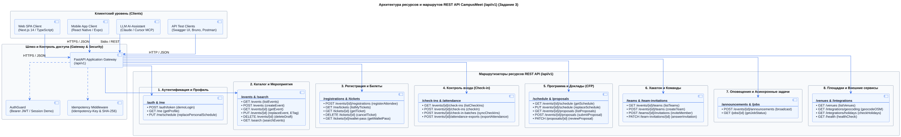

---

# Раздел 5. Проектирование и тестирование API (Задание 4)

## 5.1. Спецификация OpenAPI 3.0.3 и контракт интерфейса

Спецификация API сгенерирована по стандарту OpenAPI 3.0.3 и охватывает 33 операции:
* Файл контракта: [`docs/api/openapi.json`](../api/openapi.json);
* Интерактивная документация: [Swagger UI портала CampusMeet](../api/index.html);
* Контрольная сумма контракта: `docs/api/contract.sha256`.

Для всех POST, PUT и PATCH операций специфицированы строгие схемы JSON Schema, включающие списки обязательных полей (`required`), ограничения форматов, перечисления (`enum`), запрет нерегламентированных параметров (`additionalProperties: false`) и примеры полезной нагрузки (`example`).

## 5.2. Семантика HTTP-методов, коды состояний и формат ошибок

В API соблюдается строгая семантика протокола HTTP:
* `GET` — безопасные идемпотентные запросы выборки данных;
* `POST` — создание новых ресурсов (билетов, команд, проходов) с обязательной проверкой заголовка `Idempotency-Key`;
* `PUT` — полная идемпотентная замена состояния (события, расписания) с проверкой версий через `If-Match` и `ETag`;
* `PATCH` — частичное изменение атрибутов (изменение статуса доклада или приглашения);
* `DELETE` — идемпотентное логическое удаление или аннулирование билета.

### Реестр кодов ответов:
* `200 OK` — успешное выполнение запроса на чтение или модификацию;
* `201 Created` — успешное создание ресурса с возвратом заголовка `Location`;
* `202 Accepted` — задача принята в асинхронную обработку (выгрузка явки);
* `204 No Content` — успешное выполнение без тела ответа (отмена регистрации);
* `400 Bad Request` — синтаксическая ошибка JSON;
* `401 Unauthorized` — отсутствует или недействителен токен Bearer;
* `403 Forbidden` — отказ в доступе (попытка чтения или отмены чужого билета);
* `404 Not Found` — запрашиваемый ресурс не существует;
* `409 Conflict` — бизнес-конфликт (исчерпание квоты, повторный чекин, повтор с тем же Idempotency-Key, но другим телом);
* `412 Precondition Failed` — конфликт параллельного редактирования (несовпадение `If-Match` с текущим `ETag`);
* `422 Unprocessable Entity` — нарушение валидации схемы JSON;
* `500 Internal Server Error` — внутренняя ошибка серверной платформы.

Ошибки возвращаются в стандартизированном формате RFC 7807 (`application/problem+json`):

```json
{
  "type": "https://campusmeet.by/errors/conflict",
  "title": "Conflict Error",
  "status": 409,
  "code": "ALREADY_CHECKED_IN",
  "detail": "Билет уже был использован для прохода на площадку",
  "instance": "/api/v1/events/ev-campusmeet-2026/check-ins"
}
```

## 5.3. Реализация Mock-сервера и режимы работы (Stateful vs Example)

Mock-сервер реализован в модуле `CampusMeet-Server/campusmeet/mock_api.py` (чистый Python 3.12+ без внешних библиотек) и поддерживает два режима:
1. **Stateful-режим (Реальное транзакционное состояние):**
   * Регистрация участников (`POST /registrations`), выдача билетов, отмена (`DELETE /tickets/{id}`), продвижение очереди ожидания, онлайн-чекин (`POST /check-ins`) и проверка ключей идемпотентности выполняют реальные SQL-транзакции в базе `mock_data.db` (SQLite);
2. **Example-режим (Контрактные примеры):**
   * Расписание, подача докладов CFP, экспорт в Wallet и аналитика возвращают типизированные структуры из OpenAPI для сквозного тестирования UI.

## 5.4. Диаграмма последовательности работы REST API и Mock-сервера (PlantUML)

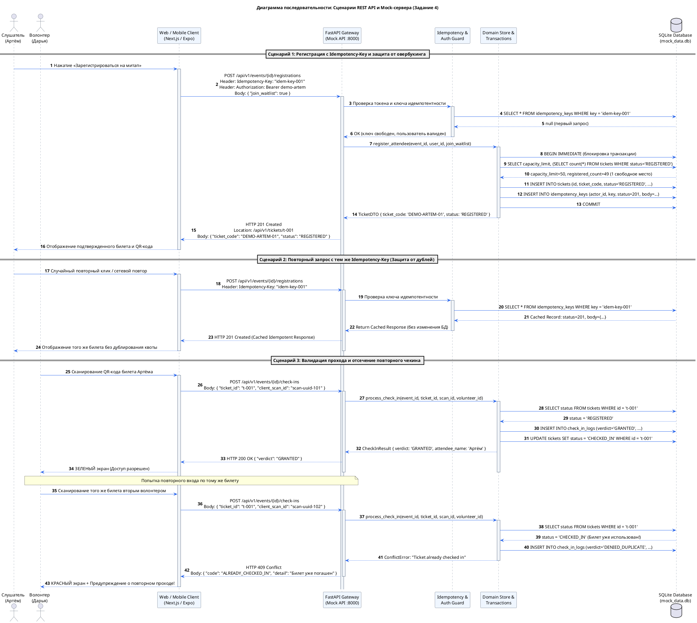

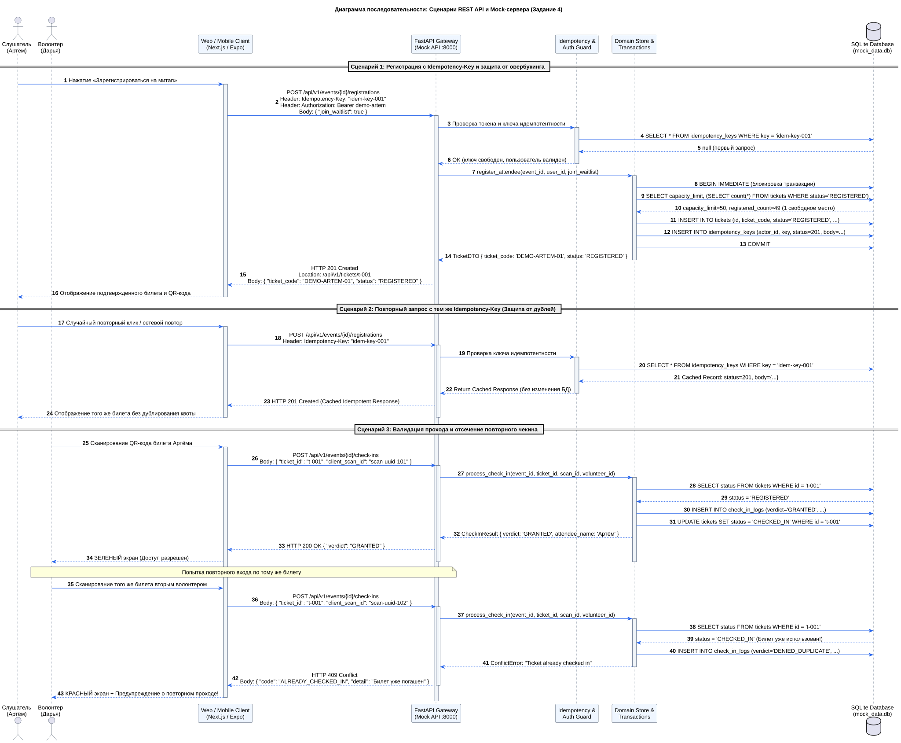

## 5.5. Тестирование с помощью Bruno, Postman и Swagger UI

Для автоматизированного тестирования API подготовлены:
1. **Коллекция Bruno:** `CampusMeet-Server/api/bruno/` с тестовыми сценариями и переменными окружения (`Local.bru`);
2. **Коллекция Postman:** `CampusMeet-Server/api/CampusMeet.postman_collection.json`;
3. **Smoke-скрипт Python:** `CampusMeet-Server/scripts/smoke_http.py`, выполняющий сквозной прогон всех 33 эндпоинтов на изолированной SQLite-базе.

### Пример реального вызова регистрации:

```bash
curl -i -X POST http://127.0.0.1:8000/api/v1/events/ev-campusmeet-2026/registrations \
  -H 'Authorization: Bearer demo-artem' \
  -H 'Content-Type: application/json' \
  -H 'Idempotency-Key: test-run-key-101' \
  -d '{"join_waitlist": true}'
```

**Ответ сервера:**

```http
HTTP/1.1 201 Created
Location: /api/v1/tickets/tkt-b8c7-45e2
Content-Type: application/json
ETag: "1"

{
  "id": "tkt-b8c7-45e2",
  "ticket_code": "DEMO-ARTEM-01",
  "qr_payload": "DEMO-ARTEM-01",
  "event_id": "ev-campusmeet-2026",
  "user_id": "usr-artem-001",
  "status": "registered",
  "created_at": "2026-10-28T07:15:00Z"
}
```

---

# Раздел 6. Проектирование и реализация MCP-сервера (Задание 5)

## 6.1. Стандарт Model Context Protocol (MCP) и архитектурная концепция

**Model Context Protocol (MCP)** — открытый спецификационный стандарт взаимодействия между большими языковыми моделями (LLM) и внешними программными системами. В отличие от жестко прописанных REST-интеграций, MCP позволяет AI-ассистенту динамически обнаруживать контекст, считывать регламентированные ресурсы и осознанно инициировать действия.

В проекте зафиксирована стабильная версия спецификации: **MCP 2025-11-25**. Сервер реализован в виде независимого CLI-процесса, взаимодействующего с LLM-хостом по протоколу **JSON-RPC 2.0** через стандартные потоки ввода-вывода (`stdio`).

## 6.2. Проектирование примитивов: Tools, Resources, Prompts

### 1. Набор инструментов (MCP Tools — Действия):
* `list_events(query?: string)` — Поиск мероприятий в каталоге;
* `check_event_capacity(event_id: string)` — Проверка остатка квоты свободных мест;
* `get_ticket(ticket_id: string)` — Чтение информации о собственном билете;
* `register_for_event(event_id: string, join_waitlist: boolean, idempotency_key: string)` — Регистрация текущего пользователя;
* `cancel_ticket(ticket_id: string)` — Аннулирование билета с освобождением места.

### 2. Набор ресурсов (MCP Resources — Данные):
* `events://upcoming` — Динамический каталог предстоящих событий;
* `tickets://mine` — Защищенный реестр билетов активного пользователя;
* `policy://ticket-cancellation` — Статический регламент правил отмены и условий листа ожидания;
* `events://{event_id}` — URI-шаблон карточки конкретного митапа.

### 3. Шаблоны промптов (MCP Prompts — Сценарии):
* `plan_visit(interest: string)` — Инструкция, заставляющая LLM сначала изучить каталог `events://upcoming`, затем проверить квоту мест и предложить оптимальный вариант пользователю;
* `cancel_registration(ticket_id: string)` — Инструкция, требующая от LLM сначала прочитать правила возврата из ресурса `policy://ticket-cancellation`, проверить статус билета и запросить подтверждение пользователя перед вызовом `cancel_ticket`.

## 6.3. Реализация MVP MCP-сервера на Python

Сервер реализован в файле `CampusMeet-Server/campusmeet/mcp_server.py`. Для работы с JSON-RPC 2.0 используется стандартная библиотека Python.

### Схема жизненного цикла взаимодействия:
1. **Рукопожатие (Handshake):** Клиент передает `initialize`, сервер отвечает перечнем возможностей (`capabilities: { tools: {}, resources: {}, prompts: {} }`);
2. **Инициализация:** Клиент направляет уведомление `notifications/initialized`;
3. **Обнаружение примитивов:** Вызовы `tools/list`, `resources/list`, `prompts/list`;
4. **Выполнение действий:** Запросы `tools/call` и `resources/read`.

## 6.4. Безопасность, изоляция агента и журнал аудита

1. **Принцип жесткой изоляции идентичности:** Параметр запуска процесса `--token demo-artem` навсегда закрепляет контекст за конкретным слушателем. В схемах `tools.json` запрещен параметр `user_id` (`additionalProperties: false`). Агент физически не способен выполнить операцию от чужого имени;
2. **Бизнес-валидация отмены:** Сервер запрещает отмену билета, если по нему уже зафиксирован чекин (`status = 'CHECKED_IN'`);
3. **Журнал аудита:** Все вызовы инструментов и чтение защищенных ресурсов регистрируются в таблице `agent_audit_log` (атрибуты: `actor_user_id`, `action`, `target_id`, `outcome`, `created_at`). Секретные токены и полезная нагрузка QR в аудит не записываются.

## 6.5. Диаграмма архитектуры MCP-сервера (PlantUML)

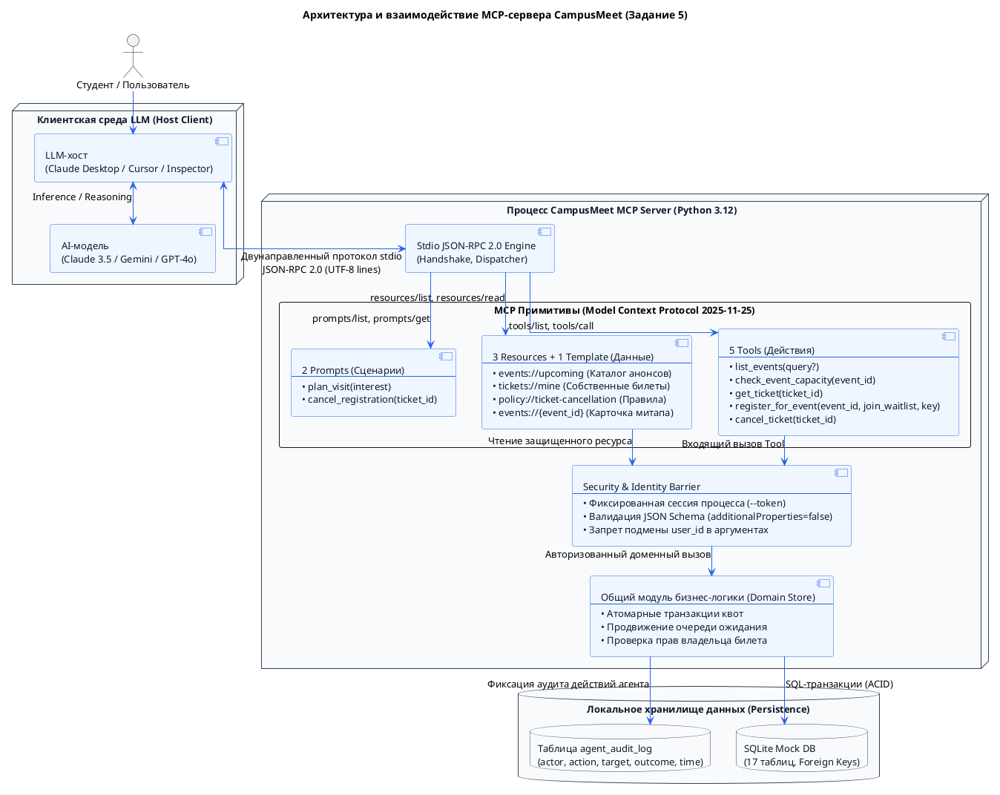

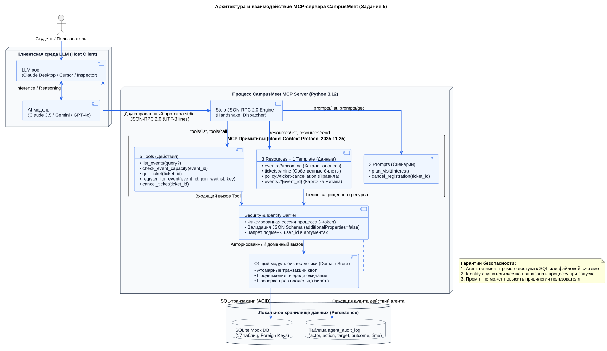

## 6.6. Тестирование через MCP Inspector и сценарии использования

Для верификации работы MCP-сервера предусмотрено подключение через официальный инструмент от Anthropic:

```bash
# Запуск через официальный MCP Inspector
npx @modelcontextprotocol/inspector python3 -m campusmeet.mcp_server --token demo-artem
```

### Примеры запросов пользователя к AI-ассистенту:
* *«Какие интересные митапы запланированы на эту неделю?»* → Ассистент считывает ресурс `events://upcoming` и формирует краткую сводку;
* *«Остались ли свободные места на хакатон CampusMeet 2026?»* → Ассистент вызывает Tool `check_event_capacity(event_id="ev-campusmeet-2026")`;
* *«Зарегистрируй меня на митап по искусственному интеллекту»* → Ассистент генерирует `Idempotency-Key` и вызывает Tool `register_for_event`;
* *«Я не смогу прийти, отмени мою регистрацию»* → Ассистент читает `policy://ticket-cancellation`, находит билет в `tickets://mine` и вызывает `cancel_ticket`.

---

# Раздел 7. Проектирование и развертывание инфраструктуры проекта (Задание 6)

## 7.1. Организация репозиториев и версионирование

В соответствии с методическими требованиями архитектура экосистемы CampusMeet декомпозирована на специализированные репозитории:
1. `CampusMeet` — мета-репозиторий проектной документации, отчетов (ЛР1–4), GitHub Pages и базы знаний Wiki;
2. `CampusMeet-Server` — серверная подсистема, REST API Mock, MCP-сервер, физические DDL базы данных, тесты, Dockerfile и CI/CD;
3. `CampusMeet-Web` — веб-приложение для организаторов и студентов (Node.js 22);
4. `CampusMeet-Mobile` — мобильное приложение волонтера и участника (React Native / Expo).

### Регламент ветвления:
* Ветка `main` (Production) — защищенная ветка стабильных релизных версий;
* Ветка `develop` (Integration) — основная рабочая ветка для интеграции фичей;
* Ветки `feature/*` — изолированные ветки для разработки отдельных компонентов.

## 7.2. Управление проектом в GitHub Projects и распределение задач

Управление проектом организовано с помощью канбан-доски **GitHub Projects** (аналог Trello) со структурой колонок:
`To do` → `In progress` → `To check` (Code Review & Testing) → `Done`.

Каждая задача оформлена в виде **Issue** с обязательным чеклистом критериев приёмки.

| ID задачи | Название задачи | Ответственный | Статус |
| :--- | :--- | :--- | :--- |
| **TSK-01** | Формализация модели требований и Use Cases API | Иванова Виктория | `Done` |
| **TSK-02** | Разработка физической модели БД PostgreSQL 16 и DDL | Шварцман Дидар | `Done` |
| **TSK-03** | Проектирование контракта OpenAPI 3.0.3 (33 операции) | Иванова Виктория | `Done` |
| **TSK-04** | Реализация транзакционного ядра REST Mock-сервера | Минчук Станислав | `Done` |
| **TSK-05** | Проектирование и реализация MCP-сервера (Tools/Resources)| Минчук Станислав | `Done` |
| **TSK-06** | Настройка Dockerfile и Docker Compose оркестрации | Минчук Станислав | `Done` |
| **TSK-07** | Разработка набора модульных тестов и CI в GitHub Actions | Шварцман Дидар | `Done` |
| **TSK-08** | Интеграция статического анализатора SonarQube | Шварцман Дидар | `Done` |
| **TSK-09** | Оформление веб-портала документации и отчета ЛР4 | Иванова Виктория | `Done` |

## 7.3. Диаграмма развертывания инфраструктуры Docker (PlantUML)

В соответствии с методическими требованиями (Задание 6, п. 7) инфраструктура бекенд и веб-приложения на основе Docker спроектирована на языке **PlantUML** в визуальном стиле ЛР3:

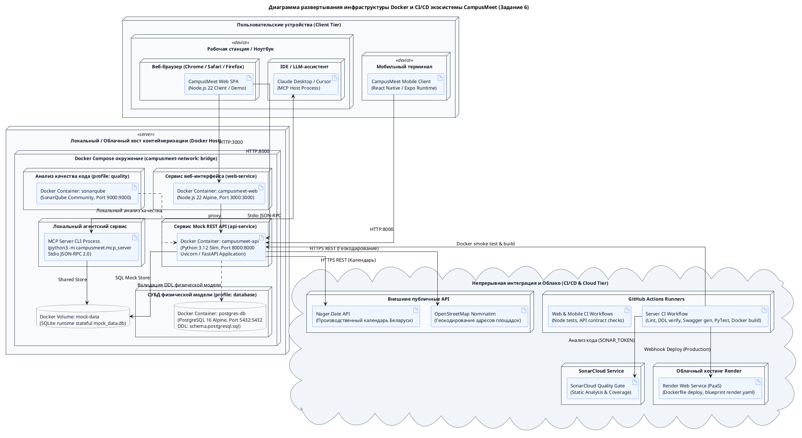

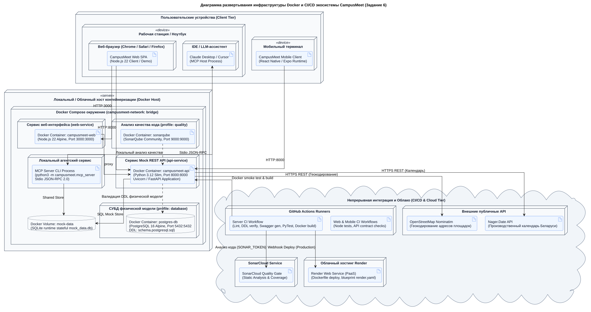

## 7.4. Контейнеризация компонентов (Dockerfile и Docker Compose)

Конфигурация контейнеризации описана в файле `CampusMeet-Server/compose.yaml`:

```yaml
services:
  api:
    build:
      context: .
      dockerfile: Dockerfile
    ports:
      - "127.0.0.1:8000:8000"
    volumes:
      - mock-data:/data
    environment:
      - CAMPUSMEET_DB=/data/mock_data.db
    healthcheck:
      test: ["CMD", "python3", "-c", "import urllib.request; urllib.request.urlopen('http://127.0.0.1:8000/api/v1/health')"]
      interval: 5s
      timeout: 3s
      retries: 5

  web:
    build:
      context: ../CampusMeet-Web
      dockerfile: Dockerfile
    ports:
      - "127.0.0.1:3000:3000"
    environment:
      - API_URL=http://api:8000/api/v1
    depends_on:
      api:
        condition: service_healthy

  postgres:
    image: postgres:16-alpine
    profiles: ["database"]
    ports:
      - "127.0.0.1:5432:5432"
    environment:
      POSTGRES_USER: campusmeet
      POSTGRES_PASSWORD: campusmeet_password
      POSTGRES_DB: campusmeet
    volumes:
      - ./database/schema.postgresql.sql:/docker-entrypoint-initdb.d/init.sql:ro

volumes:
  mock-data:
```

### Команды управления контейнерами:
```bash
# Проверка синтаксиса конфигурации Compose
docker compose config --quiet

# Сборка и запуск API и Web-клиента в фоновом режиме
docker compose up --build -d

# Запуск отдельного профиля с PostgreSQL 16 для верификации DDL
docker compose --profile database up -d postgres

# Просмотр статуса запущенных сервисов
docker compose ps
```

## 7.5. Автоматизированные тесты и непрерывная интеграция (CI/CD)

В репозитории `CampusMeet-Server` реализован набор из **34 модульных тестов** (`python3 -m unittest discover -s tests -v`), проверяющих:
* Идемпотентность регистрации и возврат сохраненных снимков ответа;
* Запрет овербукинга при конкурентных запросах;
* Автоматическое продвижение первого слушателя из листа ожидания при отмене билета;
* Отсечение повторного чекина (HTTP 409) и запись отказа в аудит;
* Изоляцию профиля процесса MCP и невозможность переопределения `user_id` через промпт.

### GitHub Actions Workflow (`.github/workflows/ci.yml`):
1. **Lint & Static Check:** Проверка синтаксиса Flake8;
2. **Contract Consistency:** Сверка контрактов `openapi.json` и генерация SQLite DDL;
3. **Automated Testing:** Прогон 34 тестов `unittest`;
4. **MCP Session Verification:** Запуск тестового сценария MCP stdio;
5. **Database DDL Smoke:** Проверка создания всех 17 таблиц в изолированном контейнере PostgreSQL;
6. **Docker Build & Smoke:** Сборка Docker-образа и проверка ответа эндпоинта `/health`.

## 7.6. Статический анализ качества кода SonarQube / SonarCloud

Для контроля соблюдения стандартов кодирования настроен `sonar-project.properties`:
* Поддержка профиля `quality` в Docker Compose для локального развертывания SonarQube Community Edition (`loopback:9000`);
* Интеграция с облачным сервисом **SonarCloud** через GitHub Actions secret `SONAR_TOKEN` с автоматическим контролем прохождения Quality Gate.

## 7.7. Развертывание в облачной среде Render

Для публикации бэкенда на платформе Render подготовлен манифест Infrastructure as Code [`render.yaml`](https://github.com/fpmi-hci-2026/CampusMeet-Server/blob/main/render.yaml):
* Тип сервиса: Web Service (Environment: Docker);
* Автоматический healthcheck: `/api/v1/health`;
* Отключение автоматического деплоя (`autoDeploy: false`) для обязательного прохождения тестов и проверок качества перед релизом.

## 7.8. Сводный отчет о вкладе участников команды

| Участник команды | Выполненная работа в рамках ЛР4 | Вклад |
| :--- | :--- | :--- |
| **Минчук Станислав** | Разработка архитектуры бэкенда, реализация ядра REST API Mock на чистом Python, проектирование и программирование MCP-сервера (Tools, Resources, Prompts), подготовка Dockerfile и `compose.yaml`, написание модульных тестов. | **35%** |
| **Иванова Виктория** | Формализация модели требований и спецификаций Use Cases, проектирование схем OpenAPI 3.0.3 для 33 операций, разработка 7 PlantUML-диаграмм в фирменном стиле ЛР3, оформление академического отчета и страниц GitHub Pages. | **35%** |
| **Шварцман Дидар** | Разработка логической и физической моделей базы данных на 17 таблиц, написание DDL для PostgreSQL 16 и генератора SQLite, настройка пайплайнов GitHub Actions CI/CD, интеграция SonarQube и проверка развертывания. | **30%** |

---

# Раздел 8. Заключение и выводы

В ходе выполнения лабораторной работы №4 проект **CampusMeet / EventHub** был успешно развит от системно-аналитических требований ЛР1–3 до действующего, строго специфицированного и проверенного программного комплекса:

1. **Модель требований и варианты использования:** Сформирована непротиворечивая трассировка от потребностей 7 персон через 17 пользовательских историй к 15 прецедентам и 33 операциям REST API;
2. **Модели данных:** Разработаны логическая и физическая модели базы данных на 17 таблиц со строгими ограничениями целостности СУБД PostgreSQL 16;
3. **REST API контракт:** Разработана спецификация OpenAPI 3.0.3, регламентирующая форматы запросов, ответы, коды ошибок и идемпотентность;
4. **Mock-сервер:** Реализован и протестирован легковесный сервер симуляции состояния с поддержкой атомарных транзакций;
5. **Агентный MCP-сервер:** Спроектирован и реализован сервер по стандарту Model Context Protocol 2025-11-25 с 5 инструментами, 3 ресурсами и 2 шаблонами промптов;
6. **Инфраструктура и качество:** Развернуто окружение контейнеризации на базе Docker Compose, настроены автоматизированные тесты в GitHub Actions CI, интегрирован анализ SonarQube.

Все графические диаграммы выполнены на языке PlantUML в едином фирменном стиле ЛР3 с векторным экспортом в SVG и поддержкой масштабирования в веб-портале документации.

---

# Список использованных источников

1. **Давидовская, М. И.** Проектирование человеко-машинных интерфейсов: Стили интеграции программных систем и проектирование API : метод. указания к лабораторной работе № 4 для студентов ФПМИ / М. И. Давидовская. – Минск : БГУ, 2026. – 16 с.
2. **Вигерс, К.** Разработка требований к программному обеспечению / К. Вигерс, Д. Битти. – 3-е изд. – М. : Русская Редакция, 2021. – 736 с.
3. **OpenAPI Specification v3.0.3** [Electronic resource] / OpenAPI Initiative. – 2024. – Mode of access: https://spec.openapis.org/oas/v3.0.3.html. – Date of access: 28.10.2026.
4. **Model Context Protocol Specification (2025-11-25)** [Electronic resource] / Anthropic & Contributors. – Mode of access: https://modelcontextprotocol.io/specification/2025-11-25. – Date of access: 28.10.2026.
5. **PostgreSQL 16.0 Documentation** : DDL Constraints & Transaction Isolation [Electronic resource] / The PostgreSQL Global Development Group. – Mode of access: https://www.postgresql.org/docs/16/. – Date of access: 28.10.2026.
6. **Docker Compose Specification** [Electronic resource] / Docker Inc. – Mode of access: https://docs.docker.com/compose/. – Date of access: 28.10.2026.
7. **RFC 7807: Problem Details for HTTP APIs** [Electronic resource] / IETF. – Mode of access: https://datatracker.ietf.org/doc/html/rfc7807. – Date of access: 28.10.2026.
8. **Bruno: Fast and Git-Friendly Open-Source API Client** [Electronic resource] / UseBruno. – Mode of access: https://docs.usebruno.com/. – Date of access: 28.10.2026.
9. **Проектирование REST API на примере интернет-магазина** [Электронный ресурс] / Школа системного анализа. – Режим доступа: https://babok-school.ru/blog/how-to-design-rest-api-i-shop-example/. – Дата доступа: 28.10.2026.
