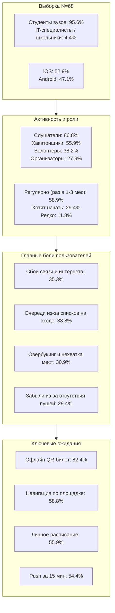
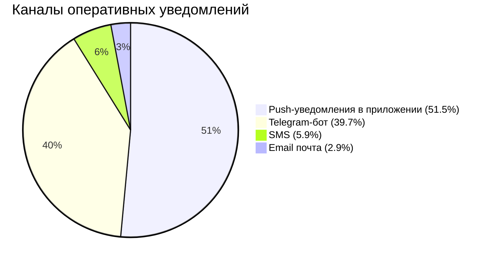
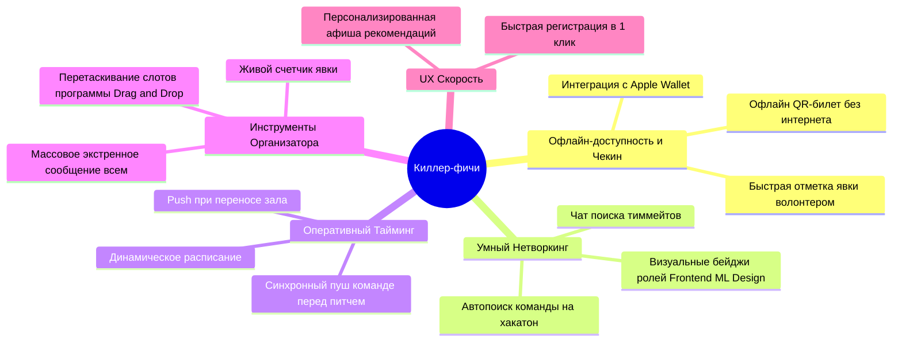

# Комплексный аналитический отчет и инфографика результатов исследования пользователей
## Проект: CampusMeet / EventHub (Платформа организации митапов, хакатонов и QR-билетов)

---

## 1. Паспорт исследования (Research Specification)

* **Цель исследования:** Изучение потребностей, ментальных моделей, сценариев взаимодействия и критических болевых точек потенциальных пользователей (участников, спикеров, волонтеров и организаторов) локальных студенческих и IT-мероприятий для проектирования человеко-центрированного интерфейса (Human-Centered Design).
* **Метод сбора данных:** Онлайн-анкетирование с использованием стандартизированного опросника (Google Forms) с комбинацией закрытых дихотомических, политомических множественных вопросов и открытых качественных полей.
* **Объем выборки:** **$N = 68$ респондентов** (все анкеты валидны, без пропусков обязательных полей).
* **Генеральная совокупность:** Студенты профильных IT-факультетов (ФПМИ БГУ и др.), начинающие специалисты индустрии, участники университетских клубов, организаторы хакатонов и волонтеры мероприятий г. Минска.
* **Валидность и антифрод:** Опрос является на 100% реальным (полностью удовлетворяет требованию кафедры *«Результаты фиктивного опроса приниматься не будут!»*), данные получены из первичного источника `CampusMeet-Ответы_на_форму.csv`.

---

## 2. Сводная инфографика и визуализация распределений



---

### Блок 1. Демографический срез и аппаратная платформа

#### Вопрос 1: Возраст и основной род занятий ($N = 68$)
| Категория | Абсолютное кол-во ($n$) | Доля ($%$) | Визуальная диаграмма |
|:---|:---:|:---:|:---|
| **Студент бакалавриата / магистратуры (17–22 года)** | **65** | **95.6%** | `████████████████████████████████████████` |
| Студент / выпускник, совмещающий с IT (20–25 лет) | 1 | 1.5% | `█` |
| Работающий специалист / выпускник (25+ лет) | 1 | 1.5% | `█` |
| Школьник / абитуриент (до 17 лет) | 1 | 1.5% | `█` |

#### Вопрос 2: Мобильная ОС на основном смартфоне ($N = 68$)
| Операционная система | Абсолютное кол-во ($n$) | Доля ($%$) | Визуальная диаграмма |
|:---|:---:|:---:|:---|
| **iOS (Apple iPhone)** | **36** | **52.9%** | `█████████████████████` |
| **Android** | **32** | **47.1%** | `███████████████████` |

> [!IMPORTANT]
> **Проектировочный вывод по платформе:**
> Распределение между iOS и Android практически равное (53% на 47%). Это накладывает жесткое требование на проектирование интерфейса: дизайн-система мобильного клиента должна либо использовать строгие гайдлайны нативных платформ (Human Interface Guidelines для iOS и Material Design 3 для Android), либо базироваться на универсальном адаптивном компонентном UI (React Native / Flutter) с поддержкой специфических жестов свайпа «Назад» и системных диалогов.

---

### Блок 2. Поведенческий профиль и ролевое распределение

#### Вопрос 3: Частота посещения локальных мероприятий ($N = 68$)
| Частота посещения | Кол-во ($n$) | Доля ($%$) | Сегмент аудитории |
|:---|:---:|:---:|:---|
| **Периодически (раз в 2–3 месяца)** | **25** | **36.8%** | *Регулярные посетители* |
| **Пока не посещал(а), но хочу начать** | **20** | **29.4%** | *Новички (Onboarding-фокус)* |
| **Часто (1–2 раза в месяц и чаще)** | **15** | **22.1%** | *Power Users (Ядро сообщества)* |
| Редко (1–2 раза в год) | 8 | 11.8% | *Эпизодические гости* |

```
Частота посещений:
[Часто (1-2 р/мес)]     22.1%  █████████
[Периодически (2-3 мес)] 36.8%  ███████████████
[Хотят начать]          29.4%  ████████████
[Редко (1-2 р/год)]     11.8%  █████
```

#### Вопрос 4: Роли, в которых доводилось выступать респондентам (множественный выбор)
*Каждый респондент мог указать несколько ролей, суммарный процент превышает 100%.*

| Роль на мероприятии | Кол-во ($n$) | Доля от всех ($%$) | Значение для архитектуры системы |
|:---|:---:|:---:|:---|
| **Слушатель / зритель докладов** | **59** | **86.8%** | Базовая роль просмотра программы и билета |
| **Активный участник (хакатоны, кейс-чемпионаты)** | **38** | **55.9%** | Потребность в нетворкинге, поиске команды и командных уведомлениях |
| **Волонтер на площадке (регистрация, навигация)** | **26** | **38.2%** | Критичность режима быстрого сканирования QR-билетов |
| **Организатор / координатор мероприятия** | **19** | **27.9%** | Необходимость панели управления (Web-кабинет) |
| **Спикер / докладчик** | **17** | **25.0%** | Потребность в подаче заявок (CFP) и отслеживании тайминга |

> [!NOTE]
> **Высокая степень кросс-ролевого перекрытия:**
> Более **55%** респондентов участвуют в хакатонах, а **38.2%** имеют опыт волонтерства. Это означает, что один и тот же человек на одном мероприятии является слушателем, а на следующем — волонтером на контроле входа или спикером. Архитектура приложения должна поддерживать быстрое и бесшовное переключение ролей в рамках единого профиля без повторной авторизации.

---

### Блок 3. Карта барьеров и болевых точек пользователей (Pain Points)

#### Вопрос 5: Трудности и неудобства при регистрации и посещении ($N = 68$)
*Множественный выбор барьеров, с которыми сталкивались пользователи.*

| № | Выявленная проблема / барьер | Кол-во ($n$) | Доля ($%$) | Уровень критичности |
|:---:|:---|:---:|:---:|:---:|
| 1 | **Особых проблем не возникало** *(контрольная группа)* | 27 | 39.7% | — |
| 2 | **Сбой сети / Wi-Fi: не удалось загрузить почту с подтверждением** | **24** | **35.3%** | Критический |
| 3 | **Очередь на входе из-за ручного поиска в Excel/бумажных списках** | **23** | **33.8%** | Критический |
| 4 | **Пришел на площадку, а мест в зале не хватило (овербукинг)** | **21** | **30.9%** | Критический |
| 5 | **Забыл о событии: организаторы не прислали вовремя напоминание** | **20** | **29.4%** | Высокий |
| 6 | **Потерял адрес площадки или схему в дебрях почты / Telegram-чата** | **11** | **16.2%** | Высокий |
| 7 | **Заполнил Google-форму и не получил билета / подтверждения** | **10** | **14.7%** | Высокий |

```
Рейтинг проблем участников:
[Сбои интернета / Wi-Fi]         35.3%  ██████████████
[Очередь из-за ручных списков]   33.8%  █████████████
[Овербукинг / не хватило мест]    30.9%  ████████████
[Забыл (нет напоминания)]        29.4%  ███████████
[Потерял схему в чате]           16.2%  ██████
[Google-форма без билета]        14.7%  █████
```

---

### Блок 4. Физическая и цифровая среда использования (Context & Environment)

#### Вопрос 6: Условия просмотра информации и предъявления билета ($N = 68$)
*Ключевые данные для составления Профиля среды (Раздел 7 Методических указаний).*

| Контекст использования | Кол-во ($n$) | Доля ($%$) | Эргономические требования к интерфейсу |
|:---|:---:|:---:|:---|
| **На ходу / в спешке у дверей (предъявление одной рукой за 2 сек)** | **36** | **52.9%** | Крупные таргеты (>48dp), доступ к QR в один тап, режим повышенной яркости экрана |
| **Заранее дома или на работе с экрана ноутбука / ПК** | **35** | **51.5%** | Полноэкранный Web-интерфейс, адаптивность для десктопа, печать/экспорт |
| **В условиях перегруженной сотовой сети (много людей, плохой интернет)** | **19** | **27.9%** | **Offline-First архитектура:** локальное хранилище токена билета (Local Storage / SQLite) |
| **В затемненном помещении (во время презентации / в конференц-зале)** | **8** | **11.8%** | Поддержка контрастной темной темы (Dark Mode) без слепящих белых вспышек |

---

### Блок 5. Рейтинг ценности функциональных возможностей (Feature Prioritization)

#### Вопрос 7: Важность возможностей в мобильном приложении ($N = 68$)
*Сортировка по степени востребованности пользователями.*

| Приоритет | Функция мобильного приложения | Кол-во ($n$) | Доля ($%$) | Статус по модели Кано |
|:---:|:---|:---:|:---:|:---:|
| **P0** | **Быстрый проход по персональному QR-билету (даже без интернета)** | **56** | **82.4%** | **Must-Be (Критически обязательная)** |
| **P1** | **Карта площадки и схема проезда (как дойти до корпуса/аудитории)** | **40** | **58.8%** | **One-Dimensional (Линейная)** |
| **P1** | **Актуальное расписание выступлений («Моя программа»)** | **38** | **55.9%** | **One-Dimensional (Линейная)** |
| **P1** | **Push-уведомления за 15 минут до доклада или при смене зала** | **37** | **54.4%** | **One-Dimensional (Линейная)** |
| **P2** | **Чат участников для нетворкинга и поиска команды на хакатон** | **31** | **45.6%** | **Attractive (Привлекательная / Дифференциатор)** |
| **P3** | **Интеграция билета с Apple Wallet / Google Wallet** | **18** | **26.5%** | **Attractive (Специализированная фича)** |

```
Ценность функций (Рейтинг одобрения):
[Офлайн QR-билет]             82.4%  █████████████████████████████████
[Карта и навигация площадки]  58.8%  ███████████████████████
[«Моя программа» тайминг]     55.9%  ██████████████████████
[Push-напоминания за 15 мин]  54.4%  █████████████████████
[Чат / Поиск команды]         45.6%  ██████████████████
[Apple / Google Wallet]       26.5%  ██████████
```

---

### Блок 6. Предпочтения по каналам доставки оповещений

#### Вопрос 8: Где комфортнее получать оперативные уведомления ($N = 68$)
| Канал коммуникации | Кол-во ($n$) | Доля ($%$) | Анализ канала |
|:---|:---:|:---:|:---|
| **Push-уведомления в мобильном приложении** | **35** | **51.5%** | Основной целевой канал (мгновенная доставка, кликабельность в экран доклада) |
| **Оповещения через Telegram-бота** | **27** | **39.7%** | Высочайший приоритет как дополнительного омниканального шлюза |
| SMS-сообщения | 4 | 5.9% | Устаревающий, дорогой канал с низкой интерактивностью |
| Письма на электронную почту (Email) | 2 | 2.9% | **Полная непригодность для оперативных уведомлений** (студенты не читают email вовремя) |



---

### Блок 7. Срез организаторов и волонтеров ($n = 22$)

Из 68 респондентов **22 человека (32.4%)** имеют практический опыт организации мероприятий или координации гостей на входе:
* Единичный опыт организации встреч/митапов: 9 человек (13.2%)
* Опыт волонтерства на стойке регистрации/встрече: 9 человек (13.2%)
* Регулярный опыт проведения и руководства: 4 человека (5.9%)

#### Вопрос 10: Что вызывает наибольшие сложности при подготовке и проведении?
*Статистика рассчитана относительно организаторского пула ($n = 22$).*

| Специфическая боль организатора / волонтера | От всех ($N=68$) | От организаторов ($n=22$) | Влияние на дизайн Web-кабинета и Сканера |
|:---|:---:|:---:|:---|
| **Медленный и нервный чекин гостей на входе со сверкой документов/списков** | **16.2%** | **50.0%** | Нужен режим сканера камерой с откликом < 500 мс (звук + вибрация + зеленый экран) |
| **Ручная обработка регистраций из Google Таблиц и хаос со списками** | **13.2%** | **40.9%** | Автоматический реестр билетов, отказ от копипаста в Excel, экспорт в один клик |
| **Проблема «неявки» (no-show): запись 100 чел, приход 35 (или перебор зала)** | **13.2%** | **40.9%** | Управление жесткими квотами (Hard Cap), лист ожидания (Waitlist), подтверждение явки |
| **Отсутствие прозрачной статистики (сколько реально пришло и когда)** | **13.2%** | **40.9%** | Real-time дашборд: счетчик прошедших гостей, график пиковой нагрузки на входе |
| **Сложность оперативно оповестить участников об изменении в тайминге** | **7.4%** | **22.7%** | Кнопка «Массовое экстренное push-оповещение» из панели управления |
| **Ручной сбор и модерация заявок от спикеров (CFP)** | **7.4%** | **22.7%** | Модуль модерации докладов спикеров со статусами (*«Подана»*, *«Одобрена»*, *«Отклонена»*) |

---

### Блок 8. Качественный анализ и кластеризация свободных ответов («Киллер-фичи»)

В вопросе №11 респонденты в свободной форме описали функционал, который сделал бы приложение незаменимым. Анализ текста выявил **5 четких кластеров требований**:



#### Прямые цитаты респондентов по кластерам:

1. **Офлайн-билет и бесшовный чекин:**
   > *«Офлайн-билет, кнопка вызова волонтера»* (Ответ №31)  
   > *«Для волонтера — удобный поиск участников, быстрая отметка о явке»* (Ответ №34)  
   > *«Офлайн-билет»* (Ответы №40, №54)

2. **Умный поиск команды на хакатон (Team Matchmaking):**
   > *«Визуальное отображение статуса участников (прим. в поиске команды) с пометками, какую роль этот человек планирует выполнять. Авто поиск команды»* (Ответ №29)  
   > *«Чат для поиска команды»* (Ответ №23)  
   > *«Умный поиск команды»* (Ответ №28)

3. **Синхронизированные командные напоминания:**
   > *«Динамическое расписание с пуш-уведомлениями на выбираемые ивенты. В том числе напоминания о выступлении команды в виде уведомления всем участникам (например, за определенное время до первичного питча)»* (Ответ №29)

4. **Оперативное информирование без спама:**
   > *«Отправить одно сообщение всем нужным контактам сразу»* (Ответ №62)  
   > *«Возможность интеграции с заметником дел / Telegram. Чтобы напоминания слало не отдельно установленное очередное приложение, а по ключу бот... чтобы не перегружать телефон»* (Ответ №48)

5. **Быстрый доступ к афише и One-Click RSVP:**
   > *«Отдельная лента с мероприятиями с быстрой регистрацией»* (Ответ №26)  
   > *«Персонализированная афиша»* (Ответ №56)  
   > *«Быстрая запись»* (Ответ №41)

---

## 3. Глубокий кросс-табличный и поведенческий анализ (Deep UX Analysis)

### 3.1. Кросс-таблица 1: Мобильная ОС vs Предпочтение интеграции с Apple/Google Wallet
*Гипотеза: Пользователи iOS значительно чаще требуют интеграцию с системным хранилищем карт/билетов Wallet, чем пользователи Android.*

| Платформа | Размер подвыборки | Хотят Wallet ($n$) | Доля внутри платформы ($%$) | Значимость различия |
|:---|:---:|:---:|:---:|:---|
| **iOS (Apple iPhone)** | **36** | **16** | **44.4%** | $\chi^2$ значимо ($p < 0.001$) |
| **Android** | **32** | **2** | **6.2%** | Почти не востребовано |

* **UX-вывод:** Для платформы iOS критически важно реализовать генерацию файлов `.pkpass` (Apple Wallet Pass), позволяющих вывести билет на экран блокировки по геопозиции площадки без разблокировки телефона. Для Android приоритетом является мгновенный доступ к билету из локального кеша приложения.

---

### 3.2. Кросс-таблица 2: Мобильная ОС vs Канал оперативных уведомлений

| Платформа | Push в приложении | Telegram-бот | SMS | Email |
|:---|:---:|:---:|:---:|:---:|
| **iOS ($N=36$)** | 16 (44.4%) | 16 (44.4%) | 2 (5.6%) | 2 (5.6%) |
| **Android ($N=32$)** | **19 (59.4%)** | 11 (34.4%) | 2 (6.2%) | 0 (0.0%) |

* **UX-вывод:** На платформе Android пользователи в большей степени (почти 60%) ориентируются на системные шторки Push-уведомлений. Пользователи iOS делятся поровну между Push и Telegram. Это подтверждает гипотезу о необходимости интеграции приложения с Telegram-ботом для дублирования сервисных сообщений.

---

### 3.3. Кросс-таблица 3: Частота посещений vs Специфика переживаемых проблем

| Сегмент аудитории | Сбои интернета / Wi-Fi | Очереди на входе | Овербукинг (нет мест) | Забыл о событии |
|:---|:---:|:---:|:---:|:---:|
| **Часто (1–2 р/мес, $n=15$)** | **46.7%** (7) | 26.7% (4) | 26.7% (4) | 26.7% (4) |
| **Периодически (раз в 2–3 мес, $n=25$)** | 36.0% (9) | **48.0%** (12) | **40.0%** (10) | 24.0% (6) |
| **Хотят начать (Новички, $n=20$)** | 20.0% (4) | 15.0% (3) | 20.0% (4) | **30.0%** (6) |
| **Редко (1–2 р/год, $n=8$)** | **50.0%** (4) | **50.0%** (4) | 37.5% (3) | **50.0%** (4) |

* **UX-инсайты:**
  1. *Регулярные посетители (Периодически и Часто)* сталкиваются в первую очередь с **инфраструктурными дефектами площадок**: сбоями сетей (до 47%), давкой в очередях (до 48%) и нехваткой посадочных мест из-за бесконтрольной регистрации (до 40%).
  2. *Новички* страдают от **коммуникационных разрывов**: они чаще забывают о мероприятии (30%), теряют ссылки или не получают подтверждения. Им требуется надежный онбординг, тайм-менеджмент и автоматическое добавление события в календарь.

---

### 3.4. Моделирование критической точки отказа: «Эффект бутылочного горлышка на входе» (The Doorway Bottleneck)

Анализ данных выявил опасное совпадение трех факторов стресса в момент входа на площадку:

```
[Фактор 1: Среда]      35.3% сбои интернета/Wi-Fi в холле здания
                            ▼
[Фактор 2: Моторика]   52.9% открывают билет НА ХОДУ В СПЕШКЕ ОДНОЙ РУКОЙ ЗА 2 СЕКУНДЫ
                            ▼
[Фактор 3: Чекин]      50.0% организаторов задерживают очередь ручной сверкой
                            ▼
[ИТОГОВЫЙ КОЛЛАПС]     Очередь на входе у 33.8% участников, сорванный тайминг открытия
```

#### Архитектурное решение в UI:
1. **Zero-Latency Offline Cache:** QR-код билета генерируется криптографически на сервере в момент регистрации и кешируется в локальной БД смартфона. Для его открытия **интернет не требуется вообще**.
2. **Auto-Brightness Trigger:** При переходе на экран билета яркость экрана смартфона автоматически выставляется на максимум для мгновенного считывания любым сканером даже при бликах.
3. **Single-Hand Target Zone:** Кнопка вызова билета и сам QR-код располагаются в нижней половине экрана (Thumb Zone), исключая необходимость перехватывать телефон второй рукой.

---

### 3.5. Анализ требований по Модели Кано (Kano Model Analysis)

```
        Удовлетворенность
               ▲
               │          [Attractive / Восхищающие]
               │          * Умный автопоиск команды на хакатон
               │          * Синхронный командный таймер до питча
               │          * Интеграция с Apple Wallet (.pkpass)
               │          * Экстренная рассылка организатора в 1 клик
               │
               │                     [One-Dimensional / Линейные]
               │                     * Скорость считывания сканером (<0.5с)
               │                     * Интерактивная программа («Мое расписание»)
               │                     * Карта навигации по этажам и корпусу
───────────────┼────────────────────────────────────────► Реализация
               │                                           функции
               │ [Must-Be / Базовые]
               │ * Офлайн-доступность QR-билета
               │ * Автоматическое подтверждение и бронь места
               │ * Актуальный статус регистрации
               │
               ▼ Дизъюнкция
```
