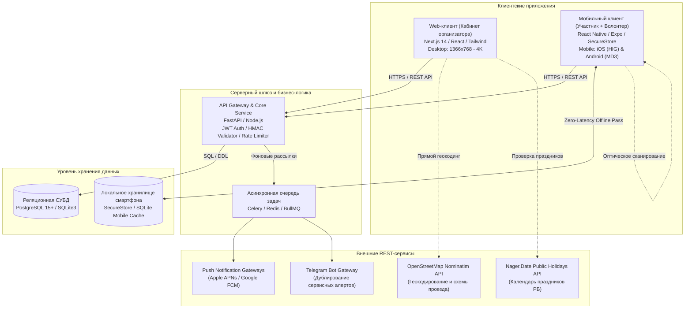

# Архитектура экосистемы и структура файлов (GitHub Wiki)

> Исполняемый MVP и окружения ЛР4: [MCP-архитектура](MCP_Server.md), [Docker/CI и границы проверки](Infrastructure_and_CI.md). Архитектура ниже задает целевую систему, а не перечень уже реализованных компонентов.

В данном разделе представлена системная архитектура программного комплекса **CampusMeet / EventHub**, диаграмма компонентов экосистемы, дерево каталогов репозиториев и спецификация разделения функционала между Web и Mobile контекстами.

---

## 1. Системная архитектура (Container Diagram)



---

## 2. Иерархическое дерево файлов и каталогов проекта (File Tree)

Согласно требованиям преподавателя для учебных подгрупп 12а и 12б, экосистема проекта CampusMeet состоит из **4 отдельных репозиториев**:
1. Основной репозиторий для документации: [CampusMeet](https://github.com/fpmi-hci-2026/CampusMeet) (`git@github.com:fpmi-hci-2026/CampusMeet.git`)
2. Репозиторий для серверного приложения и API: [CampusMeet-Server](https://github.com/fpmi-hci-2026/CampusMeet-Server) (`git@github.com:fpmi-hci-2026/CampusMeet-Server.git`)
3. Репозиторий для веб-клиента: [CampusMeet-Web](https://github.com/fpmi-hci-2026/CampusMeet-Web) (`git@github.com:fpmi-hci-2026/CampusMeet-Web.git`)
4. Репозиторий для мобильного клиента: [CampusMeet-Mobile](https://github.com/fpmi-hci-2026/CampusMeet-Mobile) (`git@github.com:fpmi-hci-2026/CampusMeet-Mobile.git`)

```text
PCHMI/                                   # Корневой рабочий каталог проекта
├── PROJECT_IDEAS.md                     # Концептуальная карточка проекта и внешние API
│
├── CampusMeet/                          # 1. ОСНОВНОЙ РЕПОЗИТОРИЙ ДЛЯ ДОКУМЕНТАЦИИ
│   ├── README.md                        # Главный паспорт проекта (6 обязательных секций)
│   ├── .gitignore                       # Исключения версионирования git
│   ├── ПЧМИ ЛабРабота1 2025-2026.md     # Методические указания и регламент курса
│   │
│   ├── docs/                            # Документация и отчетность по курсу
│   │   ├── README.md                    # Навигационный реестр отчетов по лабораторным работам 1-8
│   │   ├── index.html                   # Интерактивный SPA-портал документации GitHub Pages
│   │   ├── reports/                     # Официальные академические отчеты
│   │   │   ├── Lab1_report.md           # Комплексный отчет по Лабораторной работе №1 (16 разделов)
│   │   │   └── Lab2_report.md           # Комплексный отчет по Лабораторной работе №2 (1466 строк, ИА, CJM 7 персонажей, 7 раскадровок)
│   │   ├── survey/                      # Первичные данные и социологический анализ (N=68)
│   │   │   ├── CampusMeet-Ответы_на_форму.csv  # Исходный датасет Google Forms
│   │   │   ├── survey_analysis.md       # Детальный аналитический отчет и статистика
│   │   │   └── survey_analysis_data.json # Агрегированные метрики и распределения в JSON
│   │   └── assets/                      # Графические проектные артефакты
│   │       ├── personas/                # Фотографии и аватары 7 синтезированных персонажей
│   │       ├── wireframes/              # 6 векторных структурных схем низкой точности (Wireframes SVG)
│   │       └── mockups/                 # 6 цветных дизайн-макетов высокой точности (UI Mockups SVG)
│   │
│   └── wiki/                            # Проектная база знаний GitHub Wiki (7 страниц)
│       ├── Home.md                      # 1. Главная страница wiki
│       ├── Functional_Requirements.md   # 2. Функциональные требования и Use Case
│       ├── Application_Architecture.md  # 3. Архитектура и структура файлов
│       ├── Additional_Specification.md  # 4. Нефункциональные требования и безопасность
│       ├── Database_Schema.md           # 5. Схема базы данных и ссылка на DDL
│       ├── API_Specification.md         # 6. Спецификация REST API и внешних сервисов
│       └── Project_Presentation.md      # 7. Презентация проекта и регламент git-flow
│
├── CampusMeet-Server/                   # 2. РЕПОЗИТОРИЙ ДЛЯ СЕРВЕРНОГО ПРИЛОЖЕНИЯ И API
│   ├── README.md                        # Стандартизированный README сервера (6 обязательных секций)
│   ├── requirements.txt                 # Зависимости (FastAPI, Uvicorn, Pydantic, Httpx)
│   └── database/                        # Реляционная СУБД и схема данных
│       └── schema.sql                   # Исполняемый DDL-скрипт PostgreSQL / SQLite (10 таблиц, seed-данные)
│
├── CampusMeet-Web/                      # 3. РЕПОЗИТОРИЙ ДЛЯ ВЕБ-КЛИЕНТА (Панель организатора)
│   ├── README.md                        # Стандартизированный README веб-клиента (6 обязательных секций)
│   └── package.json                     # Зависимости Next.js 14, Tailwind CSS, React
│
└── CampusMeet-Mobile/                   # 4. РЕПОЗИТОРИЙ ДЛЯ МОБИЛЬНОГО КЛИЕНТА (Участник + Волонтер)
    ├── README.md                        # Стандартизированный README мобильного клиента (6 обязательных секций)
    └── package.json                     # Зависимости React Native, Expo, Camera, SecureStore
```

---

## 3. Разграничение контекстов использования (Web vs. Mobile)

Исследование пользователей ($N=68$) доказало необходимость строгого разделения интерфейсных контекстов для десктопа и портативных устройств:

| Критерий сравнения | Web-приложение (Кабинет организатора) | Мобильное приложение (Участник / Волонтер) |
|:---|:---|:---|
| **Целевая аудитория** | Организаторы, члены программного комитета, администрация вуза, спикеры | Рядовые слушатели, участники соревнований, волонтеры контроля доступа |
| **Аппаратная база** | Ноутбуки, стационарные ПК, рабочие станции (экраны 13"–32") | Смартфоны iPhone и Android (экраны 5.8"–6.7") |
| **Устройства ввода** | Полноразмерная клавиатура, мышь, тачпад (точный ввод текстов) | Сенсорный емкостный экран, камера смартфона, тактильный вибромотор |
| **Паттерн моторики** | Двуручная работа в стационарной позе сидя за рабочим столом | **Управление одной рукой на ходу (Thumb Zone)** у входных дверей за 1–2 сек |
| **Сетевые условия** | Стабильное проводное подключение или офисный Wi-Fi | **Нестабильная сеть, блэкаут в холле, перегруженная вышка сотовой связи** |
| **Ключевые сценарии** | Конструирование программы (Drag & Drop), ручная модерация тезисов CFP, экспорт реестров CSV, аналитика конверсий | **Мгновенное предъявление билета (Offline), оптическое сканирование за <0.5с, трекер докладов** |
| **UX-приоритеты** | Информационная плотность, глубина табличных представлений | Минимализм, скорость отклика, контрастность, крупные интерактивные зоны |
