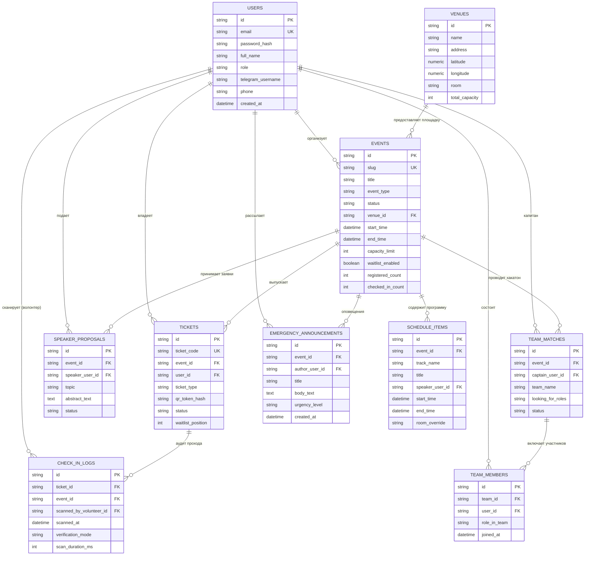

# Схема базы данных проекта CampusMeet (GitHub Wiki)

Настоящая страница содержит спецификацию реляционной модели данных программного комплекса **CampusMeet / EventHub**, концептуальную диаграмму сущностей (ER-диаграмму), описание полей, внешних ключей и индексов, а также ссылку на исходный исполняемый DDL-скрипт.

---

## 1. Концептуальная диаграмма связей сущностей (ER-Diagram)

---

## 2. Описание таблиц реляционной модели

### 1. Таблица `users` (Учетные записи пользователей)
* `id` (VARCHAR(36), PK): Уникальный UUID v4 пользователя.
* `email` (VARCHAR(255), UNIQUE): Основной почтовый адрес.
* `role` (VARCHAR(30)): Роль в системе (`guest`, `attendee`, `team_lead`, `speaker`, `volunteer`, `organizer`, `admin`).
* `telegram_username` (VARCHAR(100)): Имя в мессенджере для дублирования Push-уведомлений.
* `skills_tags` (TEXT): Набор навыков для хакатонов (Frontend, ML, UI/UX).

### 2. Таблица `venues` (Геолокация и площадки)
* Содержит координаты `latitude` и `longitude`, полученные через Nominatim OpenStreetMap API, поэтажные инструкции и схему прохода.

### 3. Таблица `events` (Мероприятия)
* Обеспечивает сквозное управление жизненным циклом события (`draft`, `registration_open`, `ongoing`, `completed`).
* Содержит атрибуты `capacity_limit` (жесткая квота) и `waitlist_enabled` (лист ожидания).

### 4. Таблица `tickets` (Билеты и офлайн-токены)
* `ticket_code`: Публичный человекочитаемый номер билета (например, `CMP-2026-X89K`).
* `qr_token_hash`: Криптографическая HMAC-SHA256 сигнатура для офлайн-валидации сканером.
* `status`: Текущее состояние билета (`registered`, `waitlisted`, `checked_in`, `cancelled`, `no_show`).

### 5. Таблица `check_in_logs` (Журнал аудита проходов)
* Фиксирует факт прохода участника, идентификатор волонтера, метод верификации (`online` / `offline_hmac`), модель смартфона и длительность считывания `scan_duration_ms` для контроля соблюдения UX-норматива (<500 мс).

---

## 3. Исходный SQL DDL файл

В соответствии с архитектурным разделением ответственности между репозиториями, исполняемый скрипт создания таблиц, внешних ключей, проверочных ограничений (`CHECK`), B-Tree индексов и тестовых демонстрационных данных размещен в серверном репозитории бэкенда:

**[database/schema.sql в репозитории CampusMeet-Server](https://github.com/fpmi-hci-2026/CampusMeet-Server/blob/main/database/schema.sql)**
