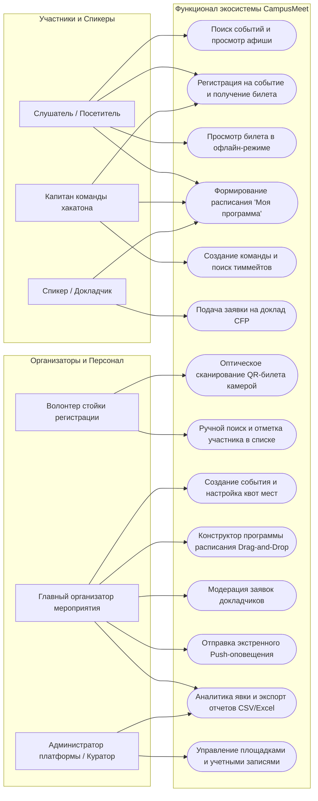

# Функциональные требования и Use Case модели (GitHub Wiki)

Настоящий документ определяет перечень функциональных требований к программному комплексу **CampusMeet / EventHub**, диаграммы вариантов использования (Use Case) и детальные текстовые спецификации ключевых сценариев взаимодействия для всех ролей пользователей.

---

## 1. Диаграмма вариантов использования (Use Case Diagram)

---

## 2. Перечень функциональных требований по подсистемам

### 2.1. Подсистема мобильного клиента участника (Mobile Attendee Module)
* **FR-M-01 (Афиша и каталог):** Система должна отображать фильтруемый список актуальных событий (по типам: митапы, хакатоны, лекции; по датам и факультетам).
* **FR-M-02 (Регистрация в 1 клик):** Пользователь должен иметь возможность зарегистрироваться на выбранное мероприятие в одно нажатие при заполненном профиле.
* **FR-M-03 (Offline-First билет):** Приложение должно локально сохранять в защищенном хранилище криптографически подписанный токен билета (HMAC-SHA256) и отображать QR-код даже при полном отсутствии интернет-соединения.
* **FR-M-04 (Auto-Brightness):** При открытии экрана билета система должна автоматически повышать яркость экрана до 100% для гарантированного считывания сканером при любом освещении.
* **FR-M-05 (Интеграция с Apple Wallet):** Для пользователей iOS должна поддерживаться кнопка генерации и добавления проездного документа формата `.pkpass` в Apple Wallet.
* **FR-M-06 (Персональное расписание):** Пользователь должен иметь возможность отмечать интересующие доклады звездочкой и просматривать персонализированный таймлайн.
* **FR-M-07 (Умные Push-уведомления):** Система должна отправлять локальные или Push-оповещения за 15 минут до начала выбранного доклада.
* **FR-M-08 (Биржа команд хакатона):** Пользователи должны иметь возможность создавать профиль команды, указывать искомые роли (Frontend, Backend, ML, Design) и принимать отклики кандидатов.

### 2.2. Подсистема волонтера-контролера (Mobile Scanner Module)
* **FR-S-01 (Высокоскоростное сканирование):** Модуль камеры должен производить оптическое распознавание QR-кода билета с временем отклика не более 500 миллисекунд.
* **FR-S-02 (Мгновенная визуальная индикация):** Экран должен окрашиваться в зеленый цвет при успешной валидации и в красный при недействительном билете.
* **FR-S-03 (Тактильный и звуковой отклик):** При успешном проходе должен воспроизводиться короткий звуковой сигнал и тактильная вибрация (Haptic Success Feedback); при ошибке — двойная резкая вибрация.
* **FR-S-04 (Защита от повторного прохода):** При попытке повторного сканирования уже отмеченного билета система должна выдавать предупреждение желтого цвета с указанием точного времени первого прохода.
* **FR-S-05 (Офлайн-валидация на входе):** Сканер должен иметь предварительно закешированный открытый ключ или список хешей мероприятия для валидации прохода при отключенном интернете волонтера.
* **FR-S-06 (Резервный ручной поиск):** В случае повреждения экрана смартфона гостя волонтер должен иметь возможность быстро найти участника по фамилии или короткому 6-значному буквенно-цифровому коду билета.

### 2.3. Подсистема веб-кабинета организатора (Web Organizer Dashboard)
* **FR-W-01 (Конструктор страницы события):** Организатор должен иметь возможность создавать карточку мероприятия с богатым форматированием (Markdown), баннером, указанием даты, времени и локации.
* **FR-W-02 (Интеграция с OSM Nominatim):** При вводе текстового адреса система должна выполнять автоматическое геокодирование, определять координаты и выводить интерактивную схему расположения площадки.
* **FR-W-03 (Проверка производственного календаря Nager.Date):** При выборе даты система должна проверять ее по календарю официальных праздников Республики Беларусь и предупреждать организатора о нерабочих днях.
* **FR-W-04 (Управление квотами и лимитами):** Организатор должен иметь возможность задавать жесткий лимит участников (Hard Cap) и включать лист ожидания (Waitlist).
* **FR-W-05 (Интерактивный конструктор расписания):** Формирование сетки программы методом Drag-and-Drop, разделение на параллельные залы/треки, назначение докладчиков.
* **FR-W-06 (CFP Модуль модерации):** Просмотр входящих заявок от спикеров, скачивание презентаций, одобрение/отклонение с отправкой статусного сообщения спикеру.
* **FR-W-07 (Экстренное вещание в 1 клик):** Отправка срочного системного Push-уведомления всем зарегистрированным участникам (например, о смене лекционной аудитории).
* **FR-W-08 (Real-Time мониторинг явки):** Отображение живого счетчика гостей на площадке, динамики нагрузки по времени и кнопка экспорта списка в формат `.csv` / `.xlsx`.

---

## 3. Детальные текстовые спецификации Use Case

### Use Case UC-01: Регистрация на событие и сохранение офлайн-билета
* **Главный актор:** Слушатель (Артём).
* **Предусловия:** Пользователь авторизован в мобильном приложении; мероприятие имеет статус `registration_open`; есть свободные места по квоте.
* **Основной сценарий (Happy Path):**
  1. Пользователь открывает карточку события в ленте и нажимает кнопку *«Зарегистрироваться»*.
  2. Система проверяет наличие свободных квот в таблице `events`.
  3. Сервер генерирует запись в таблице `tickets` с уникальным кодом и формирует криптографический QR-токен `HMAC-SHA256(secret, ticket_id + event_id + user_id)`.
  4. Мобильное приложение получает токен и сохраняет его в защищенное локальное хранилище смартфона (SecureStore).
  5. На экране отображается статус *«Вы успешно зарегистрированы!»* с карточкой билета и кнопкой быстрого вызова.
* **Альтернативный сценарий (Заполнение квоты — Лист ожидания):**
  1. На шаге 2 система определяет, что квота мест исчерпана (`registered_count >= capacity_limit`), но включен `waitlist_enabled`.
  2. Система предлагает пользователю: *«Места закончились. Встать в лист ожидания под номером 5?»*.
  3. Пользователь подтверждает согласие; статус билета устанавливается в `waitlisted`.
  4. При отмене регистрации другим участником система автоматически переводит первого кандидата из листа ожидания в статус `registered` и присылает поздравительный Push-нотификатор.

### Use Case UC-02: Высокоскоростной проход на площадку по QR-коду (Doorway Check-in)
* **Главные акторы:** Слушатель (Артём), Волонтер-контролер (Дарья).
* **Предусловия:** Участник находится у входа в аудиторию; волонтер открыл режим сканера в мобильном приложении.
* **Основной сценарий (Happy Path):**
  1. Участник на ходу достает смартфон, нажимает виджет билета внизу экрана (Thumb Zone).
  2. Приложение мгновенно открывает экран билета без обращения к сети (из локального кеша) и автоматически устанавливает яркость экрана на максимум.
  3. Волонтер наводит камеру сканера на экран участника.
  4. Оптический сканер декодирует QR-код за 320 мс, выполняет верификацию криптографической подписи токена.
  5. Экран сканера волонтера вспыхивает зеленым цветом с надписью: *«Ковалёв Артём — Студент ФПМИ (Вход разрешен)»*, телефон волонтера производит короткий виброотклик.
  6. В локальный аудит-лог пишется запись `check_in_logs`.
  7. Участник проходит в зал без задержки. Время операции: **1.2 секунды**.
* **Исключительный сценарий (Полный блэкаут сотовой связи):**
  1. В лекционном крыле полностью пропадает Wi-Fi и LTE.
  2. Сканер волонтера переключается в автономный режим (Offline Verification Mode) по закешированному публичному ключу события.
  3. Валидация проходит локально без обращения к серверу.
  4. Логи чекина сохраняются в локальную очередь SQLite и автоматически синхронизируются с сервером при восстановлении связи.

### Use Case UC-03: Экстренное оповещение участников о переносе аудитории
* **Главные акторы:** Главный организатор (Максим), Слушатели.
* **Предусловия:** До начала митапа остается 20 минут; администрация корпуса сообщила о ремонте проектора в аудитории 512 и переносе в 519.
* **Основной сценарий:**
  1. Максим открывает панель управления мероприятием в CampusMeet-Web.
  2. Нажимает красную кнопку *«Экстренное оповещение»*.
  3. Выбирает тип оповещения *«Срочный перенос аудитории»*, указывает новую аудиторию: *«Ауд. 519 (правое крыло)»*.
  4. Нажимает *«Разослать всем зарегистрированным»*.
  5. Сервер инициирует высокоприоритетную рассылку Push-уведомлений через Firebase Cloud Messaging (FCM) / Apple APNs и дублирует в Telegram-бота.
  6. У всех участников (включая Артёма, который еще едет в метро) на экране смартфона появляется системное уведомление: *«Внимание: CampusMeet перенесен в ауд. 519!»*.
  7. При клике на уведомление в приложении открывается интерактивная схема этажа с маршрутом до аудитории 519.

---

## 4. Развитие в Лабораторной работе №2: Проектирование информационной архитектуры
* **Информационная архитектура и Sitemap:** 4 уровня вложенности (каталог, программа, спикеры, кабинеты, билеты);
* **Карта влияния (Impact Map):** декомпозиция целей и связывание метрик с функционалом;
* **Карты пути клиента (CJM):** для Артёма (слушатель), Дарьи (волонтер) и Максима (организатор);
* **Проверочные сценарии (Edge Cases):** отказоустойчивость при 0% сигнала сети, детекция дубликатов, разбитые экраны и авто-промоушн из листа ожидания;
* **Полный отчет по концептуальному проектированию:** [docs/reports/Lab2_report.md](../docs/reports/Lab2_report.md).
