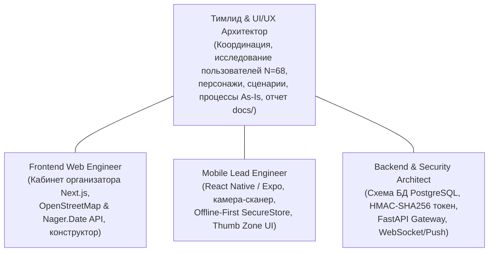

# Презентация проекта и регламент командной работы (GitHub Wiki)

Настоящая страница содержит концептуальную структуру итоговой презентации проекта **CampusMeet / EventHub**, матрицу распределения ролей и зон ответственности в студенческой команде, а также регламент версионирования кода (Git-flow) и критерии приемки Pull Request.

---

## 1. Концептуальная презентация по Лабораторной работе №1

В соответствии с требованиями учебной программы к первому этапу проектирования подготовлен драфт структуры презентации результатов предпроектного исследования предметной области и пользователей:

* **Ссылка на электронные слайды презентации:** `[Размещение слайдов презентации на Google Slides / PDF будет добавлено перед защитой]`

### Структура концептуальной презентации (10 слайдов):

| № Слайда | Тема слайда | Содержание и визуальные материалы Лабораторной работы №1 |
|:---:|:---|:---|
| **1** | **Титульный слайд** | Тема проекта: *«CampusMeet — экосистема студенческих митапов и офлайн-чекина»*, состав студенческой команды, учебная группа, кафедра ТП ФПМИ БГУ |
| **2** | **Проблема и контекст предметной области** | Анализ текущей ситуации на факультетских мероприятиях: очереди у входа в аудитории, сбои при отсутствии интернета, потеря заявок в Google-формах |
| **3** | **Эмпирическое исследование ($N=68$)** | Ключевые инсайты анкетирования студентов: 35% сталкивались с отсутствием связи в лекториях, 34% недовольны очередями, баланс платформ (iOS 53% / Android 47%) |
| **4** | **Целевые группы и профили пользователей** | Анализ категорий: Студент-слушатель, Организатор/Модератор, Волонтер на входе, Спикер-докладчик |
| **5** | **Ключевые персонажи (Personas)** | Портреты типовых пользователей: Артём Ковалёв (первичный), Дарья Мельникова (вторичный), Максим Ветров (организатор) и анти-персонаж Влад |
| **6** | **Моделирование процессов As-Is и To-Be** | Сравнительные диаграммы процессов регистрации и входа на площадку; ликвидация узких мест (ручная сверка списков) |
| **7** | **Архитектура экосистемы из 4 репозиториев** | Разделение зон ответственности: Main Docs, Server (FastAPI + DB DDL), Web (Next.js), Mobile (React Native / Expo) |
| **8** | **Реляционная модель данных (10 сущностей)** | Структура базы данных (`database/schema.sql`): пользователи, роли, мероприятия, билеты, квоты и журнал аудита проходов |
| **9** | **Внешние интерфейсы и протокол безопасности** | Интеграция с Nominatim OpenStreetMap и Nager.Date API; концепция офлайн-билета с HMAC-SHA256 подписью |
| **10** | **Дорожная карта реализации (Roadmap)** | Этапы разработки интерфейсов на семестр (Лабораторные работы №2–8), целевые метрики эргономики и юзабилити |

---

## 2. Распределение ролей и персональный вклад участников

В соответствии с требованиями методических указаний проект реализуется студенческой командой с четким разграничением зон ответственности:

### Матрица ответственности (RACI Matrix):
* **R (Responsible):** Непосредственный исполнитель задачи.
* **A (Accountable):** Лицо, несущее персональную ответственность за результат и приемку.
* **C (Consulted):** Эксперт, привлекаемый для консультаций.
* **I (Informed):** Участник, информируемый о статусе.

| Задача / Артефакт | Тимлид (UI/UX) | Web Dev | Mobile Dev | Backend Dev |
|:---|:---:|:---:|:---:|:---:|
| Исследование аудитории и анкетирование ($N=68$) | **A / R** | I | I | C |
| Синтез персонажей и контекстные сценарии | **A / R** | C | C | I |
| Моделирование бизнес-процессов As-Is | **A / R** | C | I | C |
| Проектирование схемы БД (`CampusMeet-Server/database/schema.sql`) | C | C | C | **A / R** |
| Спецификация REST API и внешних сервисов | C | **R** | **R** | **A / R** |
| Веб-панель организатора (`CampusMeet-Web`) | I | **A / R** | I | C |
| Мобильный билет и сканер (`CampusMeet-Mobile`) | C | I | **A / R** | C |
| Итоговый сводный отчет (`docs/reports/Lab1_report.md`) | **A / R** | C | C | C |

---

## 3. Регламент версионирования Git-flow и правила Pull Request

Для обеспечения стабильности репозиториев принят регламент Git-flow:

1. **Ветвление:**
   * `main`: Защищенная ветка (Protected Branch), содержит только стабильные релизные версии после сдачи лабораторных работ преподавателю.
   * `develop`: Ветка интеграции текущего семестра.
   * `feature/<название-задачи>`: Ветки разработки отдельных компонентов (например, `feature/offline-qr-pass`, `feature/nominatim-osm-client`).
   * `docs/<номер-лабы>`: Ветки наполнения аналитической документации.

2. **Правила Pull Request (PR):**
   * Каждый PR должен иметь понятное название и описание решаемой задачи со ссылкой на соответствующий Issue.
   * Обязательно прохождение автоматических проверок (линтеры, юнит-тесты).
   * Обязателен Code Review как минимум от одного участника команды перед слиянием (Approval required).
   * Прямые коммиты в ветку `main` строго запрещены.
