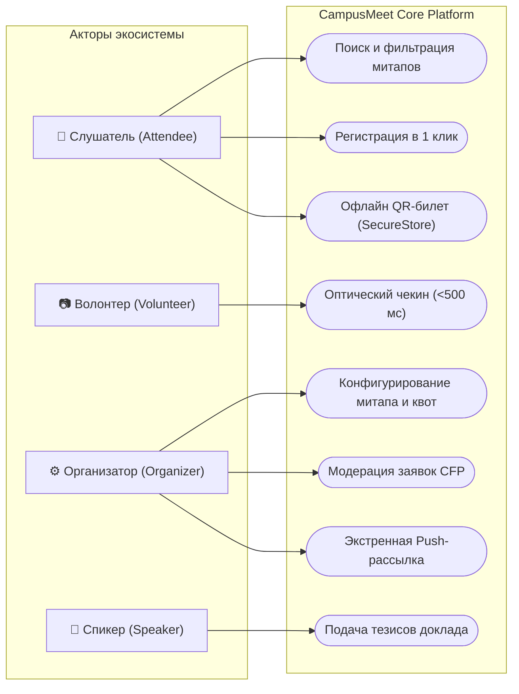
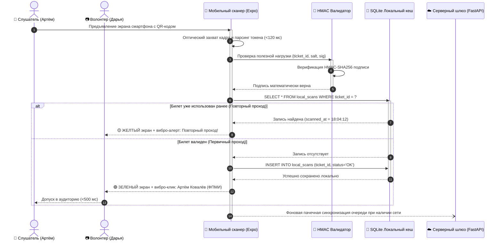
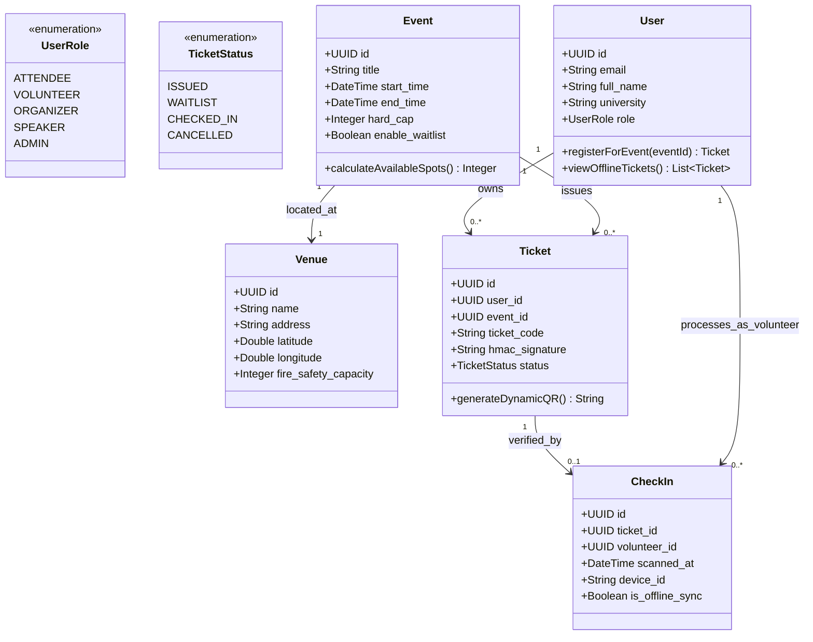

# Комплексная спецификация системы на языках PlantUML и Mermaid

В данном разделе представлена системная спецификация требований и архитектуры кроссплатформенной экосистемы **CampusMeet / EventHub** с использованием нотаций **PlantUML** и **Mermaid**. Спецификация включает базовый набор (Задания 2 и 3), а также исчерпывающий расширенный аналитический комплекс (Задание 4) с детальными сценариями использования.

---

## 1. Базовая спецификация на языке PlantUML (Задание 2)

### 1.1. Диаграмма вариантов использования (Use Case Diagram)
Исходный файл: `docs/diagrams/puml/use_cases/use_case_base.puml`

```plantuml
@startuml
skinparam packageStyle rectangle
skinparam defaultFontName "Helvetica, Arial, sans-serif"

actor "Слушатель (Attendee)" as Attendee
actor "Волонтер (Volunteer)" as Volunteer
actor "Организатор (Organizer)" as Organizer
actor "Спикер (Speaker)" as Speaker

rectangle "Экосистема CampusMeet" {
    usecase "UC-B1: Просмотр каталога\nи поиск митапов" as UC_Catalog
    usecase "UC-B2: Регистрация на событие\nи получение билета" as UC_Register
    usecase "UC-B3: Просмотр билета\nв офлайн-режиме" as UC_OfflineTicket
    usecase "UC-B4: Оптическое сканирование\nQR-билета камерой" as UC_ScanTicket
    usecase "UC-B5: Создание митапа и\nуправление квотами" as UC_CreateEvent
    usecase "UC-B6: Модерация заявок\nдокладчиков (CFP)" as UC_ModerateCFP
    usecase "UC-B7: Подача заявки на доклад" as UC_SubmitTalk
    usecase "UC-B8: Отправка экстренного\nPush-оповещения" as UC_EmergencyPush
}

Attendee --> UC_Catalog
Attendee --> UC_Register
Attendee --> UC_OfflineTicket

Volunteer --> UC_ScanTicket

Organizer --> UC_CreateEvent
Organizer --> UC_ModerateCFP
Organizer --> UC_EmergencyPush

Speaker --> UC_SubmitTalk
@enduml
```

* **Описание для команды разработки:** Модель четко разграничивает зоны ответственности ключевых ролей. Слушатель взаимодействует с мобильным каталогом и офлайн-билетом; волонтер оперирует оптическим сканером; организатор администрирует квоты и CFP; спикер подает заявки на доклады.

---

### 1.2. Базовая диаграмма деятельности (Activity Diagram)
Исходный файл: `docs/diagrams/puml/activity/activity_base.puml`

* **Описание процесса:** Отображает сквозной пользовательский путь от выбора события в афише до физического прохода в аудиторию. Модель специфицирует точку ветвления по квоте мест (прямой выпуск билета vs добавление в Waitlist), переход в режим максимальной яркости экрана при предъявлении QR-кода и валидацию сканером (<500 мс) со звуковым и тактильным откликом.

---

### 1.3. Базовая диаграмма классов (Class Diagram)
Исходный файл: `docs/diagrams/puml/classes/class_base.puml`

* **Описание доменных связей:** Определяет 5 ключевых сущностей: `User` (пользователи и роли), `Event` (события, квоты, временные рамки), `Venue` (площадки и аудит вместимости), `Ticket` (динамические QR-токены) и `CheckIn` (журнал проходов). Связи показывают, что пользователь может владеть множеством билетов, событие привязано к конкретной площадке, а чекин фиксирует факт погашения билета волонтером.

---

## 2. Базовая спецификация на языке Mermaid (Задание 3)

### 2.1. Диаграмма вариантов использования (Mermaid Use Case)

---

### 2.2. Диаграмма последовательности чекина (Mermaid Sequence Diagram)

---

### 2.3. Диаграмма классов (Mermaid Class Diagram)

---

## 3. Расширенный аналитический комплекс PlantUML (Задание 4)

### 3.1. Детальные текстовые спецификации Use Case (5 сценариев по Коберну / ГОСТ)

#### Сценарий UC-01: Регистрация на событие и резервирование квоты мест
* **Идентификатор и название:** `UC-01: ReserveEventSpotAndIssueTicket`.
* **Основной действующий актор:** Слушатель (Attendee).
* **Второстепенные акторы:** Сервис очередей бронирования, Почтовый шлюз.
* **Предусловия:** Пользователь аутентифицирован в системе; карточка мероприятия опубликована (`is_published = true`); текущее время меньше времени окончания регистрации.
* **Триггер:** Пользователь нажимает экранную кнопку «Зарегистрироваться» на карточке события.
* **Основной успешный поток (Basic Flow):**
  1. Система проверяет наличие активных бронирований данного пользователя на это событие.
  2. Система инициирует транзакцию базы данных с уровнем изоляции `Repeatable Read`.
  3. Система подсчитывает количество выданных билетов со статусом `ISSUED`.
  4. Проверяется условие: `COUNT(tickets) < event.hard_cap`.
  5. Генерируется уникальный криптографический токен билета с солью мероприятия `secret_salt`.
  6. В базу данных вставляется запись `tickets` со статусом `ISSUED`.
  7. Клиентскому приложению возвращается подтверждение бронирования и цифровой билет.
  8. Мобильный клиент автоматически сохраняет билет в защищенное хранилище `SecureStore`.
  9. В фоновом режиме формируется задача отправки письма с подтверждением на email гостя.
* **Альтернативные потоки (Alternative Flows):**
  - *3a. Квота мест полностью исчерпана (`COUNT >= hard_cap`):*
    1. Система проверяет флаг `enable_waitlist`.
    2. Если Waitlist включен, пользователю предлагается занять очередь ожидания.
    3. При согласии создается запись в таблице `waitlist` с фиксацией времени заявки и присвоением номера очереди.
    4. Пользователю отображается сообщение: «Вы добавлены в лист ожидания под номером X». Сценарий завершается.
    5. Если Waitlist отключен, выводится сообщение «Все места забронированы», транзакция откатывается.
  - *1a. Пользователь уже зарегистрирован на данное событие:*
    1. Система блокирует создание дубликата и возвращает код `409 Conflict`.
    2. На интерфейсе открывается экран существующего активного билета.
* **Постусловия (Postconditions):** Счетчик свободных мест уменьшен на 1; в защищенной памяти мобильного клиента закеширован офлайн-билет; статус события обновлен.
* **Бизнес-правила:** Студент не может иметь более одного активного билета на одно мероприятие; отмена бронирования разрешена не позднее чем за 2 часа до начала.

---

#### Сценарий UC-02: Оптическая офлайн-валидация билета волонтером
* **Идентификатор и название:** `UC-02: OfflineOpticalTicketValidation`.
* **Основной действующий актор:** Волонтер стойки регистрации (Volunteer).
* **Второстепенные акторы:** Слушатель (предъявитель билета).
* **Предусловия:** Волонтер авторизован под служебной учетной записью; в приложении волонтера открыт экран сканера; предварительно загружен открытый реестр мероприятия.
* **Триггер:** Волонтер наводит видоискатель камеры на динамический QR-код на экране смартфона участника.
* **Основной успешный поток (Basic Flow):**
  1. Оптический движок захватывает видеокадр с частотой 60 fps и декодирует строку QR-кода.
  2. Парсер извлекает структуру данных: `ticket_id`, `event_id`, `timestamp`, `signature`.
  3. Криптографический модуль вычисляет `HMAC-SHA256(payload, event_salt)` и сравнивает с подписью.
  4. Подпись подтверждена математически.
  5. Сканер запрашивает локальную базу SQLite: `SELECT * FROM local_scans WHERE ticket_id = ?`.
  6. Запись не найдена (билет предъявляется впервые).
  7. Сканер записывает факт прохода в локальную БД: `INSERT INTO local_scans (ticket_id, scanned_at, volunteer_id)`.
  8. Экран смартфона волонтера на 600 мс окрашивается в зеленый цвет; звучит подтверждающий тон (880 Гц); срабатывает тактильный вибро-клик (Haptic Success).
  9. На экране крупно выводится: «Артём Ковалёв, ФПМИ, Категория: Слушатель».
  10. Запись чекина добавляется в локальную очередь синхронизации `SyncQueue`.
  11. Волонтер пропускает участника в аудиторию.
* **Альтернативные потоки (Alternative Flows):**
  - *4a. Подпись недействительна (попытка спуфинга / подделки):*
    1. Экран волонтера вспыхивает красным цветом; вибромотор выдает двойной резкий импульс.
    2. Выводится сообщение: «ОШИБКА: Поддельный или поврежденный токен!». Проход заблокирован.
  - *6a. Билет уже найден в локальной базе (повторный проход по скриншоту):*
    1. Экран окрашивается в желтый цвет; срабатывает тройной вибро-сигнал.
    2. На экране выводится: «ВНИМАНИЕ: Повторный проход! Билет погашен в 18:04 волонтером Дарья».
    3. Волонтер отказывает в проходе и направляет участника к стойке ручного разбора.
* **Постусловия (Postconditions):** Факт прохода сохранен в локальном защищенном журнале; участник физически допущен на мероприятие.

---

#### Сценарий UC-03: Создание события и внешняя гео/календарная валидация
* **Идентификатор и название:** `UC-03: CreateEventWithExternalValidation`.
* **Основной действующий актор:** Главный организатор (Organizer).
* **Второстепенные акторы:** Сервисы OSM Nominatim и Nager.Date.
* **Предусловия:** Организатор авторизован в десктопном Web-кабинете и обладает правами создания мероприятий.
* **Триггер:** Нажатие кнопки «Создать мероприятие» в главном дашборде.
* **Основной успешный поток (Basic Flow):**
  1. Организатор вводит название, описание события и указывает дату проведения.
  2. Фронтенд асинхронно отправляет запрос к сервису `Nager.Date` для проверки производственного календаря РБ.
  3. Сервис подтверждает, что выбранная дата является стандартным рабочим/учебным днем.
  4. Организатор вводит адрес площадки («г. Минск, пр. Независимости, 4») и номер аудитории.
  5. Фронтенд отправляет запрос геокодирования к `OSM Nominatim API`.
  6. Получены географические координаты `lat: 53.8938, lon: 27.5471` и нормализованный адрес.
  7. На форме отображается интерактивная векторная карта с маркером входа в корпус.
  8. Организатор указывает Hard Cap квоты мест (например, 120 человек).
  9. Система проверяет, что указанный лимит не превышает предельную пожарную вместимость зала (140 чел.).
  10. Организатор нажимает «Опубликовать событие».
  11. Данные атомарно фиксируются в СУБД; генерируется криптографическая соль события.
  12. Событие появляется в открытой афише экосистемы.
* **Альтернативные потоки (Alternative Flows):**
  - *2a. Дата проведения совпадает с государственным праздником РБ:*
    1. Система выводит предупреждающий баннер: «Внимание: 7 ноября — праздничный нерабочий день. Корпуса университета могут быть закрыты».
    2. Организатор может либо скорректировать дату, либо нажать «Я согласовал доступ с деканатом» для продолжения.
  - *5a. Ошибка распознавания адреса через OSM:*
    1. При отсутствии точного совпадения организатору предлагается вручную указать маркер на карте.
* **Постусловия (Postconditions):** Создана карточка события с подтвержденными гео-координатами и привязанной аудиторией.

---

#### Сценарий UC-04: Подача заявки на доклад в рамках CFP (Call for Papers)
* **Идентификатор и название:** `UC-04: SubmitTalkProposalCFP`.
* **Основной действующий актор:** Приглашенный спикер / Докладчик (Speaker).
* **Второстепенные акторы:** Программный комитет митапа (Организаторы).
* **Предусловия:** У события активен статус приема докладов (`is_cfp_open = true`).
* **Триггер:** Спикер нажимает «Подать доклад» на странице митапа.
* **Основной успешный поток (Basic Flow):**
  1. Спикер заполняет тему выступления, развернутые тезисы (аннотацию) и целевой уровень аудитории (Junior / Middle / Senior).
  2. Указывает желаемый тайминг (20, 40 или 60 минут).
  3. Прикрепляет файл презентации (PDF/PPTX) и ссылку на репозиторий кода.
  4. Нажимает кнопку «Отправить на рецензирование».
  5. Система валидирует объем файла (<50 MB) и сохраняет заявку со статусом `SUBMITTED`.
  6. Организаторам приходит уведомление о новой входящей заявке.
* **Альтернативные потоки (Alternative Flows):**
  - *1a. Дедлайн приема заявок истек:*
    1. Форма блокируется с уведомлением «Прием заявок на данный митап завершен».
* **Постусловия (Postconditions):** Заявка зарегистрирована в модуле CFP и доступна для модерации организаторам.

---

#### Сценарий UC-05: Мэтчинг команды хакатона и привлечение участников
* **Идентификатор и название:** `UC-05: HackathonTeamFormationAndMatching`.
* **Основной действующий актор:** Капитан команды хакатона (Hacker Lead).
* **Второстепенные акторы:** Студент-соискатель (Applicant).
* **Предусловия:** Хакатон объявлен; открыт период формирования команд; капитан зарегистрирован как участник.
* **Триггер:** Капитан нажимает «Создать команду» в хакатон-хабе.
* **Основной успешный поток (Basic Flow):**
  1. Капитан вводит название команды, формулирует идею проекта и указывает открытые вакансии (например: «Требуется ML-инженер со знанием PyTorch»).
  2. Команда публикуется в открытом реестре «Биржи команд».
  3. Студент-соискатель фильтрует реестр по навыку `DATA_SCIENCE_ML` и находит команду.
  4. Соискатель нажимает кнопку «Откликнуться», прикрепляя ссылку на свой профиль GitHub.
  5. Капитану приходит Push-уведомление с кандидатом.
  6. Капитан просматривает профиль и нажимает «Принять в команду».
  7. Система добавляет соискателя в состав команды и автоматически уменьшает счетчик вакантных мест.
  8. Соискатель получает статус `MEMBER` и доступ к командному таймингу защит.
* **Альтернативные потоки (Alternative Flows):**
  - *7a. Лимит участников команды исчерпан (максимум 5 человек):*
    1. Вакансия закрывается, карточка команды исключается из активного поиска биржи.
* **Постусловия (Postconditions):** Состав команды сформирован и зафиксирован в хакатон-реестре.

---

### 3.2. Реестр всех диаграмм расширенного комплекса PlantUML

Все диаграммы скомпилированы в векторный формат SVG и размещены в каталоге `docs/diagrams/puml/`:

1. **Диаграммы вариантов использования (Use Cases):**
   - `docs/diagrams/puml/use_cases/use_case_base.puml` (.svg) — Базовая диаграмма (Задание 2).
   - `docs/diagrams/puml/use_cases/use_case_full.puml` (.svg) — Полная системная диаграмма со связями `<<include>>` и `<<extend>>`.
2. **Диаграммы деятельности (Activity):**
   - `docs/diagrams/puml/activity/activity_base.puml` (.svg) — Базовый сквозной сценарий (Задание 2).
   - `docs/diagrams/puml/activity/activity_registration_waitlist.puml` (.svg) — Алгоритм квот и ротации Waitlist.
   - `docs/diagrams/puml/activity/activity_checkin_validation.puml` (.svg) — Оптический чекин и обнаружение повторных проходов.
   - `docs/diagrams/puml/activity/activity_cfp_moderation.puml` (.svg) — Жизненный цикл заявок докладчиков.
3. **Диаграммы классов и объектов (Classes & Objects):**
   - `docs/diagrams/puml/classes/class_base.puml` (.svg) — Базовая модель сущностей ядра.
   - `docs/diagrams/puml/classes/class_core_domain.puml` (.svg) — Расширенная доменная модель (Event, Venue, Ticket, User).
   - `docs/diagrams/puml/classes/class_schedule_cfp.puml` (.svg) — Программа, сессии, треки и спикеры.
   - `docs/diagrams/puml/classes/class_hackathon_matching.puml` (.svg) — Хакатон, команды и биржа компетенций.
   - `docs/diagrams/puml/classes/class_crypto_offline.puml` (.svg) — Криптография HMAC-SHA256 и SecureStore кеширование.
   - `docs/diagrams/puml/classes/object_runtime_event.puml` (.svg) — Диаграмма конкретных объектов рантайма («FPMI AI Night 2026»).
4. **Диаграммы последовательности (Sequence):**
   - `docs/diagrams/puml/sequence/sequence_auth_ticket_sync.puml` (.svg) — Авторизация и загрузка билета в локальное хранилище.
   - `docs/diagrams/puml/sequence/sequence_scanner_offline_validation.puml` (.svg) — Сканирование камерой и офлайн-валидация.
   - `docs/diagrams/puml/sequence/sequence_event_creation_external_api.puml` (.svg) — Создание события, гео-валидация OSM и праздники Nager.Date.
   - `docs/diagrams/puml/sequence/sequence_emergency_push_broadcast.puml` (.svg) — Срочная Push-рассылка через Celery, Redis и FCM.
   - `docs/diagrams/puml/sequence/sequence_hackathon_team_invite.puml` (.svg) — Мэтчинг участников хакатона и подтверждение капитаном.
5. **Архитектурные диаграммы:**
   - `docs/diagrams/puml/architecture/component_architecture.puml` (.svg) — Диаграмма компонентов (Web, Mobile, Gateway, DB, Redis, Celery).
   - `docs/diagrams/puml/architecture/package_backend_structure.puml` (.svg) — Диаграмма пакетов Python/FastAPI бэкенда.
   - `docs/diagrams/puml/architecture/deployment_infrastructure.puml` (.svg) — Топология физического развертывания (Docker, CDN, Mobile devices).
   - `docs/diagrams/puml/architecture/erd_database_model.puml` (.svg) — Реляционная схема базы данных (10 таблиц, внешние ключи, типы данных).
